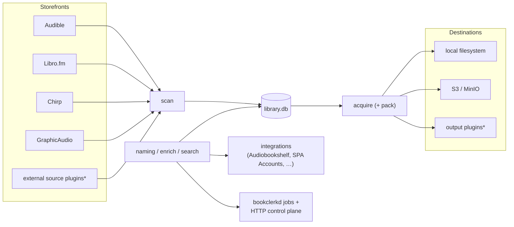

<h1 align="center">
  <a href="https://bookclerk.app">
    <picture>
      <source media="(prefers-color-scheme: dark)" srcset="assets/brand/svg/bookclerk-logo-dark.svg">
      
    </picture>
  </a>
</h1>

<p align="center">
  <strong>Every purchase, properly placed.</strong>
  <br/>
  One library for the audiobooks you bought from every store,
  <br/>
  with copies you control, shelved where your player already looks.
</p>

<div align="center">

[](https://github.com/Bookclerk/bookclerk/actions/workflows/ci.yml?query=branch%3Amain)
[](LICENSE)
[](https://bookclerk.app/download#pre-release)

[Website](https://bookclerk.app) ·
[Docs](https://bookclerk.app/docs) ·
[Get started](https://bookclerk.app/docs/guide/getting-started) ·
[Live demo](https://demo.bookclerk.app) ·
[Privacy](https://bookclerk.app/privacy) ·
[Security](https://bookclerk.app/security)

</div>

> [!WARNING]
> Bookclerk has not had a release yet. The development version changes often
> and may break your library. See
> [what pre-release means](https://bookclerk.app/download#pre-release).

Bookclerk is a headless-first **multi-storefront audiobook library manager**.
It syncs owned titles from multiple stores into one library, acquires and
decrypts media with a native pipeline, writes to local disk and/or object
storage, and hooks into library servers through pluggable integrations.

It began as a Rust rewrite of [Libation](https://github.com/rmcrackan/Libation)
for Audible. It is now a broader toolkit: several content sources, multiple
output destinations, a daemon control plane, third-party plugins, and a Connect
portal for services like [Audiobookshelf](https://www.audiobookshelf.org/).

## What you get

| Area | Capabilities |
| --- | --- |
| **Sources** | Audible, Libro.fm, Chirp, GraphicAudio (enable/disable per store) |
| **Library** | Unified SQLite catalog (UUID keys; ASIN/ISBN as attributes), Tantivy search, tags/ratings |
| **Acquire** | Native Adrm + Widevine/CENC decrypt, optional MP3, covers/PDFs/cues/chapters |
| **Destinations** | Local filesystem and/or S3/MinIO (write to every enabled destination) |
| **Integrations** | Audiobookshelf scan notify, claim tickets, SPA Accounts |
| **Plugins** | External source/integration plugins over Workers RPC (`api_version = 3`), each in a host-imposed jail |
| **Ops** | `bookclerk` CLI + `bookclerkd` daemon, Docker, systemd |
| **GUI** | Shared React web UI served by `bookclerkd` (native/tray deferred) |

The library GUI and `/api/*` control plane live in Rust (`bookclerkd`) with
operator-token auth. See [docs/server/sign-in.md](docs/server/sign-in.md).

## Architecture at a glance



\* Discovered at runtime; see [docs/plugins/README.md](docs/plugins/README.md).

See [docs/internals/architecture.md](docs/internals/architecture.md) for crate layout and data flow.

## Quick start

```bash
cargo build --release -p bookclerk-cli -p bookclerkd \
  -p bookclerk-media-worker -p bookclerk-jail
export PATH="$PWD/target/release:$PATH"

export BOOKCLERK_FILES_DIR=./BookclerkFiles
mkdir -p "$BOOKCLERK_FILES_DIR"
cp config/config.example.toml "$BOOKCLERK_FILES_DIR/config.toml"

# Connect stores in the web UI (Accounts): Audible via browser / QR OAuth
# (OTP/2FA completed in the browser); Libro.fm, Chirp and GraphicAudio via
# email + password, sealed into the database. Passwords are never read from
# the environment or argv.
bookclerk login   # prints a loopback sign-in URL for a running bookclerkd

bookclerk library scan
bookclerk library acquire --asin B0EXAMPLE   # or --isbn / UUID / product id
```

First-time setup, auth notes, and “existing files” workflows:
[docs/contributing/build-from-source.md](docs/contributing/build-from-source.md).

## Documentation

| Doc | Topic |
| --- | --- |
| [docs/README.md](docs/README.md) | Documentation index |
| [docs/guide/getting-started.md](docs/guide/getting-started.md) | First start, connecting stores, first books |
| [docs/contributing/build-from-source.md](docs/contributing/build-from-source.md) | Build the binaries and use the CLI |
| [docs/internals/architecture.md](docs/internals/architecture.md) | Components and data flow |
| [docs/server/stores.md](docs/server/stores.md) | Storefront plugins and login |
| [docs/server/output.md](docs/server/output.md) | Local + S3 output, naming |
| [docs/server/integrations.md](docs/server/integrations.md) | Audiobookshelf, SPA Accounts |
| [docs/plugins/README.md](docs/plugins/README.md) | Writing plugins: the model, `plugin.toml`, capabilities and the ABI |
| [docs/server/operations.md](docs/server/operations.md) | Daemon, Docker, systemd |
| [docs/server/configuration.md](docs/server/configuration.md) | `config.toml` and env overrides |
| [docs/guide/from-libation.md](docs/guide/from-libation.md) | Move from classic Libation |
| [docs/server/backups.md](docs/server/backups.md) | Backups, import and export |
| [docs/server/diagnostics.md](docs/server/diagnostics.md) | Opt-in crash/error reports |
| [docs/contributing/research/libation-parity.md](docs/contributing/research/libation-parity.md) | Headless Libation parity matrix |
| [docs/contributing/research/source-candidates.md](docs/contributing/research/source-candidates.md) | Research notes for future stores |

## Example configuration

Minimal multi-store, local + S3 sketch (full example:
[`config/config.example.toml`](config/config.example.toml)):

```toml
[library]
auto_acquire = false
scan_interval_minutes = 60
enrich_from_audible = true

[output]
format = "enriched_m4b"
naming_profile = "audiobookshelf"
```

`[output]` only seeds the shared `core.output` document the first time a host
enrolls against the database; after that change it with
`bookclerk config set output.<key> <value>` or **Settings → Output**.

Storefronts, destinations, and integrations are plugin instances in the
database, not TOML. Each plugin declares its settings in `plugin.toml`
`[[settings]]`; "enabled" is a deployment on a host:

```bash
bookclerk plugins list
bookclerk plugins config set local root /data/Audiobooks
bookclerk plugins config set s3 bucket my-audiobooks
bookclerk plugins config set s3 secret_access_key --secret   # value on stdin
bookclerk plugins deploy s3
bookclerk plugins config set graphicaudio access web          # web | zip | device
bookclerk plugins deploy audiobookshelf
```

The same operations are in **Settings → Plugins**. Store passwords are
entered in Accounts and sealed in the database (see
[docs/server/stores.md](docs/server/stores.md)).

## Binaries

| Binary | Role |
| --- | --- |
| `bookclerk` | One-shot CLI (`auth`, `library`, `integrations`, `plugins`, …) |
| `bookclerkd` | Long-running daemon: scheduled scan/acquire + HTTP API / GUI (optional in-process tray) |
| `bookclerk-media-worker` | Confined child process for one codec job ([docs/server/media.md](docs/server/media.md)) |
| `bookclerk-jail` | Confines a plugin guest, then becomes it ([docs/internals/guest-jail.md](docs/internals/guest-jail.md)) |

The two helpers ship beside the hosts. Without them, a host refuses media work
and declines to load external plugins rather than running either unconfined.

Default listen: `127.0.0.1:8787` and `[::1]:8787`. Public routes: `GET /health`, static UI,
`POST /api/auth/login`. Authenticated: `/api/status`, `/api/jobs`,
`/api/library/*`, plus legacy `/status` `/scan` `/acquire` `/jobs`.
JSON POST bodies need `Content-Type: application/json`.

## Status

Headless multi-source acquire, daemon, destinations, Audiobookshelf
integration, the plugin host, an MVP web library GUI, and an optional
in-process tray→browser companion are in active development. An embedded Tauri
window is deferred until an OSV-clean GTK4 graph is available (see
[docs/contributing/ui.md](docs/contributing/ui.md#desktop-shell-path)). Libation Classic/Chardonnay CLI parity for the
Audible acquire surface is tracked in
[docs/contributing/research/libation-parity.md](docs/contributing/research/libation-parity.md).

## License

Bookclerk is licensed under the GNU Affero General Public License v3.0 or
later (AGPL-3.0-or-later). Copyright (C) 2026 Bookclerk contributors.

Bookclerk is free software: you can redistribute it and/or modify it under the
terms of the GNU Affero General Public License as published by the Free
Software Foundation, either version 3 of the License, or (at your option) any
later version. It is distributed in the hope that it will be useful, but
WITHOUT ANY WARRANTY; without even the implied warranty of MERCHANTABILITY or
FITNESS FOR A PARTICULAR PURPOSE. See the [GNU Affero General Public
License](LICENSE) for more details.

Some parts carry other licenses: the plugin SDKs and examples (so plugin
authors can pick their own license), code ported from other projects, and
vendored third-party code such as
[audible-rs](https://github.com/mkb79/audible-rs). Each crate's `Cargo.toml`
states its license, and
[docs/contributing/licensing.md](docs/contributing/licensing.md) lists them.

Additional term under section 7(e) of the license: it does not grant rights
under trademark law to use the Bookclerk name or logo. See
[TRADEMARK.md](TRADEMARK.md) for how you may use them.

Contributions are accepted under the [Contributor License Agreement](CLA.md).
