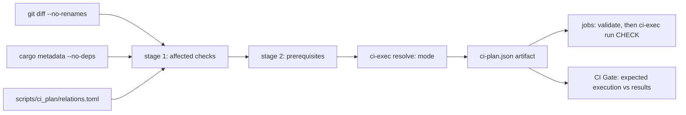

# Continuous integration

Bookclerk’s GitHub Actions workflow (`.github/workflows/ci.yml`) uses a
**dependency-aware planner** so pull requests can skip unrelated work, while
`merge_group` always runs the full suite. A push to `main` (which only
advances through the merge queue) compiles the full suite to refresh the
dependency caches and runs no tests.

## Selective CI

`SELECTIVE_CI` in `.github/workflows/ci.yml` selects the execution mode:

| Mode | When | What runs |
| --- | --- | --- |
| `full` | `main` push, `merge_group`, or any fail-closed trigger | Every job and check at full scope (build only on a `main` push, see below) |
| `shadow` | `SELECTIVE_CI != "1"` | Every job at full scope; the selective prediction is recorded in the plan summary for audit |
| `selective` | `SELECTIVE_CI == "1"` on a PR | Only the predicted checks, each with its prerequisites |

Full-suite `merge_group` runs are the audit for missed selective coverage: a
check that fails there but was skipped on the PR is a planner bug, and it
keeps the PR out of `main`.

### Build-only `main` pushes

`main` only advances through the merge queue, and the queue's run already
tested that exact commit. The push run resolves with `--build-only`
(`build_only: true` in the artifact):

- Only the jobs that save caches run: `check`, `test`, `native-gateway` and
  `release` (`BUILD_ONLY_JOBS` in `scripts/ci_plan/execute.py`). The gate
  expects every other job to be skipped.
- Builds, Clippy and installs run as usual; `cargo test` and the nextest run
  become `cargo test … --no-run`; doctests, formatting, scripts, staging and
  runtime assertions are dropped.

Caches are saved only on `main` (merge-group refs cannot share theirs), so
this run is what keeps pull-request and queue runs warm.

### Test runner and retries

`rust_test` runs under [cargo-nextest](https://nexte.st/) (installed pinned in
the `test` job). Tests from every binary share one parallel pool instead of
`cargo test` running binaries one after another, and each test runs in its own
process. In a `merge_group` run a failed test is retried once
(`MERGE_GROUP_TEST_RETRIES`); nextest marks a pass on retry `FLAKY` in its
summary, and a test that fails twice fails the job. Pull requests never retry,
so a flaky test still shows up red where it can be fixed. File an issue for
every `FLAKY` line.

A merge group only needs to know whether it can land, so it fails fast: nextest
stops at the first test that fails its retry, and the `merge-queue-fail-fast`
job cancels the rest of the run as soon as any job fails, so `CI Gate` reports
at once and the queue ejects the group without waiting for the slowest job.
That job runs no repository code and is the only one with `actions: write`.
Pull requests run every test and every job (`--no-fail-fast`), so one round
shows every failure to fix.

Test targets with `harness = false` whose `main` does not answer libtest's
`--list` protocol would list zero tests under nextest. They are excluded from
the nextest run and run with `cargo test --test` (`CUSTOM_HARNESS_TESTS`);
`scripts/tests/test_ci_contract.py` fails when a new one is not listed.
Locally, `cargo test --workspace` still runs everything; install nextest
(`cargo install cargo-nextest --locked`) to reproduce `ci-exec.py run
rust_test`.

### Caches

Rust dependency caches use three shared keys, each saved by one job on
`main` and restored by the others: `lint` (`check`), `debug` (`test` on
Linux, `native-gateway` on macOS and Windows; restored by `e2e`,
`confinement`, `tray`, `postgres` and `windows-cluster`) and `release`
(`release`, restored by `envelope`). Fewer entries keep the repository under
the Actions cache limit so jobs stop missing their cache. CI builds dev and
test profiles with `CARGO_PROFILE_DEV_DEBUG=line-tables-only`, which keeps
file and line in panics while cutting link time and cache size. A failing test prints its
panic backtrace (`RUST_BACKTRACE=1`); `RUST_LIB_BACKTRACE=0` keeps error
libraries such as `anyhow` from capturing one for every error they build.

### Plan → execution contract



- The `plan` job runs `scripts/ci-exec.py resolve`, which writes
  `ci-plan.json` (schema version, run id, a fresh `execution_id`, checked-out
  commit, the prediction and the resolved `execution`) and the job outputs
  used by `if:` gates — both from the same JSON.
- Every downstream job downloads that artifact and runs
  `ci-exec.py validate` first; a missing, stale or foreign artifact fails the
  job.
- Each check is one workflow step running `ci-exec.py run <check>`. The
  executor runs the check's prerequisites (once per execution, in order: builds →
  pinned `workerd` → platform install → guest staging) and then its commands.
  Local reproduction uses the same entry points:

  ```bash
  python3 scripts/ci-plan.py --paths crates/bookclerk-cli/src/main.rs --format summary
  python3 scripts/ci-exec.py resolve --selective 1 --paths crates/bookclerk-cli/src/main.rs
  python3 scripts/ci-exec.py show rust_test --run-id local   # print commands
  python3 scripts/ci-exec.py run rust_test --run-id local    # run them
  ```

  Resolving again mints a new `execution_id` and starts a fresh execution.
  Prerequisite completion from the previous artifact is not reused, even in
  the same temporary directory with the same commit and run id. Checks that
  share one artifact still run each prerequisite only once. `show` prints
  commands and does not record completion.

- `CI Gate` compares every job's result with `execution.jobs`: expected jobs
  must succeed, unexpected jobs must be skipped. Failures, cancellations,
  unexpected skips and unexpected runs all fail the gate. Because the gate
  uses the *execution* (not the prediction), shadow mode's intentional full
  runs pass.
- `scripts/tests/test_ci_contract.py` (PyYAML, hash-pinned in
  `scripts/tests/requirements.txt`) fails when the workflow and planner could
  diverge: unknown or unused outputs, a check with zero or two steps, a job
  the gate does not see, a job that does not validate first, unpinned actions,
  or `continue-on-error`.

## Planner

```bash
python3 scripts/ci-plan.py --base <sha> --head <sha> --format summary
python3 scripts/tests/test_ci_plan.py        # planner + executor scenarios
python3 scripts/tests/test_ci_relations.py   # relations.toml guardrails
python3 scripts/tests/test_ci_contract.py    # workflow contract (needs PyYAML)
```

### Stage 1: affected checks

Each changed path (renames contribute old and new paths) is classified:

| Input | Effect |
| --- | --- |
| Package source (`src/`, `build.rs`, `Cargo.toml`, other package files) | Package is **compiled-affected**; propagates over **normal/build** edges to compiled consumers (optional edges count — no feature resolution) |
| `tests/**`, `benches/**`, `examples/**` in a package | Owner only, by target type: `--tests`, `cargo bench --benches --no-run`, `cargo build --examples` |
| **Dev** edge to a compiled package | Consumer's tests, bench/example builds and doctests; **not** propagated to its production consumers |
| Declared `embed` (e.g. TS/Python SDK runtime into `bookclerk-workerd`) | Package compiled-affected |
| Declared `test_input` / `fixture` | Consumer tests (fixtures skip the owner's compile propagation) |
| Declared `test_guests` executable changed | Launching package's tests re-run (no propagation) |
| `ui/`, `packages/plugin-sdk*/`, ABI scripts | UI, SDK ABI and API-doc checks |
| `docs/**` | Nothing beyond the plan job's always-on lint tests |
| Root `Cargo.toml` / `Cargo.lock`, toolchain, `.cargo/`, workflows, the planner, `fuzz/`, unknown or unclassified paths, planner errors | **Full suite** |

A planner error still uses that normal full plan when metadata, relations, and
the guest inventory are available (an unavailable diff is the usual case).
If those inputs are missing, `ci-exec.py resolve` fails instead of publishing
a plan with empty prerequisites.

`Cargo.lock` stays a full-suite trigger in this iteration; dependency-update
precision can follow.

### Stage 2: prerequisites

Every selected check lists what a clean runner needs, with a reason:

- `rust_test`: `cargo build -p` for executables its packages' tests launch
  (`test_guests`), plus pinned `workerd` when they spawn through it. Tests run
  with `BOOKCLERK_REQUIRE_TEST_GUESTS=1`, so a missing guest fails instead of
  skipping.
- `e2e`: jail + launcher + the native guests in scope, pinned `workerd`,
  `cargo install-platform --skip-build`, and `cargo stage-plugins --plugin
  <id>…` (or `--optional --examples` for the full installation). Runs
  `bookclerk-plugin-e2e` (`--lib --test staged_plugins --test
  installed_plugin_path`; never `native_gateway`) with
  `BOOKCLERK_REQUIRE_STAGED_PLUGINS=1`.
- `postgres` `rpc_like`: postgres guest + launcher + jail and pinned `workerd`.
- `native_gateway`: `cargo build -p bookclerk-jail -p bookclerk-workerd` and
  pinned `workerd` only — no platform install, staging, database services or
  app build. The fixture guest is a bin target of `bookclerk-plugin-e2e`, so
  `cargo test --test native_gateway` builds it.
- `windows_cluster`: `cargo build -p bookclerk-plugin-database-sqlite
  -p bookclerk-jail -p bookclerk-workerd` and pinned `workerd`, then the
  existing identity filters and `cargo test -p bookclerk-cli --test
  cluster_secret_startup`. The CLI target still sets
  `plugins.isolation = "required"` and keeps its assertions.
  `BOOKCLERK_REQUIRE_TEST_GUESTS=1` is set for that target.

Prerequisites never select suites: building the sqlite guest for host tests
does not select sqlite's own tests or E2E.

### Staged E2E scope

`bookclerk-plugin-e2e` owns the staged-installation suite; the ordinary test
step excludes it (`--exclude bookclerk-plugin-e2e` on the full suite).

- **Full** — a direct source change in a `staged_e2e.full_packages` package
  (dev, manifest, abi, workerd, jail, sandbox, the e2e crate), an inventory
  manifest (`crates/bookclerk-plugins/*/*/plugin.toml`,
  `examples/plugins-*/plugin.toml`), host discovery / registry / install
  preflight, or the full suite.
- **Subsets** — each compiled-affected guest package adds its id; changed
  non-Cargo example guests add theirs; the workerd SDK runtime embed adds
  every workerd-runtime guest; shared host runtime changes add the
  `runtime_smoke` guests (native Rust, workerd TS, workerd Python).
- **Combination** — full wins over subsets, subsets are unioned,
  prerequisites add nothing. Platform guests (`sqlite`, `local`) are always
  installed and checked. An embedded SDK change marks `bookclerk-workerd`
  affected *through the embed*, so it selects the workerd-runtime subset, not
  the full installation; a change under `crates/bookclerk-workerd/src/` is a
  direct source change and selects full.

### Declarations (`scripts/ci_plan/relations.toml`)

The only handwritten graph: relationships `cargo metadata` cannot describe
(embedded assets, cross-package test inputs and fixtures, executables tests
launch, feature-specific test runs, postgres step owners, E2E scope rules,
platform-job membership, release packaging inputs). It does not restate the
workspace dependency graph.

`scripts/tests/test_ci_relations.py` is a **guardrail, not a completeness
guarantee**. It recognizes literal `include_str!` / `include_bytes!` paths,
Rust string literals that resolve to another package or repository path, and
workspace binary names in `tests/`; each must be declared, related through
Cargo, under a full-suite path, or listed in `[[reviewed]]` with a reason.
Computed paths, macro-generated includes and dynamically discovered fixtures
are **not** detected — declare them, or rely on the conservative fallbacks.

Postgres tests only run in the `postgres` check, through the name filters of
`POSTGRES_STEPS` in `scripts/ci_plan/execute.py`. `scripts/tests/test_ci_contract.py`
finds every Postgres-gated test (an `#[ignore]` reason naming Postgres, or a
body that reads `BOOKCLERK_TEST_POSTGRES_URL` directly or through a helper in
the same package) and fails when no step filter matches its function name, or
when a step matches no test. Name such tests `postgres_*`.

## Jobs

| Job | Runs when | Checks |
| --- | --- | --- |
| `plan` | Always | Planner/executor/contract/guardrail tests, DB isolation + docs lints, `resolve`, `ci-plan` artifact |
| `fmt / clippy / docs` | Any check below is selected | `ui`, `plugin_sdk_abi`, `python_sdk`, `author_surface`, `fmt`, `clippy`, `clippy_publish`, `api_docs`, `doctest`, `store_free` |
| `unit + integration tests` | `rust_test` is selected | nextest over the affected packages (workspace on the full suite), custom-harness targets, feature test runs, bench/example builds |
| `staged plugin installation (e2e)` | `e2e` is selected | Builds, installs and stages the guests in scope, then `bookclerk-plugin-e2e` staged targets |
| `release build` | A shipped binary (hosts, helpers, platform guests) is compiled-affected | `affected`: `cargo build --release -p <affected shipped>`; `full` (packaging inputs: `bookclerk-dev`, workerd pins, platform manifests; or full suite): `build-app --release --platform` + helper layout assertions |
| `sandbox + jailed tiers` (3 OS) | sandbox / jail / media / media-worker affected | Clippy + enforcement tests (Windows `--test-threads=1`) |
| `native-behind-workerd gateway` (3 OS) | A `[native_gateway].packages` member (plugin-host, workerd, plugin-sdk, sandbox, jail, the e2e crate) is in the Cargo-compiled closure, a `[native_gateway].paths` smoke input changed, or the full suite | `cargo test -p bookclerk-plugin-e2e --test native_gateway --test native_gateway_isolation --test native_gateway_lifecycle --test native_gateway_authenticated_endpoint` on every OS (see below); Windows adds clippy workerd, sdk `http`, host `--lib`, workerd lib tests (inherited `handle:` `SOCKET_PROXY`), and the lifecycle churn test alone before that suite; macOS adds workerd lib tests |
| `tray` (3 OS) | `bookclerk-tray` affected | Clippy + tests |
| `postgres 16/17/18` | An owning package's unit tests are affected (library, db-guest, postgres guest, plugin-host RPC LIKE) | Only the owners' steps, on every supported major |
| `windows cluster startup + identity` | A `[windows_cluster].paths` input changed, or the full suite | On `windows-latest` only: identity create, restart/binding, and different-cluster rejection, then the full `cluster_secret_startup` target with the sqlite guest, jail, `bookclerk-workerd`, and pinned `workerd` |
| `small-VPS envelope` | A `[envelope].paths` input changed (harness, seed, search rebuild, library book page, books HTTP handler), or the full suite | On the `ubuntu-latest` VM, release-build the hosts and compile the seed. `docker run --memory=1g --memory-swap=1g --cpus=1 ubuntu:24.04` then runs the seed, daemon, and load. `small-vps.sh` reads `memory.max` and `cpu.max` and refuses to record numbers when they are `max` or looser than 1 GiB / one core. It drops build and object file cache and writes `envelope-metrics.json` even when a later step fails. Books routes must return 200, `q=Title` must hit the rebuilt index, and daemon anonymous memory (`RssAnon` when `/proc/<pid>/status` reports it, otherwise `memory.stat` `anon`, or `memory.current` when anon is absent) stays under 256 MiB after idle and during the API windows. `memory.peak` is recorded and not gated: the container cannot reset it, so the lifetime peak includes the seed. One `cpu.max` core means 1 media worker. Latency is recorded and not gated. `available_parallelism` (daemon `logical_cpus`) is recorded separately from the affinity mask |
| `CI Gate` | Always | Stable required check (see contract above) |

OSV scanning remains a separate workflow/gate. A green OSV job that applies
[`osv-scanner.toml`](../osv-scanner.toml) `IgnoredVulns` means **zero
unignored/actionable** findings, not that ignored advisories have left the
dependency graph. Each ignore must record reachability evidence and an
`ignoreUntil` review date.

The scheduled **SQL-v1 property** job (`.github/workflows/sql-v1-proptest.yml`)
runs a longer `proptest` suite (`PROPTEST_CASES=256`) on `bookclerk-plugin-abi`
and `bookclerk-db-exec`, grammar-aware sqlite admission plus a PostgreSQL 16
differential (normalized `DbValue` / `DbErrorClass`). It is
`workflow_dispatch` + weekly; PR CI keeps the modest in-crate case counts,
deterministic corpus replay, and the postgres matrix (binding UTF8 readiness +
sqlite/postgres differential).

### Fuzzing

Coverage-guided fuzzing runs on [ClusterFuzzLite](https://google.github.io/clusterfuzzlite/)
over the `cargo-fuzz` targets in `fuzz/` (`sql_parse`, `sql_lower`,
`mp4_parse`). Seed corpora are checked in under `fuzz/corpus/<target>/` and
replayed by ordinary tests in PR CI (`bookclerk-db-exec/tests/fuzz_corpus.rs`,
`bookclerk-mp4/tests/fuzz_corpus.rs`), so a fixed crash stays fixed without a
nightly toolchain.

| Workflow | When | What |
| --- | --- | --- |
| `cflite-pr.yml` | PRs touching `fuzz/`, the fuzzed crates, or the ClusterFuzzLite config | 10 min, AddressSanitizer, code-change mode; fails on a new crash |
| `cflite-batch.yml` | weekly + `workflow_dispatch` | 30 min batch fuzzing, then corpus pruning and a coverage report (kept as Actions artifacts) |

Build config lives in `.clusterfuzzlite/` (`Dockerfile`, `build.sh`,
`project.yaml`). To add a target, add a `[[bin]]` to `fuzz/Cargo.toml` and a
seed directory under `fuzz/corpus/`; `build.sh` packages every target that
`cargo fuzz list` reports. Reproduce locally with
`cargo +nightly fuzz run <target>` from `fuzz/`.

The scheduled **workerd pin bump** job (`.github/workflows/workerd-pin-bump.yml`)
also compiles `bookclerk-workerd` / `bookclerk-plugin-abi`, so it installs
`capnproto` before `cargo build` when a pin bump is eligible.

### Native-behind-workerd gateway smoke

`crates/bookclerk-plugin-e2e/tests/native_gateway.rs` (plus
`native_gateway_isolation.rs`, `native_gateway_lifecycle.rs`, and
`native_gateway_authenticated_endpoint.rs`) installs the
test-only `native_gateway_probe` guest (an SDK-only bin of the e2e crate;
never staged or packaged) into a temporary files dir, grants exactly one
ephemeral loopback TCP port, and spawns it through `PluginSession::spawn_with`
with `Isolation::Required`. The session goes through host discovery and
launch planning, then two sibling `bookclerk-jail` processes:
`bookclerk-workerd` + pinned `workerd` in the gateway jail, and the native
backend in a deny-network sibling joined by inherited duplex links (on
Windows, two host-created AppContainers plus a session Job; no named-pipe
`SOCKET_PROXY`). It asserts, against harness-held listeners:

- describe/open and a real CLI entrypoint RPC answer through the front door;
- a unique payload round-trips through `bookclerk_plugin_sdk::net::connect`
  to the granted port;
- a second, live listener on an ungranted port is refused by policy (`403`)
  and is never dialed;
- a direct `std::net` connect from the guest to the live granted listener is
  blocked;
- both `gateway_pid()` and `guest_pid()` exit after drop, the host session
  directory is gone, and the guest cannot read gateway state or
  `WORKERD_GRANT_*` / `BOOKCLERK_JAIL_*` env;
- two concurrent sessions cannot exercise each other's grants or gateway
  state. After both authenticate and complete a connect, `channel_ident`
  via `cli_invoke` reports each configured tag. Those sessions do not publish
  candidate-endpoint metadata, so `extra_status=not-run`. That status is not
  proof that the other session's endpoint is absent;
- a paired fixture keeps one pre-authenticated endpoint B (its own challenge;
  A's challenge is not replayed onto B) and publishes the same candidate
  metadata in both cases, through the same `cli_invoke` path. The normal
  launcher path does not preserve the test-only extra fd and does not list
  B's handles, and the RPC reports `extra_status=absent` because that slot
  is inaccessible. A live object at the slot that is not the candidate is
  `ident-failed` (numeric collision), not absence. When the fixture also
  transfers B through the guest jail handoff, the same RPC reports B's tag
  while A still answers. Transfer without the candidate metadata stays
  `not-run` even though the endpoint was handed off. On Windows the
  challenge is written with an event so that guest end is not bound to the
  test process's I/O completion port; binding it makes the guest report
  `ident-failed` instead of the tag. Production spawn does not add the slot.
  A numeric fd or handle is not identity;
- guest-exit / missing-workerd / mid-session kill fail closed.

Nothing skips: a missing helper, runtime, confinement backend, startup failure
or timeout fails the test. On Windows,
`sequential_and_concurrent_spawn_cycles_do_not_leak` runs by itself before
that suite, and the suite runs it again in the original order with
`windows_job_extras_deny_the_next_direct_ping`. Smoke-only inputs (the four
targets, `tests/native_gateway/`, and the fixture guest source) select
`native_gateway` but not the staged E2E suite.

## Branch protection / merge queue

Configure repository rulesets / branch protection so the **required** CI check
is **`CI Gate`** (plus the OSV check), **not** every matrix child. Skipped
`release` / `confinement` / `native-gateway` / `tray` jobs report `skipped`; if those job names are
individually required, merges stay pending forever.

Also enable a merge queue that consumes `merge_group` checks so the full suite
runs on the synthetic merge commit before landing. Merge queues are only
available on **organization-owned** repositories (free for public repos), so
this step waits until the repository lives in an organization. Queue settings:
squash, "only merge non-failing pull requests", build concurrency around 5.
With a queue required, "require branches to be up to date" no longer matters;
the queue tests each entry against current `main` stacked on the entries ahead
of it.

## Dependabot auto-merge

`.github/workflows/dependabot-auto-merge.yml` runs
[`fastify/github-action-merge-dependabot`](https://github.com/fastify/github-action-merge-dependabot)
when a Dependabot PR opens or updates. It approves the PR and turns on GitHub
auto-merge (squash) **for that PR only**. GitHub then merges it, or adds it to
the merge queue when one is required, once `CI Gate` and `PR scan / osv-scan`
pass. Failing PRs stay open for a human.

The repository-level **Allow auto-merge** setting only makes the per-PR
"Enable auto-merge" button and API available; it never merges a PR on its own,
so human PRs merge exactly as before unless someone opts a PR in.

The action must run while checks are still pending: GitHub rejects enabling
auto-merge on a PR that is already mergeable. To retry a Dependabot PR (for
example after adding the secrets), comment `@dependabot rebase`.

Policy knobs live in the workflow's `with:` block:

- `target: any` merges every update type. Tighten to `minor` or `patch` to
  leave larger bumps for manual review.
- `exclude: 'crate-a,crate-b'` skips auto-merge for PRs touching those
  packages.

### Setup

1. **Settings → General → Pull Requests:** enable **Allow auto-merge**.
2. Create a GitHub App (owned by the organization once the repo is
   transferred; an App owned by a user can be transferred later) with
   repository permissions **Contents: read and write** and **Pull requests:
   read and write**, no webhook, and install it on this repository only.
3. Add two **Dependabot** secrets (Settings → Secrets and variables →
   Dependabot). Dependabot-triggered runs do not receive Actions secrets:
   - `DEPENDABOT_MERGE_APP_CLIENT_ID`: the App's client ID.
   - `DEPENDABOT_MERGE_APP_KEY`: a private key generated for the App.

The App token matters: merges and queue entries attributed to `GITHUB_TOKEN`
do not start new workflow runs, so `push` CI on `main`, the OSV SARIF upload,
and `merge_group` checks would be skipped. The App can also approve PRs without
the "Allow GitHub Actions to create and approve pull requests" setting.

### Before the merge queue exists

While the repository is still owned by a user, `Protect Main` keeps "require
branches to be up to date" on. Auto-merge then waits on a Dependabot PR that
has fallen behind `main` until it is rebased. Either:

- turn that option off in the `Protect Main` required-status-checks rule, so
  green Dependabot PRs merge as soon as their checks pass (Dependabot rebases
  PRs that actually conflict, and `push` CI on `main` is the safety net). This
  also relaxes the rule for human PRs until the queue replaces it; or
- leave it on and comment `@dependabot rebase` on PRs that fall behind.

## Automation App

Scheduled workflows that open pull requests or file issues use the same GitHub
App as [Dependabot auto-merge](#dependabot-auto-merge) instead of
`GITHUB_TOKEN`:

- The organization does not allow GitHub Actions to create or approve pull
  requests, so `GITHUB_TOKEN` cannot open them.
- Pushes and pull requests made with `GITHUB_TOKEN` do not start workflow
  runs, so their required checks would never report. App-token pushes start
  CI like any other contributor's.

| Workflow | Writes |
| --- | --- |
| `workerd-pin-bump.yml` | `deps/workerd-pin` branch, pull request, auto-merge |
| `librofm-apk-probe.yml` | `api-drift` issue; `api-drift/librofm` branch and pull request |
| `graphicaudio-api-probe.yml` | `api-drift` issue; `api-drift/graphicaudio` branch and pull request |
| `chirp-api-probe.yml` | `api-drift` issue; `api-drift/chirp` branch and pull request |
| `osv-remediate.yml` | reads OSV code-scanning alerts; `deps/osv-remediation` branch and pull request |

The probes share `.github/actions/api-drift-report`: one open issue per source
(found by a hidden `<!-- api-drift:<source> -->` marker and updated in place,
with a comment per new detection), and, when the probe's fixer produced
verified changes, a draft pull request on a fixed branch that closes it (a
maintainer marks it ready after CI and review). Each
workflow's own `GITHUB_TOKEN` stays read-only, and each job mints the App token
only when it has something to write, scoped to the permissions that step needs.
Commits are made through the API (`sign-commits`), so they are signed and
attributed to the App.

### Setup

1. Give the App these repository permissions, then accept the new
   permissions on its installation (an installation keeps its old
   permissions until they are accepted):
   - **Contents: read and write** (push branches)
   - **Pull requests: read and write** (open, update and auto-merge PRs)
   - **Issues: read and write** (file and update drift issues, add labels)
   - **Code scanning alerts: read** (`osv-remediate.yml` reads the OSV
     alerts on `main`)
   - **Metadata: read** (always granted)

   **Workflows** is not needed: none of these pull requests touch
   `.github/workflows/`.
2. Add two **Actions** secrets (Settings → Secrets and variables → Actions).
   Scheduled runs do not receive the Dependabot copies:
   - `AUTOMATION_APP_CLIENT_ID`: the App's client ID.
   - `AUTOMATION_APP_PRIVATE_KEY`: a private key generated for the App.

### OSV remediation

`osv-remediate.yml` runs after every full OSV scan of `main` (push, schedule
or manual run) and on demand. It reads the open OSV-Scanner alerts in
Security → Code scanning, looks each advisory up on api.osv.dev, and
`scripts/osv-remediate.py` tries lockfile-only updates (`cargo update
--precise`, then the newest compatible release; `npm update
--package-lock-only --ignore-scripts`) until no locked version of the package
is inside the advisory's affected ranges. An attempt that does not clear the
advisory is rolled back. Manifests are never edited, so a fix that needs a new
major version, or a change upstream, stays an open alert for a maintainer.

Scan results are not public, so the run keeps them private: its log prints
counts only (command output is discarded, because a failed attempt would name
a vulnerable package), and the pull request lists only the bumps it applied
with their advisory ids. The pull request opens as a draft and is not
auto-merged: it can take a release newer than the Dependabot cooldown, so a
maintainer approves it.

Dependabot does not cover this: it raises alerts and security updates only for
advisories GitHub has reviewed, and RustSec advisories often stay unreviewed,
while its version updates wait out the cooldown and never touch transitive-only
crates.

Pull requests the App opens are not authored by a person, so rulesets that
require approval for such changes still need a maintainer's approval before
the merge queue takes them.

## Expected PR feedback (when `SELECTIVE_CI=1`)

| Change | Jobs after `plan` | Notes |
| --- | --- | --- |
| `docs/**` only | none | `CI Gate` passes with every job skipped |
| `README.md`, `AGENTS.md`, other top-level prose, `config/config.example.toml`, `scripts/tests/**` | none | the plan job runs the planner and lint tests on every event |
| `ui/**` only | `fmt / clippy / docs` (UI + UI API docs) | no Rust toolchain checks |
| `crates/bookclerk-cli/src/**` | check, test (`-p bookclerk-cli`), release (`bookclerk-cli`) | no postgres, no E2E |
| `crates/bookclerk-plugin-host/src/**` | check, test (host + dependents), e2e (runtime smoke), release (hosts), native gateway (3 OS), postgres (`rpc_like` only) | no sandbox matrix |
| One optional guest (e.g. Libro) | check, test (guest tests), e2e (`libro` only) | other storefronts are neither built nor staged |
| `packages/plugin-sdk/embed/**` | check (SDK ABI), test (workerd tests), e2e (workerd-runtime subset), release (launcher), native gateway (3 OS) | not the full installation |

For `merge_group`, `--force-full` runs every job and check; a `main` push
adds `--build-only`.
