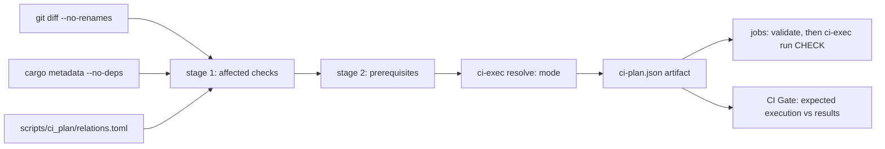

# Continuous integration

Bookclerk’s GitHub Actions workflow (`.github/workflows/ci.yml`) uses a
**dependency-aware planner** so pull requests can skip unrelated work, while
`merge_group` always runs the full suite. A push to `main` (which only
advances through the merge queue) compiles the full suite to refresh the
dependency caches and runs no tests.

## Selective CI

`SELECTIVE_CI` in `.github/workflows/ci.yml` selects the execution mode:

| Mode | When | What runs |
| --- | --- | --- |
| `full` | `main` push, `merge_group`, or any fail-closed trigger | Every job and check at full scope (build only on a `main` push, see below) |
| `shadow` | `SELECTIVE_CI != "1"` | Every job at full scope; the selective prediction is recorded in the plan summary for audit |
| `selective` | `SELECTIVE_CI == "1"` on a PR | Only the predicted checks, each with its prerequisites |

Full-suite `merge_group` runs are the audit for missed selective coverage: a
check that fails there but was skipped on the PR is a planner bug, and it
keeps the PR out of `main`.

### Build-only `main` pushes

`main` only advances through the merge queue, and the queue's run already
tested that exact commit. The push run resolves with `--build-only`
(`build_only: true` in the artifact):

- Only the jobs that save caches run: `check`, `test`, `native-gateway` and
  `release` (`BUILD_ONLY_JOBS` in `scripts/ci_plan/execute.py`). The gate
  expects every other job to be skipped.
- Builds, Clippy and installs run as usual; `cargo test` and the nextest run
  become `cargo test … --no-run`; doctests, formatting, scripts, staging and
  runtime assertions are dropped.

Caches are saved only on `main` (merge-group refs cannot share theirs), so
this run is what keeps pull-request and queue runs warm.

A dependency cache key covers `Cargo.lock`, the manifests, the toolchain and
the CI environment, not the repository's own sources, and an existing key is
never saved again. Most merges therefore leave every key unchanged, and their
build would save nothing. Each build-only job first looks up its own key
(`lookup-only`, run only when `CI_BUILD_ONLY` is true). On a hit it sets
`CI_SAVED_CACHE_CURRENT=true`, skips restoring the cache, and `ci-exec.py run`
issues no commands. The Linux `native-gateway` child always skips, because the
`test` job saves the Linux `debug` cache. A changed lockfile or toolchain, or
an evicted cache, misses the lookup and builds as before.
`ci-exec.py` ignores the variable outside build-only runs, so it can never
skip a test.

### Test runner and retries

`rust_test` runs under [cargo-nextest](https://nexte.st/) (installed pinned in
the `test` job). Tests from every binary share one parallel pool instead of
`cargo test` running binaries one after another, and each test runs in its own
process. In a `merge_group` run a failed test is retried once
(`MERGE_GROUP_TEST_RETRIES`); nextest marks a pass on retry `FLAKY` in its
summary, and a test that fails twice fails the job. Pull requests never retry,
so a flaky test still shows up red where it can be fixed. File an issue for
every `FLAKY` line.

A merge group only needs to know whether it can land, so it fails fast: nextest
stops at the first test that fails its retry, and the `merge-queue-fail-fast`
job cancels the rest of the run as soon as any job fails, so `CI Gate` reports
at once and the queue ejects the group without waiting for the slowest job.
That job runs no repository code and is the only one with `actions: write`.
Pull requests run every test and every job (`--no-fail-fast`), so one round
shows every failure to fix.

Test targets with `harness = false` whose `main` does not answer libtest's
`--list` protocol would list zero tests under nextest. They are excluded from
the nextest run and run with `cargo test --test` (`CUSTOM_HARNESS_TESTS`);
`scripts/tests/test_ci_contract.py` fails when a new one is not listed.
Locally, `cargo test --workspace` still runs everything; install nextest
(`cargo install cargo-nextest --locked`) to reproduce `ci-exec.py run
rust_test`.

### Caches

Rust dependency caches use three shared keys, each saved by one job on
`main` and restored by the others: `lint` (`check`), `debug` (`test` on
Linux, `native-gateway` on macOS and Windows; restored by `e2e`,
`confinement`, `tray`, `postgres` and `windows-cluster`) and `release`
(`release`, restored by `envelope`). Fewer entries keep the repository under
the Actions cache limit so jobs stop missing their cache. CI builds dev and
test profiles with `CARGO_PROFILE_DEV_DEBUG=line-tables-only`, which keeps
file and line in panics while cutting link time and cache size. A failing test prints its
panic backtrace (`RUST_BACKTRACE=1`); `RUST_LIB_BACKTRACE=0` keeps error
libraries such as `anyhow` from capturing one for every error they build.

### Plan → execution contract



- The `plan` job runs `scripts/ci-exec.py resolve`, which writes
  `ci-plan.json` (schema version, run id, a fresh `execution_id`, checked-out
  commit, the prediction and the resolved `execution`) and the job outputs
  used by `if:` gates — both from the same JSON.
- Every downstream job downloads that artifact and runs
  `ci-exec.py validate` first; a missing, stale or foreign artifact fails the
  job.
- Each check is one workflow step running `ci-exec.py run <check>`. The
  executor runs the check's prerequisites (once per execution, in order: builds →
  pinned `workerd` → platform install → guest staging) and then its commands.
  Local reproduction uses the same entry points:

  ```bash
  python3 scripts/ci-plan.py --paths crates/bookclerk-cli/src/main.rs --format summary
  python3 scripts/ci-exec.py resolve --selective 1 --paths crates/bookclerk-cli/src/main.rs
  python3 scripts/ci-exec.py show rust_test --run-id local   # print commands
  python3 scripts/ci-exec.py run rust_test --run-id local    # run them
  ```

  Resolving again mints a new `execution_id` and starts a fresh execution.
  Prerequisite completion from the previous artifact is not reused, even in
  the same temporary directory with the same commit and run id. Checks that
  share one artifact still run each prerequisite only once. `show` prints
  commands and does not record completion.

- `CI Gate` compares every job's result with `execution.jobs`: expected jobs
  must succeed, unexpected jobs must be skipped. Failures, cancellations,
  unexpected skips and unexpected runs all fail the gate. Because the gate
  uses the *execution* (not the prediction), shadow mode's intentional full
  runs pass.
- `scripts/tests/test_ci_contract.py` (PyYAML, hash-pinned in
  `scripts/tests/requirements.txt`) fails when the workflow and planner could
  diverge: unknown or unused outputs, a check with zero or two steps, a job
  the gate does not see, a job that does not validate first, unpinned actions,
  or `continue-on-error`.

## Planner

```bash
python3 scripts/ci-plan.py --base <sha> --head <sha> --format summary
python3 scripts/tests/test_ci_plan.py        # planner + executor scenarios
python3 scripts/tests/test_ci_relations.py   # relations.toml guardrails
python3 scripts/tests/test_ci_contract.py    # workflow contract (needs PyYAML)
```

### Stage 1: affected checks

Each changed path (renames contribute old and new paths) is classified:

| Input | Effect |
| --- | --- |
| Package source (`src/`, `build.rs`, `Cargo.toml`, other package files) | Package is **compiled-affected**; propagates over **normal/build** edges to compiled consumers (optional edges count — no feature resolution) |
| `tests/**`, `benches/**`, `examples/**` in a package | Owner only, by target type: `--tests`, `cargo bench --benches --no-run`, `cargo build --examples` |
| **Dev** edge to a compiled package | Consumer's tests, bench/example builds and doctests; **not** propagated to its production consumers |
| Declared `embed` (e.g. TS/Python SDK runtime into `bookclerk-workerd`) | Package compiled-affected |
| Declared `test_input` / `fixture` | Consumer tests (fixtures skip the owner's compile propagation) |
| Declared `test_guests` executable changed | Launching package's tests re-run (no propagation) |
| `ui/`, `packages/plugin-sdk*/`, ABI scripts | UI, SDK ABI and API-doc checks |
| `docs/**` | The website tests (`site_test`), whose link check covers the docs the site publishes |
| `tools/site/**`, `assets/brand/**` | The website tests and audit (`site_test`, `site_audit`) |
| `tools/diagnostics-collector/**` | The collector's tests (`collector_test`) |
| Root `Cargo.toml` / `Cargo.lock`, toolchain, `.cargo/`, workflows, the planner, `fuzz/Cargo.*`, unknown or unclassified paths, planner errors | **Full suite** |
| `fuzz/corpus/<target>/**`, `fuzz/oracles/<target>.rs` | Owning crate's tests (declared `test_input`; an undeclared corpus or oracle is unclassified) |
| `fuzz/fuzz_targets/**`, `fuzz/dictionaries/**` | Nothing here; the ClusterFuzzLite workflows select themselves by path |

A planner error still uses that normal full plan when metadata, relations, and
the guest inventory are available (an unavailable diff is the usual case).
If those inputs are missing, `ci-exec.py resolve` fails instead of publishing
a plan with empty prerequisites.

`Cargo.lock` stays a full-suite trigger in this iteration; dependency-update
precision can follow.

### Stage 2: prerequisites

Every selected check lists what a clean runner needs, with a reason:

- `rust_test`: `cargo build -p` for executables its packages' tests launch
  (`test_guests`), plus pinned `workerd` when they spawn through it. Tests run
  with `BOOKCLERK_REQUIRE_TEST_GUESTS=1`, so a missing guest fails instead of
  skipping.
- `e2e`: jail + launcher + the native guests in scope, pinned `workerd`,
  `cargo install-platform --skip-build`, and `cargo stage-plugins --plugin
  <id>…` (or `--optional --examples` for the full installation). Runs
  `bookclerk-plugin-e2e` (`--lib --test staged_plugins --test
  installed_plugin_path`; never `native_gateway`) with
  `BOOKCLERK_REQUIRE_STAGED_PLUGINS=1`.
- `postgres` `rpc_like`: postgres guest + launcher + jail and pinned `workerd`.
- `native_gateway`: `cargo build -p bookclerk-jail -p bookclerk-workerd` and
  pinned `workerd` only — no platform install, staging, database services or
  app build. The fixture guest is a bin target of `bookclerk-plugin-e2e`, so
  `cargo test --test native_gateway` builds it.
- `windows_cluster`: `cargo build -p bookclerk-plugin-database-sqlite
  -p bookclerk-jail -p bookclerk-workerd` and pinned `workerd`, then the
  existing identity filters and `cargo test -p bookclerk-cli --test
  cluster_secret_startup`. The CLI target still sets
  `plugins.isolation = "required"` and keeps its assertions.
  `BOOKCLERK_REQUIRE_TEST_GUESTS=1` is set for that target.

Prerequisites never select suites: building the sqlite guest for host tests
does not select sqlite's own tests or E2E.

### Staged E2E scope

`bookclerk-plugin-e2e` owns the staged-installation suite; the ordinary test
step excludes it (`--exclude bookclerk-plugin-e2e` on the full suite).

- **Full** — a direct source change in a `staged_e2e.full_packages` package
  (dev, manifest, abi, workerd, jail, sandbox, the e2e crate), an inventory
  manifest (`crates/bookclerk-plugins/*/*/plugin.toml`,
  `examples/plugins-*/plugin.toml`), host discovery / registry / install
  preflight, or the full suite.
- **Subsets** — each compiled-affected guest package adds its id; changed
  non-Cargo example guests add theirs; the workerd SDK runtime embed adds
  every workerd-runtime guest; shared host runtime changes add the
  `runtime_smoke` guests (native Rust, workerd TS, workerd Python).
- **Combination** — full wins over subsets, subsets are unioned,
  prerequisites add nothing. Platform guests (`sqlite`, `local`) are always
  installed and checked. An embedded SDK change marks `bookclerk-workerd`
  affected *through the embed*, so it selects the workerd-runtime subset, not
  the full installation; a change under `crates/bookclerk-workerd/src/` is a
  direct source change and selects full.

### Declarations (`scripts/ci_plan/relations.toml`)

The only handwritten graph: relationships `cargo metadata` cannot describe
(embedded assets, cross-package test inputs and fixtures, executables tests
launch, feature-specific test runs, postgres step owners, E2E scope rules,
platform-job membership, release packaging inputs). It does not restate the
workspace dependency graph.

`scripts/tests/test_ci_relations.py` is a **guardrail, not a completeness
guarantee**. It recognizes literal `include_str!` / `include_bytes!` paths,
Rust string literals that resolve to another package or repository path, and
workspace binary names in `tests/`; each must be declared, related through
Cargo, under a full-suite path, or listed in `[[reviewed]]` with a reason.
Computed paths, macro-generated includes and dynamically discovered fixtures
are **not** detected — declare them, or rely on the conservative fallbacks.

Postgres tests only run in the `postgres` check, through the name filters of
`POSTGRES_STEPS` in `scripts/ci_plan/execute.py`. `scripts/tests/test_ci_contract.py`
finds every Postgres-gated test (an `#[ignore]` reason naming Postgres, or a
body that reads `BOOKCLERK_TEST_POSTGRES_URL` directly or through a helper in
the same package) and fails when no step filter matches its function name, or
when a step matches no test. Name such tests `postgres_*`.

## Jobs

| Job | Runs when | Checks |
| --- | --- | --- |
| `plan` | Always | Planner/executor/contract/guardrail tests, DB isolation + docs lints, `resolve`, `ci-plan` artifact |
| `fmt / clippy / docs` | Any check below is selected | `ui`, `plugin_sdk_abi`, `python_sdk`, `author_surface`, `fmt`, `clippy`, `clippy_publish`, `api_docs`, `doctest`, `store_free` |
| `unit + integration tests` | `rust_test` is selected | nextest over the affected packages (workspace on the full suite), custom-harness targets, feature test runs, bench/example builds |
| `staged plugin installation (e2e)` | `e2e` is selected | Builds, installs and stages the guests in scope, then `bookclerk-plugin-e2e` staged targets |
| `release build` | A shipped binary (hosts, helpers, platform guests) is compiled-affected | `affected`: `cargo build --release -p <affected shipped>`; `full` (packaging inputs: `bookclerk-dev`, workerd pins, platform manifests; or full suite): `build-app --release --platform` + helper layout assertions |
| `sandbox + jailed tiers` (3 OS) | sandbox / jail / media / media-worker affected | Clippy + enforcement tests (Windows `--test-threads=1`) |
| `native-behind-workerd gateway` (3 OS) | A `[native_gateway].packages` member (plugin-host, workerd, plugin-sdk, sandbox, jail, the e2e crate) is in the Cargo-compiled closure, a `[native_gateway].paths` smoke input changed, or the full suite | `cargo test -p bookclerk-plugin-e2e --test native_gateway --test native_gateway_isolation --test native_gateway_lifecycle --test native_gateway_authenticated_endpoint` on every OS (see below); Windows adds clippy workerd, sdk `http`, host `--lib`, workerd lib tests (inherited `handle:` `SOCKET_PROXY`), and the lifecycle churn test alone before that suite; macOS adds workerd lib tests |
| `tray` (3 OS) | `bookclerk-tray` affected | Clippy + tests |
| `postgres 16/17/18` | An owning package's unit tests are affected (library, db-guest, postgres guest, plugin-host RPC LIKE) | Only the owners' steps, on every supported major |
| `windows cluster startup + identity` | A `[windows_cluster].paths` input changed, or the full suite | On `windows-latest` only: identity create, restart/binding, and different-cluster rejection, then the full `cluster_secret_startup` target with the sqlite guest, jail, `bookclerk-workerd`, and pinned `workerd` |
| `small-VPS envelope` | A `[envelope].paths` input changed (harness, seed, search rebuild, library book page, books HTTP handler), or the full suite | On the `ubuntu-latest` VM, release-build the hosts and compile the seed. `docker run --memory=1g --memory-swap=1g --cpus=1 ubuntu:24.04` then runs the seed, daemon, and load. `small-vps.sh` reads `memory.max` and `cpu.max` and refuses to record numbers when they are `max` or looser than 1 GiB / one core. It drops build and object file cache and writes `envelope-metrics.json` even when a later step fails. Books routes must return 200, `q=Title` must hit the rebuilt index, and daemon anonymous memory (`RssAnon` when `/proc/<pid>/status` reports it, otherwise `memory.stat` `anon`, or `memory.current` when anon is absent) stays under 256 MiB after idle and during the API windows. `memory.peak` is recorded and not gated: the container cannot reset it, so the lifetime peak includes the seed. One `cpu.max` core means 1 media worker. Latency is recorded and not gated. `available_parallelism` (daemon `logical_cpus`) is recorded separately from the affinity mask |
| `website + collector Workers` | `tools/site/**` or `assets/brand/**` (site tests and audit), `docs/**` (site tests only), `tools/diagnostics-collector/**` (collector tests), or the full suite | `site_test`: `npm test` in `tools/site` (generator, Worker and the docs link check). `site_audit`: Lighthouse and axe-core on the built site (see [Website checks](#website-checks)). `collector_test`: `npm test` in `tools/diagnostics-collector`. No Rust toolchain |
| `CI Gate` | Always | Stable required check (see contract above) |

OSV scanning remains a separate workflow/gate. A green OSV job that applies
[`osv-scanner.toml`](../osv-scanner.toml) `IgnoredVulns` means **zero
unignored/actionable** findings, not that ignored advisories have left the
dependency graph. Each ignore must record reachability evidence and an
`ignoreUntil` review date.

The scheduled **SQL-v1 property** job (`.github/workflows/sql-v1-proptest.yml`)
runs a longer `proptest` suite (`PROPTEST_CASES=256`) on `bookclerk-plugin-abi`
and `bookclerk-db-exec`, grammar-aware sqlite admission plus a PostgreSQL 16
differential (normalized `DbValue` / `DbErrorClass`). It is
`workflow_dispatch` + weekly; PR CI keeps the modest in-crate case counts,
deterministic corpus replay, and the postgres matrix (binding UTF8 readiness +
sqlite/postgres differential).

### Fuzzing

Coverage-guided fuzzing runs on [ClusterFuzzLite](https://google.github.io/clusterfuzzlite/)
over the `cargo-fuzz` targets in `fuzz/`. Every untrusted-input boundary
ships a target, a seed corpus and a replay test
([ADR](adr/untrusted-input-fuzzing.md)); this table is the boundary list, and
a pull request that adds or widens a boundary extends it.

| Target | Boundary | Oracle beyond "no panic" |
| --- | --- | --- |
| `sql_parse` | SQL-v1 lexer, packer, grammar and TEXT admission (`bookclerk-plugin-abi`) | — |
| `sql_lower` | Adapter lowering of canonical SQL (`bookclerk-db-exec`) | Quoted strings and comments survive lowering verbatim except documented rewrites |
| `mp4_parse` | ISO-BMFF parse and remux of store downloads (`bookclerk-mp4`) | — |
| `granted_http` | Granted reverse channel: request head, body framing, chunked bodies, query string (`bookclerk-workerd::granted_http`) | Split-invariant chunked decoding; agrees with an `httparse` reference decoder; the route body reader (framing dispatch, byte cap, end of stream) is split-invariant and yields what the declared framing promises |
| `egress_policy` | Guest egress allowlist (`bookclerk-plugin-manifest::EgressPolicy`, JSON wire form; the workerd `egress.js` gate is a separate implementation, see #335 below) | Deny allows nothing; loopback/private/metadata need a CIDR in every spelling (trailing dot, fullwidth digits, legacy `127.1` / hex / octal IPv4); `*.suffix` never matches `xsuffix`; percent-encoded hosts never match; JSON round trip |
| `plugin_manifest` | `plugin.toml` parse, validation, derived egress and consent (`bookclerk-plugin-manifest`) | `format_manifest` round trip; a deny manifest yields a deny policy |
| `abi_decode` | Every generated Cap'n Proto `read_*` codec (`read_any_message`) and the database envelope decoders (`bookclerk-plugin-abi`) | Traversal budget derived from input size |
| `abi_roundtrip` | Every generated Cap'n Proto `read_*` / `write_*` codec pair (`roundtrip_any_message`, `bookclerk-plugin-abi`) | A value the decoder accepts re-encodes, re-decodes and compares equal (`read(write(v)) == v`) |
| `guest_sql_authz` | Guest SQL authorization, every host-issued policy shape (`bookclerk-plugin-abi::GuestSqlPolicy`, lowered as the SQLite adapter lowers it) | Every table, column, function and schema action SQLite's own authorizer reports for an admitted statement is inside the policy; shared oracle `fuzz/oracles/guest_sql_authz.rs`, replayed from `bookclerk-library` |
| `mux_peer` | Peer frames on the multiplexed byte link (`bookclerk-plugin-sdk::mux`: `Open`, `Data`, `Close`, `Window`, lengths and ids) | Settles within a bound once the peer's bytes end, delivers no more than the peer sent, accepts no more streams than the peer could open, leaves no task behind; shared oracle `fuzz/oracles/mux_peer.rs`, replayed from `bookclerk-plugin-sdk` |

One boundary lives outside the Rust workspace and follows the ADR's rule for
non-Rust tooling (decision 6): the diagnostics triage plan validator
(`tools/diagnostics-collector/scripts/validate_plan.py`), which decides what
model output reaches public issues.
`scripts/tests/test_diagnostics_plan.py` replays its seed corpus
(`scripts/tests/diagnostics_plan_corpus/`) and runs seeded mutation fuzzing on
every PR, checking each accepted plan against an independent oracle (no links,
mentions, cross-references, raw HTML or forged Report IDs; only batch report
IDs; at most five issues).

Still to add (tracked in the fuzzing ADR's follow-ups): a full RPC session
against a scripted guest, the workerd `egress.js` gate checked against
`EgressPolicy` (#335), Audible CENC/DASH parsing, package extraction, naming
paths, node frames, media chapter math, backup import.

Seed corpora are checked in under `fuzz/corpus/<target>/` and replayed by
ordinary tests in PR CI (`tests/fuzz_corpus.rs` in the owning crate), so a
fixed crash stays fixed without a nightly toolchain. The planner routes a
corpus change to that crate's tests only (`relations.toml` `test_input`);
`scripts/tests/test_ci_contract.py` fails when a target lacks a corpus, a
planner route or a replay test, or when a fuzzed crate is missing from the
PR workflow's path filter. An oracle shared by a target and a replay test lives
in `fuzz/oracles/<target>.rs` and is included by both with `#[path]`, so the
two cannot drift; `relations.toml` lists the oracle beside the corpus, so an
oracle change runs that crate's tests only. `fuzz/dictionaries/<target>.dict` and
`<target>.options` (libFuzzer INI with a `[libfuzzer]` section whose `max_len`
matches the target's early-return cap)
ride beside each binary.

| Workflow | When | What |
| --- | --- | --- |
| `cflite-pr.yml` | PRs touching `fuzz/`, the fuzzed crates, or the ClusterFuzzLite config | 10 min, AddressSanitizer, code-change mode; fails on a new crash |
| `cflite-batch.yml` | daily + `workflow_dispatch` | 45 min batch fuzzing split across targets, private [crash triage](#fuzz-crash-triage), then corpus pruning and a coverage report (kept as Actions artifacts) |

A crash found by the scheduled run is handled as a security report: fix
first, then land the minimized input as `fuzz/corpus/<target>/regression_*`
in the fixing pull request.

Build config lives in `.clusterfuzzlite/` (`Dockerfile`, `build.sh`,
`project.yaml`). To add a target: a `[[bin]]` in `fuzz/Cargo.toml`, a seed
directory under `fuzz/corpus/`, a `test_input` route in
`scripts/ci_plan/relations.toml`, a replay test in the owning crate, the
crate on `cflite-pr.yml`'s path filter, a row above, and an entry in
`fuzz/boundaries.toml` ([triage](#fuzz-crash-triage)). `build.sh`
packages every target `cargo fuzz list` reports. Reproduce locally with
`cargo +nightly fuzz run <target>` from `fuzz/` (needs `capnp` on `PATH`).

#### Fuzz-crash triage

Job logs and artifacts of this public repository are readable by anyone, and
the stock ClusterFuzzLite `run_fuzzers` action prints each crash's stack and
libFuzzer output (small crashing inputs included) to the log and uploads the
reproducer as an artifact. The scheduled workflow therefore never uses it:

1. `batch`, `prune` and `coverage` run the same pinned run-fuzzers image
   through `.github/actions/cflite-private-run`, which runs
   `scripts/fuzz-crash-triage.py run`: the image's own mode, with its output
   in a private log and its crash upload disabled. Corpus and coverage
   artifacts are unchanged, so PR fuzzing is too. The log shows a crash count.
   Timeout inputs are kept (`REPORT_TIMEOUTS`) so triage sees them. Every
   scheduled build sets `bad-build-check: false`, because that check runs
   each target briefly and prints its output to the log.
2. When `batch` kept crashes, it seals them with its log
   (`FUZZ_CRASH_BUNDLE_KEY`, `scripts/osv-remediation-bundle.sh`) as the
   `fuzz-crashes-<sanitizer>` artifact (7 days).
3. `triage` rebuilds the fuzzers from the same commit and runs
   `fuzz-crash-triage.py reproduce` in the same image: each crash is re-run
   (dropped unless it reproduces), minimized with `-minimize_crash`,
   classified (sanitizer error, panic, stack overflow, out of memory,
   timeout, leak, or a failed oracle: a panic raised from code under
   `fuzz/`) and deduplicated by target, kind and the top three frames of the
   code under test (a crash with no usable frames, such as a wall-clock
   timeout, is keyed by its input instead, so unrelated ones stay apart).
   The output is sealed as `fuzz-triage-<sanitizer>` (90 days).
4. `fuzz-crash-triage.py file`, with the [automation App](#automation-app)
   token, files each signature not already on record (a hidden
   `<!-- fuzz-crash-signature: … -->` marker in an open `fuzz-crash` issue
   or in any repository advisory):
   - **Draft security advisory** for every crash that is not an oracle
     failure, before the first release too (drafts are private, and filing
     them proves the path). The draft carries the stack, the reproducer
     (base64, up to 4 KiB) and a reproduce command; affected packages are the
     target's artifacts from `fuzz/boundaries.toml`, with a proposed range
     `<= <newest tag>` that a maintainer confirms (the crash reproduced on
     `main`, not on the release). Before the first release (prereleases
     count, drafts do not) no range is proposed. Default severity: high for memory-safety errors (and anything
     unrecognized; the advisory asks for the fix in a temporary private
     fork, which a maintainer starts, since that needs the Administration
     permission the App does not have), medium for a
     denial of service in host code, low inside a guest or for a leak. A
     maintainer reviews and publishes.
   - **Issue** for a failed oracle (a panic raised from `fuzz/fuzz_targets/`
     or `fuzz/oracles/`), which is a bug rather than a vulnerability: the
     issue names the target, its boundary and the sealed bundle. An issue
     closed as completed does not suppress a later identical crash (a
     regression); one closed as not planned or duplicate does.
   - A crash already on record as an advisory is not filed again. While that
     advisory is still a draft, a run that sees the crash again rewrites
     only the automated part of its description (a new reproducer, boundary
     or default severity mapping), the same way as the
     [OSV advisories](#osv-advisories) do; closed and published advisories
     are never touched.

`fuzz/boundaries.toml` maps every target to its crate, who controls its input,
whether it runs host-side, and which shipped artifacts contain it;
`scripts/tests/test_fuzz_crash_triage.py` fails when a target in
`fuzz/Cargo.toml` or in the table above lacks an entry, so adding a target
means adding one there too.
To read a bundle, download the artifact and run
`BUNDLE_KEY=<passphrase> scripts/osv-remediation-bundle.sh open sealed.bin <dir>`.
A new sanitizer needs a matrix entry in both jobs; a new
run-fuzzers image digest must be bumped in the action and in `triage`
together, and re-tested, because the wrapper patches one method of the
image's Python package (it refuses to fuzz when that method is missing).

The scheduled **workerd pin bump** job (`.github/workflows/workerd-pin-bump.yml`)
also compiles `bookclerk-workerd` / `bookclerk-plugin-abi`, so it installs
`capnproto` before `cargo build` when a pin bump is eligible.

### Native-behind-workerd gateway smoke

`crates/bookclerk-plugin-e2e/tests/native_gateway.rs` (plus
`native_gateway_isolation.rs`, `native_gateway_lifecycle.rs`, and
`native_gateway_authenticated_endpoint.rs`) installs the
test-only `native_gateway_probe` guest (an SDK-only bin of the e2e crate;
never staged or packaged) into a temporary files dir, grants exactly one
ephemeral loopback TCP port, and spawns it through `PluginSession::spawn_with`
with `Isolation::Required`. The session goes through host discovery and
launch planning, then two sibling `bookclerk-jail` processes:
`bookclerk-workerd` + pinned `workerd` in the gateway jail, and the native
backend in a deny-network sibling joined by inherited duplex links (on
Windows, two host-created AppContainers plus a session Job; no named-pipe
`SOCKET_PROXY`). It asserts, against harness-held listeners:

- describe/open and a real CLI entrypoint RPC answer through the front door;
- a unique payload round-trips through `bookclerk_plugin_sdk::net::connect`
  to the granted port;
- a second, live listener on an ungranted port is refused by policy (`403`)
  and is never dialed;
- a direct `std::net` connect from the guest to the live granted listener is
  blocked;
- both `gateway_pid()` and `guest_pid()` exit after drop, the host session
  directory is gone, and the guest cannot read gateway state or
  `WORKERD_GRANT_*` / `BOOKCLERK_JAIL_*` env;
- two concurrent sessions cannot exercise each other's grants or gateway
  state. After both authenticate and complete a connect, `channel_ident`
  via `cli_invoke` reports each configured tag. Those sessions do not publish
  candidate-endpoint metadata, so `extra_status=not-run`. That status is not
  proof that the other session's endpoint is absent;
- a paired fixture keeps one pre-authenticated endpoint B (its own challenge;
  A's challenge is not replayed onto B) and publishes the same candidate
  metadata in both cases, through the same `cli_invoke` path. The normal
  launcher path does not preserve the test-only extra fd and does not list
  B's handles, and the RPC reports `extra_status=absent` because that slot
  is inaccessible. A live object at the slot that is not the candidate is
  `ident-failed` (numeric collision), not absence. When the fixture also
  transfers B through the guest jail handoff, the same RPC reports B's tag
  while A still answers. Transfer without the candidate metadata stays
  `not-run` even though the endpoint was handed off. On Windows the
  challenge is written with an event so that guest end is not bound to the
  test process's I/O completion port; binding it makes the guest report
  `ident-failed` instead of the tag. Production spawn does not add the slot.
  A numeric fd or handle is not identity;
- guest-exit / missing-workerd / mid-session kill fail closed.

Nothing skips: a missing helper, runtime, confinement backend, startup failure
or timeout fails the test. On Windows,
`sequential_and_concurrent_spawn_cycles_do_not_leak` runs by itself before
that suite, and the suite runs it again in the original order with
`windows_job_extras_deny_the_next_direct_ping`. Smoke-only inputs (the four
targets, `tests/native_gateway/`, and the fixture guest source) select
`native_gateway` but not the staged E2E suite.

## Branch protection / merge queue

Configure repository rulesets / branch protection so the **required** CI check
is **`CI Gate`** (plus the OSV check), **not** every matrix child. Skipped
`release` / `confinement` / `native-gateway` / `tray` jobs report `skipped`; if those job names are
individually required, merges stay pending forever.

Also enable a merge queue that consumes `merge_group` checks so the full suite
runs on the synthetic merge commit before landing. Merge queues are only
available on **organization-owned** repositories (free for public repos), so
this step waits until the repository lives in an organization. Queue settings:
squash, "only merge non-failing pull requests", build concurrency around 5.
With a queue required, "require branches to be up to date" no longer matters;
the queue tests each entry against current `main` stacked on the entries ahead
of it.

## Dependabot auto-merge

`.github/workflows/dependabot-auto-merge.yml` runs
[`fastify/github-action-merge-dependabot`](https://github.com/fastify/github-action-merge-dependabot)
when a Dependabot PR opens or updates. It approves the PR and turns on GitHub
auto-merge (squash) **for that PR only**. GitHub then merges it, or adds it to
the merge queue when one is required, once `CI Gate` and `PR scan / osv-scan`
pass. Failing PRs stay open for a human.

The repository-level **Allow auto-merge** setting only makes the per-PR
"Enable auto-merge" button and API available; it never merges a PR on its own,
so human PRs merge exactly as before unless someone opts a PR in.

The action must run while checks are still pending: GitHub rejects enabling
auto-merge on a PR that is already mergeable. To retry a Dependabot PR (for
example after adding the secrets), comment `@dependabot rebase`.

Version updates (`.github/dependabot.yml`, weekly, 7-day cooldown) cover
every lockfile of a shipped artifact or its build: Cargo at the workspace
root, npm in `ui/`, `packages/plugin-sdk`, `tools/diagnostics-collector` and
`tools/site`,
uv in `packages/plugin-sdk-python`, and GitHub Actions. `examples/` lockfiles
are left out (reference plugins, never packaged); the full OSV scan still
reports them.

The Python SDK has no runtime dependencies. Its `uv.lock` pins the `dev`
and `docs` extras that the `python_sdk` check and
`generate-api-docs.sh --python` install (`uv sync --locked --no-install-project`,
which fails when the lockfile is out of date with `pyproject.toml`; the SDK is
imported from `src/` rather than built, so its unlocked build backend never
runs), so OSV scans them and a runtime dependency added later is scanned from
the start. [Docs publishing](#docs-publishing) reads the SDK's source with the
standard library and installs nothing. After
changing `pyproject.toml` dependencies, run `uv lock` in
`packages/plugin-sdk-python`.

Policy knobs live in the workflow's `with:` block:

- `target: any` merges every update type. Tighten to `minor` or `patch` to
  leave larger bumps for manual review.
- `exclude: 'crate-a,crate-b'` skips auto-merge for PRs touching those
  packages.

### Setup

1. **Settings → General → Pull Requests:** enable **Allow auto-merge**.
2. Create a GitHub App (owned by the organization once the repo is
   transferred; an App owned by a user can be transferred later) with
   repository permissions **Contents: read and write** and **Pull requests:
   read and write**, no webhook, and install it on this repository only.
3. Add two **Dependabot** secrets (Settings → Secrets and variables →
   Dependabot). Dependabot-triggered runs do not receive Actions secrets:
   - `DEPENDABOT_MERGE_APP_CLIENT_ID`: the App's client ID.
   - `DEPENDABOT_MERGE_APP_KEY`: a private key generated for the App.

The App token matters: merges and queue entries attributed to `GITHUB_TOKEN`
do not start new workflow runs, so `push` CI on `main`, the OSV SARIF upload,
and `merge_group` checks would be skipped. The App can also approve PRs without
the "Allow GitHub Actions to create and approve pull requests" setting.

### Before the merge queue exists

While the repository is still owned by a user, `Protect Main` keeps "require
branches to be up to date" on. Auto-merge then waits on a Dependabot PR that
has fallen behind `main` until it is rebased. Either:

- turn that option off in the `Protect Main` required-status-checks rule, so
  green Dependabot PRs merge as soon as their checks pass (Dependabot rebases
  PRs that actually conflict, and `push` CI on `main` is the safety net). This
  also relaxes the rule for human PRs until the queue replaces it; or
- leave it on and comment `@dependabot rebase` on PRs that fall behind.

## Automation App

Scheduled workflows that open pull requests or file issues use the same GitHub
App as [Dependabot auto-merge](#dependabot-auto-merge) instead of
`GITHUB_TOKEN`:

- The organization does not allow GitHub Actions to create or approve pull
  requests, so `GITHUB_TOKEN` cannot open them.
- Pushes and pull requests made with `GITHUB_TOKEN` do not start workflow
  runs, so their required checks would never report. App-token pushes start
  CI like any other contributor's.

| Workflow | Writes |
| --- | --- |
| `workerd-pin-bump.yml` | `deps/workerd-pin` branch, pull request, auto-merge |
| `librofm-apk-probe.yml` | `api-drift` issue; `api-drift/librofm` branch and pull request |
| `graphicaudio-api-probe.yml` | `api-drift` issue; `api-drift/graphicaudio` branch and pull request |
| `chirp-api-probe.yml` | `api-drift` issue; `api-drift/chirp` branch and pull request |
| `osv-remediate.yml` | reads OSV code-scanning alerts; `deps/osv-remediation` branch, pull request, auto-merge |
| `cflite-batch.yml` | `fuzz-crash` issues for oracle failures; draft repository security advisories for crashes ([triage](#fuzz-crash-triage)) |
| `osv-advisories.yml` | reads OSV code-scanning and Dependabot alerts; draft repository security advisories ([verdicts](#osv-advisories)) |
| `docs-publish.yml` | commits and release tags on the `bookclerk-docs` repository ([docs publishing](#docs-publishing)) |

The probes share `.github/actions/api-drift-report`: one open issue per source
(found by a hidden `<!-- api-drift:<source> -->` marker and updated in place,
with a comment per new detection), and, when the probe's fixer produced
verified changes, a draft pull request on a fixed branch that closes it (a
maintainer marks it ready after CI and review). Each
workflow's own `GITHUB_TOKEN` stays read-only, and each job mints the App token
only when it has something to write, scoped to the permissions that step needs.
Commits are made through the API (`sign-commits`), so they are signed and
attributed to the App.

### Setup

1. Give the App these repository permissions, then accept the new
   permissions on its installation (an installation keeps its old
   permissions until they are accepted):
   - **Contents: read and write** (push branches)
   - **Pull requests: read and write** (open, update and auto-merge PRs)
   - **Issues: read and write** (file and update drift issues, add labels)
   - **Code scanning alerts: read** (`osv-remediate.yml` and
     `osv-advisories.yml` read the OSV alerts on `main`)
   - **Dependabot alerts: read** (`osv-advisories.yml`)
   - **Repository security advisories: read and write**
     (`cflite-batch.yml` and `osv-advisories.yml` file draft advisories and
     dedupe against them)
   - **Metadata: read** (always granted)
   - **Variables: read and write**, as an organization and/or repository
     permission (`diagnostics-collector-deploy.yml` stores the workers.dev
     collector URL when `DOMAIN` is unset; organization first, repository as
     the fallback). That token cannot be narrowed, because the token API has
     no Variables permission to request, so the job mints it only for the
     one write.

   **Workflows** is not needed: none of these pull requests touch
   `.github/workflows/`. Install the App on `bookclerk-docs` as well, with
   the same Contents permission, for `docs-publish.yml`.
2. Add two **Actions** secrets (Settings → Secrets and variables → Actions).
   Scheduled runs do not receive the Dependabot copies:
   - `AUTOMATION_APP_CLIENT_ID`: the App's client ID.
   - `AUTOMATION_APP_PRIVATE_KEY`: a private key generated for the App.
3. For `osv-remediate.yml`, add one more Actions secret,
   `OSV_REMEDIATION_BUNDLE_KEY`: a random passphrase (for example
   `openssl rand -base64 32`). It only encrypts the bump while CI tests it;
   rotating it affects nothing but a run already in progress.
4. For `cflite-batch.yml`, add `FUZZ_CRASH_BUNDLE_KEY`, generated the same
   way and kept by maintainers: it seals crash bundles that are read after
   the run. Without it a run that finds a crash fails before uploading
   anything. `osv-advisories.yml` seals its verdict report with the same
   key, and its intermediate evidence with `OSV_REMEDIATION_BUNDLE_KEY`.

### OSV remediation

`osv-remediate.yml` runs after every full OSV scan of `main` (push, schedule
or manual run) and on demand. It reads the open OSV-Scanner alerts in
Security → Code scanning, looks each advisory up on api.osv.dev (with its
aliases; when OSV does not know an alert's rule id, for example a new CVE that
OSV-Scanner chose to name a group of advisories, the other advisory ids in the
alert's rule and message text stand in for it), and
`scripts/osv-remediate.py` tries lockfile-only updates (`cargo update
--precise`, then the newest compatible release; `npm update
--package-lock-only --ignore-scripts`; `uv lock --no-build --upgrade-package
<name>==<fix>`, then the newest allowed release) until no locked version of
the package is inside the advisory's affected ranges. An attempt that does not clear the
advisory is rolled back. Manifests are never edited, so a fix that needs a new
major version, or a change upstream, stays an open alert for a maintainer.

A bump is published only once it is known to pass:

1. `bump` commits the bump locally and seals it, with the pull request body,
   using `OSV_REMEDIATION_BUNDLE_KEY` (`scripts/osv-remediation-bundle.sh`).
   Artifacts of a public repository are downloadable by anyone, so the bump
   never travels in the clear.
2. `verify` calls `ci.yml` with `private-head: true`. Every CI job opens the
   sealed bundle right after checkout (`.github/actions/osv-remediation-head`)
   and tests the bump with the full suite. Caches are not saved, cargo output
   is quiet, and the first failed job cancels the run, as in the merge queue.
3. `publish` runs only when that CI Gate passed. It pushes
   `deps/osv-remediation`, opens the pull request ready for review (the suite
   has already passed, so it skips the draft stage) and turns on auto-merge,
   so the merge queue lands it as soon as the pull request's required checks
   pass.

A bump that fails verification publishes nothing: the run fails and the
alerts stay in Security → Code scanning for a maintainer. A run with nothing
to bump publishes nothing either.

While a remediation pull request is open, later runs stop at the `pending`
job and change nothing. Rebuilding `deps/osv-remediation` on every push to
`main` would restart the pull request's checks and drop it from the merge
queue, and the queue already tests it against the latest `main`. Once it
merges or is closed, the next full scan of `main` starts a fresh run. To
replace an open remediation pull request that failed its checks, close it and
run the workflow manually.

Scan results are not public, so the run keeps them private: its log prints
counts only (command output is discarded, because a failed attempt would name
a vulnerable package), and the pull request lists only the bumps it applied
with their advisory ids. This hides which advisories the project is acting on
until the fix is ready to land. It cannot hide the advisories themselves:
`main`'s lockfiles are public, so anyone can scan them.

Dependabot does not cover this: it raises alerts and security updates only for
advisories GitHub has reviewed, and RustSec advisories often stay unreviewed,
while its version updates wait out the cooldown and never touch transitive-only
crates.

Pull requests the App opens are not authored by a person, so rulesets that
require approval for such changes still need a maintainer's approval before
the merge queue takes them. Auto-merge stays on while it waits.

### OSV advisories

`osv-advisories.yml` runs after every full OSV scan of `main`, next to the
remediation, and answers a different question: does an open dependency alert
affect something Bookclerk ships? A draft repository security advisory is
filed only when it does ([ADR](adr/security-advisory-automation.md)). Drafts
are private to maintainers and are filed before the first release too, which
proves the path; nothing becomes public until a maintainer publishes.

[`shipped-artifacts.toml`](../shipped-artifacts.toml) declares the shipped
artifacts and which lockfile entries end up in each; every lockfile in the
repository is either listed there or named as not shipped
(`scripts/tests/test_osv_advisories.py` fails on an unclassified one). For
each open OSV-Scanner alert and Dependabot alert on `main` (merged per
lockfile when their ids or aliases overlap), `scripts/osv-advisories.py`
gives every artifact of that lockfile a verdict:

| Lockfile | Artifact | Affected when |
| --- | --- | --- |
| `Cargo.lock` | host binaries, platform and optional guests | the crate is in the shipped closure of the shipped crates in `cargo metadata` (normal edges, every target platform; dev and build dependencies and proc macros excluded, except `*-src` build dependencies, which compile vendored C into the binary; their own dependencies, such as `cc`, are build tooling and excluded), and, when the upstream advisory names vulnerable functions, one of them is in the DWARF of the fat-LTO release build of the shipped binaries (the method of OSV-Scanner's Rust call analysis) |
| `Cargo.lock` | Rust plugin SDK | the crate is in the SDK's shipped closure (a library: no binary to analyze) |
| `ui/package-lock.json` | web UI, served by `bookclerkd` | a production dependency with code in the production bundle (`vite build --sourcemap`, then the source maps); if the bundle cannot be built, any production dependency. A test keeps the UI from importing package files as `?url`/`?raw` assets or wasm, which source maps would not show |
| `packages/plugin-sdk/package-lock.json` | `@bookclerk/plugin-sdk` | a production dependency (not `dev` in the lockfile) |
| `tools/diagnostics-collector/package-lock.json` | diagnostics collector Worker | a production dependency (it has none today) |
| `packages/plugin-sdk-python/` | `bookclerk-plugin-sdk` (PyPI) | never by a dependency: the SDK has no runtime dependencies, and both the test and the workflow fail if `[project].dependencies` or a non-dev extra gains one before its closure is resolved |
| anything else | none | never: examples, fuzzing, scripts and dev dependencies stay an alert plus the remediation bump |

The call-analysis build takes hours, so it runs only when an advisory with
function data for a shipped crate has no advisory yet or only an open draft
(which the analysis then refreshes), and then only on the weekly scheduled
scan or a manual run (`call-analysis` input forces it). On other runs such an
advisory waits as "awaiting call analysis". Runs queue one at a time, and a
newer run replaces one still waiting, so a scheduled run queued behind
another can give way to a push's run; its call analysis then waits a week,
or a manual run with `call-analysis` does it now. An open draft whose
advisory the analysis (or the web bundle) later shows unaffected is left as
is and reported as "open draft, now not affected" for a maintainer to close.
The web UI bundle is built only when an open advisory is on
`ui/package-lock.json`.
A build that fails, reports no executables, or leaves a binary with too few
functions or no `main` in its DWARF fails closed: the advisory is filed on
the closure alone. An advisory a maintainer judges unaffected is closed as a
draft (it is not filed again) or ignored in `osv-scanner.toml`.

A draft carries the upstream ids (each as a hidden
`<!-- osv-advisory: <id> <ecosystem>/<package> -->` marker, so it is never
filed twice and a draft a maintainer closed is not filed again), the locked
and first fixed versions, the severity (a CVSS 3.1 vector from the GHSA
record or the RustSec entry, else the highest GHSA severity, else low for an
informational notice such as "unmaintained" and medium otherwise), CWE ids
(CWE-1395 for every draft, the GHSA records' CWE ids, and CWEs mapped from
RustSec categories and informational kinds, which RustSec records carry
instead), the verdict and its evidence
(saying so when reachability is unproven), and a proposed range up to the
highest release tag (or, for the TypeScript and Python SDKs, the version in
their manifest) for a maintainer to confirm. The affected package's
ecosystem is the one `shipped-artifacts.toml` declares (`other` for
packages on no public registry), except that an artifact with a
`crate_manifest` is filed as `rust` once that crate's `publish` allows
crates.io; markers keep the declared ecosystem. A later run that finds the same advisory never files
a second draft: while the first is still a draft it rewrites only the
automated part of its description (between the
`<!-- bookclerk-auto: begin … -->` and `<!-- bookclerk-auto: end -->`
comments: new evidence, fixed versions, aliases, the newest release), adds
markers for new aliases, and fills an affected range that is still unset
once a release exists. Text a maintainer adds outside that part, and the
severity, CWE ids, summary and any range a maintainer set, are left alone;
nothing is rewritten when only the "Last seen" line would change; closed and
published advisories are never touched. One run files at most ten drafts
(and updates at most ten); a draft GitHub
refuses is reported and fails the run without holding back the others.
Before the first release no draft proposes a range (nothing is published
yet): the draft says so, and a maintainer either closes it once the fix is
on `main` or sets the range when a release ships the code.

Three jobs keep secrets away from third-party build code:

1. `fetch` mints a read-only App token (code scanning, Dependabot and
   repository advisories) for one step that reads the alerts, their records
   on api.osv.dev, the newest release and the advisories on record, and
   revokes it when the step ends. It then computes the closures from the
   lockfiles and `cargo metadata`, which runs no build script, and decides on
   call analysis. Its output leaves the job sealed with
   `OSV_REMEDIATION_BUNDLE_KEY`.
2. `analyze` has no secrets and no token. It builds the web UI
   (`npm ci --ignore-scripts`) and, when planned, the shipped binaries. Its
   output names no advisory (the bundled packages and a truncated SHA-256 of
   every function in each binary), so it travels unsealed.
3. `file` builds nothing. It mints an advisory-write token, files the
   drafts, and writes the verdict report.

The verdict report is the record for everything that did not become a draft:
one row per (advisory, shipped artifact) with its verdict, packages and
outcome (filed, already on record, capped, failed), the advisories on
lockfiles that do not ship, and the evidence behind each verdict. It never
leaves the job in the clear: it is sealed with `FUZZ_CRASH_BUNDLE_KEY` (the
passphrase maintainers keep) and uploaded as the `osv-advisories-report`
artifact of that workflow run, kept 30 days. Anyone can download the sealed
file from the run page (Actions → OSV advisories → the run → Artifacts) or
with `gh run download <run-id> -n osv-advisories-report`; only the
passphrase opens it:
`BUNDLE_KEY=<passphrase> scripts/osv-remediation-bundle.sh open sealed.bin <dir>`
then read `<dir>/report.md`.

Logs print counts only. A new shipped artifact, or a new lockfile, goes into
`shipped-artifacts.toml` in the pull request that adds it. Cutting the fix
release automatically is a documented future goal, not built yet (see the
ADR).

### Docs publishing

`docs-publish.yml` keeps the separate public repository
[`Bookclerk/bookclerk-docs`](https://github.com/Bookclerk/bookclerk-docs) in
step with this one, as Markdown that the website and agents read:

- Its `main` mirrors this repository's `main`. Every push to `main` builds
  the tree and commits it there with a `Source-Commit: <sha>` trailer naming
  the commit it was built from. Runs on `main` share one concurrency group
  that cancels the older run, so a burst of merges publishes only the newest commit, and a
  run whose commit is no longer the tip of `main` when it reaches the publish
  step skips it. A build identical to the docs `main` adds no commit.
- A published release tags the docs commit whose trailer names the release's
  commit with the same tag name. When no `main` commit matches (a burst
  skipped it), the release's build is committed beside `main`, parented on
  its head without moving it, and that commit is tagged. An existing tag is
  never moved.
- The tree is `docs/` as it is, plus `api/`, whose index lists the plugin
  SDKs first (TypeScript, Python, Rust), then the web API, then the Rust
  crates and the web UI library:
  - TypeScript: TypeDoc's Markdown theme for `@bookclerk/plugin-sdk` and
    `ui/src/lib` (`typedoc-plugin-markdown`, a dev dependency of both), one
    page per module, without source links or breadcrumbs.
  - Python: `scripts/python_api_markdown.py` reads the SDK with `ast` (it
    imports nothing) and renders each public module's `__all__`, with
    Google-style sections as lists and cross-references as links.
  - Rust: `scripts/rustdoc_markdown.py` renders rustdoc JSON for every
    workspace library from a pinned nightly, one page per public module.
    Items re-exported from private modules are documented where they are
    re-exported, signatures are rebuilt from the JSON, doc headings sit
    under their item, and intra-doc links come from rustdoc's own link
    table. `api/rust/README.md` groups the crates (plugin interface,
    plugins, host internals, development).
  - Web API: `scripts/openapi_markdown.py` renders `bookclerkd`'s committed
    OpenAPI document (`crates/bookclerkd/openapi.json`) as an index of
    routes and credentials, one page per route group with each route's
    access rule, parameters, body and responses, and a page of schemas.

  Every relative link to a file in the tree must resolve, and links in
  `api/` must stay inside the tree, or the build fails.

The `build` job has no secrets and a read-only token; it runs
`scripts/docs-markdown.py` and uploads the tree as an artifact. The `publish`
job checks out only `scripts/docs-publish.py` from the default branch, mints
the [Automation App](#automation-app) token for `bookclerk-docs` alone
(contents: write), and writes one commit through the Git Data API, so GitHub
signs it as the App. A manual run publishes only from `main`. The publish
script refuses redirects, so the token is only sent to `api.github.com`.

`docs-markdown.py` clears its output before each build, so it refuses a
scratch root (`--scratch-root`, default `target/docs-markdown/`) that is not
strictly inside the repository's `target/` or the system temp directory, an
output directory that is not strictly inside the scratch root, and an
existing output directory that lacks the marker file it writes. The filesystem root, the
home directory, the repository root, `/mnt` and `/tmp` are refused as either
the output or the scratch root.

To build the tree locally (it lands in `target/docs-markdown/out/`):

```bash
rustup toolchain install nightly-2025-11-15 --profile minimal
python3 scripts/docs-markdown.py
```

The nightly is pinned because rustdoc's JSON format changes between
nightlies and `rustdoc_markdown.py` reads format 56; bump `RUST_NIGHTLY` and
`RUST_JSON_FORMAT` in `docs-markdown.py` and the workflow together, and adjust
the renderer for any change in the format. The nightly may predate the workspace's
`rust-version`, so the build passes `--ignore-rust-version`; it only produces
documentation.

### Website checks

`site_audit` (`tools/site/audit/audit.mjs`) builds the site, serves it
through the real Worker under `wrangler dev`, and audits it with the
runner's Chrome. Docs pages are read from this checkout's `docs/` through a
local server (`tools/site/audit/entry.mjs`), not from the docs repository,
so the audit covers the docs as the pull request has them and needs no
network. A docs key the local server fails renders the docs-unavailable page.

| Pages | Lighthouse (mobile and desktop) |
| --- | --- |
| `/`, `/download`, `/docs/getting-started`, `/docs/ci` | performance ≥ 90, accessibility 100, best practices ≥ 95, SEO 100, CLS ≤ 0.05 |
| 404 and docs-unavailable | accessibility 100 (their SEO and best-practice misses, such as the status code and `noindex`, are intended) |

A run that misses only on performance is repeated once and the better run
kept, since lab scores vary on shared runners. axe-core then checks every
page in light and dark color schemes at 1350 and 390 px against WCAG 2.0 to
2.2 A/AA and its best-practice rules, and any violation fails the check. The
results table goes to the job summary; a failed audit uploads the Lighthouse
reports as the `site-audit` artifact. Locally: `npm run build` in
`tools/site`, then `npm ci && node audit.mjs` in `tools/site/audit`
(`--chrome <path>` or `CHROME_PATH` picks the browser).

## Cloudflare Worker deploys

Two workflows deploy Workers with `wrangler deploy`, sharing the repository
secrets `CLOUDFLARE_API_TOKEN` and `CLOUDFLARE_ACCOUNT_ID`:

| Workflow | Worker | Custom domain |
|----------|--------|---------------|
| `site-deploy.yml` | `bookclerk-site` | `<DOMAIN>` |
| `diagnostics-collector-deploy.yml` | `bookclerk-diagnostics` | `diagnostics.<DOMAIN>` |

`DOMAIN` is the organization variable (default `bookclerk.app` for the site). With `DOMAIN` unset the diagnostics collector is served on the account's workers.dev subdomain instead (see `docs/diagnostics.md`).

The API token is scoped to the Workers by name, so it needs, for each Worker
the workflows deploy:

- The **Workers** permission with the **Editor** role, scoped to
  *Individual Workers* and naming the Worker (`bookclerk-site`,
  `bookclerk-diagnostics`). This is the current Workers permission; the
  legacy *Workers Scripts: Edit* maps to Editor on all Workers, which is
  broader than the deploys need.
- **Zone → Workers Routes → Edit** (Write in the API reference) on the
  `<DOMAIN>` zone, for the custom domain.

Editor cannot create a Worker; creating one takes the **Admin** role on the
Workers product. So the first deploy of a new Worker needs one of these:

1. Create the Worker in the Cloudflare dashboard first, under its exact name
   (an empty "Hello World" Worker is fine; the first deploy replaces it), then
   add it to the token's Individual Workers scope; or
2. Temporarily give the token the Workers Admin role, run the first deploy,
   then remove it again and add the new Worker to the Individual Workers
   scope.

See [Workers roles and permissions](https://developers.cloudflare.com/workers/authorization/workers/).

After that, only the two permissions above are needed. Renaming a Worker in
`wrangler.toml` creates a new Worker, so it repeats this step and leaves the
old one behind; keep the names as they are.

## Expected PR feedback (when `SELECTIVE_CI=1`)

| Change | Jobs after `plan` | Notes |
| --- | --- | --- |
| `docs/**` only | website + collector Workers (`site_test` only) | the site's link check covers the docs it publishes |
| `tools/site/**` only | website + collector Workers (`site_test`, `site_audit`) | no Rust toolchain |
| `tools/diagnostics-collector/**` only | website + collector Workers (`collector_test`) | no Rust toolchain |
| `README.md`, `AGENTS.md`, other top-level prose, `config/config.example.toml`, `scripts/tests/**` | none | the plan job runs the planner and lint tests on every event |
| `ui/**` only | `fmt / clippy / docs` (UI + UI API docs) | no Rust toolchain checks |
| `crates/bookclerk-cli/src/**` | check, test (`-p bookclerk-cli`), release (`bookclerk-cli`) | no postgres, no E2E |
| `crates/bookclerk-plugin-host/src/**` | check, test (host + dependents), e2e (runtime smoke), release (hosts), native gateway (3 OS), postgres (`rpc_like` only) | no sandbox matrix |
| One optional guest (e.g. Libro) | check, test (guest tests), e2e (`libro` only) | other storefronts are neither built nor staged |
| `packages/plugin-sdk/embed/**` | check (SDK ABI), test (workerd tests), e2e (workerd-runtime subset), release (launcher), native gateway (3 OS) | not the full installation |

For `merge_group`, `--force-full` runs every job and check; a `main` push
adds `--build-only`.
