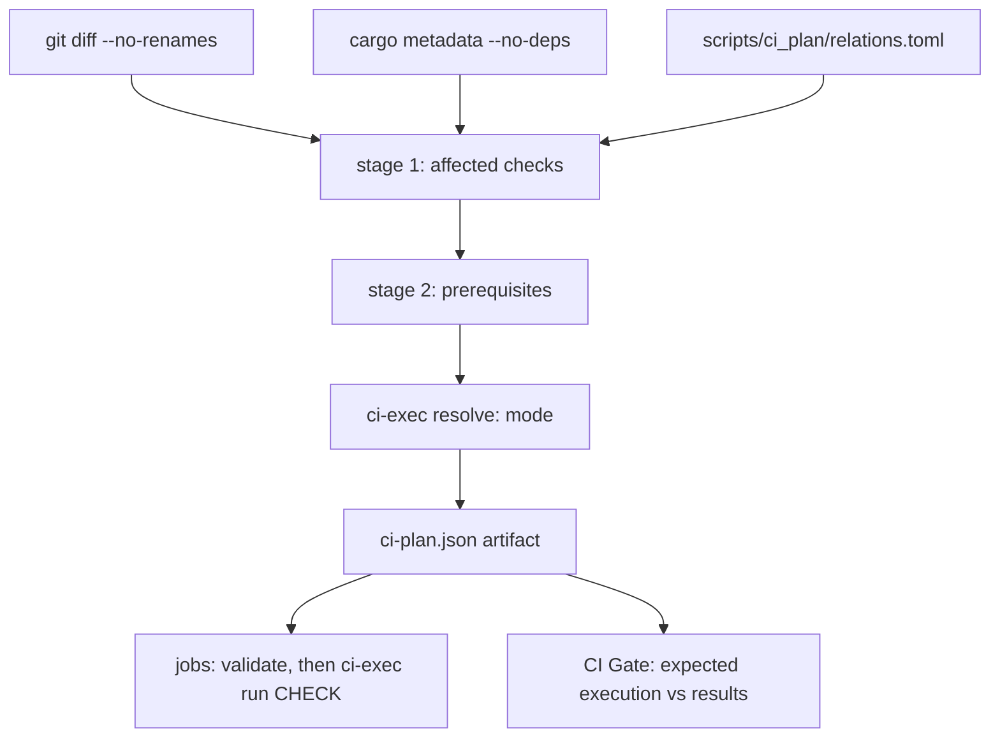

# Continuous integration

This page explains how Bookclerk's CI decides what to run: the execution
modes, the planner, each job, and the branch protection that ties them
together.

The workflow is `.github/workflows/ci.yml`. A **dependency-aware planner**
lets pull requests skip unrelated work, while `merge_group` always runs the
full suite. A push to `main`, which only advances through the merge queue,
compiles the full suite to refresh the dependency caches and runs no tests.

Fuzzing has its own page, [Fuzzing](fuzzing.md). The workflows outside the
pull-request checks (dependency updates, advisories, docs publishing and
Worker deploys) are in [Repository automation](automation.md).

## Selective CI

`SELECTIVE_CI` in `.github/workflows/ci.yml` selects the execution mode:

| Mode | When | What runs |
| --- | --- | --- |
| `full` | A `main` push, `merge_group`, or any fail-closed trigger | Every job and check at full scope (build only on a `main` push) |
| `shadow` | `SELECTIVE_CI != "1"` | Every job at full scope, with the selective prediction in the plan summary |
| `selective` | `SELECTIVE_CI == "1"` on a pull request | Only the predicted checks, each with its prerequisites |

Full-suite `merge_group` runs audit the selective coverage. A check that
fails there but was skipped on the pull request is a planner bug, and it
keeps the pull request out of `main`.

### Build-only `main` pushes

`main` only advances through the merge queue, and the queue's run already
tested that exact commit. So the push run resolves with `--build-only`
(`build_only: true` in the artifact):

- Only the jobs that save caches run: `check`, `test`, `native-gateway`
  and `release` (`BUILD_ONLY_JOBS` in `scripts/ci_plan/execute.py`). The
  gate expects every other job to be skipped.
- Builds, Clippy and installs run as usual. `cargo test` and the nextest
  run become `cargo test … --no-run`. Doctests, formatting, scripts,
  staging and runtime assertions are dropped.

Caches are saved only on `main`, because merge-group refs can't share
theirs. So this run is what keeps pull-request and queue runs warm.

A dependency cache key covers `Cargo.lock`, the manifests, the toolchain
and the CI environment, not the repository's own sources. An existing key
is never saved again, so most merges leave every key unchanged and their
build would save nothing.

To skip that wasted build, each build-only job first looks up its own key
(`lookup-only`, run only when `CI_BUILD_ONLY` is true):

- On a hit it sets `CI_SAVED_CACHE_CURRENT=true`, skips restoring the
  cache, and `ci-exec.py run` issues no commands.
- The Linux `native-gateway` child always skips, because the `test` job
  saves the Linux `debug` cache.
- A changed lockfile or toolchain, or an evicted cache, misses the lookup
  and builds as before.

`ci-exec.py` ignores the variable outside build-only runs, so it can never
skip a test.

### Test runner and retries

`rust_test` runs under [cargo-nextest](https://nexte.st/), installed pinned
in the `test` job. Tests from every binary share one parallel pool, rather
than `cargo test` running binaries one after another, and each test runs in
its own process.

- **Merge groups retry once.** A failed test is retried once
  (`MERGE_GROUP_TEST_RETRIES`). nextest marks a pass on retry `FLAKY` in
  its summary, and a test that fails twice fails the job. File an issue for
  every `FLAKY` line.
- **Pull requests never retry**, so a flaky test still shows up red where
  it can be fixed.

A merge group only needs to know whether it can land, so it fails fast.
nextest stops at the first test that fails its retry. The
`merge-queue-fail-fast` job cancels the rest of the run as soon as any job
fails, so `CI Gate` reports at once and the queue ejects the group without
waiting for the slowest job.

That job runs no repository code and is the only one with
`actions: write`. Pull requests run every selected test and job to the
end (nextest's `--no-fail-fast`, and no cancelling job), so one round shows
every failure among them.

Test targets with `harness = false` whose `main` doesn't answer libtest's
`--list` protocol would list zero tests under nextest. So they are excluded
from the nextest run and run with `cargo test --test`
(`CUSTOM_HARNESS_TESTS`). `scripts/tests/test_ci_contract.py` fails when a
new one isn't listed.

Locally, `cargo test --workspace` still runs everything. To reproduce
`ci-exec.py run rust_test`, install nextest:

```sh
cargo install cargo-nextest --locked
```

### Caches

Rust dependency caches use three shared keys. Each is saved by one job on
`main` and restored by the others:

- **`lint`**: saved by `check`.
- **`debug`**: saved by `test` on Linux and by `native-gateway` on macOS
  and Windows. Restored by `e2e`, `confinement`, `tray`, `postgres` and
  `windows-cluster`.
- **`release`**: saved by `release`, restored by `envelope`.

Fewer entries keep the repository under the Actions cache limit, so jobs
stop missing their cache.

The `test` job instruments its build for [coverage](#coverage) and still
uses the `debug` key: the instrumentation applies only to workspace crates,
which no cache holds, so the cached dependencies match. The build-only
`main` push that saves the key runs uninstrumented.

CI builds the dev and test profiles with
`CARGO_PROFILE_DEV_DEBUG=line-tables-only`. That keeps file and line in
panics while cutting link time and cache size. A failing test prints its
panic backtrace (`RUST_BACKTRACE=1`), and `RUST_LIB_BACKTRACE=0` keeps
error libraries such as `anyhow` from capturing one for every error they
build.

### Plan → execution contract



1. The `plan` job runs `scripts/ci-exec.py resolve`. It writes
   `ci-plan.json` (the schema version, run id, a fresh `execution_id`, the
   checked-out commit, the prediction and the resolved `execution`) and the
   job outputs that `if:` gates use, both from the same JSON.
2. Every downstream job downloads that artifact and runs
   `ci-exec.py validate` first. A missing, stale or foreign artifact fails
   the job.
3. Each check is one workflow step running `ci-exec.py run <check>`. The
   executor runs the check's prerequisites once per execution, in order
   (builds, pinned `workerd`, platform install, guest staging), then its
   commands.
4. `CI Gate` compares every job's result with `execution.jobs`. Expected
   jobs must succeed and unexpected jobs must be skipped; failures,
   cancellations, unexpected skips and unexpected runs all fail the gate.
   Because the gate uses the *execution*, not the prediction, shadow
   mode's intentional full runs pass.

Local reproduction uses the same entry points:

```sh
python3 scripts/ci-plan.py --paths crates/bookclerk-cli/src/main.rs --format summary
python3 scripts/ci-exec.py resolve --selective 1 --paths crates/bookclerk-cli/src/main.rs
python3 scripts/ci-exec.py show rust_test --run-id local   # print commands
python3 scripts/ci-exec.py run rust_test --run-id local    # run them
```

- Resolving again mints a new `execution_id` and starts a fresh execution.
  Prerequisite completion from the previous artifact isn't reused, even in
  the same temporary directory with the same commit and run id.
- Checks that share one artifact still run each prerequisite only once.
- `show` prints commands and doesn't record completion.

`scripts/tests/test_ci_contract.py` (PyYAML, hash-pinned in
`scripts/tests/requirements.txt`) fails when the workflow and the planner
could diverge:

- unknown or unused outputs;
- a check with zero or two steps;
- a job the gate doesn't see, or one that doesn't validate first;
- unpinned actions, or `continue-on-error`.

## Planner

```sh
python3 scripts/ci-plan.py --base <sha> --head <sha> --format summary
python3 scripts/tests/test_ci_plan.py        # planner + executor scenarios
python3 scripts/tests/test_ci_relations.py   # relations.toml guardrails
python3 scripts/tests/test_ci_contract.py    # workflow contract (needs PyYAML)
```

### Stage 1: affected checks

Each changed path is classified (a rename contributes its old and new
paths):

| Input | Effect |
| --- | --- |
| Package source (`src/`, `build.rs`, `Cargo.toml`, other package files) | The package is **compiled-affected** (see below) |
| `tests/**`, `benches/**`, `examples/**` in a package | The owner only, by target type |
| A **dev** edge to a compiled package | The consumer's tests, bench and example builds and doctests |
| A declared `embed` (such as the TS or Python SDK runtime in `bookclerk-workerd`) | The package is compiled-affected |
| A declared `test_input` | The consumer's tests |
| A declared `fixture` | The checks declared for that fixture |
| A declared `test_guests` executable | The launching package's tests re-run, with no propagation |
| `ui/`, `packages/plugin-sdk*/`, ABI scripts | The UI, SDK ABI and API-doc checks |
| `docs/**` | The website tests (`site_test`) |
| `tools/site/**`, `assets/brand/**` | The website tests and audit (`site_test`, `site_audit`) |
| `tools/diagnostics-collector/**` | The collector's tests (`collector_test`) |
| `tools/demo/**` and the files the demo copies | The hosted demo Worker's tests (`demo_test`) |
| Markdown, TypeScript, JavaScript, JSON, YAML or CSS anywhere (not lockfiles) | Formatting and Markdown lint (`lint`), on top of whatever else the file selects |
| `.prettierrc.json`, `.prettierignore`, `.markdownlint-cli2.jsonc`, `tools/lint/**` | Only `lint` |
| Root `Cargo.toml` or `Cargo.lock`, the toolchain, `.cargo/`, workflows, the planner, `fuzz/Cargo.*`, unknown paths, planner errors | **Full suite** |
| `fuzz/corpus/<target>/**`, `fuzz/oracles/<target>.rs` | The owning crate's tests |
| `fuzz/fuzz_targets/**`, `fuzz/dictionaries/**` | Nothing here |
| `packaging/docker/**`, `.dockerignore` | Nothing here |
| `.devcontainer/**`, `scripts/dev-env/**` | **Full suite** (unclassified) |
| `packaging/demo/**` | Nothing here |

Some rows need more detail:

- **Compiled-affected** packages propagate over **normal and build** edges
  to their compiled consumers. Optional edges count, because there is no
  feature resolution.
- **Owner-only paths** run `--tests`, `cargo bench --benches --no-run` or
  `cargo build --examples`, by target type.
- **Dev edges** are not propagated to the consumer's production consumers.
- **Fixtures** skip the owner's compile propagation.
- **`docs/**`** runs the site tests because their link check covers the
  docs the site publishes.
- **The demo copies** are `crates/bookclerkd/openapi.json`, the website's
  footer and fonts, and `ui/public/bookclerk-mark.svg`. The demo's route
  table must cover every operation, and the copies must match.
- **Fuzz corpora and oracles** are declared `test_input`. An undeclared
  corpus or oracle is unclassified.
- **"Nothing here"** paths are covered elsewhere. The ClusterFuzzLite
  workflows and the [Docker image](#other-workflows) workflow select
  themselves by path, and the demo image is built by the
  [demo deploy](automation.md#cloudflare-worker-deploys).
- **Dev Container paths** also select the
  [Dev Container image](#other-workflows) workflow by path.

A planner error still uses the normal full plan when metadata, relations
and the guest inventory are available; an unavailable diff is the usual
case. If those inputs are missing, `ci-exec.py resolve` fails instead of
publishing a plan with empty prerequisites.

`Cargo.lock` stays a full-suite trigger for now. Precision for dependency
updates can follow.

### Stage 2: prerequisites

Every selected check lists what a clean runner needs, with a reason:

- **`rust_test`**: `cargo build -p` for executables its packages' tests
  launch (`test_guests`), plus pinned `workerd` when they spawn through it.
  Tests run with `BOOKCLERK_REQUIRE_TEST_GUESTS=1`, so a missing guest
  fails instead of skipping.
- **`e2e`**: the jail, the launcher, the native guests in scope, pinned
  `workerd`, `cargo install-platform --skip-build`, and
  `cargo stage-plugins --plugin <id>…` (or `--optional --examples` for the
  full installation). It runs `bookclerk-plugin-e2e`
  (`--lib --test staged_plugins --test installed_plugin_path`; never
  `native_gateway`) with `BOOKCLERK_REQUIRE_STAGED_PLUGINS=1`.
- **`postgres` `rpc_like`**: the postgres guest, the launcher, the jail and
  pinned `workerd`.
- **`native_gateway`**: `cargo build -p bookclerk-jail -p bookclerk-workerd`
  and pinned `workerd` only, with no platform install, staging, database
  services or app build. The fixture guest is a bin target of
  `bookclerk-plugin-e2e`, so `cargo test --test native_gateway` builds it.
- **`windows_cluster`**: `cargo build -p bookclerk-plugin-database-sqlite
  -p bookclerk-jail -p bookclerk-workerd` and pinned `workerd`, then the
  existing identity filters and
  `cargo test -p bookclerk-cli --test cluster_secret_startup`. The CLI
  target still sets `plugins.isolation = "required"` and keeps its
  assertions, and `BOOKCLERK_REQUIRE_TEST_GUESTS=1` is set for it.

Prerequisites never select suites. Building the sqlite guest for host tests
doesn't select sqlite's own tests or E2E.

### Staged E2E scope

`bookclerk-plugin-e2e` owns the staged-installation suite. The ordinary
test step excludes it (`--exclude bookclerk-plugin-e2e` on the full suite).

- **Full.** A direct source change in a `staged_e2e.full_packages` package
  (dev, manifest, abi, workerd, jail, sandbox, the e2e crate), an inventory
  manifest (`crates/bookclerk-plugins/*/*/plugin.toml`,
  `examples/plugins-*/plugin.toml`), host discovery, registry or install
  preflight, or the full suite.
- **Subsets.** Each compiled-affected guest package adds its id. Changed
  non-Cargo example guests add theirs. The workerd SDK runtime embed adds
  every workerd-runtime guest. Shared host runtime changes add the
  `runtime_smoke` guests (native Rust, workerd TS, workerd Python).
- **Combination.** Full wins over subsets, subsets are unioned, and
  prerequisites add nothing. Platform guests (`sqlite`, `local`) are always
  installed and checked.

An embedded SDK change marks `bookclerk-workerd` affected *through the
embed*, so it selects the workerd-runtime subset, not the full
installation. A change under `crates/bookclerk-workerd/src/` is a direct
source change and selects full.

### Declarations (`scripts/ci_plan/relations.toml`)

This file is the only handwritten graph. It holds the relationships
`cargo metadata` can't describe, and doesn't restate the workspace
dependency graph:

- embedded assets;
- cross-package test inputs and fixtures;
- executables that tests launch;
- feature-specific test runs and postgres step owners;
- E2E scope rules and platform-job membership;
- release packaging inputs.

`scripts/tests/test_ci_relations.py` is a **guardrail, not a completeness
guarantee**. It recognizes literal `include_str!` / `include_bytes!` paths,
Rust string literals that resolve to another package or repository path,
and workspace binary names in `tests/`. Each must be declared, related
through Cargo, under a full-suite path, or listed in `[[reviewed]]` with a
reason.

> [!WARNING]
> Computed paths, macro-generated includes and dynamically discovered
> fixtures are **not** detected. Declare them, or rely on the conservative
> fallbacks.

Postgres tests only run in the `postgres` check, through the name filters
of `POSTGRES_STEPS` in `scripts/ci_plan/execute.py`.
`scripts/tests/test_ci_contract.py` finds every Postgres-gated test: an
`#[ignore]` reason naming Postgres, or a body that reads
`BOOKCLERK_TEST_POSTGRES_URL` directly or through a helper in the same
package. It fails when no step filter matches the test's function name, or
when a step matches no test. Name such tests `postgres_*`.

## Jobs

| Job | Runs when | Checks |
| --- | --- | --- |
| `plan` | Always | Planner, executor, contract and guardrail tests; DB isolation and docs lints; `resolve`; the `ci-plan` artifact |
| `fmt / clippy / docs` | Any of its checks is selected | `lint`, `ui`, `plugin_sdk_abi`, `python_sdk`, `author_surface`, `fmt`, `clippy`, `clippy_publish`, `api_docs`, `doctest`, `store_free` |
| `unit + integration tests` | `rust_test` is selected | nextest over the affected packages (the workspace on the full suite), custom-harness targets, feature test runs, bench and example builds |
| `staged plugin installation (e2e)` | `e2e` is selected | Builds, installs and stages the guests in scope, then the `bookclerk-plugin-e2e` staged targets |
| `release build` | A shipped binary (hosts, helpers, platform guests) is compiled-affected | See [Release build](#release-build) |
| `sandbox + jailed tiers` (3 OS) | sandbox, jail, media or media-worker is affected | Clippy and enforcement tests (Windows `--test-threads=1`) |
| `native-behind-workerd gateway` (3 OS) | See [the gateway job](#native-behind-workerd-gateway-job) | The four `native_gateway` targets, plus per-OS extras |
| `tray` (3 OS) | `bookclerk-tray` is affected | Clippy and tests |
| `postgres 16/17/18` | An owning package's unit tests are affected | Only the owners' steps, on every supported major |
| `windows cluster startup + identity` | A `[windows_cluster].paths` input changed, or the full suite | See [Windows cluster](#windows-cluster-startup-and-identity) |
| `small-VPS envelope` | An `[envelope].paths` input changed, an `[envelope].packages` member is compiled-affected, or the full suite | See [Small-VPS envelope](#small-vps-envelope) |
| `website + collector Workers` | See [Workers](#website-and-collector-workers) | `site_test`, `site_audit`, `collector_test`, `demo_test`; no Rust toolchain |
| `CI Gate` | Always | The stable required check (see the [contract](#plan--execution-contract)) |

The postgres owners are the library, the db guest, the postgres guest and
the plugin host's RPC `LIKE`.

### Formatting and Markdown lint

The `lint` check needs no Rust toolchain. It installs `tools/lint` (pinned
Prettier and markdownlint-cli2) and runs both from the repository root:

- **Prettier** checks TypeScript, JavaScript, JSON, YAML and CSS against
  `.prettierrc.json`. `.prettierignore` leaves out Markdown, HTML (page
  templates whose whitespace reaches the output), lockfiles, generated
  files, byte-identical mirrors, fuzz or test corpora, and the build output
  that nested `.gitignore` files hide.
- **markdownlint** checks every Markdown file against
  `.markdownlint-cli2.jsonc`, which relaxes the rules that fight GitHub-first
  docs (see [Writing docs](writing-docs.md#markdown-lint)).

Each language's own linter runs in its own check: oxlint in `ui`, the
TypeScript SDK and the three Workers, and `ruff check` plus
`ruff format --check` in `python_sdk`.

To fix formatting locally:

```console
$ npm ci --prefix tools/lint
$ node tools/lint/node_modules/prettier/bin/prettier.cjs --write .
$ node tools/lint/node_modules/markdownlint-cli2/markdownlint-cli2-bin.mjs --fix
```

### Release build

The release job runs at one of two scopes:

- **`affected`**: `cargo build --release -p <affected shipped>`.
- **`full`**: `build-app --release --platform` plus helper layout
  assertions. It runs when a packaging input changes (`bookclerk-dev`, the
  workerd pins, the platform manifests) or on the full suite.

### Native-behind-workerd gateway job

The job runs when any of these hold:

- a `[native_gateway].packages` member (plugin-host, workerd, plugin-sdk,
  sandbox, jail, the e2e crate) is in the Cargo-compiled closure;
- a `[native_gateway].paths` smoke input changed;
- it is the full suite.

On every OS it runs
`cargo test -p bookclerk-plugin-e2e --test native_gateway --test native_gateway_isolation --test native_gateway_lifecycle --test native_gateway_authenticated_endpoint`
(see [the smoke](#native-behind-workerd-gateway-smoke) below).

- **Windows** first adds Clippy on workerd, the SDK `http` feature, the
  host `--lib`, the workerd lib tests (inherited `handle:` `SOCKET_PROXY`),
  and the lifecycle churn test alone.
- **macOS** adds the workerd lib tests.

### Windows cluster startup and identity

On `windows-latest` only, the job runs identity create, restart and
binding, and different-cluster rejection. Then it runs the full
`cluster_secret_startup` target with the sqlite guest, the jail,
`bookclerk-workerd` and pinned `workerd`.

### Small-VPS envelope

The job checks that Bookclerk fits a small VPS. Its paths are the harness,
the seed, the search rebuild, the library book page and the books HTTP
handler.

1. On the `ubuntu-latest` VM, it release-builds the hosts and compiles the
   seed.
2. `docker run --memory=1g --memory-swap=1g --cpus=1` runs the seed, the
   daemon and the load in an Ubuntu container of the runner's own release
   (`ubuntu:<VERSION_ID>` from `/etc/os-release`, or `ubuntu:24.04` on a
   non-Ubuntu host), because the hosts link the runner's glibc and libssl.
3. On failure, it uploads `bookclerkd-envelope.log` with the metrics.

`small-vps.sh` reads `memory.max` and `cpu.max`, and refuses to record
numbers when they are `max` or looser than 1 GiB and one core. It drops the
build and object file cache, and writes `envelope-metrics.json` even when a
later step fails.

What is gated:

- Books routes must return 200, and `q=Title` must hit the rebuilt index.
- Daemon anonymous memory stays under 256 MiB after idle and during the API
  windows. That is `RssAnon` when `/proc/<pid>/status` reports it,
  otherwise `memory.stat` `anon`, or `memory.current` when anon is absent.

What is only recorded:

- `memory.peak`. The container can't reset it, so the lifetime peak
  includes the seed.
- Latency.
- `available_parallelism` (the daemon's `logical_cpus`), separately from
  the affinity mask.

One `cpu.max` core means one media worker.

### Website and collector Workers

The job's checks are selected by path, with no Rust toolchain:

- **`site_test`**: `npm run typecheck` (strict `tsc --noEmit`),
  `npm run lint` (oxlint) and `npm test` in `tools/site`, covering the
  generator, the Worker and the
  docs link check. Selected by `tools/site/**`, `assets/brand/**` or
  `docs/**`.
- **`site_audit`**: `tsc` on the audit, then Lighthouse and axe-core on the
  built site (see [Website checks](automation.md#website-checks)).
  Selected by `tools/site/**` or `assets/brand/**`.
- **`collector_test`**: `npm run typecheck` (strict `tsc --noEmit`),
  `npm run lint` (oxlint) and `npm test` in
  `tools/diagnostics-collector`. Selected by its folder.
- **`demo_test`**: `npm run typecheck` (strict `tsc --noEmit`),
  `npm run lint` (oxlint) and `npm test` in `tools/demo`.
  Selected by its folder.

The full suite runs all four.

`npm test` is Vitest in all three Workers, configured in each one's
`vitest.config.ts` with two projects:

- **`workers`** runs the Worker's tests inside the Workers runtime through
  `@cloudflare/vitest-plugin`, on the compatibility date in `wrangler.toml`.
  The collector and the demo test against real D1 databases with their
  `migrations/` applied. The site's Worker tests serve a real build, which
  a global setup makes in Node first.
- **`node`** runs what needs the host: the site's build and docs-tree
  tests, the demo's page-script tests and the collector's Python-oracle
  fuzz test.

`npm run coverage` adds V8 coverage from both projects (`text-summary` and
`lcov` under `coverage/`). CI runs it in place of `npm test` to feed the
[coverage](#coverage) report.

### Other workflows

These run outside `CI Gate`:

- **OSV scanning** is a separate workflow and gate. A green OSV job that
  applies [`osv-scanner.toml`](../../osv-scanner.toml) `IgnoredVulns`
  means **zero unignored, actionable** findings, not that ignored
  advisories have left the dependency graph. Each ignore must record
  reachability evidence and an `ignoreUntil` review date.
- **SQL-v1 property** (`.github/workflows/sql-v1-proptest.yml`) runs a
  longer `proptest` suite (`PROPTEST_CASES=256`) on `bookclerk-plugin-abi`
  and `bookclerk-db-exec`: grammar-aware sqlite admission, plus a
  PostgreSQL 16 differential (normalized `DbValue` / `DbErrorClass`). It
  runs on `workflow_dispatch` and weekly. Pull-request CI keeps the modest
  in-crate case counts, deterministic corpus replay, and the postgres
  matrix (binding UTF8 readiness and the sqlite/postgres differential).
- **Docker image** (`.github/workflows/docker-image.yml`) builds and
  smoke-tests the release image (see below).
- **Dev Container image** (`.github/workflows/devcontainer-image.yml`)
  builds and checks the contributor image (see below).
- **ABS Integration** (`.github/workflows/abs-integration.yml`) tests the
  `audiobookshelf` plugin against a real Audiobookshelf server (see below).

The Docker image job builds `packaging/docker/Dockerfile` and runs
`packaging/docker/smoke.sh`, which boots the image twice on one fresh
`/config` volume:

1. The first boot must install the bundled `sqlite` and `local` plugins
   and load the database guest under the default isolation.
2. The second must reinstall nothing.
3. The image must not override `BOOKCLERK_PLUGIN_ISOLATION` or
   `BOOKCLERK_MEDIA_ISOLATION`.

It is a full release build, so it runs weekly, on demand, and on pull
requests that touch the image or its startup install path:
`packaging/docker/**`, `.dockerignore`, the workflow, `bookclerk-dev`, the
platform plugin sources, the bundled-install, trust and ledger modules, the
database loader and the workerd pin.

The ABS Integration job (`.github/workflows/abs-integration.yml`) runs a
real Audiobookshelf server beside the production image with the
`audiobookshelf` plugin added
([`tests/abs-integration/`](../../tests/abs-integration/)). The plugin is
built from the checkout, so it does not get the host-implied grant to its
`base_url` that the crates.io package gets. The test sets it up the way an
operator would:

1. It approves the plugin through the consent API with a TCP grant to the
   server.
2. It sets `base_url`, `library_id` and the sealed `api_key` with
   `bookclerk plugins config set`, and deploys the plugin.
3. It checks `integrations test` and `integrations status`.
4. It redeems a claim ticket on the portal and signs in to the portal with
   Audiobookshelf credentials.
5. It starts a remote library scan.

Both containers share one network namespace, because the plugin accepts
plain `http` only for a loopback host. The job runs by hand, on a published
release, and on pull requests that change the test or the plugin. To run it
locally, build the images as its workflow does, then run:

```sh
bash tests/abs-integration/smoke.sh
```

The Dev Container image job builds `.devcontainer/Dockerfile` and runs the
contributor toolchain inside it as the dev user (cargo, rustfmt, Clippy,
cargo-nextest, `capnp`, Node.js, npm, uv, PyYAML, git, ssh). It runs
weekly, on demand, and on pull requests that touch `.devcontainer/**`,
`scripts/dev-env/**`, `scripts/tests/requirements.txt`,
`rust-toolchain.toml`, `.dockerignore` or the workflow.

`scripts/tests/test_dev_env.py` (in the plan job) checks on every run that
the image's tool pins match CI, and that every Dockerfile's base images are
tag and digest pinned, aligned, and covered by Dependabot.

### Native-behind-workerd gateway smoke

The smoke tests are `crates/bookclerk-plugin-e2e/tests/native_gateway.rs`,
plus `native_gateway_isolation.rs`, `native_gateway_lifecycle.rs` and
`native_gateway_authenticated_endpoint.rs`. They:

1. Install the test-only `native_gateway_probe` guest (an SDK-only bin of
   the e2e crate, never staged or packaged) into a temporary files folder.
2. Grant exactly one ephemeral loopback TCP port.
3. Spawn it through `PluginSession::spawn_with` with
   `Isolation::Required`.

The session goes through host discovery and launch planning, then two
sibling `bookclerk-jail` processes:

- `bookclerk-workerd` and pinned `workerd` in the gateway jail;
- the native backend in a deny-network sibling, joined by inherited duplex
  links. On Windows, that is two host-created AppContainers plus a session
  Job, with no named-pipe `SOCKET_PROXY`.

Against harness-held listeners, the tests assert that:

- describe, open and a real CLI entrypoint RPC answer through the front
  door;
- a unique payload round-trips through `bookclerk_plugin_sdk::net::connect`
  to the granted port;
- a second, live listener on an ungranted port is refused by policy
  (`403`) and is never dialed;
- a direct `std::net` connect from the guest to the live granted listener
  is blocked;
- both `gateway_pid()` and `guest_pid()` exit after drop, the host session
  folder is gone, and the guest can't read gateway state or the
  `WORKERD_GRANT_*` / `BOOKCLERK_JAIL_*` env;
- two concurrent sessions can't exercise each other's grants or gateway
  state (see [Concurrent sessions](#concurrent-sessions));
- a guest exit, a missing `workerd`, or a mid-session kill fails closed.

#### Concurrent sessions

After both sessions authenticate and complete a connect, `channel_ident`
through `cli_invoke` reports each configured tag. Those sessions don't
publish candidate-endpoint metadata, so `extra_status=not-run`. That status
isn't proof that the other session's endpoint is absent.

So a paired fixture keeps one pre-authenticated endpoint B, with its own
challenge (A's challenge isn't replayed onto B). It publishes the same
candidate metadata in both cases, through the same `cli_invoke` path:

- The normal launcher path doesn't preserve the test-only extra fd and
  doesn't list B's handles. The RPC reports `extra_status=absent`, because
  that slot is inaccessible.
- A live object at the slot that isn't the candidate is `ident-failed` (a
  numeric collision), not absence.
- When the fixture also transfers B through the guest jail handoff, the
  same RPC reports B's tag while A still answers.
- A transfer without the candidate metadata stays `not-run`, even though
  the endpoint was handed off.

On Windows the challenge is written with an event, so that guest end isn't
bound to the test process's I/O completion port. Binding it makes the
guest report `ident-failed` instead of the tag. Production spawn doesn't
add the slot, and a numeric fd or handle isn't identity.

#### Nothing skips

A missing helper, runtime or confinement backend, a startup failure or a
timeout fails the test.

- On Windows, `sequential_and_concurrent_spawn_cycles_do_not_leak` runs by
  itself before the suite. The suite runs it again in the original order,
  with `windows_job_extras_deny_the_next_direct_ping`.
- Smoke-only inputs (the four targets, `tests/native_gateway/` and the
  fixture guest source) select `native_gateway` but not the staged E2E
  suite.

## Coverage

CI Gate reports how much of a change its tests run. It is **report only**
for now: it writes a summary and warnings but never fails the gate.

Coverage is measured in the jobs that already run the tests, so it costs no
extra test run:

| Area | Measured by | Tool |
| --- | --- | --- |
| `rust` | `test` (`rust_test`) | [cargo-llvm-cov](https://github.com/taiki-e/cargo-llvm-cov), source-based LLVM coverage |
| `site`, `collector`, `demo` | Workers (`site_test`, `collector_test`, `demo_test`) | Vitest V8 coverage (`npm run coverage`) |
| `python-sdk` | `fmt / clippy / docs` (`python_sdk`) | pytest-cov |

How a run gets there:

1. The workflow sets `CI_COVERAGE_DIR` on those steps. With it set,
   `scripts/ci-exec.py` runs each check with coverage and writes
   `<dir>/<area>/lcov.info`. Unset (locally, by default), the checks run as
   before.
2. Each job uploads its reports as a `coverage-*` artifact. The plan job
   uploads the hunk headers of `git diff --unified=0 base...head` as
   `ci-patch`, because CI Gate checks out a single commit.
3. After comparing the job results, CI Gate downloads both and runs
   `scripts/coverage_gate.py`. It writes the summary to the job's step
   summary.

The summary has two figures:

- **Patch coverage**: of the executable lines the change adds, the share
  the tests ran. The target is 80%. Lines in an area this run did not
  measure, such as Rust on a docs-only change, are listed apart rather than
  counted.
- **Area floors**: each area's total line coverage against its floor in
  [`scripts/coverage_areas.toml`](../../scripts/coverage_areas.toml). A
  selective Rust run tests only the affected packages, so the `rust` floor
  is checked only when `rust_test` ran the whole workspace.

Floors ratchet. Raise an area's floor when its coverage rises, keeping it a
little below the measured value so noise does not fail a run. Never lower a
floor to make a change pass.

> [!NOTE]
> An unpublished OSV remediation run uploads no coverage and CI Gate skips
> the report. The diff and reports would show the bumped versions.

To check coverage before pushing, run a Worker's `npm run coverage`, or
pytest with `--cov=packages/plugin-sdk-python/src`. For Rust,
`cargo llvm-cov nextest -p <crate>` covers one crate; the whole workspace
needs a lot of disk.

### Codecov

The same reports also go to [Codecov](https://about.codecov.io/), which
comments on pull requests and posts `codecov/project` and `codecov/patch`
statuses. For now both statuses are informational, so they never fail a
commit.

The upload runs in its own workflow,
[`coverage-upload.yml`](../../.github/workflows/coverage-upload.yml), after
each CI run of a pull request or merge group finishes:

1. It runs from the default branch through `workflow_run`. CI keeps its
   read-only token, and fork pull requests upload too.
2. It downloads the run's `coverage-*` artifacts and plan, and runs
   `scripts/coverage_gate.py --export`. That rewrites each report through
   the gate's parser, keeping only repository-relative paths, line numbers
   and hit counts.
3. It uploads each area under its own flag, signing in to Codecov with
   OIDC, so there is no Codecov token secret. The commit, branch and pull
   request come from the CI run GitHub recorded, never from an artifact.

The upload never checks out the pull request. Its checkout is the default
branch, so it sends Codecov no file list and no line fixes from it. The
reports' paths are already repository-relative. A head branch name outside
a conservative character set skips the upload, because Codecov must never
file it under the default branch.

The settings live in [`.github/codecov.yml`](../../.github/codecov.yml).
Each area is a flag with carryforward, so a selective run that skips an
area keeps that area's last figure. A selective run that tests only some
Rust packages uploads under `rust-partial` instead of `rust`. That flag is
never carried forward, so the whole-workspace `rust` figure stays as it
was while the change's own lines are still measured. The patch target
matches CI Gate's.
A test checks that the flags, their paths and the target agree with
`scripts/coverage_areas.toml`.

Merge groups upload too. Their commit is the one that lands on `main`, so it
gives later pull requests their base.

> [!IMPORTANT]
> Uploads need the [Codecov GitHub App](https://github.com/apps/codecov)
> installed on the repository. Without it, the upload steps warn and the
> workflow still passes.

To make `codecov/patch` required later:

1. Remove its `informational: true` line in `.github/codecov.yml`.
2. Add `codecov/patch` to the default branch's ruleset, with the Codecov
   App as its source.

## Branch protection and the merge queue

Configure repository rulesets or branch protection so the **required** CI check is
**`CI Gate`** (plus the OSV check), **not** every matrix child.

> [!WARNING]
> Skipped `release`, `confinement`, `native-gateway` and `tray` jobs report
> `skipped`. If those job names are required individually, merges stay
> pending forever.

Also enable a merge queue that consumes `merge_group` checks, so the full
suite runs on the synthetic merge commit before landing. Merge queues are
only available on **organization-owned** repositories (free for public
repositories).

Queue settings:

- squash;
- "only merge non-failing pull requests";
- build concurrency around 5.

With a queue required, "require branches to be up to date" no longer
matters. The queue tests each entry against the current `main`, stacked on
the entries ahead of it.

## Expected pull-request feedback

With `SELECTIVE_CI=1`, a pull request should see these jobs after `plan`:

| Change | Jobs after `plan` | Notes |
| --- | --- | --- |
| `docs/**` only | Workers (`site_test` only), `fmt / clippy / docs` (`lint` only) | The site's link check covers the docs it publishes |
| `tools/site/**` only | Workers (`site_test`, `site_audit`), `fmt / clippy / docs` (`lint` only) | No Rust toolchain |
| `tools/diagnostics-collector/**` only | Workers (`collector_test`), `fmt / clippy / docs` (`lint` only) | No Rust toolchain |
| `tools/demo/**` only | Workers (`demo_test`), `fmt / clippy / docs` (`lint` only) | No Rust toolchain; `packaging/demo/**` selects nothing |
| `README.md`, `AGENTS.md`, other top-level prose, `config/config.example.toml`, `scripts/tests/**` | `fmt / clippy / docs` (`lint` only) for Markdown and JSON | The plan job runs the planner and lint tests on every event |
| `ui/**` only | `fmt / clippy / docs` (UI, UI API docs and `lint`) | No Rust toolchain checks |
| `crates/bookclerk-cli/src/**` | check, test (`-p bookclerk-cli`), release (`bookclerk-cli`) | No postgres, no E2E |
| `crates/bookclerk-plugin-host/src/**` | check, test (host and dependents), e2e (runtime smoke), release (hosts), native gateway (3 OS), postgres (`rpc_like` only) | No sandbox matrix |
| One optional guest (such as Libro) | check, test (guest tests), e2e (`libro` only) | Other storefronts are neither built nor staged |
| `packages/plugin-sdk/embed/**` | check (SDK ABI), test (workerd tests), e2e (workerd-runtime subset), release (launcher), native gateway (3 OS) | Not the full installation |

For `merge_group`, `--force-full` runs every job and check. A `main` push
adds `--build-only`.

## Next steps

- [Fuzzing](fuzzing.md): the fuzz targets and their own workflows.
- [Repository automation](automation.md): the workflows outside
  pull-request checks.
- [Dev Container](devcontainer.md): the environment that mirrors these
  checks locally.
