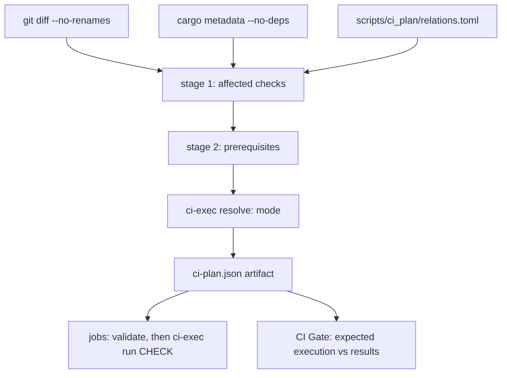

# Continuous integration

This page explains how Bookclerk's CI decides what to run: the execution
modes, the planner, each job, and the branch protection that ties them
together.

The workflow is `.github/workflows/ci.yml`. A **dependency-aware planner**
lets pull requests skip unrelated work, while `merge_group` always runs the
full suite. A push to `main`, which only advances through the merge queue,
compiles the full suite to refresh the dependency caches and runs no tests.

Fuzzing has its own page, [Fuzzing](fuzzing.md). The workflows outside the
pull-request checks (dependency updates, advisories, docs publishing and
Worker deploys) are in [Repository automation](automation.md).

## Selective CI

`SELECTIVE_CI` in `.github/workflows/ci.yml` selects the execution mode:

| Mode | When | What runs |
| --- | --- | --- |
| `full` | A `main` push, `merge_group`, or any fail-closed trigger | Every job and check at full scope (build only on a `main` push) |
| `shadow` | `SELECTIVE_CI != "1"` | Every job at full scope, with the selective prediction in the plan summary |
| `selective` | `SELECTIVE_CI == "1"` on a pull request | Only the predicted checks, each with its prerequisites |

Full-suite `merge_group` runs audit the selective coverage. A check that
fails there but was skipped on the pull request is a planner bug, and it
keeps the pull request out of `main`.

### Build-only `main` pushes

`main` only advances through the merge queue, and the queue's run already
tested that exact commit. So the push run resolves with `--build-only`
(`build_only: true` in the artifact):

- Only the jobs that save caches run: `check`, `test`, `native-gateway`
  and `release` (`BUILD_ONLY_JOBS` in `scripts/ci_plan/execute.py`), plus
  the [macOS job](#macos-job), which runs the `native-gateway` leg. The
  gate expects every other job to be skipped. The release job drops its
  envelope check (`BUILD_ONLY_SKIPPED_CHECKS`), which only measures, and
  runs a fat and a thin leg so both of its caches stay warm.
- Builds, Clippy and installs run as usual. `cargo test` and the nextest
  run become `cargo test … --no-run`. Doctests, formatting, scripts,
  staging and runtime assertions are dropped.

Caches are saved only on `main`, because merge-group refs can't share
theirs. So this run is what keeps pull-request and queue runs warm.

A dependency cache key covers `Cargo.lock`, the manifests, the toolchain
and the CI environment, not the repository's own sources. An existing key
is never saved again, so most merges leave every key unchanged and their
build would save nothing.

To skip that wasted build, each build-only job first looks up its own key
(`lookup-only`, run only when `CI_BUILD_ONLY` is true):

- On a hit it sets `CI_SAVED_CACHE_CURRENT=true`, skips restoring the
  cache, and `ci-exec.py run` issues no commands.
- The Linux `native-gateway` child always skips, because the `test` job
  saves the Linux `debug` cache.
- A changed lockfile or toolchain, or an evicted cache, misses the lookup
  and builds as before.

`ci-exec.py` ignores the variable outside build-only runs, so it can never
skip a test.

### Test runner and retries

`rust_test` runs under [cargo-nextest](https://nexte.st/), installed pinned
in the `test` job. Tests from every binary share one parallel pool, rather
than `cargo test` running binaries one after another, and each test runs in
its own process.

- **Merge groups retry once.** A failed test is retried once
  (`MERGE_GROUP_TEST_RETRIES`). nextest marks a pass on retry `FLAKY` in
  its summary, and a test that fails twice fails the job. File an issue for
  every `FLAKY` line.
- **Pull requests never retry**, so a flaky test still shows up red where
  it can be fixed.

A merge group only needs to know whether it can land, so it fails fast.
nextest stops at the first test that fails its retry. The
`merge-queue-fail-fast` job cancels the rest of the run as soon as any job
fails, so `CI Gate` reports at once and the queue ejects the group without
waiting for the slowest job.

That job runs no repository code and is the only one with
`actions: write`. Pull requests run every selected test and job to the
end (nextest's `--no-fail-fast`, and no cancelling job), so one round shows
every failure among them.

Test targets with `harness = false` whose `main` doesn't answer libtest's
`--list` protocol would list zero tests under nextest. So they are excluded
from the nextest run and run with `cargo test --test`
(`CUSTOM_HARNESS_TESTS`). `scripts/tests/test_ci_contract.py` fails when a
new one isn't listed.

Locally, `cargo test --workspace` still runs everything. To reproduce
`ci-exec.py run rust_test`, install nextest:

```sh
cargo install cargo-nextest --locked
```

### Caches

Rust dependency caches use three shared keys. Each is saved by one job on
`main` and restored by the others:

- **`lint`**: saved by `check`.
- **`debug`**: saved by `test` on Linux, by `native-gateway` on Windows
  and by the [macOS job](#macos-job) on macOS. Restored by `e2e`,
  `confinement`, `tray`, `postgres` and `windows-cluster`.
- **`release`**: saved by `release` (the job that also runs the
  envelope), once per LTO mode (see [Release build](#release-build)).

Fewer entries keep the repository under the Actions cache limit, so jobs
stop missing their cache.

The `test` job instruments its build for [coverage](#coverage) and still
uses the `debug` key: the instrumentation applies only to workspace crates,
which no cache holds, so the cached dependencies match. The build-only
`main` push that saves the key runs uninstrumented.

CI builds the dev and test profiles with
`CARGO_PROFILE_DEV_DEBUG=line-tables-only`. That keeps file and line in
panics while cutting link time and cache size. A failing test prints its
panic backtrace (`RUST_BACKTRACE=1`), and `RUST_LIB_BACKTRACE=0` keeps
error libraries such as `anyhow` from capturing one for every error they
build.

### Plan → execution contract



1. The `plan` job runs `scripts/ci-exec.py resolve`. It writes
   `ci-plan.json` (the schema version, run id, a fresh `execution_id`, the
   checked-out commit, the prediction and the resolved `execution`) and the
   job outputs that `if:` gates use, both from the same JSON.
2. Every downstream job downloads that artifact and runs
   `ci-exec.py validate` first. A missing, stale or foreign artifact fails
   the job.
3. Each check is one workflow step running `ci-exec.py run <check>`. The
   executor runs the check's prerequisites once per execution, in order
   (builds, pinned `workerd`, platform install, guest staging), then its
   commands.
4. `CI Gate` compares every job's result with `execution.jobs`. Expected
   jobs must succeed and unexpected jobs must be skipped; failures,
   cancellations, unexpected skips and unexpected runs all fail the gate.
   Because the gate uses the *execution*, not the prediction, shadow
   mode's intentional full runs pass.

Local reproduction uses the same entry points:

```sh
python3 scripts/ci-plan.py --paths crates/bookclerk-cli/src/main.rs --format summary
python3 scripts/ci-exec.py resolve --selective 1 --paths crates/bookclerk-cli/src/main.rs
python3 scripts/ci-exec.py show rust_test --run-id local   # print commands
python3 scripts/ci-exec.py run rust_test --run-id local    # run them
```

- Resolving again mints a new `execution_id` and starts a fresh execution.
  Prerequisite completion from the previous artifact isn't reused, even in
  the same temporary directory with the same commit and run id.
- Checks that share one artifact still run each prerequisite only once.
- `show` prints commands and doesn't record completion.
- `prereqs <check>` runs only the check's prerequisites. With
  `--github-env` it also exports the environment the check's commands run
  with (`PATH` with the built helpers first, `BOOKCLERK_WORKERD_BIN`), for
  a job that runs the tests its own way, such as
  [mutation testing](#mutation-testing).

`scripts/tests/test_ci_contract.py` (PyYAML, hash-pinned in
`scripts/tests/requirements.txt`) fails when the workflow and the planner
could diverge:

- unknown or unused outputs;
- a check with zero or two steps;
- a job the gate doesn't see, or one that doesn't validate first;
- unpinned actions, or `continue-on-error`.

## Planner

```sh
python3 scripts/ci-plan.py --base <sha> --head <sha> --format summary
python3 scripts/tests/test_ci_plan.py        # planner + executor scenarios
python3 scripts/tests/test_ci_relations.py   # relations.toml guardrails
python3 scripts/tests/test_ci_contract.py    # workflow contract (needs PyYAML)
```

### Stage 1: affected checks

Each changed path is classified (a rename contributes its old and new
paths):

| Input | Effect |
| --- | --- |
| Package source (`src/`, `build.rs`, `Cargo.toml`, other package files) | The package is **compiled-affected** (see below) |
| `tests/**`, `benches/**`, `examples/**` in a package | The owner only, by target type |
| A **dev** edge to a compiled package | The consumer's tests, bench and example builds and doctests |
| A declared `embed` (such as the TS or Python SDK runtime in `bookclerk-workerd`) | The package is compiled-affected |
| A declared `test_input` | The consumer's tests |
| A declared `fixture` | The checks declared for that fixture |
| A declared `test_guests` executable | The launching package's tests re-run, with no propagation |
| `ui/`, `packages/plugin-sdk*/`, ABI scripts | The UI, SDK ABI and API-doc checks |
| `docs/**` | The website tests (`site_test`) |
| `tools/site/**`, `assets/brand/**` | The website tests and audit (`site_test`, `site_audit`) |
| `tools/diagnostics-collector/**` | The collector's tests (`collector_test`) |
| `tools/demo/**` and the files the demo copies | The hosted demo Worker's tests (`demo_test`) |
| Markdown, TypeScript, JavaScript, JSON, YAML or CSS anywhere (not lockfiles) | Formatting and Markdown lint (`lint`), on top of whatever else the file selects |
| `.prettierrc.json`, `.prettierignore`, `.markdownlint-cli2.jsonc`, `tools/lint/**` | Only `lint` |
| Root `Cargo.toml` or `Cargo.lock`, the toolchain, `.cargo/`, workflows, the planner, `fuzz/Cargo.*`, unknown paths, planner errors | **Full suite** |
| `fuzz/corpus/<target>/**`, `fuzz/oracles/<target>.rs` | The owning crate's tests |
| `fuzz/fuzz_targets/**`, `fuzz/dictionaries/**` | Nothing here |
| `packaging/docker/**`, `.dockerignore` | Nothing here |
| `.devcontainer/**`, `scripts/dev-env/**` | **Full suite** (unclassified) |
| `packaging/demo/**` | Nothing here |

Some rows need more detail:

- **Compiled-affected** packages propagate over **normal and build** edges
  to their compiled consumers. Optional edges count, because there is no
  feature resolution.
- **Owner-only paths** run `--tests`, `cargo bench --benches --no-run` or
  `cargo build --examples`, by target type.
- **Dev edges** are not propagated to the consumer's production consumers.
- **Fixtures** skip the owner's compile propagation.
- **`docs/**`** runs the site tests because their link check covers the
  docs the site publishes.
- **The demo copies** are `crates/bookclerkd/openapi.json`, the website's
  footer and fonts, and `ui/public/bookclerk-mark.svg`. The demo's route
  table must cover every operation, and the copies must match.
- **Fuzz corpora and oracles** are declared `test_input`. An undeclared
  corpus or oracle is unclassified.
- **"Nothing here"** paths are covered elsewhere. The ClusterFuzzLite
  workflows and the [Docker image](#other-workflows) workflow select
  themselves by path, and the demo image is built by the
  [demo deploy](automation.md#cloudflare-worker-deploys).
- **Dev Container paths** also select the
  [Dev Container image](#other-workflows) workflow by path.

A planner error still uses the normal full plan when metadata, relations
and the guest inventory are available; an unavailable diff is the usual
case. If those inputs are missing, `ci-exec.py resolve` fails instead of
publishing a plan with empty prerequisites.

`Cargo.lock` stays a full-suite trigger for now. Precision for dependency
updates can follow.

### Stage 2: prerequisites

Every selected check lists what a clean runner needs, with a reason:

- **`rust_test`**: `cargo build -p` for executables its packages' tests
  launch (`test_guests`), plus pinned `workerd` when they spawn through it.
  Tests run with `BOOKCLERK_REQUIRE_TEST_GUESTS=1`, so a missing guest
  fails instead of skipping.
- **`e2e`**: the jail, the launcher, the native guests in scope, pinned
  `workerd`, `cargo install-platform --skip-build`, and
  `cargo stage-plugins --plugin <id>…` (or `--optional --examples` for the
  full installation). It runs `bookclerk-plugin-e2e`
  (`--lib --test staged_plugins --test installed_plugin_path`; never
  `native_gateway`) with `BOOKCLERK_REQUIRE_STAGED_PLUGINS=1`.
- **`postgres` `rpc_like`**: the postgres guest, the launcher, the jail and
  pinned `workerd`.
- **`native_gateway`**: `cargo build -p bookclerk-jail -p bookclerk-workerd`
  and pinned `workerd` only, with no platform install, staging, database
  services or app build. The fixture guest is a bin target of
  `bookclerk-plugin-e2e`, so `cargo test --test native_gateway` builds it.
- **`windows_cluster`**: `cargo build -p bookclerk-plugin-database-sqlite
  -p bookclerk-jail -p bookclerk-workerd` and pinned `workerd`, then the
  existing identity filters and
  `cargo test -p bookclerk-cli --test cluster_secret_startup`. The CLI
  target still sets `plugins.isolation = "required"` and keeps its
  assertions, and `BOOKCLERK_REQUIRE_TEST_GUESTS=1` is set for it.

Prerequisites never select suites. Building the sqlite guest for host tests
doesn't select sqlite's own tests or E2E.

### Staged E2E scope

`bookclerk-plugin-e2e` owns the staged-installation suite. The ordinary
test step excludes it (`--exclude bookclerk-plugin-e2e` on the full suite).

- **Full.** A direct source change in a `staged_e2e.full_packages` package
  (dev, manifest, abi, workerd, jail, sandbox, the e2e crate), an inventory
  manifest (`crates/bookclerk-plugins/*/*/plugin.toml`,
  `examples/plugins-*/plugin.toml`), host discovery, registry or install
  preflight, or the full suite.
- **Subsets.** Each compiled-affected guest package adds its id. Changed
  non-Cargo example guests add theirs. The workerd SDK runtime embed adds
  every workerd-runtime guest. Shared host runtime changes add the
  `runtime_smoke` guests (native Rust, workerd TS, workerd Python).
- **Combination.** Full wins over subsets, subsets are unioned, and
  prerequisites add nothing. Platform guests (`sqlite`, `local`) are always
  installed and checked.

An embedded SDK change marks `bookclerk-workerd` affected *through the
embed*, so it selects the workerd-runtime subset, not the full
installation. A change under `crates/bookclerk-workerd/src/` is a direct
source change and selects full.

### Declarations (`scripts/ci_plan/relations.toml`)

This file is the only handwritten graph. It holds the relationships
`cargo metadata` can't describe, and doesn't restate the workspace
dependency graph:

- embedded assets;
- cross-package test inputs and fixtures;
- executables that tests launch;
- feature-specific test runs and postgres step owners;
- E2E scope rules and platform-job membership;
- release packaging inputs.

`scripts/tests/test_ci_relations.py` is a **guardrail, not a completeness
guarantee**. It recognizes literal `include_str!` / `include_bytes!` paths,
Rust string literals that resolve to another package or repository path,
and workspace binary names in `tests/`. Each must be declared, related
through Cargo, under a full-suite path, or listed in `[[reviewed]]` with a
reason.

> [!WARNING]
> Computed paths, macro-generated includes and dynamically discovered
> fixtures are **not** detected. Declare them, or rely on the conservative
> fallbacks.

Postgres tests only run in the `postgres` check, through the name filters
of `POSTGRES_STEPS` in `scripts/ci_plan/execute.py`.
`scripts/tests/test_ci_contract.py` finds every Postgres-gated test: an
`#[ignore]` reason naming Postgres, or a body that reads
`BOOKCLERK_TEST_POSTGRES_URL` directly or through a helper in the same
package. It fails when no step filter matches the test's function name, or
when a step matches no test. Name such tests `postgres_*`.

## Jobs

| Job | Runs when | Checks |
| --- | --- | --- |
| `plan` | Always | Planner, executor, contract and guardrail tests; DB isolation and docs lints; `resolve`; the `ci-plan` artifact |
| `fmt / clippy / docs` | Any of its checks is selected | `lint`, `ui`, `plugin_sdk_abi`, `python_sdk`, `author_surface`, `fmt`, `clippy`, `clippy_publish`, `api_docs`, `doctest`, `store_free` |
| `unit + integration tests` | `rust_test` is selected | nextest over the affected packages (the workspace on the full suite), custom-harness targets, feature test runs, bench and example builds |
| `staged plugin installation (e2e)` | `e2e` is selected | Builds, installs and stages the guests in scope, then the `bookclerk-plugin-e2e` staged targets |
| `release build + small-VPS envelope (<lto> LTO)` | A shipped binary (hosts, helpers, platform guests) is compiled-affected (`release`), or an `[envelope].paths` input changed, an `[envelope].packages` member is compiled-affected, or the full suite (`envelope`) | Each selected check as its own step; see [Release build](#release-build) and [Small-VPS envelope](#small-vps-envelope) |
| `sandbox + jailed tiers` (Linux, Windows) | sandbox, jail, media or media-worker is affected | Clippy and enforcement tests (Windows `--test-threads=1`) |
| `native-behind-workerd gateway` (Linux, Windows) | See [the gateway job](#native-behind-workerd-gateway-job) | The four `native_gateway` targets, plus per-OS extras |
| `tray` (Linux, Windows) | `bookclerk-tray` is affected | Clippy and tests |
| `macOS (sandbox, gateway, tray)` | Any of the three jobs above runs | The macOS run of each of them, one step each; see [macOS job](#macos-job) |
| `postgres 16/17/18` | An owning package's unit tests are affected | Only the owners' steps, on every supported major |
| `windows cluster startup + identity` | A `[windows_cluster].paths` input changed, or the full suite | See [Windows cluster](#windows-cluster-startup-and-identity) |
| `website + collector Workers` | See [Workers](#website-and-collector-workers) | `site_test`, `site_audit`, `collector_test`, `demo_test`; no Rust toolchain |
| `CI Gate` | Always | The stable required check (see the [contract](#plan--execution-contract)) |

The postgres owners are the library, the db guest, the postgres guest and
the plugin host's RPC `LIKE`.

### Tool versions

The root [`.tool-versions`](../../.tool-versions) file is the one pin for
every tool version that crosses a boundary between workflows, images and
scripts:

| Pin | Read by | Bumped by |
| --- | --- | --- |
| `nodejs` (a major) | Every `actions/setup-node` step (`node-version-file`); the `node` images' tags | Hand, with the `node` image tags |
| `uv` | Every `astral-sh/setup-uv` step (`version-file`); the Dev Container's `ghcr.io/astral-sh/uv` image | `tool-versions-bump.yml` |
| `cargo-nextest` | The `unit + integration tests` job (through `scripts/tool_versions.py github-output`); `scripts/dev-env/provision.sh` | `tool-versions-bump.yml` |

`scripts/tests/test_dev_env.py` (in the `plan` job) fails when a workflow
sets one of these versions itself, or when a Dockerfile's `node` or uv image
disagrees with the file. A change to `.tool-versions` runs the full suite and
rebuilds the Dev Container image.

`scripts/tool_versions.py` parses the file strictly: exactly the pins above,
in that order, one `<tool> <version>` per line, no comments.
`actions/setup-node` reads the first line that looks like a version, so
`nodejs` stays first.

The daily `tool-versions-bump.yml` workflow takes the newest release of uv
and cargo-nextest that is at least 7 days old (the same cooldown as
Dependabot and the workerd pin). For uv it also resolves the image digest
and rewrites every Dockerfile that builds from the image. It opens one pull
request for every tool due that day, on the `deps/tool-versions` branch, with
the [automation App](automation.md#automation-app), and turns on auto-merge. Dependabot ignores the uv image and Node.js majors, so
the two never race.

> [!NOTE]
> The Rust toolchain keeps its own pin in `rust-toolchain.toml`, and the
> workerd binary in `crates/bookclerk-workerd/workerd-pin.json`. Base image
> digests shared by several Dockerfiles stay with Dependabot's grouped
> updates; `test_dev_env.py` checks they match.

### Formatting and Markdown lint

The `lint` check needs no Rust toolchain. It installs `tools/lint` (pinned
Prettier and markdownlint-cli2) and runs both from the repository root:

- **Prettier** checks TypeScript, JavaScript, JSON, YAML and CSS against
  `.prettierrc.json`. `.prettierignore` leaves out Markdown, HTML (page
  templates whose whitespace reaches the output), lockfiles, generated
  files, byte-identical mirrors, fuzz or test corpora, and the build output
  that nested `.gitignore` files hide.
- **markdownlint** checks every Markdown file against
  `.markdownlint-cli2.jsonc`, which relaxes the rules that fight GitHub-first
  docs (see [Writing docs](writing-docs.md#markdown-lint)).

Each language's own linter runs in its own check: oxlint in `ui`, the
TypeScript SDK and the three Workers, and `ruff check` plus
`ruff format --check` in `python_sdk`.

To fix formatting locally:

```console
$ npm ci --prefix tools/lint
$ node tools/lint/node_modules/prettier/bin/prettier.cjs --write .
$ node tools/lint/node_modules/markdownlint-cli2/markdownlint-cli2-bin.mjs --fix
```

### Release build

The release job runs at one of two scopes:

- **`affected`**: `cargo build --release -p <affected shipped>`.
- **`full`**: `build-app --release --platform` plus helper layout
  assertions. It runs when a packaging input changes (`bookclerk-dev`, the
  workerd pins, the platform manifests) or on the full suite.

The release profile ships fat LTO with one codegen unit, which links on a
single core. On pull requests the job sets
`CARGO_PROFILE_RELEASE_LTO=thin`, which links in parallel and still checks
that the release build compiles. The merge queue and OSV remediation runs
keep fat LTO, so the build and the envelope that gate `main` use the
binaries we ship.

Cargo recompiles dependencies when the LTO mode changes, and the cache key
covers every `CARGO*` variable, so each mode has its own `release` cache.
The job is a matrix over the mode: one `thin` leg on a pull request, one
`fat` leg in the merge queue, and both on the build-only `main` push, which
seeds the two caches. Each leg skips its build there when its cache is
already current. On a 4-core machine a warm thin build of `bookclerkd` took
about 10 minutes against 17 for fat; a thin build without its own cache
gains nothing.

### Native-behind-workerd gateway job

The job runs when any of these hold:

- a `[native_gateway].packages` member (plugin-host, workerd, plugin-sdk,
  sandbox, jail, the e2e crate) is in the Cargo-compiled closure;
- a `[native_gateway].paths` smoke input changed;
- it is the full suite.

On every OS (on macOS, as a step of the [macOS job](#macos-job)) it runs
`cargo test -p bookclerk-plugin-e2e --test native_gateway --test native_gateway_isolation --test native_gateway_lifecycle --test native_gateway_authenticated_endpoint`
(see [the smoke](#native-behind-workerd-gateway-smoke) below).

- **Windows** first adds Clippy on workerd, the SDK `http` feature, the
  host `--lib`, the workerd lib tests (inherited `handle:` `SOCKET_PROXY`),
  and the lifecycle churn test alone.
- **macOS** adds the workerd lib tests.

### Windows cluster startup and identity

On `windows-latest` only, the job runs identity create, restart and
binding, and different-cluster rejection. Then it runs the full
`cluster_secret_startup` target with the sqlite guest, the jail,
`bookclerk-workerd` and pinned `workerd`.

### Small-VPS envelope

The check makes sure Bookclerk fits a small VPS. Its paths are the harness,
the seed, the search rebuild, the library book page and the books HTTP
handler. It runs in the release job, after the release build step when both
are selected, so the hosts are compiled once per run.

1. On the `ubuntu-latest` VM, `install-platform --release` builds what the
   release step did not (all of it when only the envelope is selected), and
   the seed is compiled.
2. `docker run --memory=1g --memory-swap=1g --cpus=1` runs the seed, the
   daemon and the load in an Ubuntu container of the runner's own release
   (`ubuntu:<VERSION_ID>` from `/etc/os-release`, or `ubuntu:24.04` on a
   non-Ubuntu host), because the hosts link the runner's glibc and libssl.
3. On failure, it uploads `bookclerkd-envelope.log` with the metrics.

`small-vps.sh` reads `memory.max` and `cpu.max`, and refuses to record
numbers when they are `max` or looser than 1 GiB and one core. It drops the
build and object file cache, and writes `envelope-metrics.json` even when a
later step fails.

What is gated:

- Books routes must return 200, and `q=Title` must hit the rebuilt index.
- Daemon anonymous memory stays under 256 MiB after idle and during the API
  windows. That is `RssAnon` when `/proc/<pid>/status` reports it,
  otherwise `memory.stat` `anon`, or `memory.current` when anon is absent.

What is only recorded:

- `memory.peak`. The container can't reset it, so the lifetime peak
  includes the seed.
- Latency.
- `available_parallelism` (the daemon's `logical_cpus`), separately from
  the affinity mask.

One `cpu.max` core means one media worker.

### Website and collector Workers

The job's checks are selected by path, with no Rust toolchain:

- **`site_test`**: `npm run typecheck` (strict `tsc --noEmit`),
  `npm run lint` (oxlint) and `npm test` in `tools/site`, covering the
  generator, the Worker and the
  docs link check. Selected by `tools/site/**`, `assets/brand/**` or
  `docs/**`.
- **`site_audit`**: `tsc` on the audit, then Lighthouse and axe-core on the
  built site (see [Website checks](automation.md#website-checks)).
  Selected by `tools/site/**` or `assets/brand/**`.
- **`collector_test`**: `npm run typecheck` (strict `tsc --noEmit`),
  `npm run lint` (oxlint) and `npm test` in
  `tools/diagnostics-collector`. Selected by its folder.
- **`demo_test`**: `npm run typecheck` (strict `tsc --noEmit`),
  `npm run lint` (oxlint) and `npm test` in `tools/demo`.
  Selected by its folder.

The full suite runs all four.

`npm test` is Vitest in all three Workers, configured in each one's
`vitest.config.ts` with two projects:

- **`workers`** runs the Worker's tests inside the Workers runtime through
  `@cloudflare/vitest-plugin`, on the compatibility date in `wrangler.toml`.
  The collector and the demo test against real D1 databases with their
  `migrations/` applied. The site's Worker tests serve a real build, which
  a global setup makes in Node first.
- **`node`** runs what needs the host: the site's build and docs-tree
  tests, the demo's page-script tests and the collector's Python-oracle
  fuzz test.

`npm run coverage` adds V8 coverage from both projects (`text-summary` and
`lcov` under `coverage/`). CI runs it in place of `npm test` to feed the
[coverage](#coverage) report.

### Other workflows

These run outside `CI Gate`:

- **CodeQL** (see [CodeQL](#codeql) below) feeds the repository's code
  scanning merge rule.
- **OSV scanning** is a separate workflow and gate. A green OSV job that
  applies [`osv-scanner.toml`](../../osv-scanner.toml) `IgnoredVulns`
  means **zero unignored, actionable** findings, not that ignored
  advisories have left the dependency graph. Each ignore must record
  reachability evidence and an `ignoreUntil` review date.
- **SQL-v1 property** (`.github/workflows/sql-v1-proptest.yml`) runs a
  longer `proptest` suite (`PROPTEST_CASES=256`) on `bookclerk-plugin-abi`
  and `bookclerk-db-exec`: grammar-aware sqlite admission, plus a
  PostgreSQL 16 differential (normalized `DbValue` / `DbErrorClass`). It
  runs on `workflow_dispatch` and weekly. Pull-request CI keeps the modest
  in-crate case counts, deterministic corpus replay, and the postgres
  matrix (binding UTF8 readiness and the sqlite/postgres differential).
- **Docker image** (`.github/workflows/docker-image.yml`) builds and
  smoke-tests the release image (see below).
- **Dev Container image** (`.github/workflows/devcontainer-image.yml`)
  builds and checks the contributor image (see below).
- **ABS Integration** (`.github/workflows/abs-integration.yml`) tests the
  `audiobookshelf` plugin against a real Audiobookshelf server (see below).

### CodeQL

[`.github/workflows/codeql.yml`](../../.github/workflows/codeql.yml) runs
CodeQL's default query suite on GitHub Actions workflows,
JavaScript/TypeScript, Python and Rust, each in build mode `none`. The
repository's "CodeQL results" merge rule reads its analyses. GitHub's
default setup for code scanning must be off, or the uploads are refused.

Rust takes about 20 minutes on a hosted runner, and CodeQL has no
incremental analysis for Rust yet (tracked in
[#585](https://github.com/Bookclerk/bookclerk/issues/585)). Rust can't be
left out of a pull request either: the "CodeQL results" merge rule reports
a pull request without `/language:rust` as neutral, "1 configuration not
found", and that blocks the merge. So a pull request that changes no Rust
input reuses `main`'s Rust results instead:

1. The `Choose languages` job diffs the merge commit against its base
   (`git diff -z --no-renames --name-only`).
2. [`scripts/codeql_languages.py`](../../scripts/codeql_languages.py)
   treats a path as a Rust input when it is a `.rs` file, a `.capnp` or
   `.proto` schema that a build script compiles into Rust, a `Cargo.toml`,
   `Cargo.lock`, `rust-toolchain.toml`, anything under a `.cargo/`
   directory at any depth, the workflow, or the scripts that choose and
   reuse. A name that isn't UTF-8 also counts. A test fails when a
   `build.rs` reads a file the chooser doesn't count, because CodeQL runs
   build scripts even in build mode `none`.
3. Before allowing reuse, it scans the merge commit's tracked `.rs` files.
   A path also counts when a Rust source embeds it with `include_str!`,
   `include_bytes!` or `include!` (a `plugin.toml`, the brand logo, the
   SDK files `bookclerk-workerd` injects, even `ci.yml`), or when it sits
   in a crate with a `build.rs`. An include whose path it can't resolve
   turns reuse off for every pull request until the scanner learns that
   form. With no Rust input, it sets the `reuse-rust` output.
4. `Analyze (<language>)` runs once per language, always all four.
5. With `reuse-rust` set, `Analyze (rust)` runs
   [`scripts/codeql_reuse.py`](../../scripts/codeql_reuse.py). It looks
   for a `codeql.yml` run on `main` for exactly the merge commit's base
   parent, started by a push, the schedule or a manual run, whose
   `Analyze (rust)` job succeeded. It downloads that run's
   `codeql-rust-sarif` artifact and checks that it is CodeQL Rust SARIF.
   The job then uploads it with category `/language:rust`.
6. If any of that fails, the job analyzes Rust as usual. That happens, for
   example, when `main`'s run for the base commit is still going.

The reused results match `main`'s analysis of the base commit, so code
scanning reports no new and no fixed Rust alerts. A real analysis would
report the same, because nothing it reads changed. The job matrix stays
the same either way, because code scanning records the matrix values with
each analysis and a pull request has to match `main`'s configuration.

Pushes to `main`, the Monday schedule and manual runs analyze every
language, and the Rust job keeps its SARIF as the `codeql-rust-sarif`
artifact for 30 days. The Rust extractor's own cargo output (build
scripts and proc macros) is cached under
`codeql-rust-target-<rustc version>-<Cargo.lock hash>`: `main` saves it
and pull requests only restore it.

The file names are the pull request author's, so the chooser is an
untrusted-input boundary, fuzzed in
`scripts/tests/test_codeql_languages.py` (see
[Fuzzing](fuzzing.md#codeql-language-chooser-python)).

The Docker image job builds `packaging/docker/Dockerfile` and runs
`packaging/docker/smoke.sh`, which boots the image twice on one fresh
`/config` volume:

1. The first boot must install the bundled `sqlite` and `local` plugins
   and load the database guest under the default isolation.
2. The second must reinstall nothing.
3. The image must not override `BOOKCLERK_PLUGIN_ISOLATION` or
   `BOOKCLERK_MEDIA_ISOLATION`.

It is a full release build, so it runs weekly, on demand, and on pull
requests that touch the image or its startup install path:
`packaging/docker/**`, `.dockerignore`, the workflow, `bookclerk-dev`, the
platform plugin sources, the bundled-install, trust and ledger modules, the
database loader and the workerd pin.

The ABS Integration job (`.github/workflows/abs-integration.yml`) runs a
real Audiobookshelf server beside the production image with the
`audiobookshelf` plugin added
([`tests/abs-integration/`](../../tests/abs-integration/)). The plugin is
built from the checkout, so it does not get the host-implied grant to its
`base_url` that the crates.io package gets. The test sets it up the way an
operator would:

1. It approves the plugin through the consent API with a TCP grant to the
   server.
2. It sets `base_url`, `library_id` and the sealed `api_key` with
   `bookclerk plugins config set`, and deploys the plugin.
3. It checks `integrations test` and `integrations status`.
4. It redeems a claim ticket on the portal and signs in to the portal with
   Audiobookshelf credentials.
5. It starts a remote library scan.

Both containers share one network namespace, because the plugin accepts
plain `http` only for a loopback host. The job runs by hand, on a published
release, and on pull requests that change the test or the plugin. To run it
locally, build the images as its workflow does, then run:

```sh
bash tests/abs-integration/smoke.sh
```

The Dev Container image job builds `.devcontainer/Dockerfile` and runs the
contributor toolchain inside it as the dev user (cargo, rustfmt, Clippy,
cargo-nextest, `capnp`, Node.js, npm, uv, PyYAML, git, ssh). It runs
weekly, on demand, and on pull requests that touch `.devcontainer/**`,
`scripts/dev-env/**`, `scripts/tests/requirements.txt`,
`rust-toolchain.toml`, `.tool-versions`, `.dockerignore` or the workflow.

`scripts/tests/test_dev_env.py` (in the plan job) checks on every run that
the image's tool pins match CI and [`.tool-versions`](#tool-versions), and that every Dockerfile's base images are
tag and digest pinned, aligned, and covered by Dependabot.

### Native-behind-workerd gateway smoke

The smoke tests are `crates/bookclerk-plugin-e2e/tests/native_gateway.rs`,
plus `native_gateway_isolation.rs`, `native_gateway_lifecycle.rs` and
`native_gateway_authenticated_endpoint.rs`. They:

1. Install the test-only `native_gateway_probe` guest (an SDK-only bin of
   the e2e crate, never staged or packaged) into a temporary files folder.
2. Grant exactly one ephemeral loopback TCP port.
3. Spawn it through `PluginSession::spawn_with` with
   `Isolation::Required`.

The session goes through host discovery and launch planning, then two
sibling `bookclerk-jail` processes:

- `bookclerk-workerd` and pinned `workerd` in the gateway jail;
- the native backend in a deny-network sibling, joined by inherited duplex
  links. On Windows, that is two host-created AppContainers plus a session
  Job, with no named-pipe `SOCKET_PROXY`.

Against harness-held listeners, the tests assert that:

- describe, open and a real CLI entrypoint RPC answer through the front
  door;
- a unique payload round-trips through `bookclerk_plugin_sdk::net::connect`
  to the granted port;
- a second, live listener on an ungranted port is refused by policy
  (`403`) and is never dialed;
- a direct `std::net` connect from the guest to the live granted listener
  is blocked;
- both `gateway_pid()` and `guest_pid()` exit after drop, the host session
  folder is gone, and the guest can't read gateway state or the
  `WORKERD_GRANT_*` / `BOOKCLERK_JAIL_*` env;
- two concurrent sessions can't exercise each other's grants or gateway
  state (see [Concurrent sessions](#concurrent-sessions));
- a guest exit, a missing `workerd`, or a mid-session kill fails closed.

#### Concurrent sessions

After both sessions authenticate and complete a connect, `channel_ident`
through `cli_invoke` reports each configured tag. Those sessions don't
publish candidate-endpoint metadata, so `extra_status=not-run`. That status
isn't proof that the other session's endpoint is absent.

So a paired fixture keeps one pre-authenticated endpoint B, with its own
challenge (A's challenge isn't replayed onto B). It publishes the same
candidate metadata in both cases, through the same `cli_invoke` path:

- The normal launcher path doesn't preserve the test-only extra fd and
  doesn't list B's handles. The RPC reports `extra_status=absent`, because
  that slot is inaccessible.
- A live object at the slot that isn't the candidate is `ident-failed` (a
  numeric collision), not absence.
- When the fixture also transfers B through the guest jail handoff, the
  same RPC reports B's tag while A still answers.
- A transfer without the candidate metadata stays `not-run`, even though
  the endpoint was handed off.

On Windows the challenge is written with an event, so that guest end isn't
bound to the test process's I/O completion port. Binding it makes the
guest report `ident-failed` instead of the tag. Production spawn doesn't
add the slot, and a numeric fd or handle isn't identity.

#### Nothing skips

A missing helper, runtime or confinement backend, a startup failure or a
timeout fails the test.

- On Windows, `sequential_and_concurrent_spawn_cycles_do_not_leak` runs by
  itself before the suite. The suite runs it again in the original order,
  with `windows_job_extras_deny_the_next_direct_ping`.
- Smoke-only inputs (the four targets, `tests/native_gateway/` and the
  fixture guest source) select `native_gateway` but not the staged E2E
  suite.

## Coverage

CI Gate checks how much of a change its tests run. It fails when the
change's patch coverage is below 80% (`patch_target`) or an area falls below
its floor, and writes a summary either way. Setting `mode = "report"` in
`scripts/coverage_areas.toml` turns those failures back into warnings.

Coverage is measured in the jobs that already run the tests, so it costs no
extra test run:

| Area | Measured by | Tool |
| --- | --- | --- |
| `rust` | `test` (`rust_test`) | [cargo-llvm-cov](https://github.com/taiki-e/cargo-llvm-cov), source-based LLVM coverage |
| `site`, `collector`, `demo` | Workers (`site_test`, `collector_test`, `demo_test`) | Vitest V8 coverage (`npm run coverage`) |
| `python-sdk` | `fmt / clippy / docs` (`python_sdk`) | pytest-cov |

How a run gets there:

1. The workflow sets `CI_COVERAGE_DIR` on those steps. With it set,
   `scripts/ci-exec.py` runs each check with coverage and writes
   `<dir>/<area>/lcov.info`. Unset (locally, by default), the checks run as
   before.
2. Each job uploads its reports as a `coverage-*` artifact. The plan job
   uploads the hunk headers of `git diff --unified=0 base...head` as
   `ci-patch`, because CI Gate checks out a single commit.
3. After comparing the job results, CI Gate downloads both and runs
   `scripts/coverage_gate.py`. It writes the summary to the job's step
   summary.

The summary has two figures:

- **Patch coverage**: of the executable lines the change adds, the share
  the tests ran. The target is 80%. Lines in an area this run did not
  measure, such as Rust on a docs-only change, are listed apart rather than
  counted.
- **Area floors**: each area's total line coverage against its floor in
  [`scripts/coverage_areas.toml`](../../scripts/coverage_areas.toml). A
  selective Rust run tests only the affected packages, so the `rust` floor
  is checked only when `rust_test` ran the whole workspace.

Floors ratchet. After every successful merge group run, which measures
every area in full,
[`coverage-floors.yml`](../../.github/workflows/coverage-floors.yml) reads
that run's coverage and runs `scripts/coverage_gate.py --ratchet`:

1. Each floor rises to the area's measured coverage rounded down, less one
   point, so noise does not fail a run.
2. A floor rises by at most five points per run and never above 99.
3. A floor never falls. Lowering one stays a reviewed, hand-made change;
   never lower a floor to make a change pass.

When a floor rises, the workflow opens a `ci/coverage-floors` pull request
with the automation App and turns on auto-merge, so the merge queue lands
it once its checks pass. Turning on auto-merge gets four attempts, because
GitHub's API sometimes fails a single call. If all four fail, the run fails,
and the next merge to `main` tries again. While that pull request is open,
later rises update it rather than opening another. Floors move in whole points, so most
merges change nothing and the run ends after a few seconds. To run it by
hand, use **Run workflow** on the Actions tab; it then reads the latest
successful merge group run, whose coverage artifacts are kept for seven
days.

Generated files are left out of both figures. They are listed under
`generated` in the areas file, because tests exercise the generator rather
than each line it writes. A file that an area owns and that starts with a
generated-file header (`GENERATED FILE - do not edit`) must be on that
list, or a test fails. Add a new generated file there when its generator
lands.

> [!NOTE]
> An unpublished OSV remediation run uploads no coverage and CI Gate skips
> the report. The diff and reports would show the bumped versions.

To check coverage before pushing, run a Worker's `npm run coverage`, or
pytest with `--cov=packages/plugin-sdk-python/src`. For Rust,
`cargo llvm-cov nextest -p <crate>` covers one crate; the whole workspace
needs a lot of disk.

### Web API contract

The daemon's test build layers a check over its router
(`crates/bookclerkd/src/openapi_contract.rs`): every response the tests
produce is compared with the committed OpenAPI document. The route the
router matched, the method, the status and the media type must be
declared, and a JSON body must validate against the declared schema,
references followed and formats asserted. Each response is one JSON line
in `target/contract-report/<pid>.jsonl` (one file per test process, since
cargo-nextest runs each test in its own); the test job keeps the files
beside its coverage report and CI Gate runs
[`scripts/contract_coverage.py`](../../scripts/contract_coverage.py) over
them.

The step summary shows how many of the declared responses (route, status
and media type) the tests observed, in all and (in a fold) per tag, and lists every
disagreement: a status or media type the route does not declare, a body
that does not validate, a body that is not JSON, and a matched route the
document does not describe (an HTML page, such as the invite page or the
SPA, is served on purpose without one). A declared response nobody
observed is not a
finding yet; it marks a route the tests do not reach.

The step is enforced: a disagreement fails CI Gate, and so does an
observed share below the floor `[contract] floor` in
[`scripts/coverage_areas.toml`](../../scripts/coverage_areas.toml) states
(a percentage of the declared responses; raise it when the share rises,
keeping it a little below the measured value, and never lower it to make
a change pass). When no report file exists because the daemon's tests
did not run (a build-only main push, a selective run that did not test
the daemon's package, or a test job that failed or was cancelled before
writing one), the floor is not checked and the step prints one line
instead of adding an empty report to the summary; a failed or cancelled
test job fails CI Gate on its own. When the plan tested the daemon's
package, the test job succeeded and no report exists all the same, or a
report line is not a whole hit (a partial write), the gate fails too. The layer never fails a
test, so a disagreement shows up in CI Gate's summary, not in a test's
output.

A disagreement means the document and the daemon differ for one
response. For a route's own statuses, fix the `#[utoipa::path]`
declaration or the handler that is wrong: a status the handler answers
on purpose is declared (with a realistic example when the body is JSON),
and a handler that answers something its route should not is corrected.
The access layer's refusals (`401`, `403`, the second-factor enrollment
`403`), the CSRF `403`, the `504` timeout and the JSON extractor's
rejections are stated by the document builder
(`crates/bookclerkd/src/openapi.rs`), not by each route.

To see the report locally, start it empty (each test process appends a
file of its own, so an old run's hits would otherwise stay in it), run
the daemon's tests and the script:

```sh
rm -rf target/contract-report
cargo nextest run -p bookclerkd
python3 scripts/contract_coverage.py --reports target/contract-report --mode enforce
```

`BOOKCLERK_CONTRACT_REPORT_DIR` moves the report files elsewhere.

### Codecov

The same reports also go to [Codecov](https://about.codecov.io/), which
comments on pull requests and posts `codecov/project` and `codecov/patch`
statuses. Both statuses are informational: CI Gate is the coverage check
that blocks a merge, and it reports on every pull request.

The upload runs in its own workflow,
[`coverage-upload.yml`](../../.github/workflows/coverage-upload.yml), after
each CI run of a pull request or merge group finishes:

1. It runs from the default branch through `workflow_run`. CI keeps its
   read-only token, and fork pull requests upload too.
2. It downloads the run's `coverage-*` artifacts and plan, and runs
   `scripts/coverage_gate.py --export`. That rewrites each report through
   the gate's parser, keeping only repository-relative paths, line numbers
   and hit counts.
3. It uploads each area under its own flag, signing in to Codecov with
   OIDC, so there is no Codecov token secret. The commit, branch and pull
   request come from the CI run GitHub recorded, never from an artifact.

The upload never checks out the pull request. Its checkout is the default
branch, so it sends Codecov no file list and no line fixes from it. The
reports' paths are already repository-relative. A head branch name outside
a conservative character set skips the upload, because Codecov must never
file it under the default branch.

The settings live in [`.github/codecov.yml`](../../.github/codecov.yml).
Each area is a flag with carryforward, so a selective run that skips an
area keeps that area's last figure. A selective run that tests only some
Rust packages uploads under `rust-partial` instead of `rust`. That flag is
never carried forward, so the whole-workspace `rust` figure stays as it
was while the change's own lines are still measured. The patch target
matches CI Gate's, and Codecov ignores the same generated files. A test
checks that the flags, their paths, the target and the ignored files agree
with `scripts/coverage_areas.toml`.

Components give parts of the code that cut across flags their own figure
on the dashboard and in the comment: the security surface, the daemon, the
CLI, the plugins, the plugin SDKs and the Workers.

Merge groups upload too. Their commit is the one that lands on `main`, so it
gives later pull requests their base.

> [!IMPORTANT]
> Uploads need the [Codecov GitHub App](https://github.com/apps/codecov)
> installed on the repository. Without it, the upload steps warn and the
> workflow still passes.

To make `codecov/patch` required later:

1. Remove its `informational: true` line in `.github/codecov.yml`.
2. Add `codecov/patch` to the default branch's ruleset, with the Codecov
   App as its source.

### Test results

The test jobs that measure coverage also write a JUnit report beside each
LCOV report. The upload workflow sends them to Codecov Test Analytics, under
the same flags. Codecov then lists a pull request's failed tests in its
comment and, from merge group runs, finds tests that are flaky on `main`.

- Rust: the main nextest run uses the `ci` profile in
  [`.config/nextest.toml`](../../.config/nextest.toml), which writes
  `target/nextest/ci/junit.xml`. A workflow step copies it into the
  coverage directory, even when tests fail. Feature-test runs and
  custom-harness tests write no report.
- The Workers: Vitest's `junit` reporter, next to the coverage run.
- The Python SDK: pytest's `--junitxml`.

The test jobs upload their artifacts even when tests fail, so failures reach
Codecov. Like the coverage reports, the JUnit reports come from the pull
request's own run. `coverage_gate.py --export` reads each one with a fuzzed
parser and writes back only test names, durations, outcomes and failure
text.

### Bundle sizes

Codecov Bundle Analysis tracks the size of the web UI and of each
Cloudflare Worker script, and comments when a pull request changes one by
at least 1 KiB. That gives early notice before a Worker nears Cloudflare's
script size limit.

1. The `ui` check keeps `ui/dist` after its build. The Worker checks
   (`site_audit`, `collector_test`, `demo_test`) bundle each Worker with
   `wrangler deploy --dry-run --outdir`, the same bundling a deploy does,
   without deploying or needing an account. Each lands in
   `$CI_BUNDLE_DIR/<bundle>/`, uploaded as a `bundle-*` artifact.
2. The upload workflow downloads them. `coverage_gate.py --export --bundles`
   copies only regular files with safe names, known asset types and bounded
   sizes (`select_bundle_files`, a fuzzed boundary). Source maps are left
   out.
3. The pinned `@codecov/bundle-analyzer` in `tools/codecov`, installed
   without install scripts, sends each bundle's file names and sizes to
   Codecov, signed in with OIDC like the coverage uploads.

The bundle status is informational, like the coverage statuses; its
settings are under `bundle_analysis` in `.github/codecov.yml`.

## Mutation testing

Coverage shows which lines the tests run, not whether a test would notice
them doing the wrong thing. Mutation testing checks that: it makes a small
change to the code, such as flipping a comparison or making a function
return a default value, and runs the tests. If a test fails, the mutant is
**caught**. If every test still passes, the mutant is **missed**: nothing
checks that behavior, so a real bug there would slip through too.

Mutation testing is slow, so it does not run on pull requests. Three
workflows run it once a day on `main` instead, each on the code merged
since its own last successful run:

- [`mutation.yml`](../../.github/workflows/mutation.yml) for Rust, at
  02:17 UTC.
- [`mutation-python.yml`](../../.github/workflows/mutation-python.yml) for
  the Python SDK, at 02:47 UTC.
- [`mutation-workers.yml`](../../.github/workflows/mutation-workers.yml)
  for the Workers, at 03:17 UTC.

Each run works like this:

1. [`scripts/mutation_base.py`](../../scripts/mutation_base.py) finds the
   commit the workflow's last successful scheduled run tested, through the GitHub
   API. A day with nothing merged, or a run that failed, is covered by the
   next run. If the API cannot be reached, the run fails rather than
   guess. With no earlier successful run, it falls back to the last commit
   from more than 25 hours ago, then to the parent of `HEAD`. Whatever it
   picks must be a full SHA and `HEAD` or one of its ancestors. When
   nothing merged since the last run, the range is empty and nothing is
   mutated.
2. The run diffs `main` against that commit and mutates only what changed,
   as described below for each language. The run number seeds every
   sample, so the choice changes from run to run.
3. The job summary lists what was tested and what was missed. A run that
   did not test its range fails, so the next run covers the same changes:
   the baseline failed, the tool exited with an error, or it left no
   results. A run stopped at its time limit, or early because the runner
   ran low on disk or memory, still succeeds with what it tested.
4. When a mutant was missed, the reusable
   [`mutation-issue.yml`](../../.github/workflows/mutation-issue.yml)
   workflow files the summary as an issue titled `Missed mutants: <area>`
   (`rust`, `python-sdk`, `site`, `demo` or `collector`), labelled
   `mutation-testing`. A later run with missed mutants in the same area
   comments on the open issue instead of opening another. Close the issue
   once the tests catch them.

The issue job holds the only write token in these workflows. It checks out
nothing and runs no repository code; it reads only the summaries the
mutants jobs uploaded.

To test a range by hand, run the workflow from the **Actions** tab and set
`base` to the commit to start from. Running it from a branch tests that
branch against `base`, which is how to try a change to the workflows
themselves. Only runs on `main` file issues, and a manual run never moves
the starting point of the next scheduled one.

### Rust

[cargo-mutants](https://mutants.rs/) tests the Rust code:

1. It mutates only the functions changed since the last run (`--in-diff`)
   in any workspace member (`--workspace`; without it cargo-mutants looks
   only at the default members), so the cost follows what merged. With no
   Rust file changed, the job builds nothing. Test code, the generated files and the
   staged-plugin harness (`bookclerk-plugin-e2e`, whose tests need the
   plugins CI's `e2e` check stages) are never mutated.
2. Mutants live only in function bodies, so a change to data that code
   reads (an attribute, a constant, a type definition) gives no mutants
   from the diff. When a changed Rust file gets none, the job mutates the
   functions in that file instead, so the tests of the code beside the
   changed data are still checked. The summary names those files. Up to 60
   of their mutants are all tested; past that, at most 60 spread across
   the files are (counting every mutant a chosen line brings in, such as
   its function's body replacements), and the choice changes with each
   run. Each file gets at least its smallest line while that fits.
   If every line alone brings in more than 60, the one that brings in the
   fewest is tested, so such a run can exceed 60. Each mutant runs its package's whole test suite, two minutes for some
   crates, so a large file would otherwise hold a runner for the whole
   time limit. Code in other files that reads the data is not covered.
3. Before the first mutant, the job builds what CI's `rust_test` check
   builds first (the jail, the workerd front door, the pinned workerd and
   the platform guests) with `ci-exec.py prereqs rust_test`, and turns on
   the same confinement enforcement as the test job. Tests that launch a
   helper then run instead of skipping.
4. Each mutant runs the tests of its own package under cargo-nextest.
5. The run stops after 4 hours and reports what it tested so far. It
   also stops early, the same way, when less than 3 GiB of disk is free or
   less than 768 MiB of memory stays available for two checks 15 seconds
   apart. A runner that runs out of either loses contact with GitHub, and
   the job then fails with no log and no results, so the next run would
   retry an even larger range. The job frees the preinstalled SDKs it never
   uses before it builds, logs the disk and memory left every 10 minutes,
   and the summary says why a run stopped early.

The job summary shows the share of mutants the tests caught and lists the
missed ones. The full results, with a log per mutant, are in the
`mutants-rust` artifact. A mutant that does not build (**unviable**) says
nothing about the tests and is left out of the score; one whose tests time
out counts as caught.

To fix a missed mutant, add a test that fails with the change it names, or
tighten an assertion that should already have caught it. To reproduce one
locally:

```sh
cargo install cargo-mutants --locked
git diff origin/main... > /tmp/change.diff
RUSTFLAGS=--cap-lints=warn cargo mutants --workspace --in-diff /tmp/change.diff
```

For a file the summary says was mutated whole, mutate all of it with
`--file`:

```sh
RUSTFLAGS=--cap-lints=warn cargo mutants --workspace --file crates/bookclerkd/src/api.rs
```

Capping lints keeps a mutant that only leaves a parameter unused from
failing to build under the crates' `deny` lints; the workflow caps them for
every build in the job. Settings live in
[`.cargo/mutants.toml`](../../.cargo/mutants.toml): nextest as the test
runner, the custom-harness test binaries CI runs with `cargo test` left
out of nextest, and the excluded files, whose generated entries must match
`generated` in `scripts/coverage_areas.toml`. Tests check both lists.

### Workers

The [`mutation-workers.yml`](../../.github/workflows/mutation-workers.yml)
workflow does the same for the Cloudflare Workers (`tools/site`,
`tools/demo` and `tools/diagnostics-collector`) with
[Stryker](https://stryker-mutator.io/), one job per Worker:

1. It finds the lines changed since the last run in the Worker's
   TypeScript sources: the lines added, and the line before each run of lines it deletes, so removing a
   guard counts as changing the code around it. That line can be a blank
   line or a closing brace with no mutant; when none of a file's changed
   lines has one, step 3 samples the file. Tests, test support, type
   declarations and configuration files are left out. A Worker with no
   changed source line skips Stryker, and its summary says so.
2. It passes those lines to Stryker as `--mutate path:start-end`. Stryker
   also mutates literals (strings, arrays, objects), so a change to data
   gets mutants too.
3. Some changes give no mutant at all: a type, an interface, an import or
   an export list. When a changed file's lines give none, a second pass
   mutates a sample of the file's other lines, so the tests of the code
   beside the change are still checked, as the Rust job does for data
   changes. The sample skips lines Stryker never mutates (types, imports,
   bare punctuation). At most 30 lines are sampled across those files,
   one per file first while the budget lasts, and the choice changes with
   each run. Stryker takes about five seconds a mutant here, so a
   whole file would not fit the time limit. The summary names the files
   and how many lines it sampled in each, or says when too little time was
   left for the second pass.
4. Each mutant runs the Vitest tests that cover it, including the ones
   that run inside the Workers runtime.
5. Both passes together stop after 40 minutes. The summary then counts the
   mutants tested before the limit and says the run was stopped.

The job summary and the `mutants-<worker>` artifact have the same shape as
the Rust job's, and missed mutants become a `site`, `demo` or `collector`
issue. Stryker
is installed for the run only, at the version pinned in the workflow, so
the Workers' lockfiles do not change. Settings live in
[`scripts/stryker.config.json`](../../scripts/stryker.config.json):

- `inPlace`, because some tests read repository files by relative path.
- A `tsconfigFile` that does not exist, because TypeScript 7 has no
  JavaScript API for Stryker's tsconfig rewriting. Type checking stays
  with each Worker's `npm run typecheck`.
- `vitest.related` off, because the Workers runtime loads modules outside
  Vitest's module graph, so Vitest cannot tell which tests import a file.
- `incremental`, writing to `reports/mutation/mutation.json`, because only
  incremental mode saves the mutants tested so far when the run is
  stopped. The second pass also mutates the first pass's lines, so their
  results carry over from that file without being tested again. The report
  step reads it.

To reproduce a Worker's run locally, from its directory:

```sh
npm install --no-save @stryker-mutator/core@10.1.1 @stryker-mutator/vitest-runner@10.1.1
npx stryker run ../../scripts/stryker.config.json --mutate "src/page.ts:10-20"
```

The report lands in `reports/mutation/mutation.json`. Delete that folder
afterwards: incremental mode reuses the results in it on the next run.

### Python SDK

The [`mutation-python.yml`](../../.github/workflows/mutation-python.yml)
workflow does the same for the Python plugin SDK
(`packages/plugin-sdk-python`) with [mutmut](https://mutmut.readthedocs.io/):

1. It finds the lines changed since the last run under the SDK's `src/`:
   the lines added, placed in the new file, and the lines deleted, placed
   in the starting commit's copy of the file. Removing a guard, even a function's last lines, counts as
   changing that function, and removing a constant counts as a change
   outside every function. Removing a whole function selects nothing in
   that function. Tests and the generated ABI modules are left
   out. With no changed source line, mutmut does not run and the summary
   says so.
2. mutmut names each mutant after its function, so
   [`scripts/mutmut_report.py`](../../scripts/mutmut_report.py) turns each
   function holding a changed line into a name pattern, such as
   `bookclerk_plugin_sdk.tools.x_check_plugin__mutmut_*`. A method's name
   is `xǁ<Class>ǁ<method>`, with mutmut's `ǁ` separator.
3. mutmut only mutates function bodies. A changed line outside every
   function, such as a constant, an import or a class attribute, selects
   the whole module instead, so the tests of the code beside the changed
   data are checked, apart from the functions mutmut never mutates (step
   4). The summary names those modules. Blank lines,
   comments and docstrings outside functions select nothing. The SDK's
   tests run in about a second, so most modules fit in the time limit.
4. mutmut never mutates a decorated function (other than one with a single
   `@staticmethod` or `@classmethod`) or an enum's methods. The summary
   names the changed functions it skipped for that reason.
5. Each mutant runs the tests that cover its function. A mutant no test
   runs counts as missed.
6. The run stops after 60 minutes. mutmut records each result as it lands,
   so the summary then counts the mutants tested before the limit and says
   the run was stopped. If mutmut fails or stops before testing any
   selected mutant, the summary says that instead of reporting no
   mutants.

The job summary has the same shape as the other jobs', with each missed
mutant's line and change, and missed mutants become a `python-sdk` issue.
Mutants mutmut ran that ended with a
result it does not count (a crash, a skip or a suspicious result) are
left out of the score, and the summary says how many there were. The `mutants-python-sdk` artifact lists every mutant, one file per
outcome. mutmut is installed for the run only, at the version pinned in
the workflow, so the SDK's `uv.lock` does not change. Settings live in the
SDK's `pyproject.toml`, under `[tool.mutmut]`: the package to mutate, the
generated modules to leave alone (the same list ruff excludes, which a
test checks) and the test folder.

To reproduce the run locally, from `packages/plugin-sdk-python`:

```sh
python3 -m venv /tmp/mutmut && /tmp/mutmut/bin/pip install pytest "mutmut==3.8.1"
/tmp/mutmut/bin/mutmut run "bookclerk_plugin_sdk.tools.x_check_plugin__mutmut_*"
/tmp/mutmut/bin/mutmut show bookclerk_plugin_sdk.tools.x_check_plugin__mutmut_3
```

mutmut works in a `mutants/` copy of the SDK and reuses the results in it
on the next run. Delete that folder afterwards.

> [!NOTE]
> None of the three workflows is a required check, and none runs on pull
> requests. A missed mutant never blocks a merge; it becomes an issue.

## Worker startup time

Cloudflare rejects a deploy whose Worker takes more than one second to run
its global scope. CI tracks how close each Worker (site, demo, collector)
is, with [`scripts/worker_startup.py`](../../scripts/worker_startup.py) and
the budgets in
[`scripts/worker_startup.toml`](../../scripts/worker_startup.toml).

- **Pull requests:** each Worker check (`site_audit`, `collector_test`,
  `demo_test`) bundles its Worker and runs `wrangler check startup` on it
  seven times. That profiles startup locally in workerd and needs no
  Cloudflare account, so forks get it too. The step summary shows each
  run's active CPU time and the median, and a median over the Worker's
  `limit_ms` budget warns.
- **Deploys:** `wrangler deploy` prints the startup time Cloudflare
  measured. Each deploy workflow writes it to its run summary and warns
  past `deploy_warn_ms` (500 ms).

> [!NOTE]
> Local figures are a trend, not Cloudflare's numbers: the runner's CPU
> differs, the profiler samples roughly every 10 ms (a small Worker reads
> as 0 to 15 ms), and the first run is often a cold start. The median of
> seven runs smooths that out; budgets sit well above today's medians so
> only a real jump, such as a large library imported at the top level,
> warns.

Both start in `report` mode. Set `mode = "enforce"` in the budgets file
to make a Worker over budget fail its check.

## Branch protection and the merge queue

Configure repository rulesets or branch protection so the **required** CI check is
**`CI Gate`** (plus the OSV check), **not** every matrix child.

> [!WARNING]
> Skipped `release`, `confinement`, `native-gateway`, `tray` and macOS jobs
> report `skipped`. If those job names are required individually, merges stay
> pending forever.

Also enable a merge queue that consumes `merge_group` checks, so the full
suite runs on the synthetic merge commit before landing. Merge queues are
only available on **organization-owned** repositories (free for public
repositories).

Queue settings:

- squash;
- "only merge non-failing pull requests";
- build concurrency around 5.

With a queue required, "require branches to be up to date" no longer
matters. The queue tests each entry against the current `main`, stacked on
the entries ahead of it.

### macOS job

The macOS runs of `confinement`, `native-gateway` and `tray` share one
job, `macOS (sandbox, gateway, tray)`, on `macos-latest`. Since 2 November
2026, GitHub has often failed to give macOS jobs a runner, whichever macOS
label they ask for. In the runs checked on 4 November, no more than two
of this repository's macOS jobs ran at the same time. One job per run asks
for one macOS runner instead of three.

The job runs when any of the three jobs is planned. It runs each planned
check as its own step once setup succeeded, and a check still runs after
an earlier check failed, so one round shows every failure. It saves the macOS `debug` cache on
`main`, as `native-gateway` does on Windows. In `OS_LEG_JOBS` in
[`scripts/ci_plan/plan.py`](../../scripts/ci_plan/plan.py), `CI Gate`
expects the job whenever it expects any of the three.

GitHub sometimes never gives the job a runner. It cancels the job with the
not-acquired annotation (see [re-enqueue](#merge-queue-re-enqueue) below),
and `CI Gate` fails, as for any job that doesn't succeed. After one retry,
the macOS checks are best effort:

1. A pull request run is re-run once (attempt 2). On a merge group, the
   pull request goes back in the queue once.
2. If the macOS job gets no runner again, `CI Gate` passes without it. A
   step in `CI Gate` runs
   `scripts/merge_queue_requeue.py --stranded-job` to check that the job
   was cancelled with no runner and no step and carries the not-acquired
   annotation, and that the same happened on the try before: the previous
   attempt of a pull request run, or the pull request's previous merge
   group, when it has entered the queue at least twice on its current
   head. That merge group must have started after the pull request first
   entered the queue on its current head, so a run of an older head never
   counts. A first miss after a retry for another reason still fails.
3. The gate prints a warning and a step-summary note that the macOS checks
   didn't run on that commit.

`CI Gate` sees such a job as `abandoned` in `needs` (the jobs API reports
it as `cancelled`), so it accepts either result for a job the step
vouched for.

A macOS job that ran and failed, or was cancelled after it started, always
fails the gate. So does a stranded job on a `main` push or an OSV
remediation run. The gate job reads the GitHub API with a read-only token
(`actions`, `checks` and `issues`).

### Merge-queue re-enqueue

Hosted runners, most often macOS arm64, sometimes never pick up a
merge-group job. GitHub cancels the job with the annotation "The job was
not acquired by Runner of type hosted even after multiple attempts",
`CI Gate` fails, and the queue removes the pull request although every job
that ran passed.

`merge-queue-requeue.yml` puts such a pull request back in the queue. It
runs when a `merge_group` CI run fails, and
[`scripts/merge_queue_requeue.py`](../../scripts/merge_queue_requeue.py)
re-enables auto-merge with the [automation App](automation.md#automation-app)
only when all of these hold:

1. Every job that didn't succeed or skip is `CI Gate`, `merge-queue
   fail-fast`, or a job that was cancelled before it got a runner or ran a
   step.
2. Each of those never-started jobs carries GitHub's not-acquired
   annotation. A job cancelled because someone removed the pull request
   from the queue has none, so a hand dequeue stays dequeued.
3. The pull request is open, isn't a draft, comes from this repository and
   doesn't already have auto-merge on.
4. Its current head is the one that was queued, and it has entered the
   queue fewer than three times, so one commit is retried at most twice. A
   commit pushed after the failure waits for its own enqueue, and the
   enqueue names the queued head (`--match-head-commit`), so a push in
   between makes it fail.

Every check stays required: the new merge group runs the full suite again.
A run whose `CI Gate` passed (the [macOS job](#macos-job) let through) is
never re-enqueued or re-run.
The workflow runs from the default branch, reads only the GitHub API and
runs no pull request code. The step summary says why it did or didn't
enqueue.

A pull request's own CI run can fail the same way. When a `pull_request`
CI run fails, the same workflow re-runs its failed jobs (the stranded jobs
and `CI Gate`) on the same commit when:

1. Every job that didn't succeed or skip passes the same test as steps 1
   and 2 above. A run cancelled by a newer push has no not-acquired
   annotation, so it is never re-run.
2. The run is on its first or second attempt, so one run gets at most two
   re-runs.
3. No newer `pull_request` CI run exists for the same head branch and
   repository. CI cancels a pull request's older runs when a new one
   starts, so re-running a run that a push has superseded would cancel CI
   for the current commit. This is checked last, just before the re-run.

The re-run uses the workflow's own token (`actions: write`), not the
automation App, and keeps the original run's context, so a fork's pull
request is re-run with the same read-only permissions it had.

## Expected pull-request feedback

With `SELECTIVE_CI=1`, a pull request should see these jobs after `plan`:

| Change | Jobs after `plan` | Notes |
| --- | --- | --- |
| `docs/**` only | Workers (`site_test` only), `fmt / clippy / docs` (`lint` only) | The site's link check covers the docs it publishes |
| `tools/site/**` only | Workers (`site_test`, `site_audit`), `fmt / clippy / docs` (`lint` only) | No Rust toolchain |
| `tools/diagnostics-collector/**` only | Workers (`collector_test`), `fmt / clippy / docs` (`lint` only) | No Rust toolchain |
| `tools/demo/**` only | Workers (`demo_test`), `fmt / clippy / docs` (`lint` only) | No Rust toolchain; `packaging/demo/**` selects nothing |
| `README.md`, `AGENTS.md`, other top-level prose, `config/config.example.toml`, `scripts/tests/**` | `fmt / clippy / docs` (`lint` only) for Markdown and JSON | The plan job runs the planner and lint tests on every event |
| `ui/**` only | `fmt / clippy / docs` (UI, UI API docs and `lint`) | No Rust toolchain checks |
| `crates/bookclerk-cli/src/**` | check, test (`-p bookclerk-cli`), release (`bookclerk-cli`) | No postgres, no E2E |
| `crates/bookclerk-plugin-host/src/**` | check, test (host and dependents), e2e (runtime smoke), release (hosts), native gateway (3 OS), postgres (`rpc_like` only) | No sandbox matrix |
| One optional guest (such as Libro) | check, test (guest tests), e2e (`libro` only) | Other storefronts are neither built nor staged |
| `packages/plugin-sdk/embed/**` | check (SDK ABI), test (workerd tests), e2e (workerd-runtime subset), release (launcher), native gateway (3 OS) | Not the full installation |

For `merge_group`, `--force-full` runs every job and check. A `main` push
adds `--build-only`.

## Next steps

- [Fuzzing](fuzzing.md): the fuzz targets and their own workflows.
- [Repository automation](automation.md): the workflows outside
  pull-request checks.
- [Dev Container](devcontainer.md): the environment that mirrors these
  checks locally.
