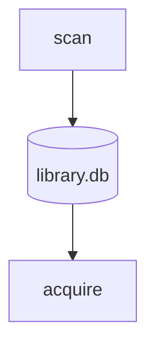

# Writing docs

This page explains how to write a docs page that people can read quickly.
Follow it for any page under `docs/` that you add or rewrite. How to
document code is covered separately, in
[Code documentation](code-documentation.md).

The docs are read in two places:

- **On GitHub**, as plain Markdown in this repository.
- **On bookclerk.app**, where the site Worker renders the same files.

Write for GitHub first. Use only Markdown that GitHub renders, and the
site will render it to match. Never use syntax that only the site
understands.

## Know who is reading

Each shelf of the docs has its own reader:

| Shelf | Reader | Assume they know |
| --- | --- | --- |
| Use Bookclerk (`guide/`) | Someone who buys audiobooks | How to use a web browser and a terminal |
| Run a server (`server/`) | Whoever runs Bookclerk for a household | Services, config files, networks |
| Build plugins (`plugins/`) | A plugin author | One of the SDK languages |
| How it works, Contribute, Design decisions | A contributor | Rust and the codebase |

On the Use Bookclerk shelf, name screens and buttons, not config keys or
crate names. Link to the server reference for the details an operator
needs.

Design decisions (`adr/`) are the exception. Each one is an architecture
decision record in the usual form: a title, a **Status** line, then
**Context**, **Decision** and **Consequences** sections (plus optional
ones such as **Non-goals**). Keep that structure rather than the page
shape below. The Markdown rules still apply, because the site renders
these pages too.

## Shape each page

1. **Title.** Name the task or the thing, such as "Connect a store" or
   "Where your books go".
2. **Opening.** One or two sentences that say what the page helps the
   reader do. The site also uses this as the page's search summary.
3. **Sections.** One `##` heading for each thing the reader might come
   for. Use `###` when a section has several parts that each need a link,
   such as the problems on a troubleshooting page.
4. **Next steps.** End with a short list of links to where the reader
   most likely goes next.

## Keep paragraphs short

- Give each paragraph one idea, in at most three sentences.
- Use short sentences that start with the action: "Open **Accounts**",
  not "The Accounts page can be opened to…".
- Write "you" for the reader, in the present tense.
- Put the most important fact first. Put the exception after it, or in a
  callout.

## Steps

Number the steps of a procedure:

- Give each step one action.
- Put screen, button and menu names in bold, with **→** between levels:
  **Settings → Plugins**.
- When the reader needs to check something, say what they should see.

If a procedure needs something first, such as the operator turning on a
plugin, say so in a sentence before step 1.

## Lists and tables

- Use a bulleted list for items that each need a sentence.
- Use a table only to compare several items across the same columns.
  Keep each cell to a phrase, with no paragraphs inside. Keep tables on
  the Use Bookclerk shelf to four columns or fewer.
- For a term and its explanation, write a bold term followed by one or
  two sentences, not a table.

## Callouts

Callouts mark what a reader must not miss. Write them with GitHub's alert
syntax:

```markdown
> [!WARNING]
> Leave **Auto acquire** off until a scan looks right.
```

The kinds are `NOTE`, `TIP`, `IMPORTANT`, `WARNING` and `CAUTION`. Use
`WARNING` or `CAUTION` when skipping the callout could lose data or
expose a secret, and `NOTE` or `TIP` for a helpful aside. Use at most
two callouts in a section; if everything stands out, nothing does.

## Diagrams

Draw diagrams in Mermaid, in a `mermaid` code block. GitHub draws them,
and so does the site, in its own colors:

````markdown

````

- Use a flowchart (`flowchart`), state diagram (`stateDiagram-v2`),
  sequence, class or ER diagram. The site shows any other type as code.
- Leave out `style`, `classDef` and `click` lines: the site colors the
  diagram itself, and a diagram that sets its own colors is shown as code.
- Lay out anything wider than four or five boxes top to bottom
  (`flowchart TB`) so it fits the page on a phone.
- Keep each diagram under 4,000 characters. Write `&lt;` and `&gt;` for
  angle brackets in labels.
- Don't draw diagrams in text or as images: they can't be read on a phone
  or by a screen reader, and they go stale.

## Words

- Define a term in bold the first time a page uses it, and use it the
  same way afterward. The [Glossary](../guide/glossary.md) lists the
  words Bookclerk uses.
- Link text says where the link goes: "see [Stores](../guide/stores.md)",
  not "click here".
- Keep repository text tool-neutral: don't name the editors, review bots
  or assistants that people use.

## Code

- Give every code block a language: `sh` for commands, `toml` for
  settings, `console` for a terminal session where `$` and a space mark the
  commands and the other lines are output. A command that ends in `\`
  continues on the next line, without a `$`.
- Put one command on each line. Readers copy the whole block with its
  copy button.
- Write placeholders as `<branch>` and say what to put in their place.

## Markdown lint

CI runs markdownlint on every Markdown file (the `lint` check in
[Continuous integration](ci.md#formatting-and-markdown-lint)). Its settings
in `.markdownlint-cli2.jsonc` keep the defaults except where they fight
this guide:

- Line length is free, so paragraphs wrap wherever the writer likes.
- Inline HTML, bare URLs and a page that opens before its `#` heading are
  allowed.
- Headings may repeat under different parents, such as "Arguments".
- Console blocks keep their `$` prompt, and two callouts in a row keep the
  blank line between them.

When one line has to break a rule, say so on that line, not for the whole
file:

```markdown
In a `console` fence only `$ ` prompt lines run. <!-- markdownlint-disable-line MD038 -->
```

Use `<!-- markdownlint-disable-next-line MDxxx -->` above a block instead.
GitHub and the site both hide these comments; any other HTML comment
shows as text on the site.
Run it locally with `--fix` to repair spacing and list markers (see
[Formatting and Markdown lint](ci.md#formatting-and-markdown-lint)).
