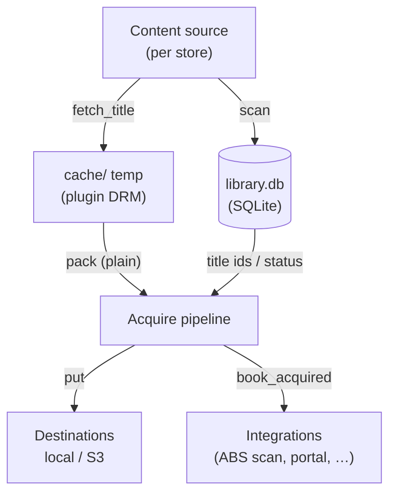

# Architecture

Bookclerk is a Cargo workspace of library crates plus binaries:

| Binary | Crate | Role |
| --- | --- | --- |
| `bookclerk` | `bookclerk-cli` | One-shot operator CLI |
| `bookclerkd` | `bookclerkd` | Scheduled jobs + authenticated HTTP API / GUI |
| `bookclerk-media-worker` | `bookclerk-media-worker` | Confined child process running one codec job |
| `bookclerk-jail` | `bookclerk-jail` | Applies a confinement policy, then `exec`s a plugin guest |
| `bookclerk-workerd` | `bookclerk-workerd` | Jailed Cloudflare workerd isolate launcher for script plugins |
| *(lib)* | `bookclerk-tray` | In-process tray linked into `bookclerkd` (not a default-member) |

Both share the same core: sources, library DB, acquire pipeline, storage, and
integrations.

## Data flow



1. **Scan** — each enabled source upserts owned titles into `library.db`.
2. **Enrich** (optional) — held editions without an ASIN may gain one via
   public catalog search (`library.enrich_from_audible`).
3. **Acquire** — fetch Plain → package/encode → name → write every enabled
   destination. Decode, encode, and packaging do not run in the host: they are
   dispatched to a bounded pool of `bookclerk-media-worker` processes, each
   confined to the paths its job declared, so the C codecs never share an
   address space with the master key or `library.db`. See [media.md](../server/media.md).
4. **Integrations** — durable `book_acquired` outbox deliveries to the live
   per-node subscriber catalog (`event_subscriber_nodes`); each VPS claims only locally loaded
   PluginKeys, with a library-wide per-plugin in-flight cap from
   `[events.concurrency]` (portable `bookclerk_slots` lock at claim; Audiobookshelf scan notify, Echo examples). Duplicate
   outbox keys are namespaced by `(account_id, source, event_type, dedup_key)`.
   Publish is commit + notify; claimed wake slices drain parked deliveries.
   One plugin failure
   never blocks others. See [jobs.md](jobs.md) and [plugins.md](../plugins/README.md).
5. **Daemon** — admits scan / auto-acquire / listen-sync as durable `jobs`
   rows (API and scheduler use the same queue) and runs the event dispatcher /
   delivery worker beside the job workers. See [jobs.md](jobs.md).

## Plugin kinds

Bookclerk uses four first-class plugin roles (in-process and/or external):

| Kind | Trait / host | Examples |
| --- | --- | --- |
| **Source** | `ContentSource` | `audible`, `libro`, `chirp`, `graphicaudio` |
| **Output / destination** | storage backends under `[output.*]` | `local`, `s3`, `r2` |
| **Database** | SeaORM connection under `[database]` | `sqlite` (default), `d1` |
| **Integration** | `Integration` | `audiobookshelf`, SPA portal claim helpers |

Third-party plugins are separate executables discovered via `plugin.toml` and
spoken to over the product ABI (`api_version = 3` object-capability Workers
RPC) on stdio (native Cap'n Proto) or via `bookclerk-workerd` (script isolates
keep `RpcTarget` stubs). Each guest is started by
`bookclerk-jail`, which confines it to its own install directory (read-only),
`$FILES_DIR/plugin-state/<PluginKey fs-id>/data`,
`$FILES_DIR/plugin-state/<PluginKey fs-id>/tmp` (fetch scratch lives under that
`tmp`),
and — for the sqlite guest — file-level grants for `library.db` and its journal
sidecars (never the files-dir parent / `master.key`). See [plugins.md](../plugins/README.md).
Database backends are selected via `[database].plugin` (see [database.md](../server/database.md));
external `databaseAdapter` guests are **required** (no in-process fallback).
Guests speak BookclerkSQL only. The host owns schema, admission, typing,
authorization, and proofs; adapters lower the proven request to SQLite,
PostgreSQL 16+, or Cloudflare D1
([ADR: SQL database contract](../adr/sql-database-contract.md)).

## Workspace crates (by concern)

| Concern | Crates |
| --- | --- |
| Config / paths / logging | `bookclerk-config` |
| Source trait + registry (host side) | `bookclerk-source` (re-exports `bookclerk-storefront`) |
| Storefront guest types | `bookclerk-storefront` (DTOs, ABI conversions, listing helpers; no database, ORM, config or OpenAPI) |
| Store adapters (plugins) | `bookclerk-plugins/optional/source-{audible,libro,chirp,graphicaudio}` (lib + guest bin; each links only the SDK, `bookclerk-storefront` and its own store crates, Audible adding `bookclerk-audible-catalog` and `bookclerk-mp4`, Libro.fm, Chirp and GraphicAudio adding `bookclerk-scan-delta`) |
| Scan deltas for stores with no change feed (plugins) | `bookclerk-scan-delta` (fingerprints in the plugin's own `SCAN_STATE` database, read through a keyed reader; links only the SDK) |
| ABS integration (plugin) | `bookclerk-plugins/optional/integration-audiobookshelf` (TypeScript workerd guest, no Cargo package; user watch and listening memory in its own `LISTENING_STATE` database) |
| Clear-media packaging | `bookclerk-media` (remux / fixup / MP3; no DRM) |
| FFmpeg decoders (WMA, AC-3/E-AC-3, AMR) | `bookclerk-libav` (pinned FFmpeg built decoders-only from source, behind a C shim; linked by the media worker in release builds) |
| MP4 container plumbing | `bookclerk-mp4` (shared with store plugins, plus the Audible brand-trim helpers; no cryptography) |
| Process confinement | `bookclerk-sandbox` (Landlock+seccomp / Seatbelt / AppContainer) |
| Guest jail launcher | `bookclerk-jail` (applies a policy, then `exec`s the guest) |
| Workerd isolate launcher | `bookclerk-workerd` (pinned Cloudflare workerd + bridge/egress) |
| Acquire orchestration | `bookclerk-acquire` |
| Naming templates | `bookclerk-naming` |
| Branch-node protocol | `bookclerk-node-proto` (node socket frames, handshake signatures, key checks) |
| Branch-node client | `bookclerk-node-client` (enrollment, pinned owner socket, claimed work, write-back, wakes, resume) |
| Library DB | `bookclerk-library` (SeaORM plugins + rusqlite store) |
| Search | `bookclerk-search` |
| Discovery / recommendations | `bookclerk-discover` (via registered `ContentSource` catalog APIs) |
| Storage backends | `bookclerk-storage` (local; the S3 backend sits behind its `s3` feature, which only the `s3` and `r2` destination plugins enable, so the hosts do not link the AWS SDK) |
| TLS provider and HTTP client | `bookclerk-tls` (one rustls provider, aws-lc-rs; see [tls.md](tls.md)) |
| OS keychain | `bookclerk-keystore` (the item that holds the library key on a keychain install; see [Master key store](../adr/master-key-store.md)) |
| Public Audible catalog | `bookclerk-audible-catalog` (unauthenticated search, genres, ratings and reviews; linked by the Audible guest and `bookclerk-enrich`) |
| Catalog enrichment | `bookclerk-enrich` (matches other stores' titles to an ASIN; re-exports `bookclerk-audible-catalog`) |
| Integrations framework + portal | `bookclerk-integrations` (traits / registry / portal; ABS lives in its plugin) |
| External plugin host | `bookclerk-plugin-host` |
| Libation migrate/export | `bookclerk-migrate` |

## Files directory layout

`$BOOKCLERK_FILES_DIR` (env or `--bookclerk-files`) is the unit of state.
Without either, it is the platform's data directory for the app:

- Linux: `$XDG_DATA_HOME/bookclerk` (`~/.local/share/bookclerk`).
- macOS: `~/Library/Application Support/app.Bookclerk.bookclerk`.
- Windows: `%APPDATA%\Bookclerk\bookclerk\data`.

Its layout:

```text
BookclerkFiles/
  config.toml
  library.db          # incl. encrypted_secrets (auth + Widevine CDM + S3 keys)
  cache/
  search_index_works/
  plugins/            # host-local trees (immutable to guests)
    .versions/<digest>/        # materialized installed versions, shared by instances
    <plugin-key-fs-id>/        # platform guests, dev trees, older installs
  plugin-state/       # host-local mutable guest state
    <plugin-key-fs-id>/data/   # one guest's HOME inside the jail
    <plugin-key-fs-id>/tmp/    # one guest's TMPDIR inside the jail
  install-ledger.json # trust anchor for host-local installs
  plugin-packages/    # operator-placed packages, published as releases
  .plugin-mutation.lock
  logs/               # reserved (Bookclerk does not rotate log files)
```

Runtime credentials are **not** stored as files under the files dir:
Audible/Libro.fm/Chirp/GraphicAudio auth, Widevine CDM blobs, and S3 destination
keys live in the `encrypted_secrets` DB table; bootstrap secrets (passphrase,
DB/API tokens) come from the environment. There is no `Accounts/` directory.

A relative `root` on the `local` destination plugin resolves under this directory.

## Identity model

- Library rows are keyed by a stable **UUID**.
- Store identifiers (ASIN, ISBN, product id) are indexed attributes.
- `library acquire` / search accept UUID, ASIN, ISBN, or source product id.
- Scan inclusion is **per account** in SQLite (`auth set-scan`), not a TOML flag.

## Control plane (`bookclerkd`)

Default listen: both loopbacks
`["127.0.0.1:8787", "[::1]:8787"]` (`BOOKCLERK_DAEMON_LISTEN` / `daemon.listen`;
string or array / comma-separated). IPv6 uses bracketed form: `[::1]:8787`.

Operator auth (`[daemon.auth]`, DB-sealed token / `BOOKCLERK_OPERATOR_TOKEN`) gates
the API. Config reload swaps auth before listen rebind. See [sign-in.md](../server/sign-in.md) and
[operations.md](../server/operations.md).

| Method | Path | Auth | Notes |
| --- | --- | --- | --- |
| `GET` | `/health` | no | Liveness |
| `POST` | `/api/auth/login` | no | Operator token → session cookie |
| `GET` | `/api/auth/me` | yes | SPA bootstrap |
| `PATCH` | `/api/auth/profile` | yes | Self-service display name / email / picture source |
| `PUT`/`DELETE` | `/api/auth/profile/avatar` | yes | Self-service uploaded profile picture |
| `GET` | `/api/users/{id}/avatar` | yes | Stored JPEG/PNG/WebP avatar |
| `GET` | `/api/status`, `/status` | yes | Counts + listen |
| `GET` | `/api/jobs`, `/jobs` | yes | Job list |
| `POST` | `/api/library/scan`, `/scan` | yes | Queue scan |
| `POST` | `/api/library/acquire`, `/acquire` | yes | Queue acquire |
| `POST` | `/api/library/convert` | yes | Queue a convert (add a copy to stored books) |
| `GET` | `/api/library/works` | yes | Works from the page index, by cursor, or matching a search (`q`) |
| `GET` | `/api/library/works/{id}` | yes | One work with editions, listings, holdings and own state |
| `PUT`/`DELETE` | `/api/library/listings/{id}/pin` | Administrator | Pin a listing to an edition (moves it now), or drop the pin |
| `POST` | `/api/library/works/{id}/split` | Administrator | Move expressions to a new, isolated work |
| `GET` | `/api/library/conflicts` | Administrator | Conflicts the resolver recorded, by cursor |
| `GET` | `/api/library/editions/{id}/cover` | yes | Best-effort local cover of an acquired edition |
| static | `/` | no | Built React UI (`ui/dist`) when present |

Portal claim sessions use `bookclerk_portal_session` (`Path=/`) via `/api/portal/*`.
