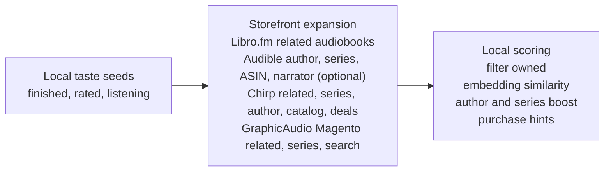

# Discovery design

How Discover finds and ranks books. For using Discover and the wishlist, see [Discover and wishlist](../guide/discover.md).

Bookclerk’s discovery stack turns **local taste** (owned library + listening)
into **unowned storefront candidates**, then ranks those with embeddings and
heuristics. Operator-facing surfaces ship first; the schema is ready for
Connect-portal identities later.

## Goals

1. **Discover unowned titles** from storefront catalogs (Libro related books,
   Audible public search / series ASIN, Chirp GraphQL related/series/author/
   deals, GraphicAudio Magento series + related), not only from the owned library.
2. **Evaluate** those candidates against local ownership, listening, ratings,
   and embeddings.
3. **Personal wishlist** (store-agnostic) with a **global request queue** ranked
   by how many users wishlisted the same work — including one-click from Discover
   cards and catalog search.
4. **Suggest where to buy** once a candidate is known.
5. Stay fit for a **cheap VPS** (≈1 vCPU, 1–2 GB RAM): no separate vector DB;
   embeddings score remote candidates locally.

## Candidate generation (storefronts first)



Owned library rows are **seeds**, not the candidate pool. Open wishlist items
merge into the personalized Discover feed (and the shared global queue).

Chirp and GraphicAudio expansion prefer seeds already owned on those sources
(Chirp product id → `relatedAudiobooks`; Magento product id → related block +
series page). Series / author signals from any seed can still query Chirp or
Magento when the catalog has a match. GraphicAudio series-set SKUs are
**included by default**; set `exclude_graphicaudio_series_sets = true` to drop
them. Chirp top/free deals are pulled once per recommend run (unowned only).

Listening taste is **optional** and **provider-agnostic**. Integrations that
support listening sync (Audiobookshelf today; third-party plugins via capability
`sync_listening`) write into the shared `listening_progress` table. Ranking never
calls those adapters — if no listening data is present, or you pass
`--no-listening` to the CLI, discovery still runs on owned-library taste
alone. The CLI scopes with `external_user_id` and/or `--listening-provider` for
multi-user or multi-integration libraries; the daemon scopes each stored feed
to its person (see [Precomputed shelves](#precomputed-shelves)).

## Precomputed shelves

The daemon never builds shelves while a page waits. Each person (the
operator, a household user, or a portal identity) has a **subject key**
(`operator`, `user:{id}`, `portal:{id}`) and two stored layers:

1. **Candidates** (`discover_candidates`): a `discover_candidates` job seeds
   from that person's own taste (books on the store accounts linked to their
   identities, household books they have listened to, their listening and
   their open wishlist, with book and wishlist seeds alternating so each
   store's call budget reaches both) and asks **every
   deployed storefront**, not only the stores they have accounts with. A
   person with no signal yet (and the operator) seeds from the household.
   `storefront_max_remote_calls` is split across the stores, so all stores
   together never make more calls than it allows (deals count as one call,
   and a store whose share is zero is not asked).
   Stores run concurrently, each call has a 10 s timeout, a store stops
   starting new calls 20 s into a fetch and saves what it has, and each store's
   rows are saved as that store finishes, so one slow store never discards
   the others. A save upserts the store's new rows, then deletes its rows
   that fetch did not return. It uses single statements, not an interactive
   transaction, which the external database plugins refuse, so a reader can
   briefly see a store's new rows beside its old ones. A store whose calls all fail or come back empty keeps its
   previous rows, since a plugin adapter can report a guest failure as an
   empty answer. The
   finished fetch is recorded in `discover_fetches`, so a fetch that found
   nothing new still counts as fresh for a day.
2. **Feed** (`discover_feeds`): when the fetch finishes it admits a
   `discover_feed` job, which ranks the stored candidates into shelves with
   no network calls and stores the result. It uses only candidates fetched
   for the person's current seeds (their own, or the household's), and none
   when `discovery.storefront_candidates` is off.

   Both steps stay inside the database plugin's 256 KiB result limit
   (`maxResultBytes` in the [SQL contract](../plugins/sql-contract/v1.md)).
   The ranking reads candidates in pages and halves a page when its result
   would be too large. A stored feed is one cell, and the plugin counts a
   row as JSON, where each quote or backslash in the feed takes two bytes.
   So the feed is kept under 192 KiB in that escaped form: if it is larger,
   every shelf is cut to its best items (down to four), then long
   descriptions are shortened, then the last shelves are dropped. Writing a
   feed replaces the old row without reading it, so an old feed that is too
   large to read cannot block its replacement.

> [!NOTE]
> A candidate fetch asks the storefronts deployed on the node that claims
> it. In a cluster that splits storefronts across nodes, stores deployed
> only on other nodes are not asked yet.

Storefront answers are cached for 24 hours in `discover_store_calls`, keyed by
a hash of the store and the request, so people whose seeds overlap share one
call. Failed and empty answers are not cached. Both jobs are deduplicated per subject, so a burst of triggers folds into
the job already waiting.

`GET /api/discover/recommendations` reads the stored feed and returns at once,
filtering the caller's hidden shelves. Its `state` says what the page is
seeing:

| `state` | Meaning |
| --- | --- |
| `ready` | The stored feed is current. |
| `refreshing` | The stored feed is shown while a newer one is built. |
| `preparing` | No feed yet (or the stored one does not decode); shelves are empty and the page shows placeholders. |

When a ranking job stores someone's shelves, the live socket's `discover`
topic changes and an open Discover page reads its feed again in place.
While the socket is down and the state is `preparing` or `refreshing`, the
page reads the feed every 4 seconds instead, up to 15 times. A `preparing`
page then keeps reading every 30 seconds until shelves arrive. With the
socket open, a `preparing` or `refreshing` page also reads every 30 seconds,
in case a write was missed or a live re-read failed. A live re-read that
fails is also retried 30 seconds later whatever the feed shows, so a `ready`
page does not keep stale shelves until the next change.

A read queues what is stale. It queues a ranking when the last fetch finished
after the feed was ranked. It queues a fetch when none has finished or the
last one is older than 24 hours.

The scheduler queues the daily fetch for every subject with a stored feed.
Deleting a user removes their Discover rows. A fetch or ranking still queued
or running for them deletes its rows instead of writing them back.

`GET /api/discover/status` reports whether the caller's shelves are stored
yet, and queues their refresh as a read would. Callers that must wait on
shelves, such as the hosted demo, poll it. Any signed-in caller can use it,
since it only reports the caller's own shelves.

### Taste events

Shelves also refresh when someone's taste changes, without waiting for a
read or the daily fetch. The daemon registers one host consumer,
`host:discover`, on the [durable event outbox](jobs.md) for three host
events:

| Event | Published when | Discover queues |
| --- | --- | --- |
| `wishlist_changed` | A wishlist entry is added or changes status, or an open one is deleted with its user. | A fetch for the person who wished (their seeds changed), and a ranking for everyone else with shelves (wish counts changed). |
| `listening_synced` | A listening sync changed, for some stored row, whose it is, which owned book or work it matched, its authors, whether they started it, which quarter they are in, or whether they finished it. | A fetch for everyone with shelves. |
| `book_acquired` | The household acquires a book. | A fetch for everyone with shelves. |

Each job it queues may only run 30 seconds later, so the changes of one
sync or one browsing session fold into a single job per person. The fetches
are cheap when little changed, because unchanged store calls come from the
24-hour cache. Apart from the person who wished, someone without stored
shelves is left to their first read.

A job that has already started may have read the data before the change,
so a change only folds into a job that is still pending. When the job the
consumer needs is running or has just finished (or the queue is full), the
delivery comes back 30 seconds later and queues again, up to 20 times.
A retry skips each person who already has a job of that kind admitted
after the event (waiting, running or finished), so with more people than
the queue holds, finished refreshes are not queued again ahead of the
people still waiting for room.
Every node registers the same consumer and the outbox delivers each event
once in the cluster.

A listening sync compares each row it writes with the row stored before it,
so a sync that reports only some people, or repeats what is stored, publishes
nothing, while a book finished, unfinished and finished again is three
changes. When one sync reports a row twice, its first stored state is
compared with its last.

A ranking job checks the newest candidate fetch again when it finishes. A
fetch that finished while it ranked had its follow-up ranking folded into the
running job, so the job ranks again, up to three passes in all.

Ratings have no event. Discover weighs a book's own rating, but ratings
change only when a Libation library is imported, and the next daily refresh
picks that import up.

## Metadata gap-fill (Open Library compliance)

`discover enrich-metadata` (and `discover recommend`) fill **low-volume
metadata gaps** on owned rows (subjects / description / cover / language)
from the deployed metadata-provider plugins, such as `openlibrary`. It is
never a bulk catalog backend.

Per [Open Library API guidelines](https://openlibrary.org/developers/api):

- The `openlibrary` plugin identifies itself with its `contact_email`
  setting ([integrations](../server/integrations.md#open-library-and-audnexus))
- The host spaces rows about 400 ms apart and stops after 25 rows per run
- A row with an ISBN is looked up by ISBN; one without is searched by title
  and author, and only a result with the same title (ignoring case and
  punctuation) is used. The first record that fills a gap wins, and the
  title's work only takes the fields it lacks
- Rows already enriched are skipped (`enrich_source` `metadata:<provider>`,
  or the legacy `openlibrary`) — provenance cache. The work record is written
  before the row is marked, so a failure leaves the row to retry
- For bulk data, use [monthly dumps](https://openlibrary.org/data), not the API

WorldCat remains reserved (API key + ToS).

## Embeddings (small / VPS-friendly)

Discover shelves rank with a **local-hash** 384-d embedder by default
(`discovery.embeddings_enabled = false`): no download, no extra runtime and
negligible RAM. AI-assisted recommendations are not designed yet, so ONNX
scoring is off unless an operator turns it on.

When enabled, discovery uses **quantized MiniLM-L6-v2** via `fastembed` / ONNX Runtime
(~22 MB model under `models/` plus the ORT shared library, ~50 MB RAM, 1
intra-thread by default). ORT is **loaded dynamically** (not statically linked)
so hosts with glibc < 2.38 still build; on first successful load the runtime
and model are cached under the Bookclerk files dir.

If ONNX cannot load (offline host, unsupported glibc for the ORT dylib, corrupt
cache, …), Bookclerk **warns and falls back** to local-hash so recommend still
works. A failed load is tried once per process: later ranking runs use
local-hash straight away until the daemon restarts, so a missing runtime
never holds up Discover again.

`discovery.embeddings_enabled = false` (the default, or CLI `--hash` / `?no`
paths that pass `prefer_onnx = false`) skips ONNX and uses local-hash directly.

### OSV / `paste`

`fastembed` → `tokenizers` (and related crates) pull crates.io `paste` 1.0.15
as a **compile-time proc-macro**. That crate is **unmaintained**
([RUSTSEC-2024-0436](https://rustsec.org/advisories/RUSTSEC-2024-0436.html):
INFO, no CVE, no patched release). There is no crates.io drop-in under the same
name; renaming to maintained [`pastey`](https://crates.io/crates/pastey) would
still leave OSV matching the lockfile package name `paste`. Bookclerk therefore
keeps the registry dependency and records a narrow, dated ignore in
[`osv-scanner.toml`](../../osv-scanner.toml) (`ignoreUntil`). That ignore filters
the INFO finding from the *actionable* scan result; the `paste` package remains
in the lockfile. Revisit when upstream depends on `pastey` (or drops `paste`)
directly, or when the ignore expires.

## Recommendation ranking

Candidates are **unowned** storefront hits (plus open wishlist items), scored by:

1. Storefront origin (related / series / author / catalog search)
2. **Series completion** — own some of a series → boost unowned siblings; prefer
   the next index; stronger when the series is actively listened to, and
   stronger still when multiple books in that series have listening activity.
   Listening weight is driven by **absolute hours heard** (soft-saturated), with
   percent complete only a secondary bonus — so 50% of a 30‑hour book outweighs
   50% of a 3‑hour book. Finished titles still get a completion bump on top of
   hours listened.
   A candidate counts toward a series only when its storefront lists it in
   that series. Audible's series keyword search also returns loose matches,
   so the Audible plugin keeps only results whose own series matches the
   searched name.
3. Overlap with liked authors
4. Embedding similarity to finished / highly rated / recently listened works
5. Wishlist boost (`wish_count × 40` on the shared queue / Discover merge)
6. Purchase hints resolved at view time (see below)

## Wishlist (no approval flow)

There is **no triage / approve / reject** path. An item stays in the **global
queue** while at least one user has it open on their personal wishlist and the
title is **not** in the household library.

- Personal wishlist: `GET`/`POST` `/api/wishlist`, `DELETE /api/wishlist/{uuid}`
  (un-wishlist = cancel own row only)
- CLI: `bookclerk discover wishlist add|list|remove`
- Global queue: `GET /api/request-queue` — shared order using **overall /
  operator** taste (not per-portal personalization) plus a heavy wish-count
  weight. Each row includes `wishers` (tiny profile pictures: upload /
  Gravatar / SSO / monogram) for the people who have the title open. Discover
  `requests` shelf cards carry the same `wishers` / `wish_count` fields.
- Identity merge: canonical ISBN-10↔13 when present, else ASIN, else soft
  title+author; ASIN-keyed and ISBN-keyed rows for the same work are merged
  (ISBN is **not** universal across Chirp / GA / Audible public search)
- **Per-source snapshots:** `POST /api/wishlist` persists storefront editions,
  HTML description, and purchase hints into `title_request_sources` (one row per
  `source` + `product_id`), then soft-resolves live prices to fill additional
  stores. `GET /api/wishlist` / request-queue merge those rows for the richest
  blurb and multi-store Where-to-buy links (legacy thin rows still fall back to
  provider title-meta). Title detail loads Audible reviews via paginated
  `POST /api/discover/title-reviews` (`sort_by=MostHelpful|MostRecent`,
  infinite scroll seeds helpful then continues recent); title-meta carries
  ratings/counts only.   For ISBN-only storefront hits (notably Libro.fm),
  title-meta gap-fills via source `catalog_detail` (explore audiobook payload
  or product-page JSON-LD / `.audiobook-genres`: narrator, runtime, description,
  publisher, genres, abridged). After multi-store search ranks a page, Discover
  may call Libro `catalog_detail` on lean ISBN-bearing rows (bounded timeout)
  so list cards get genres/runtime without N+1 product fetches inside each
  store’s `search_catalog`.

Multi-region storefronts are deferred (US default for now).

## Configuration

```toml
[discovery]
embeddings_enabled = false
embedding_model = "local-hash-v1"
embed_intra_threads = 1
storefront_candidates = true
storefront_seed_limit = 8
storefront_max_remote_calls = 32
# exclude_graphicaudio_series_sets = true  # opt-in; default keeps Magento series sets
listen_sync_interval_minutes = 60  # 0 disables daemon listening sync
recommend_limit = 20
```

Listening sync fans out through `IntegrationRegistry` (every integration with
`supports_listening_sync`). Daemon honors `listen_sync_interval_minutes`; CLI
`discover sync-listening` and `POST /api/discover/sync-listening` do the same.

Shelf visibility is **per-user** (SQLite `user_preferences`, not TOML). Use
the Preferences dialog in the GUI header, or `GET` / `PATCH /api/preferences` with
`{ "disabled_shelves": ["chirp_deals", "genre"] }`. Empty list = all shelves on.
CLI `discover recommend` applies the operator prefs row.

## Catalog search vs shelves

**Discover shelves** stay taste-ranked (library, listening, embeddings).

**Catalog search** (`GET /api/discover/search`) is a **non-personalized multi-store
browser**: one page per connected storefront in parallel, identity-merge, then
server-side include/exclude filters and sort. By default results are hard-filtered
to the client language (`lang` / `language=`). Chirp catalog hits carry Chirp’s
`language` field (`English` / `Spanish` / …) plus `promotedTags` as genres, so
non-matching languages are dropped; unknown/missing language metadata (e.g.
sparse GraphicAudio rows) still passes. **All languages** (`all_languages=1`)
disables the hard filter
(soft prefer remains a weak tie-break).

| Param | Notes |
| --- | --- |
| `q` | Query (min 2 chars) |
| `page_size` | Default 24, clamp 1–48 (`limit` still accepted) |
| `cursor` | Opaque hex cursor (per-source page counters + query fingerprint) |
| `sort` | `relevance` (default) / `popularity` / `rating` / `title` / `author` / `price` / `length` — Audible page order for relevance/popularity; host re-ranks price/length/rating/title/author. Rating sort uses a Bayesian average of `rating_overall` with `rating_count` (prior mean 4.0, strength 100) so tiny sample 5.0s do not outrank high-volume 4.8s |
| `sort_dir` | `asc` / `desc` (defaults: desc for relevance/popularity/rating/price; asc for title/author/length). Relevance ignores direction for ranking |
| `field` | Optional scoped search: `author` / `narrator` / `series` / `genre` |
| `lang` | Default language (BCP-47); hard-include when `language` omitted |
| `language` | Comma-separated language codes to include |
| `all_languages` | `1` / `true` — no hard language filter |
| `author`, `narrator`, `series`, `genre`, `source` | Comma-separated includes (OR within a kind, AND across kinds) |
| `exclude_source` | Comma-separated store ids to hide (empty = all sources, including future) |
| `exclude_narrator` | Comma-separated substrings; GUI **Hide Virtual Voice** sends `Virtual Voice` |
| `min_rating` | Keep hits with `rating_overall >= min` or missing rating |
| `min_length_minutes` / `max_length_minutes` | Runtime bounds; missing length still passes |

Response envelope: `{ items, page_size, has_more, next_cursor?, sort, sort_dir }`.
Hits may include catalog `price_cents` when the storefront provided it (no
purchase-hints round-trip). The UI infinite-scrolls with `next_cursor` and
dedupes rare cross-page `work_key`s. Facet option lists grow from loaded pages
(not full upstream facet counts). Typeahead still uses a small first page
(`page_size=10`).

Per-user Discover defaults live on `GET`/`PATCH /api/preferences`:
`discover_sort`, `discover_sort_dir`, `discover_language` (`null` = browser
language), `discover_excluded_sources` (empty = all stores including future).

Audible Discover browse uses public `GET /1.0/catalog/search` (website index).
The older `GET /1.0/catalog/products?keywords=` filter often omits titles that
still resolve by ASIN (e.g. English *A Game of Thrones* `B002UZZ93G`).

## Surfaces

| Surface | Commands / routes |
| --- | --- |
| CLI | `bookclerk discover recommend` (prints shelves), `embed`, `sync-listening`, `wishlist …` |
| Daemon | `GET /api/discover/recommendations` (stored feed), `GET /api/discover/status`, `GET /api/discover/search?q=` (paged multi-store catalog browse + typeahead), `POST /api/discover/purchase-hints` (+ `/batch`), `GET`/`POST` `/api/wishlist`, `DELETE /api/wishlist/{uuid}`, `GET /api/request-queue`, `GET`/`PATCH /api/preferences` |
| GUI | **Discover** — personalized shelves + catalog search (filter rail, sort + direction, language, Hide Virtual Voice); **Wishlist** — personal list with global queue sidebar |

Wishlists are **store-agnostic**. Rows share a `work_key` plus runtime identity
merge (ISBN/ASIN aliases and soft title+author). The global queue ranks with
**overall / operator** taste plus `wish_count × 40`. Every viewer sees the same
queue order; Discover personalizes the feed (including wishlist items).

### Shelf taxonomy

| Shelf | Kind id | Signal |
| --- | --- | --- |
| Finish these series | `finish_series` | Incomplete series + next index |
| Pick up where you left off | `keep_listening` | Active / multi-book listening in a series |
| More from {Author} | `author` | Liked-author overlap (top authors) |
| If you like {Author} | `because` | Related/similar titles **not** by that author |
| Narrated by {Narrator} | `narrator` | Liked-narrator overlap |
| Because you like {Genre} | `genre` | Category/subject overlap from finished titles |
| From {Store} | `from_store` (`from_audible`, …) | Candidates from storefronts already in the library |
| Chirp deals right now | `chirp_deals` | Chirp top + free deals |
| Similar to books you finish | `similar_taste` | Embedding similarity |
| On the wishlist | `requests` | Open shared wishlist items (tiny wisher avatars on each card) |
| Top picks for you | `top_picks` | Fallback when every other shelf is empty |

Shelf **titles** stay dynamic (`More from {Author}`, …). Prefs filter on stable
**category tags** carried on each recommendation (`finish_series`, `author`,
`genre`, …), not on human-readable reason strings.

All kinds are **offered by default**. Each user hides shelves via
`disabled_shelves` in `/api/preferences` (Discover settings in the GUI). The
recommendations endpoint applies the caller's prefs server-side; the API still
returns `shelf_kinds` so the prefs UI knows what can be toggled.

Kind matching: `author` hides every `author:…` row; `from_store` hides all
`from_*` rows; exact ids like `finish_series` or `from_chirp` also work.

## Store links and pricing

Recommendations are consolidated by bibliographic identity (canonical ISBN when
present, ASIN, soft title+author) so the same book from multiple storefronts
appears as **one card** with `store_editions` for each catalog match.

Live prices use **public** storefront endpoints (no auth). The Discover feed
loads with `no_purchase_hints=true`; the GUI:

1. Progressively reveals shelves/cards while scrolling
2. **Viewport-gates** pricing (`IntersectionObserver`)
3. **Batches** visible cards into `POST /api/discover/purchase-hints/batch`

The daemon still searches **all** stores, then highlights `best` using the
caller’s associated accounts (portal account links, or all operator accounts)
as a **membership** signal: linked stores are compared at member price; other
stores at list / non-member price; the shelf shows the global cheapest of those
effective prices. Client-supplied `preferred_sources` are ignored.

## Non-goals (this iteration)

- Chirp personalized endpoints that require a logged-in session
  (`currentUserRelatedAudiobooks`, …)
- Multi-region storefront merchandising (US only for now)
- Bulk Open Library harvest (use dumps)
- Paid WorldCat / Goodreads / Hardcover providers
- A long-running vector DB sidecar
- Audible Spatial/Atmos (L1) merchandising
