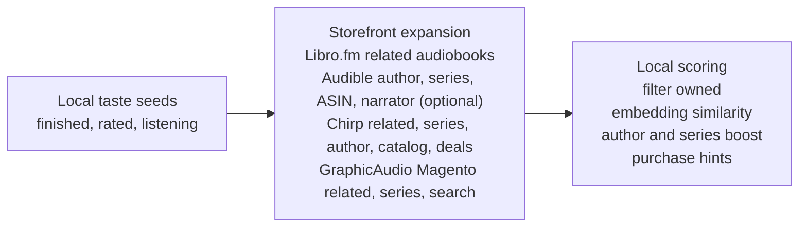

# Discovery design

How Discover finds and ranks books. For using Discover and the wishlist, see [Discover and wishlist](../guide/discover.md).

Bookclerk’s discovery stack turns **local taste** (owned library + listening)
into **unowned storefront candidates**, then ranks those with embeddings and
heuristics. Operator-facing surfaces ship first; the schema is ready for
Connect-portal identities later.

## Goals

1. **Discover unowned titles** from storefront catalogs (Libro related books,
   Audible public search / series ASIN, Chirp GraphQL related/series/author/
   deals, GraphicAudio Magento series + related), not only from the owned library.
2. **Evaluate** those candidates against local ownership, listening, ratings,
   and embeddings.
3. **Personal wishlist** (store-agnostic) with a **global request queue** ranked
   by how many users wishlisted the same work — including one-click from Discover
   cards and catalog search.
4. **Suggest where to buy** once a candidate is known.
5. Stay fit for a **cheap VPS** (≈1 vCPU, 1–2 GB RAM): no separate vector DB;
   embeddings score remote candidates locally.

## Candidate generation (storefronts first)



Owned library rows are **seeds**, not the candidate pool. Open wishlist items
merge into the personalized Discover feed (and the shared global queue).

Chirp and GraphicAudio expansion prefer seeds already owned on those sources
(Chirp product id → `relatedAudiobooks`; Magento product id → related block +
series page). Series / author signals from any seed can still query Chirp or
Magento when the catalog has a match. GraphicAudio series-set SKUs are
**included by default**; set `exclude_graphicaudio_series_sets = true` to drop
them. Chirp top/free deals are pulled once per recommend run (unowned only).

Listening taste is **optional** and **provider-agnostic**. Integrations that
support listening sync (Audiobookshelf today; third-party plugins via capability
`sync_listening`) write into the shared `listening_progress` table, one row
per listener and work (see [Listening sync](../server/integrations.md#listening-sync)).
Discover reads each row's authors and library title through its work. Ranking never
calls those adapters — if no listening data is present, or you pass
`--no-listening` to the CLI, discovery still runs on owned-library taste
alone. The CLI scopes with `external_user_id` and/or `--listening-provider` for
multi-user or multi-integration libraries; the daemon scopes each stored feed
to its person (see [Precomputed shelves](#precomputed-shelves)).

## Precomputed shelves

The daemon never builds shelves while a page waits. Each person (the
operator, a household user, or a portal identity) has a **subject key**
(`operator`, `user:{id}`, `portal:{id}`) and two stored layers:

1. **Candidates** (`discover_candidates`): a `discover_candidates` job seeds
   from that person's own taste (books on the store accounts linked to their
   identities, household books they have listened to, their listening and
   their open wishlist, with book and wishlist seeds alternating so each
   store's call budget reaches both) and asks **every
   deployed storefront**, not only the stores they have accounts with.
   While a person has fewer than five books and listens of their own, the
   rest of the household's books **blend in** at half weight, behind their
   own, with the household's listening to those books at the same weight:
   a first wish or book adds to the shelves they already had instead
   of replacing them, and the household drops out once their own taste can
   stand alone. A person with no signal of their own yet (and the operator)
   seeds from the household as it stands. With fewer than five seeds in
   all, each store is also asked for a fixed set of **starter genres**
   (Science Fiction, Fantasy, Mystery & Thriller, Romance, History &
   Biography, Self-help) through its catalog search, as far as its call
   budget reaches, so a new library still gets shelves.
   Every title a store returns goes into the **shared listing pool**
   (see [Shared listing pool](#shared-listing-pool)), and the person's
   `discover_candidates` rows are references to those listings plus what
   is personal to them: the seed that found the title, how the store found
   it and the starter genre.
   `storefront_max_remote_calls` is split across the stores, so all stores
   together never make more calls than it allows (deals count as one call,
   and a store whose share is zero is not asked).
   Stores run concurrently, each call has a 10 s timeout, a store stops
   starting new calls 20 s into a fetch and saves what it has, and each store's
   rows are saved as that store finishes, so one slow store never discards
   the others. A save upserts the store's new rows, then deletes its rows
   that fetch did not return. It sends them as a few atomic host batches,
   each as large as the database plugin's `maxStatements` and
   `maxRequestBytes` allow, not one statement per row and not an interactive
   transaction, which the external database plugins refuse. The delete
   rides in the last batch, so a reader can briefly see part of a store's
   new rows beside its old ones. A store whose calls all fail or come back empty keeps its
   previous rows, since a plugin adapter can report a guest failure as an
   empty answer. A store with an answer that had a title the pool could not
   place this time keeps its previous rows beside the new ones, so that
   title is not dropped until a complete fetch replaces them. The
   finished fetch is recorded in `discover_fetches`, so a fetch that found
   nothing new still counts as fresh for a day.
2. **Feed** (`discover_feeds`): when the fetch finishes it admits a
   `discover_feed` job, which ranks the stored candidates into shelves with
   no network calls and stores the result. It uses only candidates fetched
   for the person's current seeds (their own, or the household's), and none
   when `discovery.storefront_candidates` is off.

   Each job reads the library once: the taste and the set of titles the
   library already holds (by ASIN, ISBN and store product id, used to keep
   owned titles out of the candidates and the feed) come from the same
   read. The read is one title per **work** the library holds, built from
   holdings, listings, editions and works (a book held on two accounts or
   from two stores counts once), so it never touches the `books` table.
   Finished flags, ratings and tags come from each user's own state on the
   work (`user_title_state`): a person's own books carry theirs, and
   household books carry everyone's merged (finished when anyone finished
   it, each rating the mean of those who gave one). A work a person
   finished, rated or tagged counts as one of their own books, so a user
   with no portal identity or linked store account still gets a taste of
   their own once they have any. A portal visitor with no user has no
   stored state. A per-person taste profile stored between
   jobs, so a job no longer reads the whole library at all, is planned for
   the rest of the book model's step 6.

   Both steps read through the database plugin's streamed result path
   ([SQL contract](../plugins/sql-contract/v1.md#streamed-results)), so a
   page of candidates or a stored feed larger than one inline 256 KiB
   result still arrives whole. Against a database plugin without streamed
   results, the ranking halves a page of candidates when its result would
   exceed the inline limit (`maxResultBytes`). A stored feed is one cell,
   and the plugin counts a row as JSON, where each quote or backslash in
   the feed takes two bytes.
   So the stored feed keeps **card references**, not whole cards. Each card
   keeps what is personal to the person (its shelf, order, score, reasons,
   shelf tags, prices and wishers) and its identity (title, authors,
   series, store editions). The catalog metadata that the person's
   candidates' listings hold in the pool (description, cover, subtitle,
   publisher, length, date, genres, language and narrators) is left out
   and joined back from those listings when the page reads the feed, in
   chunks that stay under the inline result limit. A field is left out only
   when that join gives it back unchanged: metadata merged in from another
   store edition is left out when that edition's listing gives the same
   value, and stays on the card when none does. A card with no
   stored candidate, such as a wish, keeps its metadata. A fetch that
   changes candidates before the page reads the feed changes what the join
   fills in: an updated row shows its new metadata, a removed row lets
   another edition's row fill the field, and a field no row holds stays
   empty until the ranking that fetch queues replaces the feed.
   `GET /api/discover/status` needs only whether a feed exists and when it
   was ranked, so it reads the feed without the join.

   The stored feed carries a format number. A feed in another format, such
   as the whole cards an older release stored, reads as missing and is
   ranked again. The ranking job logs the stored feed's size and card count
   (`stored discover feed`). As a backstop the stored feed is kept under
   192 KiB in that escaped form: if it is ever larger, long descriptions
   left on cards are shortened to 300 characters, then each card keeps
   three reasons and drops `seed_categories`, then every shelf is cut to
   its best items (down to four), and last the final shelves are dropped.
   Writing a
   feed replaces the old row without reading it, so an old feed that is too
   large to read cannot block its replacement.

> [!NOTE]
> A candidate fetch asks the storefronts deployed on the node that claims
> it. In a cluster that splits storefronts across nodes, stores deployed
> only on other nodes are not asked yet.

Storefront answers are cached for 24 hours in `discover_store_calls`, keyed by
a hash of the store and the request, so people whose seeds overlap share one
call. The cache stores the parsed answer, not the store's raw reply: the
listings it returned, in order, in `discover_store_call_hits`, each with how
the store found it and its rank. Failed and empty answers, and answers none of whose titles could be stored,
are not cached. The fetch time is written after the hits, so an answer cut
off part way reads as expired. Each write claims the cached call with its
own token, and its hits and fetch time apply only while the call still
carries it, so two members refreshing one call at once never leave a mix of
both answers.

### Shared listing pool

Catalog data has one home: the library model's `store_listings`
([ADR](../adr/library-data-model.md)). When a store answers a Discover call,
each title is resolved into the library the way a scanned title is (shared
identifiers first, then the work's identifiers, then the work-level match on
title, authors and kind), so it gets a work, an expression, an edition and a
listing row. The listing has **no holding**, so the library does not own
it, and a later scan of the same product finds the same listing and only
adds its holding. Work identity always comes from that resolution, never
from comparing display text.

The store's own text for the listing is stored on the row as parsed
columns: subtitle, authors and narrators as the store prints them, series,
the whole synopsis (never shortened), publisher, date, length, language,
cover, product URL, ratings and abridgement. What it costs is stored in
`listing_offers`, one row per listing and audience: `non_member` (what
someone without an account at the store pays) and `member`, each with the
price, the store's label, the currency and when it was quoted. An older
quote never overwrites a newer one.

A listing a store reported in the last day keeps its resolution and text,
and a new answer only refreshes its offers, so members whose tastes overlap
cost one resolution a day per title. A title that other writers kept
changing on every attempt is skipped and stays stale, so the next answer
resolves it again, and the answer that skipped it is not cached; any other
read or write failure fails the whole call. A `discover_candidates` job also
deletes listings that no store has reported for a week and that nothing
refers to: no holding, candidate, cached call, wish or resolution override (at
most once an hour on each daemon). The edition and work they made stay.
A new catalog listing emits no library event; a scan that later holds it
announces it with `holding_added`. A catalog answer that fills or relinks a
stored edition announces that change as a scan would.

The `discover_candidates` and `discover_feed` jobs are deduplicated per
subject, so a burst of triggers folds into
the job already waiting.

`GET /api/discover/recommendations` reads the stored feed and returns at once,
filtering the caller's hidden shelves. Its `state` says what the page is
seeing:

| `state` | Meaning |
| --- | --- |
| `ready` | The stored feed is current. |
| `refreshing` | The stored feed is shown while a newer one is built: a read found it stale, or a fetch or ranking for the caller is waiting or running (queued by a taste event or the Refresh button). The page shows an "Updating shelves" notice. |
| `preparing` | No feed yet (or the stored one does not decode); shelves are empty and the page shows placeholders. |

When a ranking job stores someone's shelves, the live socket's `discover`
topic changes and an open Discover page reads its feed again in place.
While the socket is down and the state is `preparing` or `refreshing`, the
page reads the feed every 4 seconds instead, up to 15 times. A `preparing`
page then keeps reading every 30 seconds until shelves arrive. With the
socket open, a `preparing` or `refreshing` page also reads every 30 seconds,
in case a write was missed or a live re-read failed. A live re-read that
fails is also retried 30 seconds later whatever the feed shows, so a `ready`
page does not keep stale shelves until the next change.

A read queues what is stale. It queues a ranking when the last fetch finished
after the feed was ranked. It queues a fetch when none has finished or the
last one is older than 24 hours.

The scheduler queues the daily fetch for every subject with a stored feed.
Deleting a user removes their Discover rows. A fetch or ranking still queued
or running for them deletes its rows instead of writing them back.

`GET /api/discover/status` reports whether the caller's shelves are stored
yet (and, as `updating`, whether a fetch or ranking for them is waiting or
running), and queues their refresh as a read would. Callers that must wait
on shelves, such as the hosted demo, poll it. Any signed-in caller can use
it, since it only reports the caller's own shelves.

`POST /api/discover/refresh` queues a storefront fetch (and the ranking
that follows it) for the caller now and answers with the same status. The
Discover page's **Refresh** button calls it: unchanged store calls answer
from the day's cache, so a refresh is cheap, and a fetch already waiting
absorbs the request. When the job queue is full the route answers `429`
and queues nothing, and the page shows the error.

### Taste events

Shelves also refresh when someone's taste changes, without waiting for a
read or the daily fetch. The daemon registers one host consumer,
`host:discover`, on the [durable event outbox](jobs.md) for three host
events:

| Event | Published when | Discover queues |
| --- | --- | --- |
| `wishlist_changed` | A wishlist entry is added or changes status, or an open one is deleted with its user. | A fetch for the person who wished (their seeds changed), and a ranking for everyone else with shelves (wish counts changed). |
| `listening_synced` | A listening sync changed, for some stored row, whose it is, which owned book or work it matched, its authors, whether they started it, which quarter they are in, or whether they finished it. | A fetch for everyone with shelves. |
| `book_acquired` | The household acquires a book. | A fetch for everyone with shelves. |

Every one of the three events also queues one ranking of the shared
[request queue](#request-queue).

Each job it queues may only run 30 seconds later, so the changes of one
sync or one browsing session fold into a single job per person. The one
exception is the fetch for the person who wished: they are looking at the
page, so it may run after 5 seconds. The fetches
are cheap when little changed, because unchanged store calls come from the
24-hour cache. Apart from the person who wished, someone without stored
shelves is left to their first read.

A job that has already started may have read the data before the change,
so a change only folds into a job that is still pending. When the job the
consumer needs is running or has just finished (or the queue is full), the
delivery comes back 30 seconds later and queues again, up to 20 times.
A retry skips each person who already has a job of that kind admitted
after the event (waiting, running or finished), so with more people than
the queue holds, finished refreshes are not queued again ahead of the
people still waiting for room.
Every node registers the same consumer and the outbox delivers each event
once in the cluster.

A listening sync compares each row it writes with the row stored before it,
so a sync that reports only some people, or repeats what is stored, publishes
nothing, while a book finished, unfinished and finished again is three
changes. When one sync reports a row twice, its first stored state is
compared with its last.

A ranking job checks the newest candidate fetch again when it finishes. A
fetch that finished while it ranked had its follow-up ranking folded into the
running job, so the job ranks again, up to three passes in all.

Ratings have no event. Discover weighs a book's own rating, but ratings
change only when a Libation library is imported, and the next daily refresh
picks that import up.

## Metadata gap-fill (Open Library compliance)

`discover enrich-metadata` (and `discover recommend`) fill **low-volume
metadata gaps** on owned rows (subjects / description / cover / language)
from the deployed metadata-provider plugins, such as `openlibrary`. It is
never a bulk catalog backend.

Per [Open Library API guidelines](https://openlibrary.org/developers/api):

- The `openlibrary` plugin identifies itself with its `contact_email`
  setting ([integrations](../server/integrations.md#open-library-and-audnexus))
- The host spaces rows about 400 ms apart and stops after 25 rows per run.
  It reads the library a page at a time and stops reading once the run's
  requests are spent
- A row with an ISBN is looked up by ISBN; one without is searched by title
  and author, and only a result with the same title (ignoring case and
  punctuation) is used. The first record that fills a gap wins, and the
  title's work only takes the fields it lacks
- Rows already enriched are skipped (`enrich_source` `metadata:<provider>`,
  or the legacy `openlibrary`) — provenance cache. The work record is written
  before the row is marked, so a failure leaves the row to retry
- For bulk data, use [monthly dumps](https://openlibrary.org/data), not the API

WorldCat remains reserved (API key + ToS).

## Embeddings (small / VPS-friendly)

Discover shelves rank with a **local-hash** 384-d embedder by default
(`discovery.embeddings_enabled = false`): no download, no extra runtime and
negligible RAM. AI-assisted recommendations are not designed yet, so ONNX
scoring is off unless an operator turns it on.

The ONNX embedder is not in the default build. Build the hosts with the
`onnx-embeddings` feature to link it:

```bash
cargo build --release -p bookclerkd -p bookclerk-cli --features bookclerkd/onnx-embeddings,bookclerk-cli/onnx-embeddings
```

The feature pulls `fastembed`, `hf-hub` and `tokenizers` and, through them,
`onig`, `esaxx`, `ort`, OpenSSL (`native-tls`) and a second `reqwest`: about
45 crates, two of them C/C++ builds, that every cold build would otherwise
compile for an experiment that is off by default. A host built without it
treats `discovery.embeddings_enabled = true` like an ONNX load failure: it
warns once and ranks with local-hash. CI tests `bookclerk-discover` with its
`onnx` feature whenever that crate is selected, so the path keeps compiling.

When enabled and built in, discovery uses **quantized MiniLM-L6-v2** via `fastembed` / ONNX Runtime
(~22 MB model under `models/` plus the ORT shared library, ~50 MB RAM, 1
intra-thread by default). ORT is **loaded dynamically** (not statically linked)
so hosts with glibc < 2.38 still build; on first successful load the runtime
and model are cached under the Bookclerk files dir.

If ONNX cannot load (built without `onnx-embeddings`, offline host, unsupported
glibc for the ORT dylib, corrupt cache, …), Bookclerk **warns and falls back** to local-hash so recommend still
works. A failed load is tried once per process: later ranking runs use
local-hash straight away until the daemon restarts, so a missing runtime
never holds up Discover again.

`discovery.embeddings_enabled = false` (the default, or CLI `--hash` / `?no`
paths that pass `prefer_onnx = false`) skips ONNX and uses local-hash directly.

### Refreshing work vectors

`embed_dirty_works` keeps one vector per work and model in `embeddings`,
stamped with a hash of the text it was computed from. It first deletes the
vectors of works that no longer exist, then walks `works` in id order, 128
at a time. Each page costs one read of the works, one read of their stored
hashes, and one embedder call for the works whose text changed, so a large
library is neither held in memory at once nor read one hash per work.

### OSV / `paste`

With the `onnx-embeddings` feature, `fastembed` → `tokenizers` (and related
crates) pull crates.io `paste` 1.0.15 as a **compile-time proc-macro**. The
default build does not compile it, but it stays in `Cargo.lock`, which OSV
scans. That crate is **unmaintained**
([RUSTSEC-2024-0436](https://rustsec.org/advisories/RUSTSEC-2024-0436.html):
INFO, no CVE, no patched release). There is no crates.io drop-in under the same
name; renaming to maintained [`pastey`](https://crates.io/crates/pastey) would
still leave OSV matching the lockfile package name `paste`. Bookclerk therefore
keeps the registry dependency and records a narrow, dated ignore in
[`osv-scanner.toml`](../../osv-scanner.toml) (`ignoreUntil`). That ignore filters
the INFO finding from the *actionable* scan result; the `paste` package remains
in the lockfile. Revisit when upstream depends on `pastey` (or drops `paste`)
directly, or when the ignore expires.

## Recommendation ranking

Candidates are **unowned** storefront hits (plus open wishlist items), scored by:

1. Storefront origin (related / series / author / catalog search)
2. **Series completion** — own some of a series → boost unowned siblings; prefer
   the next index; stronger when the series is actively listened to, and
   stronger still when multiple books in that series have listening activity.
   Listening weight is driven by **absolute hours heard** (soft-saturated), with
   percent complete only a secondary bonus — so 50% of a 30‑hour book outweighs
   50% of a 3‑hour book. Finished titles still get a completion bump on top of
   hours listened.
   A candidate counts toward a series only when its storefront lists it in
   that series. Audible's series keyword search also returns loose matches,
   so the Audible plugin keeps only results whose own series has the same
   name. Names are compared without a leading article or trailing generic
   words such as "Series" or "Sequence", so "The Dune Sequence" matches
   "Dune" but "Midnight World" does not match "Midnight".
3. Overlap with liked authors
4. Embedding similarity to finished / highly rated / recently listened works
5. Wishlist boost (`wish_count × 40` on the shared queue / Discover merge)
6. Purchase hints resolved at view time (see below)

Before scoring, a candidate in a language the reader does not listen in is
dropped (`retain_reader_languages` in `bookclerk-discover`). The reader's
languages are the normalized languages of the taste books (the subject's own,
with the household's blended in while those are few), or the default
preferred language (`en`) when no taste book has one. A candidate whose store
gave no language, or one `normalize_language` does not recognize, stays, as
in catalog search. Editions in two different known languages are never merged
into one candidate by a title-and-author match, so dropping one language never
drops the other edition with it.

Whether a wished title is already owned is decided by the library's
resolver (`LibraryStore::owned_work_for`), the same way a scanned listing
finds its work: shared identifiers, then the work's identifiers, then the
work-level title-and-author match. A wish whose work no library title
resolves to stays on the queue, so *Dune Messiah* is not hidden by an owned
*Dune*. Storefront candidates are dropped by owned ASIN, ISBN and product
id, and then by work: a candidate read from the shared listing pool uses
the work its listing resolved into, a live store hit is resolved the same
way (`LibraryStore::work_for`), and one whose work has a library title is
dropped when the feed is ranked. Another store's edition of an owned book
(a different ASIN, ISBN or narrator) therefore never reaches a shelf, such
as **Because you wishlisted**, while a sequel stays.

Shelves then partition the ranked list so that **every title lands on one
shelf**. Shelves claim titles in page order: the wishlist first,
then the series shelves, the person's own wishes, authors, narrators,
genres, starter genres, similar taste, Chirp deals, then one **Picked for
you on {Store}** shelf per store for whatever is left, each title under the
store where it costs the person least (member price on stores they have an
account with, list price elsewhere, its own store when no price is known on
the card). A wished title shows on the wishlist shelf alone (every wish
shows, however many share a series; wishes past the shelf's size are
claimed too, and shown nowhere). A shelf that is not about series keeps at
most **two titles of one series**, so a long series cannot crowd the others
out; the two series shelves and the wishlist instead rotate between series,
so their first cards show several series rather than one in
a row.

## Wishlist (no approval flow)

There is **no triage / approve / reject** path. An item stays in the **global
queue** while at least one user has it open on their personal wishlist and the
title is **not** in the household library.

- Personal wishlist: `GET`/`POST` `/api/wishlist`, `DELETE /api/wishlist/{uuid}`
  (un-wishlist = cancel own row only)
- CLI: `bookclerk discover wishlist add|list|remove`
- Global queue: `GET /api/request-queue` — shared order using **overall /
  operator** taste (not per-portal personalization) plus a heavy wish-count
  weight. Each row includes `wishers` (tiny profile pictures: upload /
  Gravatar / SSO / monogram) for the people who have the title open. Discover's
  `requests` shelf (the first row) carries the same `wishers` / `wish_count` fields.
  The route only reads a stored ranking; see [Request queue](#request-queue).
- Identity merge: a wish is resolved to a library work when it is created
  and stores the `work_id`. A wish that names a store edition the server
  could look up is for the work that edition's pooled listing resolved to
  (see **Per-source snapshots**); otherwise its own title, authors and
  identifiers find the work (`LibraryStore::work_for_wish`, the same
  resolution a scanned listing gets); wishes with the same work are one queue entry,
  and Discover treats such an entry as owned when a library title resolves
  to that work. The entry (`GET /api/request-queue`) carries that `work_id`,
  and the Wishlist and Discover pages match the viewer's own wish on it
  before the bibliographic key, since the entry keeps only one wisher's key.
  Wishes the library could not place fall back to canonical ISBN-10↔13 when
  present, else ASIN, else soft title+author; ASIN-keyed and ISBN-keyed rows
  for the same work are merged (ISBN is **not** universal across Chirp / GA /
  Audible public search)
- **Per-source snapshots:** `POST /api/wishlist` first resolves live prices
  and further stores (server-side purchase hints), then asks each store about
  every edition the wish names (`catalog_detail`, at most eight editions at
  once) and records the store's answer in the
  [shared listing pool](#shared-listing-pool), with any member price a
  purchase hint quoted. It then persists the editions, HTML description and
  purchase hints into `title_request_sources` (one row per `source` +
  `product_id`), each naming its pooled listing in `listing_id` when the store
  answered. The pool holds only what stores reported: the text and prices the
  browser sends stay on the wish's own rows, so one person's wish never
  changes what anyone else's Discover shows. The hints and the edition
  lookups share one 5 s deadline, well inside the route's 8 s budget, so the
  wish is always saved; an edition whose store is not deployed, fails or does
  not answer in time is saved without a listing. `GET /api/wishlist` / request-queue merge those rows for the richest
  blurb and multi-store Where-to-buy links (legacy thin rows still fall back to
  provider title-meta). Title detail loads Audible reviews via paginated
  `POST /api/discover/title-reviews` (`sort_by=MostHelpful|MostRecent`,
  infinite scroll seeds helpful then continues recent); title-meta carries
  ratings/counts only.   For ISBN-only storefront hits (notably Libro.fm),
  title-meta gap-fills via source `catalog_detail` (explore audiobook payload
  or product-page JSON-LD / `.audiobook-genres`: narrator, runtime, description,
  publisher, genres, abridged). After multi-store search ranks a page, Discover
  asks the stores that declare `catalog.detailByIsbn` (Libro.fm today) to fill
  lean rows by ISBN (bounded timeout), so list cards get genres/runtime without
  N+1 product fetches inside each store’s `search_catalog`. See
  [Catalog search capabilities](../plugins/abi.md#catalog-search-capabilities).

Multi-region storefronts are deferred (US default for now).

### Request queue

The shared queue is ranked by a job, not inside the page request. Ranking
reads the whole library and listening history, so doing it per request
held the Discover gate and slowed every Wishlist load as libraries grew.

1. A `discover_request_queue` job ranks every open entry against household
   taste. It stores one row per entry in `discover_request_queue`, keyed by
   the work every wish names: the taste score, up to six taste reasons and
   whether the library already holds the work (an account or a branch holds
   a listing of one of its editions). It copies no title, cover or price:
   those stay with the wishes.
2. Discover's consumer (see [Taste events](#taste-events)) queues the job
   on every `wishlist_changed`, `book_acquired` and `listening_synced`,
   after the same 30-second debounce. The queue is not personalized, so one
   job serves everyone, and its dedup key folds a burst of events into one
   pass.
3. `GET /api/request-queue` reads the open wishes, joins each entry with its
   stored row, and adds the wish-count boost and the wish reasons from the
   live counts. It hides entries the last pass found in the library. An
   entry wished since that pass shows straight away with no taste score,
   so its wish count alone places it.
4. When an entry has no stored row, or the ranking is older than a day, the
   read queues a pass and still answers with what it has. The day limit
   covers taste changes no event announces, such as a removed book.

> [!NOTE]
> Store titles and prices for the queue live in the shared store listing
> pool, not in this table.

## Configuration

```toml
[discovery]
embeddings_enabled = false
embedding_model = "local-hash-v1"
embed_intra_threads = 1
storefront_candidates = true
storefront_seed_limit = 8
storefront_max_remote_calls = 32
# exclude_graphicaudio_series_sets = true  # opt-in; default keeps Magento series sets
listen_sync_interval_minutes = 60  # 0 disables daemon listening sync
recommend_limit = 20
```

Listening sync fans out through `IntegrationRegistry` (every integration with
`supports_listening_sync`). Daemon honors `listen_sync_interval_minutes`; CLI
`discover sync-listening` and `POST /api/discover/sync-listening` do the same.

Shelf visibility is **per-user** (SQLite `user_preferences`, not TOML). Use
the Preferences dialog in the GUI header, or `GET` / `PATCH /api/preferences` with
`{ "disabled_shelves": ["chirp_deals", "genre"] }`. Empty list = all shelves on.
CLI `discover recommend` applies the operator prefs row.

## Catalog search vs shelves

**Discover shelves** stay taste-ranked (library, listening, embeddings).

**Catalog search** (`GET /api/discover/search`) is a **non-personalized multi-store
browser**: one page per connected storefront in parallel, identity-merge, then
server-side include/exclude filters and sort. By default results are hard-filtered
to the client language (`lang` / `language=`). Chirp catalog hits carry Chirp’s
`language` field (`English` / `Spanish` / …) plus `promotedTags` as genres, so
non-matching languages are dropped; unknown/missing language metadata (e.g.
sparse GraphicAudio rows) still passes. **All languages** (`all_languages=1`)
disables the hard filter
(soft prefer remains a weak tie-break).

| Param | Notes |
| --- | --- |
| `q` | Query (min 2 chars) |
| `page_size` | Default 24, clamp 1–48 (`limit` still accepted) |
| `cursor` | Opaque hex cursor (per-source page counters + query fingerprint) |
| `sort` | `relevance` (default) / `popularity` / `rating` / `title` / `author` / `price` / `length` — storefront rank (`rankHint`, declared by Audible today) for relevance/popularity; host re-ranks price/length/rating/title/author. Rating sort uses a Bayesian average of `rating_overall` with `rating_count` (prior mean 4.0, strength 100) so tiny sample 5.0s do not outrank high-volume 4.8s |
| `sort_dir` | `asc` / `desc` (defaults: desc for relevance/popularity/rating/price; asc for title/author/length). Relevance ignores direction for ranking |
| `field` | Optional scoped search: `author` / `narrator` / `series` / `genre` |
| `lang` | Default language (BCP-47); hard-include when `language` omitted |
| `language` | Comma-separated language codes to include |
| `all_languages` | `1` / `true` — no hard language filter |
| `author`, `narrator`, `series`, `genre`, `source` | Comma-separated includes (OR within a kind, AND across kinds) |
| `exclude_source` | Comma-separated store ids to hide (empty = all sources, including future) |
| `exclude_narrator` | Comma-separated substrings; GUI **Hide Virtual Voice** sends `Virtual Voice` |
| `min_rating` | Keep hits with `rating_overall >= min` or missing rating |
| `min_length_minutes` / `max_length_minutes` | Runtime bounds; missing length still passes |

Response envelope: `{ items, page_size, has_more, next_cursor?, sort, sort_dir }`.
Hits may include catalog `price_cents` when the storefront provided it (no
purchase-hints round-trip). The UI infinite-scrolls with `next_cursor` and
dedupes rare cross-page `work_key`s. Facet option lists grow from loaded pages
(not full upstream facet counts). Typeahead still uses a small first page
(`page_size=10`).

Per-user Discover defaults live on `GET`/`PATCH /api/preferences`:
`discover_sort`, `discover_sort_dir`, `discover_language` (`null` = browser
language), `discover_excluded_sources` (empty = all stores including future).

Audible Discover browse uses public `GET /1.0/catalog/search` (website index).
The older `GET /1.0/catalog/products?keywords=` filter often omits titles that
still resolve by ASIN (e.g. English *A Game of Thrones* `B002UZZ93G`).

## Surfaces

| Surface | Commands / routes |
| --- | --- |
| CLI | `bookclerk discover recommend` (prints shelves), `embed`, `sync-listening`, `wishlist …` |
| Daemon | `GET /api/discover/recommendations` (stored feed), `GET /api/discover/status`, `POST /api/discover/refresh`, `GET /api/discover/search?q=` (paged multi-store catalog browse + typeahead), `POST /api/discover/purchase-hints` (+ `/batch`), `GET`/`POST` `/api/wishlist`, `DELETE /api/wishlist/{uuid}`, `GET /api/request-queue`, `GET`/`PATCH /api/preferences` |
| GUI | **Discover** — personalized shelves + catalog search (filter rail, sort + direction, language, Hide Virtual Voice); **Wishlist** — personal list with global queue sidebar |

Wishlists are **store-agnostic**. Every wish names the library work it is
for: adding one resolves its ASIN, ISBN, title and authors the way a scan
resolves a listing. A book the library does not hold gets a catalog work and
edition (no listing or holding), with ids derived from what it was resolved
from, so two people wishing for the same ASIN share one work. Wishes for one
work are one queue entry, and a person's second wish for a work they already
wish for returns the first. The wish's `work_key` is derived on read from its
identifiers, for display matching only. The global queue ranks with
**overall / operator** taste plus `wish_count × 40`. Every viewer sees the same
queue order; Discover personalizes the feed (including wishlist items).

### Shelf taxonomy

| Shelf | Kind id | Signal |
| --- | --- | --- |
| On the wishlist | `requests` | Open shared wishlist items, first on the page and in the viewer's own taste order (tiny wisher avatars on each card) |
| Finish these series | `finish_series` | Incomplete series + next index; series take turns |
| Pick up where you left off | `keep_listening` | Active / multi-book listening in a series; series take turns |
| Because you wishlisted {Title} | `wish` (`wish:dune`, …) | Titles the stores found from one of the person's own open wishes (newest three wishes) |
| More from {Author} | `author` | Liked-author overlap (top authors) |
| If you like {Author} | `because` | Related/similar titles **not** by that author |
| Narrated by {Narrator} | `narrator` | Liked-narrator overlap |
| Because you like {Genre} | `genre` | Category/subject overlap from finished titles |
| Similar to books you finish | `similar_taste` | Embedding similarity |
| Popular in {Genre} | `starter_genre` (`starter_genre:fantasy`, …) | Starter-genre browse while the taste is thin |
| Chirp deals right now | `chirp_deals` | Chirp top + free deals |
| Picked for you on {Store} | `from_store` (`from_audible`, …) | Titles no personal shelf took, ranked by taste, under the store where they cost the person least |
| Top picks for you | `top_picks` | Fallback when every other shelf is empty |

Shelf **titles** stay dynamic (`More from {Author}`, …). Prefs filter on stable
**category tags** carried on each recommendation (`finish_series`, `author`,
`genre`, …), not on human-readable reason strings.

All kinds are **offered by default**. Each user hides shelves via
`disabled_shelves` in `/api/preferences` (Discover settings in the GUI). The
recommendations endpoint applies the caller's prefs server-side; the API still
returns `shelf_kinds` so the prefs UI knows what can be toggled.

Kind matching: `author` hides every `author:…` row; `from_store` hides all
`from_*` rows; exact ids like `finish_series` or `from_chirp` also work.

## Store links and pricing

Recommendations are consolidated by bibliographic identity (canonical ISBN when
present, ASIN, soft title+author) so the same book from multiple storefronts
appears as **one card** with `store_editions` for each catalog match.

Live prices use **public** storefront endpoints (no auth). The Discover feed
loads with `no_purchase_hints=true`; the GUI:

1. Progressively reveals shelves/cards while scrolling
2. **Viewport-gates** pricing (`IntersectionObserver`)
3. **Batches** visible cards into `POST /api/discover/purchase-hints/batch`

The daemon still searches **all** stores, then highlights `best` using the
caller’s associated accounts (portal account links, or all operator accounts)
as a **membership** signal: linked stores are compared at member price; other
stores at list / non-member price; the shelf shows the global cheapest of those
effective prices. Client-supplied `preferred_sources` are ignored.

A page of cards is priced with **one call per store**: the batch route
sends every visible card's query to each deployed store's `purchaseHints`
entrypoint together, with the product id the card already knows for that
store, so Audible prices up to fifty titles in one catalog request and
Chirp prices a page in one aliased GraphQL query; Libro.fm and GraphicAudio
have no bulk endpoint and loop inside the guest. Audible and Chirp resolve
the titles whose product id they already know first, then look the rest up
by title for at most five seconds, so a slow search never costs a known
title its price; Audible prices each query in its own marketplace. The batch answers within
**10 seconds** with what has resolved: a store still working then counts as
timed out. A query no store answered with a hint carries only its trusted
store links, unpriced, with `incomplete: true`: a store's `None` is no
proof it lacks the title, since a guest out of its own time budget answers
`None` for titles it never tried. Such an answer is not cached, the page
keeps no copy, and the card asks again after 15 seconds (twice at most)
without dropping prices it already shows, so one slow store never turns a
page of cards into a failed request or a card left unpriced. Queries a
store answered with a hint are cached for 10 minutes.

Cards show a price before any lookup: a candidate read from the pool
carries its listing's `non_member` offer when it was quoted in the last day
(by anyone's fetch), and at the end of each store's fetch the
`discover_candidates` job prices up to 120 distinct titles of the rest in
one `purchase_hints` call, so a refresh after a wish asks the store only
about titles it has not priced. The answers are stored as the listings'
offers: the list price as `non_member`, a member price as `member`. The
card shows the non-member price as the store's list price and the live
lookup refreshes it on screen when the card scrolls into view (a live
lookup does not write the pool). Member prices are
applied only for stores the viewer has an account with, decided server-side
as before. A store paused for rate limiting is not asked, a 429 here pauses
its live lookups too, and a failure or timeout leaves the rest unpriced until
a card asks.

Stores are paused in two ways. A store that answers **429** returns
`rate_limited` with its `Retry-After`, and its price lookups are left alone
for that long (at most fifteen minutes), or for a minute that doubles on
each repeat when it did not say; a store that answers again closes the
pause. A store that times out three lookups in a row is paused for five
minutes (the breaker logs `price lookups paused after repeated timeouts`),
then tried again. The single-title route honors the same pauses.

## Non-goals (this iteration)

- Chirp personalized endpoints that require a logged-in session
  (`currentUserRelatedAudiobooks`, …)
- Multi-region storefront merchandising (US only for now)
- Bulk Open Library harvest (use dumps)
- Paid WorldCat / Goodreads / Hardcover providers
- A long-running vector DB sidecar
- Audible Spatial/Atmos (L1) merchandising
