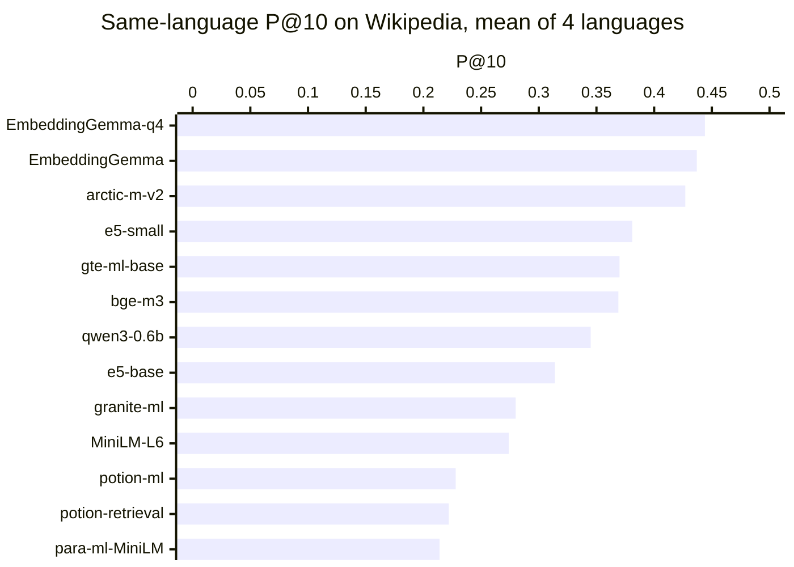
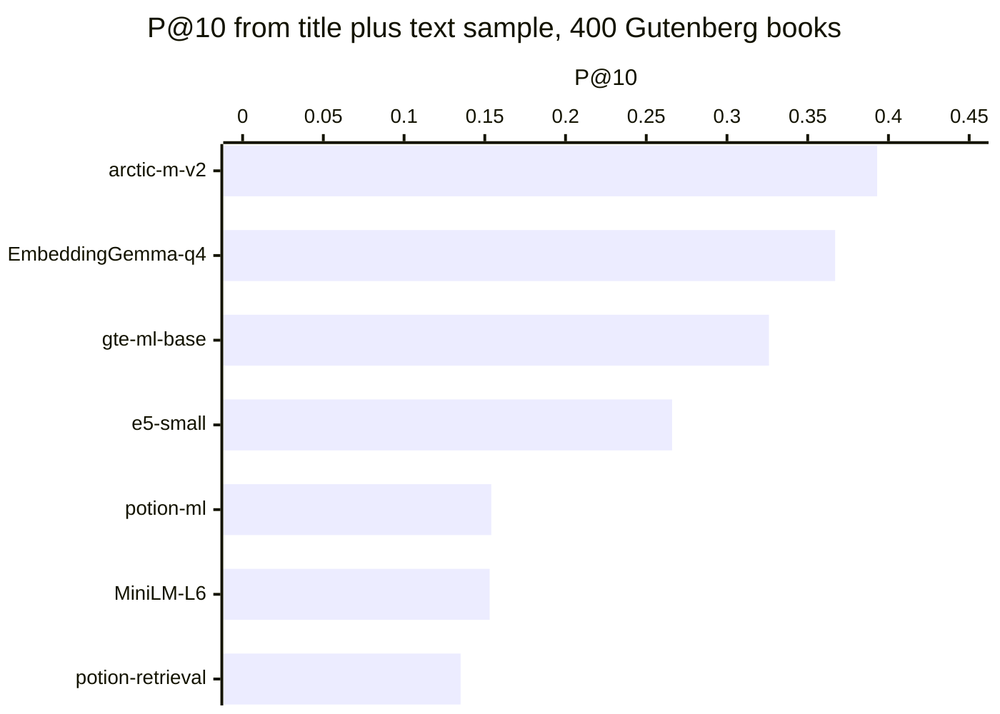
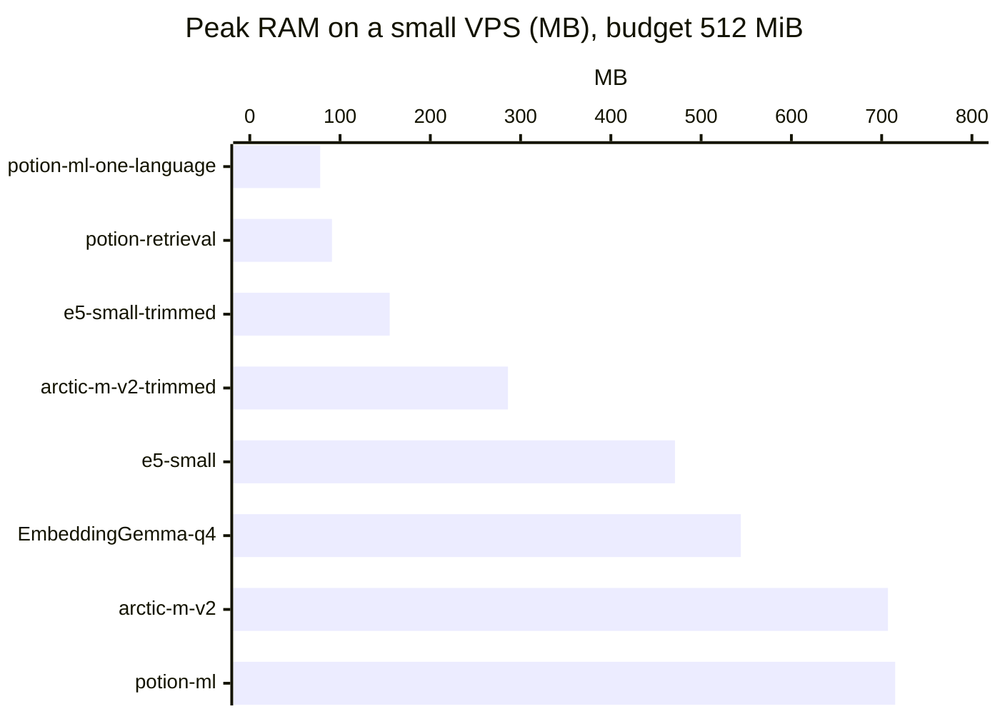
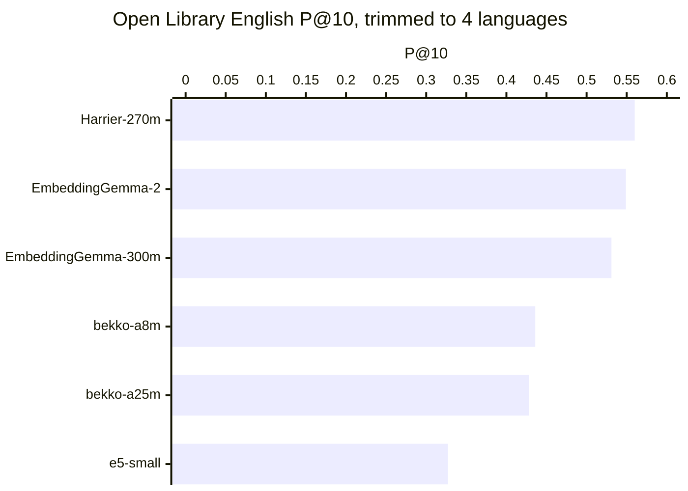

# Embedding model benchmarks

This page records how well candidate text-embedding models match a
reader's taste, and what they cost to run, measured in November 2026. It
is the evidence for choosing the models that Discover's semantic taste
ranking will offer. Discover still ranks with the local-hash embedder
today (see [Discovery design](discovery.md#embeddings-small--vps-friendly)).

> [!NOTE]
> These are research results, not shipped behavior. No model on this
> page is in a release yet.

## What was measured

Every test asks the same question Discover asks: given five books a
reader finished in one genre, are the 10 nearest books by embedding in
the same genre? The score is **precision at 10** (P@10), the share of
those 10 that match, averaged over 300 to 400 random trials. Books by
the seed books' authors are left out, because Discover already boosts
them by author.

Three test sets were used:

- **Open Library:** 765 English works in 16 subjects, embedded from
  title, authors and description.
- **Wikipedia:** 716 novels in 15 Wikidata genres, with the article's
  intro in English (716), Spanish (654), French (436) and German (317).
- **Project Gutenberg:** 400 public-domain books (136 German, 99
  English, 98 French, 67 Spanish) in 10 fiction genres from Gutenberg's
  own shelves, with their full text. Another 130 books were held back to
  build the trimmed vocabularies below.

Cost was measured in Docker at two sizes:

- **Small VPS:** the plugin's default budget of 0.8 vCPU and 512 MiB,
  with one thread.
- **Desktop:** 8 vCPU, 8 GB and 4 threads.

A **chunk** is up to 256 tokens of text, about one book description.

## Quality across languages

| Model | English | Spanish | French | German | English seeds, Spanish books | Finds its own translation |
| --- | --- | --- | --- | --- | --- | --- |
| arctic-embed-m-v2.0 | 0.482 | 0.407 | 0.420 | 0.398 | 0.431 | 99% |
| EmbeddingGemma-300m q4 | 0.476 | 0.445 | 0.439 | 0.417 | 0.421 | 94% |
| EmbeddingGemma-300m | 0.466 | 0.428 | 0.444 | 0.411 | 0.393 | 95% |
| gte-multilingual-base | 0.454 | 0.342 | 0.355 | 0.330 | 0.379 | 98% |
| multilingual-e5-small | 0.417 | 0.395 | 0.353 | 0.358 | 0.415 | 97% |
| bge-m3 | 0.407 | 0.371 | 0.359 | 0.340 | 0.342 | 99% |
| Qwen3-Embedding-0.6B | 0.478 | 0.300 | 0.328 | 0.273 | 0.358 | 67% |
| multilingual-e5-base | 0.373 | 0.320 | 0.293 | 0.270 | 0.327 | 97% |
| granite-embedding-107m-multilingual | 0.316 | 0.265 | 0.271 | 0.268 | 0.253 | 97% |
| MiniLM-L6-v2 | 0.365 | 0.229 | 0.241 | 0.259 | 0.241 | 78% |
| potion-retrieval-32M (English) | 0.416 | 0.127 | 0.181 | 0.163 | 0.220 | 65% |
| potion-multilingual-128M | 0.253 | 0.226 | 0.237 | 0.196 | 0.196 | 74% |
| paraphrase-multilingual-MiniLM-L12 | 0.237 | 0.217 | 0.213 | 0.188 | 0.200 | 85% |

Chance is about 0.07. "Finds its own translation" is how often a
book's English intro is nearest to its own Spanish intro.

What this shows:

- The English-only models fall apart outside English: potion-retrieval
  drops from 0.42 to 0.13 in Spanish.
- Among models that fit a small VPS, multilingual-e5-small is the
  strongest; arctic-embed-m-v2.0 and EmbeddingGemma lead overall.
- On the English-only Open Library set, potion-retrieval-32M (0.453)
  ties arctic-embed-m-v2.0 (0.455), and EmbeddingGemma leads (0.53).

## Text, chapters and openings

The Gutenberg set compares what to embed. A **text sample** is 8
passages of about 1,000 characters, spread evenly through the book.

| Model | Title and author | Opening 1,000 characters | Text sample | Title plus text sample | Chapter titles plus text sample (English) |
| --- | --- | --- | --- | --- | --- |
| arctic-embed-m-v2.0 | 0.276 | 0.256 | 0.341 | 0.393 | 0.189 |
| EmbeddingGemma-300m q4 | 0.242 | 0.236 | 0.383 | 0.367 | 0.233 |
| gte-multilingual-base | 0.235 | 0.207 | 0.320 | 0.326 | 0.173 |
| multilingual-e5-small | 0.220 | 0.152 | 0.269 | 0.266 | 0.166 |
| potion-multilingual-128M | 0.132 | 0.125 | 0.200 | 0.154 | 0.172 |
| MiniLM-L6-v2 | 0.176 | 0.133 | 0.177 | 0.153 | 0.175 |
| potion-retrieval-32M | 0.148 | 0.122 | 0.151 | 0.135 | 0.199 |

Candidates here may be in any language, and chance is 0.08. The
chapter column covers the 170 books with three or more chapter headings,
where only the English groups were big enough to score (chance 0.04).

What this shows:

- A text sample lifts every multilingual model; arctic goes from 0.28 to
  0.39. The English-only models barely move, because most of these books
  aren't in English.
- The opening alone is worse than a spread-out sample. Openings are
  front matter, prefaces and tables of contents.
- Chapter titles add little: most are just "Chapter IV". Use them only
  when they're real names.
- Gutenberg's shelves are noisy, so read these scores for direction.

## Memory and speed

| Model | Peak RAM, small VPS (MB) | Small VPS: ms per chunk | Desktop: ms per chunk |
| --- | --- | --- | --- |
| potion-retrieval-32M int8 | 91 | 0.5 | 0.1 |
| potion-multilingual-128M int8, one language | 66 to 78 | 1.1 | 0.1 |
| multilingual-e5-small, trimmed to 4 languages | 155 | 77 | 8.2 |
| arctic-embed-m-v2.0, trimmed to 4 languages | 286 | 207 | 34 |
| MiniLM-L6-v2 | 243 | 19 | 4.3 |
| granite-embedding-107m-multilingual | 531 | 17 | 3.5 |
| EmbeddingGemma-300m q4 | 544 | 264 | 66 |
| multilingual-e5-small | 471 | 79 | 8.2 |
| arctic-embed-m-v2.0 | 707 | out of memory | 34 |
| gte-multilingual-base | 1,002 | out of memory | 33 |
| EmbeddingGemma-300m | 1,563 | out of memory | 72 |

> [!NOTE]
> The times in this table come from batches of 8 texts padded to the
> longest one, which roughly doubles the cost of each text (multilingual-e5-small
> takes 77 ms a text in a batch of 8 and 37 ms alone). They compare models
> fairly with each other, but [Fast multilingual models](#fast-multilingual-models)
> has the times to plan with: one description at a time.

granite and EmbeddingGemma q4 peaked just above 512 MiB and survived only
because the kernel didn't reclaim in time, so they don't count as
fitting. potion-multilingual-128M untrimmed peaks at 715 MB and fails
too.

## Trimming to the library's languages

The multilingual models carry a vocabulary of about 250,000 tokens for
some 100 languages. That table and its tokenizer are most of their
memory. **Trimming** keeps only the tokens a set of languages uses: it
slices the model's word-embedding table and renumbers the tokenizer, and
leaves the rest of the network alone.

| Model | Tokens kept | Peak RAM (MB) | Same vectors? | Open Library P@10 |
| --- | --- | --- | --- | --- |
| multilingual-e5-small, 4 languages | 55,952 of 250,002 | 471 to 155 | Yes | 0.320 to 0.327 |
| arctic-embed-m-v2.0, 4 languages | 46,197 of 250,002 | 707 to 286 | Nearly | 0.455 to 0.459 |
| arctic-embed-m-v2.0, English | 33,296 of 250,002 | 707 to 285 | Nearly | 0.455 to 0.455 |
| multilingual-e5-small, 7 languages | 65,172 of 250,002 | 471 to 167 | Yes | |
| arctic-embed-m-v2.0, 7 languages | 52,004 of 250,002 | 707 to 309 | Nearly | |
| potion-multilingual-128M, one language | 37,054 to 51,743 of 500,353 | 715 to 66 to 78 | Yes | 0.294 to 0.293 |

The 7-language rows add Italian, Portuguese and Japanese, so the set
covers every language Audible sells in. Their token lists came from 12
Gutenberg books per added language, so lists built from a larger corpus
will keep more tokens.

"Nearly" means a rare word now splits into smaller pieces, which moved
the lowest cosine between old and new vectors to 0.96. A word outside
the kept tokens still embeds, from those pieces.

A plain static distillation of multilingual-e5-small (model2vec, with no
further training) scored 0.14 on Open Library, against 0.45 for
potion-retrieval-32M. Good static models need an extra training pass per
language; the next section measures that pass.

## Trained static models

A static model can be trained per language so that the average of its
token vectors matches a transformer's output (tokenlearn, the method
behind the potion models). Five such models were trained on one consumer
GPU (8 GB): 1 million passages each, the teacher run in 16-bit floats,
outputs reduced to 256 dimensions. Each was then trimmed to the tokens it
saw in training and stored as 8-bit integers.

| Model | Open Library English P@10 | Wikipedia English | Wikipedia German | English to German | int8 size |
| --- | --- | --- | --- | --- | --- |
| potion-retrieval-32M (published) | 0.451 | 0.419 | 0.163 | 0.245 | 32 MB |
| potion-base-32M (published) | 0.384 | 0.336 | 0.140 | 0.183 | 32 MB |
| English, bge-base teacher | 0.379 | 0.368 | 0.208 | 0.215 | 18 MB |
| English, multilingual-e5-small teacher | 0.270 | 0.236 | 0.142 | 0.176 | 46 MB |
| German, multilingual-e5-small teacher | 0.143 | 0.184 | 0.237 | 0.160 | 42 MB |
| German, arctic-embed-m-v2.0 teacher | 0.199 | 0.255 | 0.217 | 0.239 | 42 MB |
| German, bge-m3 teacher | 0.290 | 0.285 | 0.202 | 0.256 | 42 MB |
| multilingual-e5-small, trimmed (transformer) | 0.327 | 0.417 | 0.358 | 0.341 | 48 MB |
| arctic-embed-m-v2.0, trimmed (transformer) | 0.459 | 0.482 | 0.398 | 0.421 | 154 MB |

- The English bge-base run reproduces potion-base-32M (0.379 against
  0.384), so the method was applied correctly.
- Training for German lifts German P@10 from 0.163 (potion-retrieval) to
  at most 0.237, which is about 60% of the transformers' 0.36 to 0.40.
- A larger teacher does not close the gap: bge-m3 (568M parameters) gives
  the best cross-language scores of the static models but a lower German
  score than the e5-small student.
- Trimming and 8-bit storage cost less than 0.005 P@10, and every static
  model embeds a text in about 0.1 ms on one core.
- Each run took 1.2 to 5 hours, so building models per language in CI is
  feasible; the quality is what limits them.

## A smaller tokenizer

A trimmed model still loads its tokenizer from `tokenizer.json`, which
costs 48 to 58 MB for multilingual-e5-small. SentencePiece Lite, the
small runtime in the SentencePiece repository, reads a compact model file
straight from disk instead. It was built as a 64 KB library and given a
SentencePiece model holding only the kept tokens, numbered like the
trimmed `tokenizer.json`: a 2.0 MB file for 4 languages and 2.5 MB for 7.

| multilingual-e5-small | `tokenizer.json` | Lite, pruned model |
| --- | --- | --- |
| Tokenizer memory, 4 languages (MB) | 48 | 6 |
| Tokenizer memory, 7 languages (MB) | 58 | 6 |
| Time per text (ms) | 0.28 to 0.30 | 0.05 |
| Whole pipeline peak, 4 languages (MB) | 268 | 246 |
| Whole pipeline peak, 7 languages (MB) | 281 | 249 |

- Lite gives the same token ids as full SentencePiece on all 3,140 test
  texts (765 Open Library, 2,375 Wikipedia), for every model tried.
- For multilingual-e5-small, SentencePiece and `tokenizer.json` disagree
  on 563 of the Wikipedia texts, trimmed or not: `tokenizer.json` adds a
  lone trailing space token and maps a few rare characters to unknown.
  The vectors stay close (mean cosine 0.995, lowest 0.964).
- Keeping all 250,000 pieces and marking the dropped ones unused saves
  nothing. The model file has to hold only the kept pieces.

These peaks include about 29 MB for the Python process that ran the test.

## Trimmed EmbeddingGemma

EmbeddingGemma-300m (4-bit) was trimmed the same way, with a trimmer that
keeps every merge step its byte-pair tokenizer needs to build a kept
token.

| Variant | Tokens kept | Weights (MB) | Peak RAM with Lite (MB) | Open Library P@10 | Wikipedia English | Wikipedia German |
| --- | --- | --- | --- | --- | --- | --- |
| Full | 262,144 | 197 | 359 | 0.526 | 0.476 | 0.417 |
| 4 languages | 111,846 | 122 | 291 | 0.531 | 0.477 | 0.421 |
| 7 languages | 121,574 | 129 | 293 | 0.528 | 0.478 | 0.419 |

- Trimming costs no quality, and Lite's ids match `tokenizer.json` on
  every test text.
- It takes about 400 ms for one description on one core, 11 times
  multilingual-e5-small. That is too slow for a small server and slow
  even on a desktop.
- The trimmed copy is a modified Gemma model under Google's Gemma terms,
  which pass use restrictions on to everyone who receives it.

## Fast multilingual models

The last round looked for a multilingual transformer fast enough to embed
at request time, that trims and runs with Lite. Four newer models were
tested against multilingual-e5-small:

- **bekko-a8m** and **bekko-a25m** (MIT): mmBERT-small cut to 4 and 13
  layers.
- **Harrier 270m** (MIT), 4-bit: a Gemma-3-sized decoder, with
  last-token pooling and an instruction prefix on queries.
- **EmbeddingGemma 2** (Apache 2.0), 4-bit: tested untrimmed.

Times are for one description of about 150 tokens at a time, on one core.

| Model, trimmed to 4 languages | ms per description | ms per query | Peak RAM with Lite (MB) | Open Library P@10 | Wikipedia English | Spanish | French | German | English seeds, German books |
| --- | --- | --- | --- | --- | --- | --- | --- | --- | --- |
| bekko-a8m | 28 | 3 | 221 | 0.436 | 0.489 | 0.398 | 0.363 | 0.385 | 0.405 |
| multilingual-e5-small | 36 | 4 | 150 | 0.327 | 0.421 | 0.396 | 0.369 | 0.356 | 0.346 |
| bekko-a25m | 89 | 14 | 221 | 0.428 | 0.494 | 0.411 | 0.428 | 0.419 | 0.429 |
| Harrier 270m | 305 | 77 | 208 | 0.560 | 0.557 | 0.501 | 0.501 | 0.452 | 0.471 |
| EmbeddingGemma-300m | 398 | 50 | 291 | 0.531 | 0.477 | 0.441 | 0.433 | 0.421 | 0.418 |
| EmbeddingGemma 2 (untrimmed) | 421 | | | 0.549 | 0.494 | 0.434 | 0.463 | 0.405 | 0.455 |

Trimming these models, for English, German, French and Spanish:

| Model | Tokens kept | Weights (MB) | Lite model file (MB) | Peak RAM, `tokenizer.json` to Lite (MB) | Lite ids match |
| --- | --- | --- | --- | --- | --- |
| bekko-a8m | 135,671 of 256,000 | 130 to 83 | 4.5 | 241 to 221 | 3,140 of 3,140 |
| bekko-a25m | 135,671 of 256,000 | 199 to 152 | 4.5 | 241 to 221 | 3,140 of 3,140 |
| Harrier 270m | 111,847 of 262,144 | 197 to 144 | 3.7 | 231 to 208 | 3,140 of 3,140 |

What this shows:

- bekko-a8m is faster than multilingual-e5-small and better on Open
  Library by a third. It trails only in French, by 0.006.
- Harrier is the most accurate model in every column, at about 11 times
  bekko-a8m's cost per description.
- Trimming changes no score by more than 0.013, and untrimmed bekko-a8m
  peaks at 460 MB against 221 MB trimmed with Lite.
- EmbeddingGemma 2 has the same depth as EmbeddingGemma-300m, so it is no
  faster.
- bekko publishes only `tokenizer.json`. A SentencePiece model was built
  from it for Lite, and the caller must first split the text on the
  tokenizer's added tokens (newlines and HTML tags). With that, the ids
  match on every text.
- Italian, Portuguese and Japanese were not scored in this round.

## What the results suggest

- A multilingual transformer trimmed to the library's languages, with
  the Lite tokenizer, is the approach: it keeps the model's vectors and
  fits a small server.
- bekko-a8m suits a default: about 28 ms a description and 3 ms a search
  query on one core, in about 220 MB.
- Harrier 270m suits desktops and background embedding where accuracy
  matters more than time.
- English-only and static models are not worth a second code path:
  potion-retrieval-32M scores 0.451 on English Open Library against
  bekko-a8m's 0.436, and falls to 0.13 to 0.18 outside English.
- Descriptions are the main signal. A text sample can be added later as a
  background pass: at 8 chunks a book, 1,000 books take roughly 5 minutes
  with bekko-a8m on one core.
- EmbeddingGemma-300m is slower than Harrier, scores lower, and is under
  Google's Gemma terms rather than an open-source licence.

## How the tests were run

- Quality runs used ONNX Runtime on CPU from Python, with each model's
  published quantized weights where it has them.
- Token ids were compared text by text between `tokenizer.json`, full
  SentencePiece and Lite, and vectors by cosine.
- Memory is the process's peak resident size. Speed runs used one thread
  on an otherwise idle machine, and were taken twice.
- Trimmed and untrimmed runs of the same model differ by up to 0.013,
  so differences that small are not findings.

## Next steps

- [Discovery design](discovery.md): how suggestions are found and ranked.
- [Plugins](../plugins/README.md): where an embedder would run.
