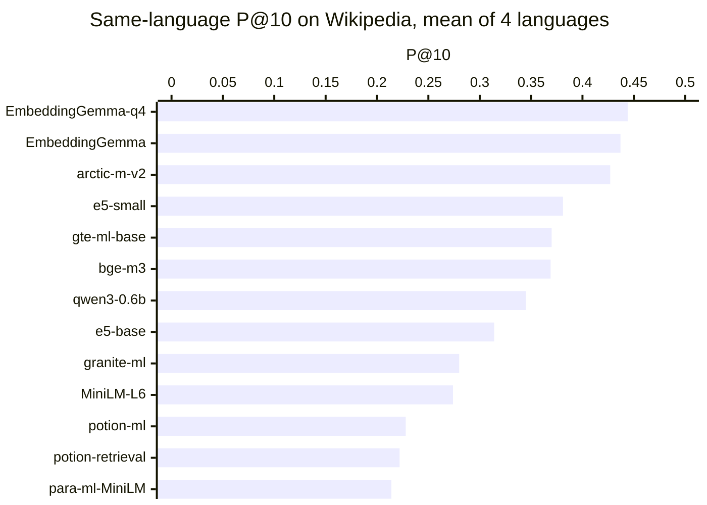
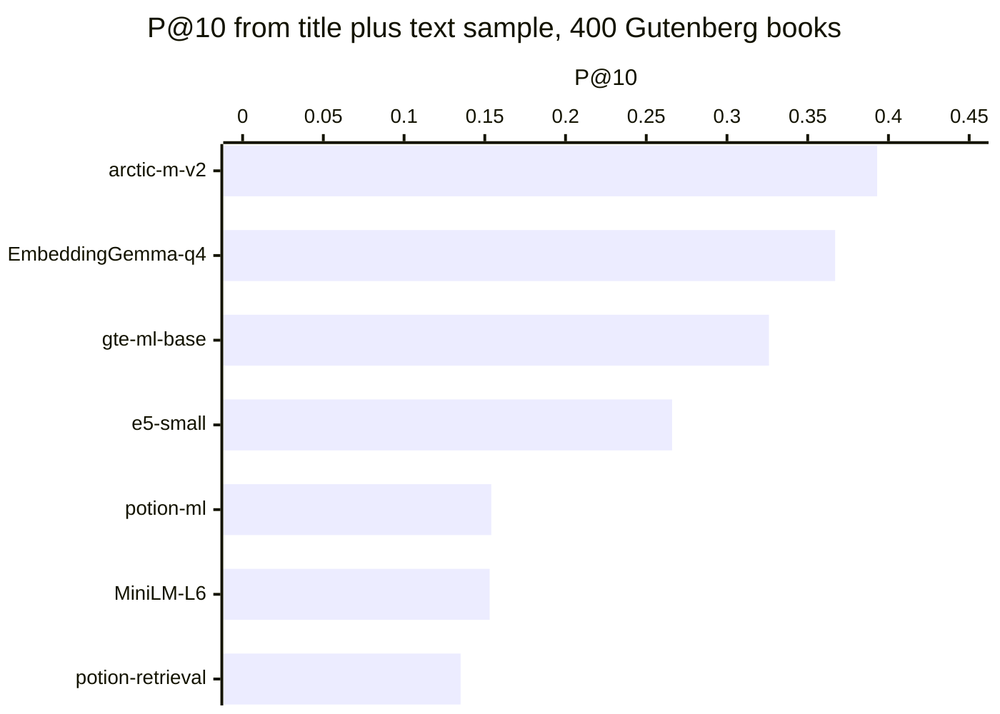
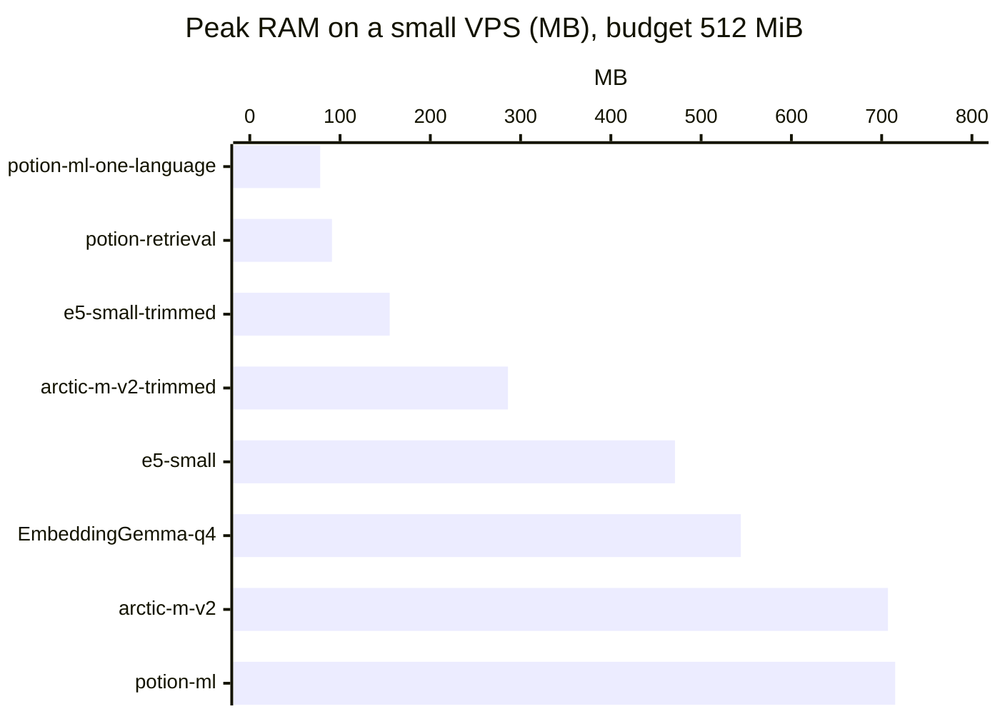

# Embedding model benchmarks

This page records how well candidate text-embedding models match a
reader's taste, and what they cost to run, measured in November 2026. It
is the evidence for choosing the models that Discover's semantic taste
ranking will offer. Discover still ranks with the local-hash embedder
today (see [Discovery design](discovery.md#embeddings-small--vps-friendly)).

> [!NOTE]
> These are research results, not shipped behavior. No model on this
> page is in a release yet.

## What was measured

Every test asks the same question Discover asks: given five books a
reader finished in one genre, are the 10 nearest books by embedding in
the same genre? The score is **precision at 10** (P@10), the share of
those 10 that match, averaged over 300 to 400 random trials. Books by
the seed books' authors are left out, because Discover already boosts
them by author.

Three test sets were used:

- **Open Library:** 765 English works in 16 subjects, embedded from
  title, authors and description.
- **Wikipedia:** 716 novels in 15 Wikidata genres, with the article's
  intro in English (716), Spanish (654), French (436) and German (317).
- **Project Gutenberg:** 400 public-domain books (136 German, 99
  English, 98 French, 67 Spanish) in 10 fiction genres from Gutenberg's
  own shelves, with their full text. Another 130 books were held back to
  build the trimmed vocabularies below.

Cost was measured in Docker at two sizes:

- **Small VPS:** the plugin's default budget of 0.8 vCPU and 512 MiB,
  with one thread.
- **Desktop:** 8 vCPU, 8 GB and 4 threads.

A **chunk** is up to 256 tokens of text, about one book description.

## Quality across languages

| Model | English | Spanish | French | German | English seeds, Spanish books | Finds its own translation |
| --- | --- | --- | --- | --- | --- | --- |
| arctic-embed-m-v2.0 | 0.482 | 0.407 | 0.420 | 0.398 | 0.431 | 99% |
| EmbeddingGemma-300m q4 | 0.476 | 0.445 | 0.439 | 0.417 | 0.421 | 94% |
| EmbeddingGemma-300m | 0.466 | 0.428 | 0.444 | 0.411 | 0.393 | 95% |
| gte-multilingual-base | 0.454 | 0.342 | 0.355 | 0.330 | 0.379 | 98% |
| multilingual-e5-small | 0.417 | 0.395 | 0.353 | 0.358 | 0.415 | 97% |
| bge-m3 | 0.407 | 0.371 | 0.359 | 0.340 | 0.342 | 99% |
| Qwen3-Embedding-0.6B | 0.478 | 0.300 | 0.328 | 0.273 | 0.358 | 67% |
| multilingual-e5-base | 0.373 | 0.320 | 0.293 | 0.270 | 0.327 | 97% |
| granite-embedding-107m-multilingual | 0.316 | 0.265 | 0.271 | 0.268 | 0.253 | 97% |
| MiniLM-L6-v2 | 0.365 | 0.229 | 0.241 | 0.259 | 0.241 | 78% |
| potion-retrieval-32M (English) | 0.416 | 0.127 | 0.181 | 0.163 | 0.220 | 65% |
| potion-multilingual-128M | 0.253 | 0.226 | 0.237 | 0.196 | 0.196 | 74% |
| paraphrase-multilingual-MiniLM-L12 | 0.237 | 0.217 | 0.213 | 0.188 | 0.200 | 85% |

Chance is about 0.07. "Finds its own translation" is how often a
book's English intro is nearest to its own Spanish intro.

What this shows:

- The English-only models fall apart outside English: potion-retrieval
  drops from 0.42 to 0.13 in Spanish.
- Among models that fit a small VPS, multilingual-e5-small is the
  strongest; arctic-embed-m-v2.0 and EmbeddingGemma lead overall.
- On the English-only Open Library set, potion-retrieval-32M (0.453)
  ties arctic-embed-m-v2.0 (0.455), and EmbeddingGemma leads (0.53).

## Text, chapters and openings

The Gutenberg set compares what to embed. A **text sample** is 8
passages of about 1,000 characters, spread evenly through the book.

| Model | Title and author | Opening 1,000 characters | Text sample | Title plus text sample | Chapter titles plus text sample (English) |
| --- | --- | --- | --- | --- | --- |
| arctic-embed-m-v2.0 | 0.276 | 0.256 | 0.341 | 0.393 | 0.189 |
| EmbeddingGemma-300m q4 | 0.242 | 0.236 | 0.383 | 0.367 | 0.233 |
| gte-multilingual-base | 0.235 | 0.207 | 0.320 | 0.326 | 0.173 |
| multilingual-e5-small | 0.220 | 0.152 | 0.269 | 0.266 | 0.166 |
| potion-multilingual-128M | 0.132 | 0.125 | 0.200 | 0.154 | 0.172 |
| MiniLM-L6-v2 | 0.176 | 0.133 | 0.177 | 0.153 | 0.175 |
| potion-retrieval-32M | 0.148 | 0.122 | 0.151 | 0.135 | 0.199 |

Candidates here may be in any language, and chance is 0.08. The
chapter column covers the 170 books with three or more chapter headings,
where only the English groups were big enough to score (chance 0.04).

What this shows:

- A text sample lifts every multilingual model; arctic goes from 0.28 to
  0.39. The English-only models barely move, because most of these books
  aren't in English.
- The opening alone is worse than a spread-out sample. Openings are
  front matter, prefaces and tables of contents.
- Chapter titles add little: most are just "Chapter IV". Use them only
  when they're real names.
- Gutenberg's shelves are noisy, so read these scores for direction.

## Memory and speed

| Model | Peak RAM, small VPS (MB) | Small VPS: ms per chunk | Desktop: ms per chunk |
| --- | --- | --- | --- |
| potion-retrieval-32M int8 | 91 | 0.5 | 0.1 |
| potion-multilingual-128M int8, one language | 66 to 78 | 1.1 | 0.1 |
| multilingual-e5-small, trimmed to 4 languages | 155 | 77 | 8.2 |
| arctic-embed-m-v2.0, trimmed to 4 languages | 286 | 207 | 34 |
| MiniLM-L6-v2 | 243 | 19 | 4.3 |
| granite-embedding-107m-multilingual | 531 | 17 | 3.5 |
| EmbeddingGemma-300m q4 | 544 | 264 | 66 |
| multilingual-e5-small | 471 | 79 | 8.2 |
| arctic-embed-m-v2.0 | 707 | out of memory | 34 |
| gte-multilingual-base | 1,002 | out of memory | 33 |
| EmbeddingGemma-300m | 1,563 | out of memory | 72 |

granite and EmbeddingGemma q4 peaked just above 512 MiB and survived only
because the kernel didn't reclaim in time, so they don't count as
fitting. potion-multilingual-128M untrimmed peaks at 715 MB and fails
too.

## Trimming to the library's languages

The multilingual models carry a vocabulary of about 250,000 tokens for
some 100 languages. That table and its tokenizer are most of their
memory. **Trimming** keeps only the tokens a set of languages uses: it
slices the model's word-embedding table and renumbers the tokenizer, and
leaves the rest of the network alone.

| Model | Tokens kept | Peak RAM (MB) | Same vectors? | Open Library P@10 |
| --- | --- | --- | --- | --- |
| multilingual-e5-small, 4 languages | 55,952 of 250,002 | 471 to 155 | Yes | 0.320 to 0.327 |
| arctic-embed-m-v2.0, 4 languages | 46,197 of 250,002 | 707 to 286 | Nearly | 0.455 to 0.459 |
| arctic-embed-m-v2.0, English | 33,296 of 250,002 | 707 to 285 | Nearly | 0.455 to 0.455 |
| potion-multilingual-128M, one language | 37,054 to 51,743 of 500,353 | 715 to 66 to 78 | Yes | 0.294 to 0.293 |

"Nearly" means a rare word now splits into smaller pieces, which moved
the lowest cosine between old and new vectors to 0.96. A word outside
the kept tokens still embeds, from those pieces.

A plain static distillation of multilingual-e5-small (model2vec, with no
further training) scored 0.14 on Open Library, against 0.45 for
potion-retrieval-32M. Good static models need an extra training pass per
language, so trimming an existing model is the cheaper route.

## What the results suggest

- For an English-only library, potion-retrieval-32M is good enough at
  every size and costs almost nothing.
- For a multilingual library, multilingual-e5-small trimmed to the
  library's languages fits a small VPS, and arctic-embed-m-v2.0 trimmed
  the same way fits too and scores higher, at about 2.7 times the CPU.
- Descriptions are the main signal. A text sample can be added later as a
  background pass: at 8 chunks a book, 1,000 books take about 10 minutes
  with trimmed e5-small on a small VPS.
- EmbeddingGemma-300m is under Google's Gemma terms rather than an
  open-source licence, so it needs a licence review before Bookclerk could
  ship it.

## Next steps

- [Discovery design](discovery.md): how suggestions are found and ranked.
- [Plugins](../plugins/README.md): where an embedder would run.
