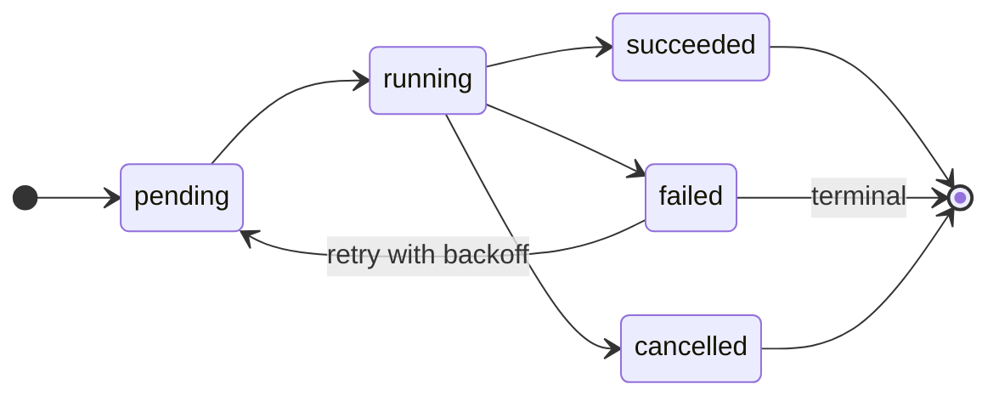

# Durable job queue

`bookclerkd` admits background work as **durable rows** in the host library
database (`jobs` + `job_temp_paths` on the same schema as `books` and
`accounts`). HTTP and the interval scheduler are producers; leased workers
claim jobs. There is no external broker and **no dedicated jobs database**.

The queue is host-owned. Guests never receive SQL against `jobs` (or any other
library table). A plugin that needs its own durable store declares a named
database binding; that unit is physically separate and holds only plugin-owned
DDL. Job lifecycle (admit, claim, heartbeat, complete) stays host SeaORM /
typed host plans on the library.

This is not a general pub/sub bus. Domain events such as `book_acquired` /
plugin `event(batch)` stay **off** `JobKind`. They use a durable outbox
(`domain_events` + `event_deliveries` + `event_subscriber_nodes`) with
the same fenced-lease pattern as jobs. Acquire success publishes
`book_acquired` with producer `source` on the envelope. Each host heartbeats discovered (config-enabled, even if spawn
failed) and loaded integrations into a **per-node** catalog keyed by
`(node_id, PluginKey)` (`plugin_id` stores the canonical PluginKey, not the
display alias) and does **not** delete other nodes’ rows. The catalog key is
the node id from `node-identity.json`, the same id the node registers with
the cluster and claims its `node.<node_id>` queue under. Dispatch uses
the live union (any enabled node whose heartbeat is within 60s). Optional
payload-object filters and `resource_class` (currently `network` only) are
matched host-side. Each dispatcher tick dispatches at most 32 undispatched
events, then always runs a wake slice (so a backlog cannot starve sleepers or
the catalog heartbeat) and continues when either undispatched remain or
`wake still_pending`. Late-join is a **missing `(event_id, plugin_id)` anti-join**
paged 200, restricted to the retention window — an unchanged catalog with no
missing pairs does a bounded empty `SELECT` and zero dispatch writes. D1
dispatch receipts are per pair (`dispatch-{event_id}-{plugin_id}` /
`reconcile-{event_id}-{plugin_id}`). Each VPS claims only PluginKeys loaded on
that process **and** only events its own node catalog matches (type, schema
version, filter). `[events]` retention and concurrency are stored in the database after the
first import (`core.events`; see [configuration](../server/configuration.md) and
[ADR: Control plane](../adr/control-plane.md)). `[events.concurrency]` is both the
local worker count **and** the
cluster-wide max `running` deliveries per `(plugin_id, resource_class)`
(serialized with a portable `bookclerk_slots` row).
`EventResult::suspended` may set `wakeOnEventType` / `wakeOnFilterJson`; the
host derives wake grants from declared subscriptions (schema versions plus the
intersection of `sub.filter` and the requested filter — requested keys only
add constraints) and wakes matching parked rows in the same account when a
later event is published. Publish commits `domain_events.wake_pending = 1` and
returns; the dispatcher claims bounded wake slices with a unique UUID fence
token (`wake_lease_*` + delivery cursor, at most 32 events and one page
each sized from negotiated `maxBinds`)
so producer latency does not track sleeper count. Cursor release, finish,
and the sleeper UPDATE require that token in the same statement; a lost
fence does not clobber another owner or a later wake registration.
Accepting a wake clears the registration so a later matching event does not
re-wake a retry. Duplicate retries leave the flag set until a claimed
slice finishes. `wakeOnEventType` must be a declared subscription (empty stays
timestamp-only); an empty requested filter keeps the subscription filter and
cannot broaden it. Late-join skip cache is invalidated on dispatch error and
reconciles at least every 60s as a backstop.
`GET /api/status` includes event queue counts plus durable retry/suspend totals
and average dispatch/handler latency. Retention is independent of jobs
(`[events].retention_days` for acked/rejected + empty parent events after that
cutoff, `dead_letter_retention_days` for dead letters). Prune is a
cluster singleton, not a dispatcher tick: see *Cluster maintenance* below.
Operator APIs: `GET /api/events`,
`GET /api/events/deliveries?state=dead_letter`,
`POST /api/events/deliveries/{id}/retry`,
`POST /api/events/deliveries/{id}/acknowledge`,
`POST /api/events/deliveries/{id}/cancel`,
`POST /api/events/deliveries/{id}/resume`. CLI:
`bookclerk events list|dead-letters|retry|ack|cancel|resume`. Plugin-owned
queues (`[queues]` in `plugin.toml`) ride the same outbox tables under their
own `queue_name`; `GET /api/queues`, `GET /api/queues/{name}` and
`bookclerk queues list|inspect <name>` show per-queue counters, live
consumers, recent messages and deliveries (see
[abi.md#queues](../plugins/abi.md#queues)).

See [architecture.md](architecture.md), [plugins.md](../plugins/README.md), and
[operations.md](../server/operations.md).

## Command envelope

Each row stores a versioned JSON command (`JobPayload.v`, currently `1`).
Unknown kinds, unsupported versions, and malformed JSON are rewritten to
`kind=invalid` / `state=failed` / `error_kind=invalid_job` and never run a
handler.

Dispatch goes through `JobTransport` (`InProcessJobTransport` today; a workerd
adapter can replace it later). Handlers receive a `JobExecCtx` with the lease
fence and a cooperative cancel flag.

## State machine

- **Admission** is one atomic backend operation (a guest atomic batch in
  production, a local `BEGIN` in tests). A partial unique index on `dedup_key` for
  `pending`/`running` rows enforces active-key uniqueness.
- A **worker** claims with a conditional `pending` → `running` update and a
  unique per-attempt `lease_generation`. Lost RPCs retry the same
  `operation_id` so a replay cannot claim a second row. That replay is
  bounded (2s); if the database stays `Unavailable`, the worker returns the
  error, drops the `job_runtime` read permit so a plugin swap can proceed,
  and lets an ambiguously claimed row expire for reclaim. The next loop
  iteration uses a new operation id.
- Heartbeat, progress, complete, fail, and reclaim are fenced on
  `(job_id, lease_owner, lease_generation)`. Zero rows (`Ok(false)`) means the
  fence is lost; the worker cancels the handler and ignores the unfenced
  result. A heartbeat **error** (transient DB/RPC failure) is retried only
  until the last confirmed lease expiry; past that deadline the worker
  cancels locally and ignores the result. It must not finalize the row as
  `cancelled` unless `cancel_requested` is set.
- Destination **publish** is not atomic with that fence. `plugin_copy`
  stream-copy is at-least-once: a lost lease can still make object bytes
  visible after the last heartbeat. Duplicates are absorbed by retry-stable
  `commit_token`s. A missing stage counts as success only when the published
  object's `commit-token` metadata is that token (see
  [storage-bounds.md](storage-bounds.md)). A pre-commit heartbeat does not
  make publication exactly-once.
- Storage scans checkpoint `storage_scan` JSON (instance id, generation,
  phase, cursor) with `checkpoint_running_job` while the row stays `running`.
  The generation is a UUID bound in `storage_scan_generations` to that storage
  instance and the job. Local-backed scans, including fan-out and plugin
  wrappers, also store the node placement (the node id from
  `node-identity.json`). A resume on another node, or a backend whose placement cannot
  be proved, starts a new scan instead of adopting the old rows. Object rows
  live in `storage_scan_rows`, not in the 64 KiB checkpoint. Page inserts happen before the cursor advances; replaying
  a page is idempotent.   `run_acquire` performs one fenced scan and matches
  against that index. An `apply` checkpoint is adopted only when its
  generation row still exists and is marked complete; a missing or incomplete
  inventory is scanned again.   A successful acquire, including one with no
  targets, deletes the generation before the handler returns. Inventory rows
  and the generation row are deleted in one database transaction. Startup
  reclaim removes abandoned generations and does not remove one owned by a
  pending or running job. While the daemon is up, a bounded sweep and each
  confirmed terminal transition delete inventories for terminal jobs. A
  failed attempt that will be retried, a lost fence, and suspended work leave
  the generation in place. Local list indexes are node-local scratch and are
  not a portable checkpoint.
- MP3 conversion counts input bytes, then reserves the whole temp quota for
  that scratch path: the output allowance is every quota byte not used by
  the input. Encoded size is not capped at a multiple of the source, so a
  low-bitrate AAC file converted at 320 kbps can exceed eight times the
  input while input plus output stay inside the quota. The worker write cap
  is that reserved allowance. No `temp_quota_bytes` does not impose a
  ceiling. A second job cannot reserve more scratch until the first
  releases the quota. The worker stops writing when the next chunk would
  pass the allowance, and dropping the encode future kills the worker.
  Scratch is `cache/convert`. The reservation is dropped only after the
  directory is gone. A cleanup failure keeps the reservation. Startup sweep
  includes `convert` and keeps directories registered to an active job.
- Reclaim also requires `lease_expires_at` to still be null or `<= now`, so a
  heartbeat that extends the same generation cannot be stolen.
- `POST /api/jobs/{id}/cancel` cancels `pending` immediately and flags
  `running` for a cooperative stop between acquire titles, scan sources, and
  listen-sync providers. Cancel retries if a worker claims the row between the
  pending read and the pending-only CAS, so a cancel that returns never leaves
  a running job unflagged. Integration `scan_library` RPCs are not interruptible;
  cancel is checked before the call and a repeat remote scan is idempotent.

## Job kinds

| Kind | Dedup key | Resource class | Handler |
| --- | --- | --- | --- |
| `scan` | `scan:account={id\|all}`, then `:instance={id}` when pinned | `network` | `run_scan` |
| `acquire` | `acquire:title={id\|all}:account={id\|all}`, then `:force=1`, `:pdf=1` and `:instance={id}` when set | `network` | `run_acquire` |
| `listen_sync` | `listen_sync` | `network` | `run_listen_sync` |
| `integration_scan` | `integration_scan:id={id}:force={0\|1}` | `network` | `run_integration_scan` |
| `plugin_copy` | `plugin_copy:plugin={id}:from={key}:to={key}` | `network` | ABI `JobRunner` stream-copy (`run_plugin_copy`) |

Reserved classes (no worker in this release): `media`, `transcription`,
`indexing`.

## Admission and backpressure

`POST /api/library/scan`, `/acquire`, `/api/discover/sync-listening`, and
`/integrations/{id}/scan` (and the scheduler) call
`LibraryStore::enqueue_job`:

| Outcome | HTTP | Meaning |
| --- | --- | --- |
| Created | 200 | New row; worker is notified |
| Duplicate | 409 | Same dedup key already `pending` or `running`; `job_id` is the existing row |
| QueueFull | 429 | `pending + running >= jobs.max_pending` |
| Unroutable | 409 | `error: "unroutable"`: the job's required instances share no node (see job routing below); no row is written |

A scan goes through the scan planner first (`control_plane::plan_scan`).
An operator, an Owner, an Administrator, or the scheduler scanning every
account gets one `scan` job per scan-enabled account id, so the response
also carries `job_ids` (200 when any was accepted, 409 when all were
already queued, 429 when the queue was full, 422 `nothing_to_scan` for an
empty plan); with no scan-enabled account it stays one `scan:account=all`
job. The scan endpoint takes the operator, Owners and Administrators only:
any other portal user is 401, and an operator impersonating one is 403.
The planner also scopes any other user to the accounts linked to them
(naming someone else's account is forbidden), but no HTTP caller reaches
that path yet.

Admission, claim, and handler execution share an `RwLock` (`job_runtime`).
A database plugin swap takes the write permit so it cannot observe an idle
worker that is about to claim. Admission waits up to 15s for a read permit
and returns `503` if a swap holds the lock too long.

Admission, claim, and scratch-quota updates take a write lock on a
`bookclerk_slots` row (`job-queue`) so `COUNT` then `INSERT` cannot
exceed `max_pending` under `READ COMMITTED` on every required backend. The required `postgres job queue` CI job runs those
concurrency tests against a disposable multi-connection database
(`BOOKCLERK_TEST_POSTGRES_URL` + `BOOKCLERK_REQUIRE_POSTGRES_TESTS=1`).
They are `#[ignore]` in the default workspace suite so a missing Postgres
cannot false-pass. TOTP enroll/disable atomic conformance
(`postgres_totp_*`) is not ignored: the same job provisions Postgres and
runs those tests automatically (`BOOKCLERK_REQUIRE_POSTGRES_TESTS=1`).

Claim (native and D1) marks pending rows with malformed JSON, an unknown kind,
an unknown `resource_class`, or an unsupported envelope version as
`invalid_job` before class-specific selection, so a bad row cannot occupy
`max_pending` forever or abort a D1 batch.

### Planners and the CLI

Every scan and acquire is admitted through a planner, whoever asks:

- **Scan** (`control_plane::plan_scan`): operator authority, an Owner or an
  Administrator scanning every account gets one job per scan-enabled
  account; anyone else only the accounts they own (see the control-plane
  ADR, *Per-item trust and the scan planner*).
- **Acquire** (`control_plane::plan_acquire`): each named title id
  (`titles`, UUID, ASIN, ISBN or product id) becomes its own job, so each
  can go to any node trusted with it. Operator authority, an Owner or an
  Administrator acquiring everything gets one unsplit job. Anyone else must
  own a named account and every library row a named title matches (403
  otherwise); with neither, they get one job per account they wholly own.
  `POST /api/library/acquire` takes `{account, plugin_instance_id, titles,
  force, pdf_only}` and answers a multi-job plan like a scan (`job_ids`;
  200, 409, 429, or 422 `nothing_to_acquire` for an empty plan).
- `force` (re-download acquired titles) and `pdf_only` (companion PDFs only)
  are part of the acquire's dedup key and run only on owner nodes; a host
  is never handed such a job. A pinned instance is part of the key too, so
  a pinned acquire never stands in for an unpinned one or another pin.

The CLI `bookclerk library scan` and `library acquire` do not run guests.
They plan as operator authority (the CLI holds the database), record each
job's routing requirements, insert the rows, and then wait for them,
printing state changes to stderr; the first Ctrl-C asks unfinished jobs to
cancel, a second stops waiting. Waiting needs a live `bookclerkd` node of
the cluster (the CLI fails before queueing otherwise); `--no-wait` only
queues and prints the job ids. `library scan --account <id>` is still
exactly one job for that account (bypassing `scan_enabled`), and
`library acquire --asin <ASIN>` exactly one job for that title.
`--match-storage` and the search index rebuild still run in the CLI after
the scans succeed. `library acquire --dry-run` plans keys locally without
queueing. `library acquire` has no `--license` or `-o key=value` flags
(both were removed, never implemented); a queued acquire runs with the
settings of the node that claims it.
A host node's operator asks its owner cluster for a scan with `bookclerk
clusters scan` ([Clusters and host nodes](../server/cluster-hosts.md)).

## Leases and crash recovery

- Default lease is 60s (`jobs.lease_seconds`); the worker heartbeats at
  `lease/3`. `Ok(false)` (fence lost) sets the handler cancel flag. A
  heartbeat `Err` is logged and retried only until the last confirmed
  `Ok(true)` (or the original claim) would have expired; after that the
  worker treats the result as unfenced and ignores it. Finalization calls
  `fail_job(..., "cancelled")` only when `cancel_requested` is set. A local
  cancel without that flag is treated as fence loss and ignored.
- Event delivery workers use the same 60s lease and `lease/3` heartbeat
  during `event(batch)`. Fence loss cancels the guest RPC and ignores the
  result. Claims are restricted to PluginKeys loaded on this process;
  releasing an unexecuted claim does not consume `attempt_count`.
  Expired-lease reclaim restores `resume_pending` when a checkpoint exists
  so a crash during resume does not burn an attempt.
- Startup and each worker tick call `reclaim_expired_leases`.
- Books left `queued` / `downloading` with **no** running acquire job are set
  to `error` (`orphaned_after_restart`). The next acquire job retries them.
- Scratch dirs under `{cache}/acquire` and `{cache}/acquire-pdf` are reserved
  against `jobs.temp_quota_bytes` (default 2 GiB) and unregistered only after
  that path is deleted (or already gone). Startup sweeps unregistered orphans.
  Fetch, remux/transcode, and companion-PDF downloads (PDF-only and sidecars
  discovered during audio acquire) are bounded by the remaining quota: sources
  can call `FetchOptions::enforce_cache_budget`, the pipeline watchdog cancels
  a stage that crosses the budget, and PDF bodies are streamed with an
  explicit remaining-byte cap.

Scan, listen-sync, and integration-scan retries are idempotent (upserts /
remote rescan). Acquire retries skip titles already `acquired`, except when
`download_pdf` is on and the companion PDF is not stored (`pdf_status` is
not `acquired`, or `pdf_storage_key` is missing/empty). Those rows stay in
the job target list so a later acquire can resume the PDF-only side effect.
A companion PDF that exceeds the remaining scratch budget is soft-failed
(`pdf_status=error`) so the audio acquire can succeed. Dedicated
`acquire --pdf` still fails the job when the PDF cannot be stored; that
path always unregisters its `acquire-pdf` scratch reservation, including
on fetch/quota errors.

## Routing to a compatible node

Every daemon sharing the database runs workers, so a job must say what the
node that runs it needs. At admission the daemon records
`JobPayload.requires`: the plugin instance ids the claiming node must run
(`control_plane::resolve_job_requirements`).

- A job pinned to an instance (`plugin_instance_id`) requires it, when some
  node has a deployment of it that should run. A pin to an instance deployed
  nowhere is not recorded, so the job is claimed anywhere and fails there as
  before instead of waiting forever.
- An acquire requires every deployed instance of a node-bound output (today
  the verified first-party `local` destination), because it writes to every
  deployed destination and a `local` output is the disk of the nodes it is
  deployed to. If plugin discovery fails on the admitting node (say an
  unrelated plugin has a duplicate alias), every instance whose plugin key
  names the first-party `local` package is required instead, unverified, so
  the acquire is never left claimable by a node without those outputs.
- Everything else (unpinned scans, listen sync, integration scans,
  `plugin_copy`) has no requirements and is claimable on any node.

The required instances must share a node where all of them are deployed to
run (`control_plane::common_deployment_nodes`); otherwise admission refuses
the job with a conflict (HTTP 409 `unroutable`) instead of leaving a row no
node can ever claim.
Required instances are never dropped to make a node fit.

The daemon's worker claims through `control_plane::claim_routed_job`: it
pages through the ready pending jobs of its class, best first (16 per page,
keyset-ordered by priority, `created_at`, id, until it claims one or the rows
run out, so jobs this node cannot run never hide runnable ones behind them),
and skips one unless every required instance has a deployment on this node whose desired
state runs it (`present` or `placed`) and whose observation from this node
says the guest is up (`running` or `healthy`) — the same placement and
observation rows delivery routing reads. Then it takes the job's cluster
permits (below) and claims that row with `claim_job_by_id`, one CAS on
`state = 'pending'` and the lease generation it read, so concurrent
claimers on any number of connections admit one. A lost CAS gives the
permits back and tries the next candidate. A job whose account or instance
semaphore is full is skipped too; a full class semaphore ends the attempt.
Requirements recorded at admission are kept current by the requirements
sweep below.

### Requirements sweep

Deployments keep moving after a job is queued: a `local` output is deployed
or retired, or the scheduler moves a replica. Each daemon runs a sweep loop
(`bookclerkd` `requirements_sweep`, rules in
`control_plane::sweep_job_requirements`), but only the holder of the
`jobs:requirements-sweep` cluster lease (90 s, renewed every pass) sweeps.
A pass runs every 30 s, on a deployment or install wakeup on this node, and
after a scheduler pass that moved replicas. It re-resolves the requirements
of every pending acquire, pinned job, or job that already has requirements,
with the node-bound output keys the daemon discovers plus every instance
keyed as the first-party `local` destination (so a sweeping node without
that plugin, or whose discovery failed, never strips them; a pass that cannot
read the instance list is skipped), and:

- **applies at once** a set that is unchanged or only gains instances when
  some node is deployed to run all of them (a newly deployed `local` output
  is added to queued acquires), clearing any unsettled mark;
- otherwise (**unsettled**: no node runs all of them, or a recorded instance
  is no longer deployed anywhere) stamps
  `JobPayload.requires_unsettled_since_ms` on the first sweep and drops no
  recorded instance for a **10-minute grace period**, so a placement move that
  retires the old replica before the new one is up never fails queued work.
  Instances the job gained are still recorded at once (the recorded set
  becomes the union of old and new), so a job that waits cannot be claimed on
  its old set and skip a newly deployed `local` output;
- when the grace period has passed, writes the new set if some node can run
  it (an instance was only dropped, which is what admission would record
  now), or fails the job with `error_kind = "unroutable"` and a message naming
  the instances. A failed job frees its `max_pending` slot and dedup key.

The grace period is a wall-clock stamp rather than a count of unsettled
sweeps, because sweeps also run on wakeups and a count would expire faster
on a busy cluster. Every write is a compare-and-swap on `state = 'pending'`
and the lease generation, which it bumps: a job claimed meanwhile is left
alone, and a claimer that read the row before the sweep wrote it loses its
own CAS (a routed claim matches the generation of the record whose
requirements it checked) and moves on to re-read it on a later pass. A wakeup on a node that does not hold the lease does
nothing; the holder's timer picks the change up within 30 s.

Before requirements and permits, the routed claim filters candidates
through the trust predicate (`control_plane::trust`). The daemon's own
worker holds the database and is trusted with every job. A Host node
(H-4) owned by a user who is not an Owner or Administrator may claim only
a scan or acquire of a named account linked to that user; a scan-all, any
pinned or instance-bound job, listen sync, integration scans, and plugin
copies are refused to it. `control_plane::handoff_routed_job` repeats the
check before a job's secrets would be handed over and, if the node lost
that trust, returns the job to `pending` without spending an attempt. It
also hands nothing over unless the claim still owns the job's running,
unexpired lease (same lease owner and generation), so a late handoff
after a reclaim, completion or expiry unseals nothing. See
*Per-item trust and the scan planner* in `docs/adr/control-plane.md`.

The unrouted `claim_next_job` (and its guest atomic plan) never claims a job
with requirements; it remains for tests and tools that run one process. It
pages past routed rows the same way (the atomic plan filters them out before
its `LIMIT 1`).

## Cluster semaphores

Process-local limits add up across nodes, so the limits that protect shared
things are counted cluster-wide. A semaphore `name` with limit `N` is the
`cluster_leases` rows `sem:<name>#0` … `sem:<name>#<N-1>`; a permit is one
of those slot leases (holder, fencing token, expiry), taken with the same
fenced compare-and-swap as the scheduler lease
(`control_plane::semaphore`). Only slots below the limit are taken, so no
more than `N` permits are live at once. A routed claim takes, all or none,
one permit of:

| Semaphore | Limit | Counts |
| --- | --- | --- |
| `jobs:<class>` | `[jobs.concurrency].network` | Running jobs of the class, cluster-wide |
| `plugin-instance:<id>` | `[jobs.concurrency].plugin_instance` (default 1) | Running jobs that require that instance |
| `account:<plugin_key>:<account_id>` | 1 | Scans and acquires touching that store account: the payload's account, else every account (of the pinned plugin, when pinned) |

Permits last as long as the job lease, are renewed with each heartbeat, and
are released after the row is finalized. A routed claim's holder is
`<lease owner>/<job id>/g<generation>/<random>`, with the lease generation
the claim runs at (the CAS only succeeds one past the generation it read),
so a node that finds its permits again by holder prefix never mistakes a
leftover permit of an earlier claim of the same job for the current one. A heartbeat whose permit renewal
matches no row (another holder took the slot) is a lost fence: the handler
is cancelled and its result ignored. When a node dies, its permits and job
lease expire; the next claimer reclaims the row, takes the slot with a
larger token, and the old holder can neither renew the permit nor finalize
the job (the job's lease generation moved on too). Lowering a limit does
not revoke slots above it; live permits on those slots still count, so no
new permit is granted until the live count is under the new limit. (That
count is read before the slot CAS, so racing claimers can briefly overshoot
the new limit, never the old one, until the high slots drain.) Each node reads the limits from its own
`config.toml` (`[jobs]` is not a database document yet), so nodes should
agree on them.

## Resource-class concurrency

`[jobs.concurrency].network` is the number of leased network workers on each
node (default **1**) and also the cluster-wide `jobs:network` permit count
above, so adding nodes does not multiply concurrent store traffic. The
historical `work_lock` still wraps `run_*` so the shared `StorageIndex` stays
single-writer within one process. Codec work stays in the `[media].workers`
pool.

## Adding a job kind

1. Add a `JobKind` variant, envelope fields, and dedup-key rule in
   [`crates/bookclerk-library/src/models.rs`](../../crates/bookclerk-library/src/models.rs).
2. Add a `JobCommand` arm on [`InProcessJobTransport`](../../crates/bookclerkd/src/job_handler.rs).
3. Enqueue from the API and/or scheduler with the same `EnqueueJobSpec`.
4. Reserve scratch paths via `LibraryStore::reserve_job_temp_path` when the
   job creates temp files; unregister one path after it is gone.
5. Add concurrent admission/claim, fence-loss, and restart tests.

## Configuration

See [configuration.md](../server/configuration.md) (`[jobs]` / `BOOKCLERK_JOBS_*` and
`[events]` / `BOOKCLERK_EVENTS_*`).

## Cluster maintenance

Cluster-wide cleanup runs on one daemon at a time. Each duty holds its own
`cluster_leases` row; every daemon polls them every 60 s, the holder renews
its leases on each poll and runs a duty when it takes the lease and then
hourly. A daemon that stops polling loses its leases after 180 s and the
next daemon to poll takes them over with a larger fencing token. Before
each delete the holder renews the lease with a compare-and-swap on its
holder and token (the fence), so a daemon that stalled past its expiry is
refused before it deletes anything.

| Lease | Duty |
| --- | --- |
| `maintenance.jobs` | Terminal jobs older than `jobs.retention_days` |
| `maintenance.events` | Terminal deliveries, empty parent events, stale subscriber catalog rows (`[events]` retention) |
| `maintenance.kv` | Expired plugin KV rows (already read as missing) |
| `maintenance.sessions` | Expired operator sessions, OIDC RP states, WebAuthn challenges |

The prunes are idempotent, so the fence bounds wasted work rather than
guarding correctness: the window between a fence check and its delete is
one statement. Node-local cleanup (scratch directories, expired job and
delivery leases) still runs on every node. `GET /api/cluster/status`
lists every lease with its holder, token, and whether it is held.

