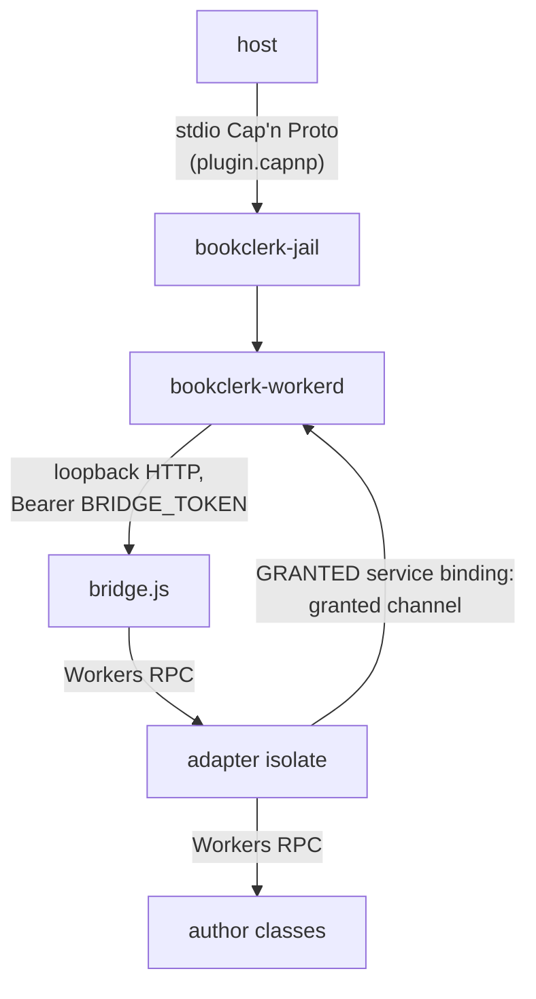

# bookclerk-workerd bridge transport

Maintainer reference for the private wire between the `bookclerk-workerd`
launcher and the isolate it hosts. Authors never see any of this: they write
`BookclerkEntrypoint` / `*Entrypoint` classes against
`@bookclerk/plugin-sdk/workerd` (or the Python mirror) and the trusted
adapter isolate maps the wire onto them. See [`plugins.md`](../plugins/README.md) for
the author model and the [Workers RPC ADR](../adr/plugin-workers-rpc-workerd.md)
for the decision record.



For `runtime = "native"` the host also starts a **sibling** `bookclerk-jail`
around the backend. The launcher does not spawn, resolve, or exec that
binary (`BOOKCLERK_NATIVE_BACKEND` is gone). The host creates the links
and inherits them into both children. Unix RPC is one socketpair. Windows
RPC is two unidirectional pipes (synchronous guest ends, overlapped
gateway ends) so a blocking stdin read cannot lock stdout.

| Link | Gateway env | Guest |
| --- | --- | --- |
| RPC (Cap'n Proto) | Unix `BOOKCLERK_GATEWAY_GUEST_RPC=fd:3`. Windows `BOOKCLERK_GATEWAY_GUEST_RPC=handle:<read>` and `BOOKCLERK_GATEWAY_GUEST_RPC_WRITE=handle:<write>` | stdin + stdout |
| CONNECT mux | Production: served by the unsandboxed host (no gateway env). Unjailed conformance may set Unix `BOOKCLERK_GATEWAY_PROXY=fd:4` or Windows `BOOKCLERK_GATEWAY_PROXY=handle:<read>` plus `BOOKCLERK_GATEWAY_PROXY_WRITE=handle:<write>` | Unix `BOOKCLERK_SOCKET_PROXY=fd:3`. Windows `BOOKCLERK_SOCKET_PROXY=handle:<read>` and `BOOKCLERK_SOCKET_PROXY_WRITE=handle:<write>` |

`BOOKCLERK_WORKERD_STATE_DIR` is the host-owned `session-<nonce>/` directory
(also the gateway `TMPDIR`). The guest `TMPDIR` is its own scratch, so it
cannot read gateway state. See [guest-jail.md](guest-jail.md) and
the [Workers RPC ADR](../adr/plugin-workers-rpc-workerd.md).

## The bridge socket

The bridge listens on an ephemeral loopback port that only the launcher
dials. The launcher never picks a port number for workerd to bind:

- **Unix:** the launcher binds `127.0.0.1:0` and hands the listener to
  workerd with `--socket-fd=rpc=<fd>`. Linux Landlock `OutboundListen`
  allows `bind(port=0)` only, so workerd could not bind a chosen port.
- **Windows:** workerd has no `--socket-fd`, so it binds `127.0.0.1:0`
  itself and reports the port with `--control-fd=1`, one JSON line on its
  stdout: `{"event":"listen","socket":"rpc","port":53117}`. Isolates write
  `console.*` output to the same stdout, so the generated config turns on
  structured logging, and `bookclerk_workerd::control::listen_port` accepts
  only an object with exactly the three control keys. The `workerd_control`
  fuzz target checks that no log line reads as a control message.

> [!NOTE]
> The launcher used to reserve a port on Windows, release it and pass it to
> workerd. Another process could take the port in between, and because
> workerd runs in a different AppContainer the bind then failed with
> `WSAEACCES` (10013) instead of "address in use" (issue #781). If workerd
> exits before it reports a port, the launcher fails at once with workerd's
> log rather than waiting out the readiness timeout.

The launcher is a `PluginWorker` toward the host. Every host call is turned
into exactly one HTTP request to the isolate; the isolate keeps no cross-request
state except database-adapter sessions (below). Three route families exist:

| Family | Routes | Encoding |
| --- | --- | --- |
| Control plane | `GET /health`, `POST /describe`, `POST /open`, `POST /shutdown` | JSON handshake (bridge JSON: camelCase projection of the typed structs, `Data` as base64) |
| Data plane | `POST /invoke` | Cap'n Proto bytes — one route for **every** entrypoint method and for `PluginWorker.databaseMigrations` |
| Streams | `GET /destination/get`, `PUT /destination/put`, `GET /source/open` | HTTP bodies (the object bytes never enter a Cap'n message) |

The control plane is a policy handshake, not a plugin method: `open` mints
grant tokens and asks the isolate which entrypoint families the covering
grant lets it export; the isolate does not retain the `Bindings`. That is
why `PluginWorker.open` / `describe` / `shutdown` stay JSON while everything
that *is* an ABI method call travels as Cap'n bytes on `/invoke`.

The launcher talks to the bridge with its own small HTTP/1.1 client on
`127.0.0.1:<port>` (`BridgeHttp`), for the `/health` check as for every other
route. It never reads proxy environment variables (`ALL_PROXY`,
`HTTPS_PROXY`, `HTTP_PROXY`), so `Bearer <BRIDGE_TOKEN>` cannot reach a proxy
the launcher inherited. Its other requests, such as the `workerd` download,
keep the usual proxy handling.

## `POST /invoke`

One ABI method call. Same framing as `/db/execute` on the granted channel:
an **unpacked, single-segment** Cap'n Proto message (`capnp::serialize::write_message`
in Rust; `encodeMessage` from the generated `generated-wire.ts` codecs in the
isolate; `_wire.py` in Python).

Request headers:

| Header | Value |
| --- | --- |
| `Authorization` | `Bearer <BRIDGE_TOKEN>` |
| `Content-Type` | `application/x-capnp` |
| `X-Bookclerk-Interface` | Cap'n interface name: `ContentSource`, `Destination`, `RemoteLibrary`, `EventConsumer`, `JobRunner`, `PluginCli`, `Oidc`, `MetadataProvider`, `CoverFetcher`, `Database`, `AdapterDatabaseSession`, `PluginWorker` |
| `X-Bookclerk-Method` | Method name as declared in `plugin.capnp` (`login`, `event`, `job`, `openSession`, `databaseMigrations`, …) |
| `X-Bookclerk-Context` | Bridge JSON `BridgeContext` (`invocation`, `config`, `secrets`, `eventsToken`, `databases` = `{ <BINDING>: <grant token> }`; `jobId` on `JobRunner.job`) — present for every entrypoint call, absent for `PluginWorker.*`. The adapter isolate exchanges the tokens for the author's `EVENTS` / `env.<BINDING>` bindings; authors never see them |
| `X-Bookclerk-Caps` | JSON array of capability descriptors for the request message's capability table (only when the `$Params` struct carries interface-typed fields) |
| `X-Bookclerk-Target` | Isolate-side object id for calls on a capability the isolate returned earlier (`AdapterDatabaseSession.*`) |

Request body: the `<Interface>.<method>$Params` struct as the message root
(the `plugin.layout.json` struct named `"<Interface>.<method>$Params"`; the
generated codecs are `<Interface><Method>ParamsCodec`).

Response:

| Status | Meaning |
| --- | --- |
| `200` | Body is the `<Interface>.<method>$Results` struct (`Content-Type: application/x-capnp`). ABI failures ride **inside** the reply union (`result.err`), exactly as over Cap'n RPC. `X-Bookclerk-Caps` lists descriptors for capabilities the reply carries. |
| `400` | Malformed message, unknown interface/method, missing context, bad capability table. JSON `{ "error": { "code", "message" } }` |
| `401` | Bearer mismatch |
| `404` | Entrypoint not exported by this isolate (`{ "error": { "code": "unsupported", … } }`) |
| `500` | Adapter binding missing / isolate failure (JSON error) |

Non-200 replies are transport failures, never a plugin's own `err`. The
launcher's hook (`crates/bookclerk-workerd/src/invoke.rs`) raises them as Cap'n
RPC errors whose text is `<code>: <message>` (`404` / `unsupported` as
`Unimplemented`, everything else as `Failed`), so the typed clients surface
them exactly like a broken Cap'n connection: `PluginError::unavailable` with
the bridge's wire code and message in the text. Request and reply bodies are
capped at `MAX_INVOKE_BODY_BYTES` (2 × `maxScalarBytes`, the isolate codec's
traversal budget); the launcher always emits a single segment (it re-copies
the params when the heap builder spilled) and rejects multi-segment replies.

### Capability descriptors (`X-Bookclerk-Caps`)

Unpacked Cap'n messages have no capability table of their own, so interface
pointers are written as capability indexes and the table travels beside the
message as JSON. Entry `i` describes capability index `i`:

```jsonc
[
  { "kind": "source",       "token": "<grant>" },   // Source          → granted GET  /open
  { "kind": "destination",  "token": "<grant>" },   // Destination     → granted PUT  /put
  { "kind": "progress",     "token": "<grant>" },   // ProgressSink    → granted POST /progress
  { "kind": "cancellation", "token": "<grant>" },   // Cancellation    → granted GET  /cancel (long poll)
  { "kind": "eventPublisher", "token": "<grant>" }, // EventPublisher  → granted POST /events/publish
  { "kind": "guestDatabase", "token": "<grant>", "binding": "DB" }, // GuestDatabase → granted POST /db/execute
  { "kind": "adapterSession", "id": "<isolate object id>" }         // reply cap: AdapterDatabaseSession
]
```

Host-served kinds carry a **grant token** the isolate presents on the granted
channel; the launcher mints them per call and revokes them when the call
returns (`RevokeGrant`). The only isolate-served kind is `adapterSession`:
`Database.openSession` replies with `AdapterSessionReply.ok` pointing at an
isolate object; later `AdapterDatabaseSession.*` calls name it in
`X-Bookclerk-Target`. `close` (or the owning `open` being dropped) releases it.

Streams are never capabilities on this transport: `Destination.get`,
`Destination.put`, and `Source.open` use the dedicated body routes, and
`JobController.input` / `output` and the `CoverFetcher.fetchCovers` `sink`
reach the launcher through the granted `GET /open` / `PUT /put` routes.

### Method table

| Interface | Methods on `/invoke` | Author class |
| --- | --- | --- |
| `PluginWorker` | `databaseMigrations` | default export `databaseMigrations(binding)` |
| `ContentSource` | all 13 | `Storefront extends StorefrontEntrypoint` |
| `Destination` | `head`, `list`, `copy`, `delete`, `commit`, `abortStage` (`get` / `put` are stream routes) | `Storage extends StorageEntrypoint` |
| `RemoteLibrary` | all 7 | `RemoteLibrary extends RemoteLibraryEntrypoint` |
| `EventConsumer` | `event` — **one call per batch** | default export `event(batch)` |
| `JobRunner` | `job` — `JobController` caps are grant tokens | default export `job(job)` |
| `PluginCli` | `describe`, `invoke` | `Cli extends CliEntrypoint` |
| `Oidc` | `clients`, `authenticateUser` | `Oidc extends OidcEntrypoint` |
| `MetadataProvider` | `health`, `lookup`, `search`, `chapters` | `Metadata extends MetadataEntrypoint` |
| `CoverFetcher` | `health`, `fetchCovers` — the `sink` is a `destination` grant token | `Covers extends CoverEntrypoint` |
| `Database` | `openSession` | `DatabaseAdapter extends DatabaseAdapterEntrypoint` |
| `AdapterDatabaseSession` | all 10 (`X-Bookclerk-Target`) | the `AdapterDatabaseSession` object `openSession` returned |

Native-behind-workerd guests never touch `/invoke`: the launcher forwards
their entrypoint families as typed Cap'n Proto over the inherited RPC link
(`Backend::Native`), and only the control plane reaches the isolate. CONNECT
authorization is unchanged (`socket_proxy::handle_client` on mux-accepted
streams).

## Granted channel (isolate → launcher)

`GRANTED` is a service binding on the adapter isolate; every request carries
`Authorization: Bearer <grant token>` and the launcher fails closed on
unknown, expired, or revoked tokens.

| Route | Grant flag | Purpose |
| --- | --- | --- |
| `GET /open?key=` | `allow_open` | `JobController.input.open` (streamed body) |
| `PUT /put?key=` | `allow_put` | `JobController.output.put` and the `fetchCovers` sink (streamed body; several puts on one grant may stream at once) |
| `POST /progress` | `allow_progress` | `JobController.progress.report` |
| `GET /cancel` | `cancel` present | Long poll: `200 {"cancelled":true}` once the host cancellation fires, `204` after the poll window so the isolate re-arms; the adapter turns it into `job.signal` |
| `POST /db/execute` | `allow_database` | Typed SQL on the granted `GuestDatabase` (Cap'n bytes). The launcher checks the guest grammar and the grant's SQL policy, desugars the statements as the host session does and stamps the canonical `requestHash` over that form, so the session's own check reproduces it (a retry token names the same hash). A request past the grant's `maxRequestBytes` is `413` whose body is the canonical `limit_exceeded` message (`limit exceeded: maxRequestBytes is <cap>; used <n>`), which the SDKs parse back into `err.limit` |
| `POST /db/execute-streamed` | `allow_database` | `GuestDatabase.executeStreamed`: the same request bytes as `/db/execute`, answered as consecutive Cap'n `ExecuteStreamFrame`s with a content length. The pre-dispatch checks answer with HTTP statuses like `/db/execute` (an unknown, expired or database-less grant, a chunked request body, a request past `maxRequestBytes` as `413` with the canonical `limit_exceeded` message); once a decoded request is dispatched every outcome is a frame sequence: a SQL authorization failure, a session that does not stream (`unsupported`) or a session error is one `err` frame. A body that does not decode as an `ExecuteRequest` closes the exchange without a reply, as on `/db/execute`; the SDKs report it as a transport failure |
| `GET /db/limits` | `allow_database` | `GuestDatabase.limits`: the session's `DbCapabilities` as a Cap'n `DbCapabilitiesReply` (`401` when the grant has no database, `500` when the reply cannot be encoded) |
| `POST /events/publish` | `events` present | `env.EVENTS.publish` |

## Isolate embed

The adapter and author isolates import `@bookclerk/plugin-sdk/workerd`; the
launcher injects `packages/plugin-sdk/embed/bookclerk_plugin.js` under that
name. The embed is **built**, not hand-written: `npm run build` in
`packages/plugin-sdk` bundles `dist/workerd.js` (author runtime, generated
codecs, typed SQL helpers) into one ES module with `scripts/build-embed.mjs`
(esbuild; only `cloudflare:workers` stays external). CI rebuilds it and fails
on drift; `scripts/gen-plugin-abi.py --check` and `scripts/sync-workerd-pin.py --check`
keep the Rust (`crates/bookclerk-plugin-sdk/embed/`) and Python
(`bookclerk_plugin_sdk/bridge/`) mirrors byte-identical.
