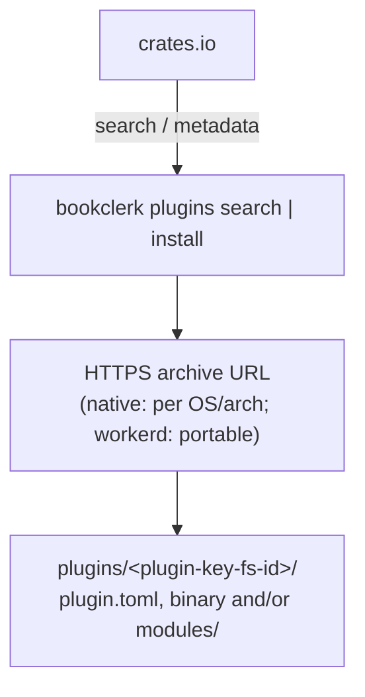

# Plugin registry (crates.io taxonomy + install without Rust)

This page is for people publishing Bookclerk plugins. It covers how to
name a plugin crate on [crates.io](https://crates.io), how to name and
host release archives, and how Bookclerk installs them from a packaged
binary, without the operator needing a Rust toolchain.

> [!NOTE]
> The crate naming taxonomy is **draft-stable for discovery**. Install
> metadata, digest requirements and federated registry identity live in
> [`bookclerk-plugin-catalog`](../../crates/bookclerk-plugin-catalog/), and
> keep evolving with CLI install. Catalog search works today; one-click
> install and the dashboard browser are still phased (see
> [Operator dashboard](#operator-dashboard-phased)).

## What a published plugin is

Third-party plugins are installed once for the cluster, and materialized
on each node under
`$BOOKCLERK_FILES_DIR/plugins/.versions/<payload digest>/` (see
[Installing plugins](../server/plugins.md#installing-plugins) and
[ADR: Workers RPC and workerd](../adr/plugin-workers-rpc-workerd.md)).

| Runtime | Archive contents |
| --- | --- |
| **`workerd` / script** | `plugin.toml` + `modules/`. **No** per-OS binary is needed; the host runs `bookclerk-workerd` under the jail |
| **`native`** | `plugin.toml` + a per-OS/arch executable (`command`) |

Authors extend **`BookclerkEntrypoint`** and export named `*Entrypoint`
classes (product `api_version = 3`) through the language SDKs:
[`@bookclerk/plugin-sdk`](../../packages/plugin-sdk/),
[`packages/plugin-sdk-python`](../../packages/plugin-sdk-python/) and
[`bookclerk-plugin-sdk`](../../crates/bookclerk-plugin-sdk/). Each SDK
ships the same `check`, `fmt` and `package` helpers for local and CI
packaging. The workerd Echo is in
[`examples/plugins-echo-workerd-ts/`](../../examples/plugins-echo-workerd-ts/).

## Design principle

| Layer | Role |
| --- | --- |
| The crates.io crate | **Discovery index** and install URL metadata, for plugin *authors* |
| An HTTPS downloadable archive | **Native:** a per OS/arch binary + `plugin.toml`. **Workerd:** `plugin.toml` + `modules/` (portable) |
| A `plugin_versions` row + `$BOOKCLERK_FILES_DIR/plugins/.versions/<digest>/` | The **installed** version (in the database) and its **materialized** tree on each node. The manifest `id` remains a display alias |
| The platform installer / `cargo package-platform` | **Hosts + jail + workerd + sqlite + local**: always bundled, never pulled from crates.io |

Bookclerk never runs `cargo build` or `npm install` on the user's machine
to install a plugin.

1. Installing downloads a release asset over HTTPS, verifies it, and
   records an installed version.
2. Each node then fetches the asset for its own target, verifies the
   payload digest, and unpacks it into its version cache.

The asset host **isn't** tied to GitHub. S3 or R2, GitLab, Forgejo or
Codeberg releases, a CDN, or a self-hosted static folder all work, as long
as the URL is a direct download.

> [!NOTE]
> **Nothing is pulled from crates.io automatically today.** Platform
> plugins ship inside the host installer. Optional storefronts are
> installed with `bookclerk plugins install`, `POST /api/config/plugins`,
> or an operator package under `plugin-packages/`.

See [Packaging](../contributing/packaging.md) for the `cargo package-*`
aliases and GitHub Actions signing notes.



## Crate naming taxonomy

Publish under a **predictable crate name**:

```text
bookclerk-plugin-{kind}-{id}
```

| Segment | Rules | Examples |
| --- | --- | --- |
| Prefix | Always `bookclerk-plugin-` | — |
| `{kind}` | One of `source`, `integration`, `output`, `database` | `source` |
| `{id}` | Globally unique across kinds. Lowercase `a-z`, `0-9` and `_` only; 2–32 characters; no leading, trailing or doubled `_`; must match `plugin.toml` `id` | `spotify`, `my_store` |

For example:

| Crate | Kind | Plugin id |
| --- | --- | --- |
| `bookclerk-plugin-source-spotify` | source | `spotify` |
| `bookclerk-plugin-integration-plex` | integration | `plex` |
| `bookclerk-plugin-output-webdav` | output | `webdav` |
| `bookclerk-plugin-database-libsql` | database | `libsql` |

**Binary name:** prefer the same string as the crate name
(`bookclerk-plugin-source-spotify`), referenced from `plugin.toml`
`command`.

First-party external plugins (`bookclerk-plugin-source-audible`,
`bookclerk-plugin-source-libro`,
`bookclerk-plugin-integration-audiobookshelf`, …) keep `publish = false`
until they are deliberately released; they are built and staged in CI
only. The Echo example stays unpublished too, as a template. Workspace
hosts may still `register()` the same adapters in-process for Rust
development.

### crates.io keywords and categories

Every published plugin crate **must** include:

```toml
[package]
name = "bookclerk-plugin-source-example"
keywords = ["bookclerk", "bookclerk-plugin", "audiobook"]
# optional kind keyword for filtering:
# keywords = ["bookclerk", "bookclerk-plugin", "bookclerk-source", "audiobook"]
categories = ["multimedia", "command-line-utilities"]
```

A kind-specific keyword is optional but recommended: `bookclerk-source`,
`bookclerk-integration`, `bookclerk-output` or `bookclerk-database`.

Discovery queries:

1. Prefer crates whose name starts with `bookclerk-plugin-`,
2. and/or with the keyword `bookclerk-plugin`.
3. Then parse `{kind}` and `{id}` from the name (authoritative over loose
   keywords).

## Cargo package metadata

Authors declare install metadata in `Cargo.toml`, so the host doesn't need
a git clone to know where binaries live. Artifact fields are **plain HTTPS
URL templates**: any host that serves a direct download is fine.

```toml
[package.metadata.bookclerk]
api_version = 1
kind = "source"                 # must match name segment
id = "example"                  # must match name segment + plugin.toml
display_name = "Example Store"

# Option A — directory/prefix + conventional filenames (most hosts):
# Placeholders: {tag} {version} {target} {crate} {ext}
artifact_base_url = "https://cdn.example.com/bookclerk-plugins/{crate}/{version}"
# → {artifact_base_url}/{crate}-{version}-{target}.{ext}

# Option B — full URL template when the host path layout differs:
# artifact_url = "https://downloads.example.com/v/{tag}/{crate}-{target}.{ext}"

# Examples of hosts (all equivalent as long as GET returns the archive bytes):
# artifact_base_url = "https://github.com/org/repo/releases/download/{tag}"
# artifact_base_url = "https://gitlab.com/org/repo/-/releases/{tag}/downloads"
# artifact_base_url = "https://codeberg.org/org/repo/releases/download/{tag}"
# artifact_base_url = "https://my-bucket.s3.amazonaws.com/plugins/{crate}"
# artifact_base_url = "https://pub-….r2.dev/bookclerk/{crate}/{version}"

# Optional: path inside the archive to the plugin root (default: ".")
# archive_root = "."
# Optional: min Bookclerk host version (semver req), when enforced
# min_host = "0.1.0"
```

- Prefer **Option A** when your files follow the recommended names below.
- Use **Option B** (`artifact_url`) when the object key can't be written
  as `{base}/{crate}-{version}-{target}.{ext}`.

The crate's `readme` or description should summarize its trust and scope
(which accounts it talks to). Enabling still means running that guest
jailed, after `bookclerk plugins approve` (see
[Capabilities and consent](capabilities.md)).

## Artifact naming (install without Rust)

**Native:** release each version as a **per-target archive** (`.tar.gz`
on Unix, `.zip` on Windows) containing at least:

```text
plugin.toml
bookclerk-plugin-{kind}-{id}    # or .exe on Windows
```

**Workerd or script:** one portable archive is enough:

```text
plugin.toml
modules/…                       # main_module and deps
```

### What an archive may assume

[The guest jail](../internals/guest-jail.md#the-guest-jail) has two
consequences for an archive:

- The install folder is **read-only** at runtime. A plugin that wants to
  keep state must use the `plugin_data_dir` it is given (also its `HOME`)
  or `TMPDIR`, not a path beside its own binary.
- A plugin that needs outbound HTTPS (and optional OAuth) declares it in
  `plugin.toml`.

A workerd plugin (the hostname allowlist is enforced in the isolate):

```toml
runtime = "workerd"
# …

[capabilities.network]
mode = "outbound"
domains = ["api.example.com"]
```

A native plugin (the sibling jail denies ambient `AF_INET`; SDK sockets
share the same policy):

```toml
runtime = "native"
command = "./my-plugin"

[capabilities.network]
mode = "outbound"
tcp = [{ host = "api.example.com", ports = [443] }]
# domains are workerd-only — omit them on native plugins.
```

Operators must `bookclerk plugins approve` before enable. Native TCP is
`host` + `ports` on the same `EgressPolicy` as workerd `connect()`.

Workerd redirect hops stay on the fetch allowlist unless the operator
granted undeclared public redirects. See
[Capabilities and consent](capabilities.md).

### Asset names

Recommended asset names use **Bookclerk targets**, not raw rustc triples:

```text
{crate}-{version}-{bookclerk_target}.tar.gz
{crate}-{version}-{bookclerk_target}.zip
```

| Bookclerk target | Legacy rustc triple (still accepted when selecting) |
| --- | --- |
| `linux-x64-gnu` | `x86_64-unknown-linux-gnu` |
| `linux-arm64-gnu` | `aarch64-unknown-linux-gnu` |
| `macos-x64` | `x86_64-apple-darwin` |
| `macos-arm64` | `aarch64-apple-darwin` |
| `windows-x64` | `x86_64-pc-windows-msvc` |
| `windows-arm64` | `aarch64-pc-windows-msvc` |

For example:

```text
bookclerk-plugin-source-example-0.1.0-linux-x64-gnu.tar.gz
bookclerk-plugin-source-example-0.1.0-macos-arm64.tar.gz
bookclerk-plugin-source-example-0.1.0-windows-x64.zip
```

- With Option A, `{ext}` is `tar.gz`, or `zip` for Windows targets.
- `{tag}` is usually `v{version}` when the host uses git-style tags. Hosts
  that key only by version can leave `{tag}` out of the template.
- Prefer inlining digests in `artifacts[]` (a static registry or Cargo
  metadata) over templates alone.

The install client issues a plain `GET`, following redirects. No GitHub,
GitLab or cloud API tokens are needed for public assets. Private or
authenticated buckets are out of scope for v1 (operators can still unpack
by hand).

### Checksums and signatures

- **Checksums:** publish `SHA256SUMS` (or a `.sha256` per asset) next to
  the assets. Unattended install **requires** matching content hashes:
  `archive_sha256`, then `manifest_sha256` and `payload_root_sha256` on
  the installed tree.
- **Publisher authenticity** (later, optional): minisign or cosign can
  attest who published an artifact. That is independent of PluginKey and
  content hashes, and isn't required for install.

## The catalog crate

Registry-neutral types and adapters live in
[`crates/bookclerk-plugin-catalog`](../../crates/bookclerk-plugin-catalog/):

| Concept | Notes |
| --- | --- |
| **Source-qualified coordinates** | `cargo:name@version`, `npm:name@version`, `pypi:name==version`, `registry:<index_url>#name@version`, `local:/path/to/archive`. Search hits never merge by bare plugin id |
| **Digest-required artifacts** | Install-grade manifests use an explicit `artifacts[]` array, and each entry needs `url` + `archive_sha256` (64 hex). URL templates alone are discovery-only |
| **Static registry** | An HTTPS or local JSON index (`schema_version`, `packages[].name` → `versions` → manifest). Fixture: [`fixtures/static-index.example.json`](../../crates/bookclerk-plugin-catalog/fixtures/static-index.example.json) |
| **PyPI** | **Exact-only**: there is no general search API, so use `pypi:project==version` or a static registry for discovery |

Publisher and packaging examples (for reference only, never in
`package-plugins`):

- [`examples/plugins-echo-workerd-ts/`](../../examples/plugins-echo-workerd-ts/): workerd, `@bookclerk/plugin-sdk`
- [`examples/plugins-echo-workerd-python/`](../../examples/plugins-echo-workerd-python/): workerd Python Workers
- [`examples/plugins-echo-workerd-rust/`](../../examples/plugins-echo-workerd-rust/): workerd Rust/Wasm
- [`examples/plugins-echo-native-rust/`](../../examples/plugins-echo-native-rust/): native Rust `PluginWorker` (`api_version = 3`)
- [`examples/plugins-echo-native-node/`](../../examples/plugins-echo-native-node/): experimental workerd JS, legacy id `echo_native_node`
- [`examples/plugins-echo-native-python/`](../../examples/plugins-echo-native-python/): experimental workerd Python, legacy id `echo_native_python`
- [`examples/plugin-publisher/`](../../examples/plugin-publisher/): reusable GitHub Actions workflow docs

### Trust (staged)

Unattended install **requires** content hashes on the install receipt
(`archive_sha256`, plus `manifest_sha256` and `payload_root_sha256` after
unpacking). Publisher PKI or notarization is optional and is **not** the
identity model: hashes prove the installed bytes match the recorded
artifact, not who wrote them.

| Flag / config | Effect |
| --- | --- |
| `--allow-unverified-publisher` / `[plugins] allow_unverified_publisher` | Permit community packages that have no independent proof of publisher authenticity. The archive SHA-256 is still required. Bookclerk does **not** verify publisher signatures |
| Verified install receipt | Required. Modified installed bytes lose platform trust (`provenance = Modified`) |
| Yanked versions | Refused by install-grade validation |
| macOS / Windows code signatures | Warned about by `plugins doctor` when the tooling is available; interactive override only |

## Host install layout

`bookclerk plugins install <coordinate>` installs a version:

1. Resolve the coordinate (crates.io name taxonomy, an exact crate, or a
   configured registry).
2. Read `[package.metadata.bookclerk]` from the crate's published
   `Cargo.toml`.
3. Download every target's archive and verify its declared digest.
4. Read `plugin.toml` and compute the payload-root digest.
5. Record a `plugin_versions` row. The first version of a plugin (or one
   installed with `--activate`) becomes the active version.
6. Enroll the plugin's default instance. The operator approves consent,
   and deploys it with `plugins deploy`.

Each host materializes the active version for its own target when a
present deployment needs it. No `cargo` or `rustc` on PATH is needed. See
[Installing plugins](../server/plugins.md#installing-plugins) for update,
rollback, approval and the daemon routes.

Alias uniqueness is cluster-wide for installed versions:

| Case | Result |
| --- | --- |
| A different PluginKey, with an alias no active version uses | Allowed |
| The same PluginKey with the same alias (an update) | Allowed |
| A different PluginKey, with an alias another plugin's active version uses | **Rejected**: remove that plugin first |
| A later local archive of a published alias | Reuses that alias's PluginKey |
| A corrupt disk with two host-local trees sharing an alias | Discovery fails closed |

`--replace` is an older spelling of `--activate`: it makes the new version
active even when another version is. It never lets a different provenance
take over an alias.

## Operator dashboard (phased)

| Phase | What |
| --- | --- |
| **A: Taxonomy (this page + types)** | Draft-stable crate names. The metadata schema keeps evolving with digests and federation |
| **B: CLI catalog** | `bookclerk plugins search [query]` against crates.io; `info` shows registry metadata |
| **C: CLI install** | Install verified versions; `plugins update` / `rollback` / `uninstall` / `versions` |
| **D: Daemon API** | Authenticated `/api/config/plugins` (install, activate, approve, uninstall). A catalog search route is still planned |
| **E: Dashboard browser** | Browse, configure and deploy in the operator SPA |

Phases D and E reuse the same catalog DTOs as the CLI. Settings live in
the plugin instance document in the database, checked against the
version's `[[settings]]` schema.

## Curated index (optional, later)

crates.io is a convenient global index, but it isn't a security boundary.
A future **Bookclerk plugin index** (signed JSON, hosted by the project)
can:

- mirror only reviewed crates;
- pin artifact URLs and digests;
- power the dashboard's "Featured" list.

The naming taxonomy stays the same, so community crates stay discoverable
even when they aren't featured.

## Standalone plugin development

Third-party authors keep **their own repository**. They **don't** fork or
vendor the Bookclerk monorepo.

The contract is the Workers RPC ABI (`api_version = 3` object-capability
classes and streams, `BookclerkEntrypoint` and named entrypoint classes)
plus the install layout. The host discovers whatever lands under
`plugins/`. See [Dynamic plugins](README.md) and
[ADR: Workers RPC and workerd](../adr/plugin-workers-rpc-workerd.md).

### TypeScript and workerd (`@bookclerk/plugin-sdk`)

This is the preferred portable path:

1. Extend `BookclerkEntrypoint` for event and job triggers.
2. Export one `*Entrypoint` subclass per named entrypoint (`Storefront`,
   `Storage`, `RemoteLibrary`, `DatabaseAdapter`, `Cli`, `Oidc`).
3. Ship `plugin.toml` + `modules/`.

Start from
[`examples/plugins-echo-workerd-ts/`](../../examples/plugins-echo-workerd-ts/).
`npx bookclerk-plugin types .` generates the `Env` binding type from
`plugin.toml`.

```ts
import { BookclerkEntrypoint, StorefrontEntrypoint } from "@bookclerk/plugin-sdk/workerd";
import type { Env } from "./bookclerk-configuration.js";

export class Storefront extends StorefrontEntrypoint<Env> {
  async scan(params) { /* … */ }
}

export default class MyPlugin extends BookclerkEntrypoint<Env> {
  async event(batch) { for (const msg of batch.messages) msg.ack(); }
}
```

### Native Rust (`bookclerk-plugin-sdk`)

For **native** Rust guests, use the slim **guest-only** crate, not the
host's `bookclerk-plugin-host` (which pulls in config, library and source
code, and is for Bookclerk itself):

```toml
# In the author's standalone crate (their repo / workspace)
[package]
name = "bookclerk-plugin-source-example"

[dependencies]
# Path while developing against a local checkout:
bookclerk-plugin-sdk = { path = "../bookclerk/crates/bookclerk-plugin-sdk" }
# Or git (no crates.io publish required yet):
# bookclerk-plugin-sdk = { git = "https://github.com/Bookclerk/bookclerk", package = "bookclerk-plugin-sdk" }

[package.metadata.bookclerk]
api_version = 1
kind = "source"
id = "example"
artifact_base_url = "https://cdn.example.com/…/{version}"
```

Cargo builds only the SDK's small dependency graph (`serde`, `tokio` I/O,
`chrono`, …), not the rest of the Bookclerk workspace.

The in-tree first-party plugins are
`crates/bookclerk-plugins/optional/source-{audible,libro,chirp,graphicaudio}`
(each package is a library plus a guest binary) and
`examples/plugins-echo-native-rust`. CI builds those binaries and stages
them with `cargo stage-plugins` for host integration tests
(`BOOKCLERK_PLUGIN_ARTIFACTS`). There is no public artifact release yet.

The author loop for a native plugin:

1. Create a new git repository with one binary crate, named per the
   taxonomy.
2. Depend on `bookclerk-plugin-sdk` (by path or git).
3. Implement `PluginWorker` and `serve`.
4. Have CI build release archives per target, and upload them wherever
   `artifact_*` points.
5. Later, `cargo publish` the plugin crate (and eventually the SDK) for
   `bookclerk plugins search`.
6. Operators install the **archive**. They never clone your (or our) git
   tree.

### Why a separate crate

| Option | Verdict |
| --- | --- |
| **`bookclerk-plugin-sdk`** (chosen) | A clear guest surface; the host can't leak into author builds; publishable later without renaming |
| Linking plugin crates into hosts | Forbidden. Production hosts never run ordinary plugins in-process |
| `bookclerk-plugin-dev` | Sounds like build tooling; authors would think it is test-only |

### What you never need

- A mirror of `Bookclerk/bookclerk`.
- Linking against `bookclerkd`, `bookclerk-cli` or the host's
  `bookclerk-plugin-host`.
- Matching our workspace `Cargo.toml` beyond the SDK's MSRV.
- A per-OS binary when shipping `runtime = "workerd"`
  (`plugin.toml` + `modules/`).
- crates.io, today (a path, git or npm workspace SDK is enough).

## Non-goals

- Compiling plugins from crates.io source on the operator's machine.
- Loading `cdylib` or WASM into the host process (a jailed subprocess or
  workerd isolate stays the model).
- Requiring plugin authors to use Rust. TypeScript through
  `@bookclerk/plugin-sdk` is first-class, and crates.io is optional for
  non-Rust publishers.
- Requiring authors to fork or mirror the Bookclerk monorepo.
- Dual-stack legacy JSON-RPC as a product ABI (see the ADR).

Non-Rust and workerd publishers ship `plugin.toml` + `modules/` with
`runtime = "workerd"`. They can leave out the crate, or publish a thin
"manifest-only" crate that only carries `[package.metadata.bookclerk]` and
documentation.

## Validation checklist for publishers

- [ ] Your own standalone repository (no Bookclerk mirror needed)
- [ ] Crate name = `bookclerk-plugin-{kind}-{id}`
- [ ] `keywords` include `bookclerk` and `bookclerk-plugin`
- [ ] `[package.metadata.bookclerk]` `kind` / `id` / `api_version` match the name and `plugin.toml`
- [ ] Release assets: native per target, or one portable workerd archive, with checksums
- [ ] `plugin.toml`: `api_version = 3`, `runtime`, and either `command` (native) or `[workerd]` + `modules/`
- [ ] `[capabilities.network]` and any `[[databases]]` bindings declared honestly; state kept in
      `plugin_data_dir` / `TMPDIR`, never beside the binary
- [ ] Required config keys and any password environment variables documented

## History

These items were kept out of the host-rename and external-default PR
(#74), and landed on the follow-up ecosystem track instead:

- the full `bookclerk plugins install` / `update` / `remove` / `doctor` /
  `registry` set;
- Windows AppContainer spawn-time confinement (`run_appcontainer` and path
  ACLs), shipped on the confinement track;
- publisher code signing or notarization as a hard requirement;
- the Python guest SDK (still experimental; the TypeScript
  `@bookclerk/plugin-sdk` is first-class).

## Next steps

- [Dynamic plugins](README.md): runtime discovery and the ABI overview.
- [ADR: Workers RPC and workerd](../adr/plugin-workers-rpc-workerd.md).
- The ABI schema:
  [`crates/bookclerk-plugin-abi/schema/plugin.capnp`](../../crates/bookclerk-plugin-abi/schema/plugin.capnp).
- The catalog crate:
  [`bookclerk-plugin-catalog`](../../crates/bookclerk-plugin-catalog/).
- The publisher reusable workflow:
  [`examples/plugin-publisher/`](../../examples/plugin-publisher/).
- [Architecture](../internals/architecture.md): the architecture overview.
- [Web app and sign-in reference](../server/sign-in.md): the operator GUI
  surfaces (the plugin browser is future work).
