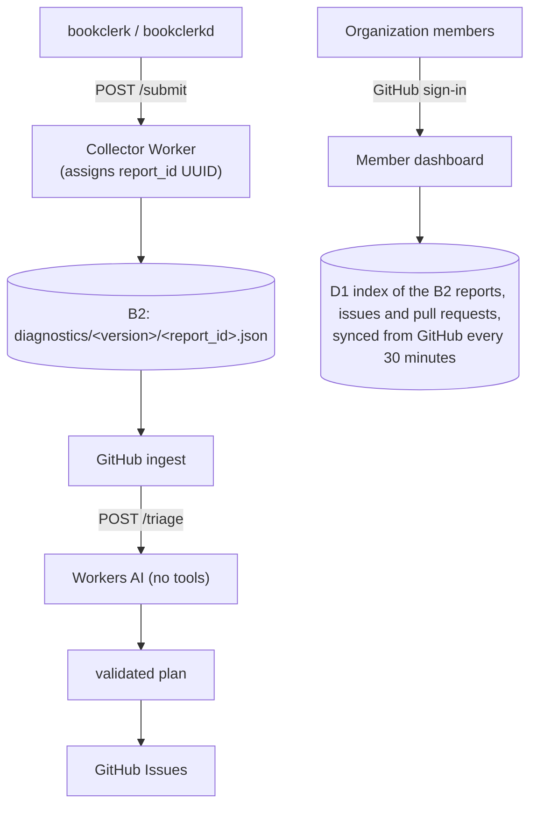

# Diagnostics & crash reports

This page explains Bookclerk's opt-in crash and error reports: how to turn
them on, what they contain, and how logging verbosity works. The second
half describes the collector service that receives them, for the people
who run it.

## Share reports

Reporting is off until you turn it on:

```toml
[diagnostics]
share_reports = true
```

A build sends reports to the collector address baked in when it was
built. Release builds in CI pick it up on their own. To build with it
yourself:

```sh
BOOKCLERK_DIAGNOSTICS_COLLECTOR_URL="https://diagnostics.bookclerk.app" cargo build --release -p bookclerk-cli
```

To send reports somewhere else, set `collector_url` in `[diagnostics]`, or
`BOOKCLERK_DIAGNOSTICS_COLLECTOR_URL` at runtime.

> [!NOTE]
> The collector is served on `https://diagnostics.<DOMAIN>` when the
> `DOMAIN` Actions variable is set (`bookclerk.app` upstream). A fork
> without a domain gets its Cloudflare account's workers.dev URL instead.
> The deploy stores that URL in the Actions variable
> `DIAGNOSTICS_COLLECTOR_BASE_URL` (organization first, then repository).

### When a report is sent

With sharing on, a report is sent on a panic, an ERROR burst, a WARN
burst, a daemon or CLI job failure, or a CLI command failure. These keys
tune it:

| Key | Default | Meaning |
| --- | --- | --- |
| `upload_on_crash` | `true` | Send the ring buffer from the panic hook |
| `upload_on_error_burst` | `true` | Send when ERROR events cross `error_burst_threshold` |
| `error_burst_threshold` | `10` | ERROR events inside the window that trigger a report |
| `error_burst_window_secs` | `60` | Sliding window for the error burst, in seconds |
| `upload_on_warn_burst` | `true` | Send when WARN events cross `warn_burst_threshold` |
| `warn_burst_threshold` | `20` | WARN events inside the window that trigger a report |
| `warn_burst_window_secs` | `60` | Sliding window for the warn burst, in seconds |
| `ring_buffer_capacity` | `200` | Most recent redacted events kept for a report (every level through TRACE) |

## Local verbosity vs ring buffer

What you see in the logs and what goes into a report are set separately.
The design behind this split is in
[ADR: Logging and tracing](../adr/observability.md).

- **stderr and the OS facility** (journald, macOS `os_log`, Windows Event
  Log) honor `BOOKCLERK_LOG`, then `RUST_LOG`, then the daemon default
  `bookclerk=info,warn`. The CLI is quiet by default (`off`). Use `-v`,
  `-vv` or `-vvv`, or `BOOKCLERK_LOG`.
- The **diagnostics ring buffer always keeps TRACE and above**, so crash
  and burst reports include deep context even when the console is quiet.

> [!TIP]
> To investigate locally, set `BOOKCLERK_LOG=bookclerk=debug`, or pass
> `-v` or `-vv` to the CLI.

Spawn stages and forwarded guest stderr are `bookclerk::spawn` tracing
events, so they follow that filter and stay inside the JSON daemon sink.

- Raw `bookclerk-spawn:` lines are written only when
  `BOOKCLERK_SPAWN_DIAG` is `1`, `true` or `stderr` (gateway CI sets
  this).
- The process-wide stage ring and the per-session stderr tail are
  byte-capped. Plugin stderr isn't kept in the stage ring after the
  session exits.

## Redaction & privacy

Reports are redacted before they leave the machine:

- Secrets are redacted by exact value, and an upload is aborted if a
  registered secret remains. The Worker applies its own heuristics too.
- Titles, paths, account ids and secrets are fully redacted.
- Emails are **partially** masked, not fully `[REDACTED]`:
  `address@sub.domain.tld` becomes `a*****s@***.d****n.tld`. The local
  part and the registrable domain label keep their first and last
  characters, middle subdomain labels become `***`, and the TLD is
  unchanged.

A report includes `os`, `arch`, the Linux or macOS distribution string,
and the rustc channel and release.

The collector keeps no client IP address, and no hash of one. Each report
stores the uploader's `User-Agent` (at most 200 characters).

Reports are kept for 180 days (the website's privacy page says 6 months).
See [Retention](#retention) for how that is enforced.

## Running the collector

The rest of this page is for the maintainers who run the collector
service.



### GitHub Actions

| Workflow | Purpose |
| --- | --- |
| `diagnostics-collector-deploy` | Deploy the Worker on `diagnostics.<DOMAIN>`, or on workers.dev when `DOMAIN` is unset (and store that URL in `DIAGNOSTICS_COLLECTOR_BASE_URL`). Apply the dashboard D1 migrations, upload the dashboard's App secrets when set, then check `/health` |
| `diagnostics-ingest` | Daily `/report` pull, `/triage` on Workers AI, issues from the validated plan, regression issues, and one summary comment per issue kept in place |
| `ci` | Release builds with `BOOKCLERK_DIAGNOSTICS_COLLECTOR_URL` set to the collector URL |

Permissions are least privilege. The keys follow GitHub's parameterized
names (hyphenated in workflow YAML); see
[repository permissions](https://docs.github.com/en/authentication/keeping-your-account-and-data-secure/managing-your-personal-access-tokens#repository-permissions).

| Workflow | Permissions |
| --- | --- |
| Deploy | `contents: read`. In workers.dev mode an automation App token ("Variables: write") stores the URL |
| Ingest | `contents: read`, `issues: write` |

The secrets are `CLOUDFLARE_API_TOKEN`, `CLOUDFLARE_ACCOUNT_ID`,
`DIAGNOSTICS_REPORT_API_KEY` and `DIAGNOSTICS_B2_*`. The member dashboard
also needs `AUTOMATION_APP_CLIENT_ID`, `AUTOMATION_APP_CLIENT_SECRET` and
`AUTOMATION_APP_PRIVATE_KEY` (GitHub's PKCS#1 key file as downloaded).

> [!IMPORTANT]
> `REPORT_API_KEY` exists only as a Worker secret and the
> `DIAGNOSTICS_REPORT_API_KEY` Actions secret. Bookclerk builds carry only
> the collector URL, so a release can submit reports but never read or
> triage them.

### Retention

B2 enforces the 180-day retention with a lifecycle rule on the bucket. An
operator sets it once, because the Worker's B2 key can't change bucket
settings:

| Field | Value |
| --- | --- |
| File name prefix | `diagnostics/` |
| Days from uploading to hiding | `180` |
| Days from hiding to deleting | `1` |

To set it in the Backblaze web console:

1. Open **Buckets**, then the bucket.
2. Open **Lifecycle Settings** and choose **Use custom lifecycle rules**.
3. Add the rule above and save.

Or with the B2 command-line tool:

```sh
b2 bucket update --lifecycle-rule \
  '{"fileNamePrefix": "diagnostics/", "daysFromUploadingToHiding": 180, "daysFromHidingToDeleting": 1}' \
  <bucket-name>
```

"Days from hiding to deleting" also removes a replaced older version of a
file one day later, as the "Keep only the last version" preset does. To
keep that preset for the rest of the bucket, add a second rule with an
empty prefix, no hide days and `1` day from hiding to deleting.

B2 allows overlapping prefixes and applies, for each setting, the smallest
value any matching rule sets. So `diagnostics/` files still hide at 180
days (see Backblaze's
[lifecycle rules](https://www.backblaze.com/docs/cloud-storage-lifecycle-rules)).

> [!WARNING]
> Leave the catch-all rule's hide days empty. A number there would expire
> reports sooner too.

The dashboard's index row for a report (version, platform, trigger, level
counts and the error signature, no log text) stays after the report is
deleted, so counts and issue links keep working. Opening a deleted report
shows that it couldn't be loaded.

## Report IDs

Each `/submit` gets a UUID `report_id`. The B2 object is named
`diagnostics/<version>/<report_id>.json`.

Every diagnostics issue ends with the IDs it was filed with, in an HTML
comment GitHub doesn't render:

```text
<!-- bookclerk-diagnostics: report ids
<report_id>
-->
```

- The dashboard reads that block to link the reports to the issue.
- Operators can still copy an ID from the raw body to pull the full
  object from B2.
- People read the issue's summary comment instead (see
  [Summary comment](#summary-comment)). It shows what the issue tracks
  now, with dashboard links (for organization members only, by design).
  The filed list stays as it was filed, even after a member detaches or
  moves a report.

Issues filed before the block existed list their IDs under a visible
`### Report IDs` heading (`` - `<id>` · [dashboard](<url>) ``). The
dashboard reads that list only when a body has no block.

## Triage

`diagnostics-ingest` sends the sanitized batch to the collector's
`POST /triage` (with the same key as `/report`). The Worker asks a small
Workers AI model for an issue plan as JSON. The model is `TRIAGE_MODEL`,
by default `@cf/ibm-granite/granite-4.0-h-micro`, with a 131k-token
context.

The model has no tools, so a crafted report can at most shape that plan.
The workflow then validates the plan before anything is filed:

- at most five issues;
- fixed labels;
- only report IDs from the batch;
- bounded sizes;
- links removed, and mentions and issue references defanged.

An empty plan means the model decided nothing needs an issue, and files
nothing.

### The holding issue

Some reports go to one open **holding issue**,
`[diagnostics] untriaged reports`, instead:

- reports that don't fit in the batch's 120,000-byte limit;
- reports a non-empty plan leaves out of every issue;
- every report of a run whose reply held no valid plan, or that the
  budget or an outage kept from the model.

The run appends their IDs to the holding issue's report block
(`scripts/holding_issue.py` edits only that list), and comments once with
the reason. When the holding issue holds 500 IDs, or was filed with the
visible `### Report IDs` list instead, a new one is opened. So every
pulled report is tracked, and nothing is buried in a new issue per run.
Its summary comment, kept like every other issue's, is the list people
read.

### Attaching to open issues

When the dashboard database is bound, the collector puts the newest open
triaged issues (at most forty, number and title) in front of the batch.
The model may then answer with an `attach` list, instead of a new issue,
for a report that is the same failure as one of them.

The workflow validates that too:

- only issue numbers the collector offered (its answer's `open_issues`);
- only report UUIDs from the batch;
- each report under one issue;
- at most twenty issues;
- a report the model both attaches and files stays attached.

Nothing is written to the issue. The workflow sends the validated
attachments to the collector's `POST /issues/attach`. Its ledger records
each report under its issue as `triage` (an existing link, or a member's
exclusion for that pair, stands), and the next summary pass counts them on
the issue's comment.

Reports whose issue was closed or unknown by then, and every attached
report when the collector can't record them, go to the holding issue.
Without the dashboard, the model sees no open issues and plans new issues
only.

### Known failures skip the model

Ingest asks `/report` with `unfiled=1`. When the dashboard database is
bound, the collector checks each report against its
[report ledger](#report-ledger):

- **Already tracked.** It passes over reports some issue already tracks,
  and moves the cursor past them, so a re-pull from the start can't file
  them again.
- **Same failure as an open issue.** A report whose error signature an
  open, triaged issue already tracks, on the same `major.minor` version
  line, is linked to that issue (`source = signature`) and not returned.
  So a known failure grows its issue instead of reaching the model.
- **Same failure as a closed issue.** The report is compared with that
  issue's [fixed-in version](#fixed-in-version-and-regressions):
  - one that runs an older version on the same `major.minor` line is
    linked to the closed issue the same way, and not returned;
  - one that runs the fixed-in version or later is returned marked
    `regression_of`, with the closed issue, its fixed-in version, fix pull
    request and title (when several closed issues qualify, the one with
    the newest fix);
  - a closed issue on the same line with no fix recorded (closed as not a
    bug or won't fix, or an earlier regression issue a member closed)
    takes the report quietly instead, so a closed judgment isn't reopened
    by a new issue each time.

A `force_full` run turns the linking off and re-triages everything. The
pull log prints every count (`linked`, `regressions`).

### Regression issues

Ingest files the regressions without the model
(`scripts/regression_issue.py`):

- One `[diagnostics] Regression of #<n> in <major.minor>` issue per closed
  issue and version line, at most ten per run. The reports of further
  groups go to the holding issue.
- It is labeled `diagnostics,bug,regression`. Its body names the closed
  issue, the fix pull request and the fixed-in version as plain
  references, and lists the report IDs.
- Its first line is a marker naming the closed issue, which the dashboard
  reads so the issue shows as a regression of it.

The closed issue isn't reopened. While a regression issue is open, further
reports on its line join it through the signature link above. A report
from the same line that arrives before the issue exists is excluded from
the model's batch and from the holding issue.

### Summary comment

After the pull, every run (whether or not it pulled anything) keeps **one
comment per issue**, edited in place. Editing a comment notifies nobody.

1. The run asks `GET /issues/summaries` for the issues whose figures
   changed since their summary was last written (at most twenty issues
   per run).
2. It writes each comment (`scripts/update-summaries.sh` and the sans-IO
   renderer `scripts/summary_comment.py`), marked
   `<!-- bookclerk-diagnostics: summary -->` on its first line.
3. It echoes the summary's fingerprint to `POST /issues/summary` once the
   comment is written. The issue isn't handed out again until its figures
   change.

The comment shows:

- how many reports the issue tracks, and from how many installations;
- how they were linked: listed in the issue, matched by signature, added
  by triage, or attached by members;
- the first and last receipt;
- the versions and platforms seen (the top eight, the rest as "others");
- the newest ten reports, with dashboard links.

The figures come from the collector's ledger, with each report counted
under the issue that tracks it. So a member's attach or detach on the
dashboard reaches GitHub on the next run.

- The comment edited is the first one the workflow's own account wrote
  with the marker. A marker someone else posts is ignored.
- The report block in a triage or regression issue's body is never
  rewritten. Only the ingest run appends to the holding issue's block.
- Versions and platforms are untrusted report fields, and are validated or
  rewritten before they reach the comment. Report IDs link only to their
  own dashboard page.

### Triage budget

Spend is capped per UTC day by `TRIAGE_DAILY_NEURONS`. The default is
2,000, a fifth of the account's 10,000 free Workers AI neurons a day.
Values above 9,000 are clamped, so a typo can't reach paid usage. A call
costs at most a few hundred neurons.

1. Each call reserves its worst case (input bytes plus the 2,048-token
   output cap) in the `TRIAGE_BUDGET` KV namespace (one key per UTC day,
   expiring after two days) before the model runs.
2. After the call it settles to the reported usage.
3. A call that would exceed the cap gets `429`, and ingest files one issue
   listing the report IDs instead.

KV has no atomic increment, and its reads can be up to a minute stale. So
two calls close together (concurrent, or back-to-back runs such as a
scheduled run followed by a manual one) can each read an old total and
undercount. Each such lost update is one call's cost, far inside the gap
between the cap and the free allocation.

> [!NOTE]
> Wrangler creates the namespace on the first deploy (the binding has no
> id), so that deploy's Cloudflare API token needs Workers KV Storage
> edit. See
> [Cloudflare Worker deploys](../contributing/automation.md#cloudflare-worker-deploys).

## Member dashboard

With the automation GitHub App's credentials set, the collector serves a
dashboard for members of the repository owner's organization. `/` signs
in with GitHub, and these pages are member-only:

| Page | Shows |
| --- | --- |
| `/dash` | The overview |
| `/reports` | A filterable list of reports |
| `/reports/<report_id>` | One report, with its event log |
| `/issues` | Diagnostics issues, their pull requests, the version each fix shipped in, and reports that keep arriving from that version on |
| `/issues/<number>` | One issue's reports, with the [corrections](#corrections) below |

Without the credentials the routes stay off, and `/` answers like
`/health`.

> [!IMPORTANT]
> The deploy only uploads the credentials. Removing the Actions secrets
> later leaves the Worker's copies in place. To turn the dashboard off,
> delete the Worker secrets `GITHUB_APP_CLIENT_ID`,
> `GITHUB_APP_CLIENT_SECRET` and `GITHUB_APP_PRIVATE_KEY` (in the
> Cloudflare dashboard or with `wrangler secret delete`).

### Sign-in

1. The Worker sends the member to GitHub with a random state and a PKCE
   challenge, kept in a 10-minute `__Host-bc_oauth` cookie.
2. It trades the returned code for a user token, reads `GET /user`, and
   revokes that token at once.
3. It checks `GET /orgs/<owner>/memberships/<login>` with its own
   installation token. Only `state: active` passes, and organization
   owners get the owner tools.

When the repository belongs to a user instead of an organization, only
that user can sign in.

The page the member opened rides along as a `next` path in the same
cookie, so sign-in returns to it. That covers dashboard pages only:
`/dash`, `/reports`, `/issues` and `/reports/<id>`, with a filter query.

### Links from other sites

The session cookie is SameSite=Strict, so a browser leaves it off a
navigation that starts on another site, such as a report link in a GitHub
issue, chat or email.

A dashboard page opened that way by a click, without a session cookie,
answers with a tiny page that reloads the same address. A click is
`Sec-Fetch-Site: cross-site`, `Sec-Fetch-Mode: navigate`,
`Sec-Fetch-Dest: document` and `Sec-Fetch-User: ?1`. That reload is
same-site, so it carries the cookie when there is one, and otherwise lands
on the sign-in page with the address kept as `next`.

- The reload isn't user-activated, so it can never repeat.
- Only clicked top-level GET page loads get this. Another site's scripts
  and frames still get the sign-in page.
- Owner actions stay POSTs with a same-origin `Origin` check, and `/live`
  is never reloaded this way.

### What the Worker holds

The App can write to the repository, so every installation token the
Worker mints is narrowed in the request to `read` on `metadata`, `issues`,
`pull_requests`, `members` and `contents` (for the release list and
compare reads below), on this one repository. The App's installation must
grant each of them, or the token can't be minted and sign-in fails.

The one write the Worker can ask GitHub for is an issue's summary comment,
from the owner's **Update GitHub now** button (below):

- For that call alone it mints a separate token narrowed to
  `issues: write` and nothing else. It lists the issue's comments, edits
  or posts the one comment, and keeps no copy.
- It still can't write pull requests, code or workflows.
- If the installation doesn't grant Issues: write, the button says so and
  the scheduled run writes the comment instead.

The client secret and private key are Worker secrets only. Neither, nor
any user token, is logged, stored or sent to a browser.
`scripts/tests/test_ci_contract.py` keeps them out of Bookclerk builds and
other workflows.

The App needs, in its settings:

- the organization permission **Members: read**, accepted on its
  installation;
- the repository permission **Issues: write**, for the **Update GitHub
  now** button. The App's token is separate from the ingest Action's
  `GITHUB_TOKEN`, so the Action's permission doesn't cover it;
- the callback URL `https://diagnostics.<DOMAIN>/auth/callback`, or the
  workers.dev URL.

### Sessions

A random 32-byte `__Host-bc_session` cookie (HttpOnly, Secure,
SameSite=Strict) names a row in D1. The row keeps the cookie only as its
SHA-256, with the member, their role and the session's times.

- Sessions end 8 hours after sign-in, so a member removed from the
  organization loses access within 8 hours.
- Sign-out deletes the row, and owners can sign everyone out.
- State-changing requests are POSTs that also need a same-origin `Origin`
  header.
- Pages carry a strict Content-Security-Policy (only this origin's
  styles, script, fonts and images; no inline script or style),
  `no-store`, and `frame-ancestors 'none'`.
- Report and issue text is escaped everywhere.

### Data

`DASHBOARD_DB` is a D1 database, created on the first deploy, with its
schema in `tools/diagnostics-collector/migrations/`. It holds one index
row per report, written by `/submit` after the B2 upload: version,
platform, trigger, level counts and a signature.

The signature is a hash of the first error's target and its message, with
numbers, IDs, paths, URLs and quoted text replaced (warnings are used
when there is no error). Raw messages stay in B2. The report page
downloads that one object with the Worker's B2 credentials, never
`REPORT_API_KEY`.

Because `/submit` is open, indexing stops at `DASHBOARD_INDEX_DAILY_ROWS`
reports a UTC day. The default is 10,000. Each report writes five D1
rows, so that is at most half of D1's 100,000 free daily row writes,
leaving the rest for sign-ins, the access log and the sync. A report past
the cap is still stored.

An owner's **Index older reports** button (also used once after the first
deploy) adds stored reports the index is missing, up to 40 per press.

The cron sync and the reindex stay within Workers Free's 50 D1 queries and
50 subrequests per invocation. Each issue page, pull request batch or
listing page is written in one or two batches that also save the cursor,
and work left over continues in the next run or press.

### Report ledger

`report_issue` records which issue each report is linked to, and how
(`source`):

| `source` | Meaning |
| --- | --- |
| `filed` | Listed in the issue body. The sync replaces these rows from GitHub |
| `signature` | Linked at ingest (see [Known failures skip the model](#known-failures-skip-the-model)) |
| `triage` | The model attached it to an open issue (see [Attaching to open issues](#attaching-to-open-issues)) |
| `manual` | A member attached it on the dashboard |
| `excluded` | A member detached it from that issue. The sync, signature matching and triage leave the pair alone from then on |

Every count on the pages reads this ledger, and a report counts once,
under the issue that tracks it. A report two issues list is a conflict:
the older issue keeps it, the report page says so, and the list shows
"+1" after the issue chip.

### Corrections

Members fix the ledger from the dashboard. The pages are plain forms that
post to `/issues/link` from the same origin. Every change is written to
the access log under the member's login, and open pages refresh.

The issue page lists:

- the reports the issue body filed;
- the ones linked later (by signature, triage or a member, each saying how
  and by whom);
- the ones detached from it;
- suggestions: indexed reports that share a signature with the issue's
  reports and are linked to no issue.

The actions are:

- **Detach** writes `excluded` for the pair. A filed report stays detached
  when the sync next reads the body.
- **Attach** writes `manual`, replacing an earlier exclusion since the
  member now asks for it. It also excludes the report from every other
  issue linking it, so the member's choice wins over the oldest-issue
  rule above. The other issues' bodies still list the report, but their
  summary comments stop counting it, and **Attach again** there reverses
  it.
- **Move** is an attach to the other issue, which takes the report from
  every issue the same way, plus a detach from this one, in one batch.
- **Merge into** attaches every report linked to the issue to the chosen
  open issue, takes them all from every other issue, and detaches them all
  from the first. The member closes the emptied issue on GitHub as a
  duplicate; the Worker doesn't.
- **Dismiss** on a suggestion writes the exclusion, so ingest doesn't link
  it by signature later.

The report page offers **Detach** under each issue that lists it (how a
conflict is resolved), and an **Attach to issue** picker when none does.

### Sending corrections to GitHub

None of this reaches GitHub directly. The issue page counts the ledger
rows written since the ingest Action last recorded the issue's summary
comment (`issues.summary_sent_at`), and the next run renders them into
that comment.

Owners get **Update GitHub now** next to that count, which writes that
comment at once:

1. The Worker renders the issue's summary with the same renderer as the
   run. `dashboard/summary.ts` is a port of `scripts/summary_comment.py`
   that the collector's tests hold to identical output.
2. It edits the bot comment carrying the summary marker in place, or posts
   it.
3. It records the fingerprint written, so the run doesn't write it again.

A refusal is shown on the page. A locked or deleted issue is recorded as
the run would record it; anything else is left for the scheduled run.

The two writers take turns per issue. A summary handed to the run isn't
written by the button until the run acknowledges it (or ten minutes
pass), and an issue a press holds is left out of the run's next hand-out.
So neither writes over the other's comment and then records the other's
figures.

### Issue sync

Every 30 minutes a cron syncs the issues:

1. It lists issues labeled `diagnostics` changed since the last run.
2. It reads the report IDs from each issue's hidden report block (or, for
   an issue filed before it, the `### Report IDs` list).
3. It asks GraphQL for the pull requests that close or reference each
   issue (the newest 50 cross-references).

A run covers up to 100 issues: changed issues first, then the rest in
turn, least recently checked first, so every issue is rechecked. An issue
that lost the `diagnostics` label is dropped, and a failed GraphQL call
keeps the links already stored.

Two other things run the same sync:

- an owner's **Sync issues from GitHub now** button, at once;
- the ingest Action, which calls `POST /issues/notify` with
  `REPORT_API_KEY` and `{"issue": <number>}` after filing each issue. The
  Worker re-reads that issue from GitHub and links it immediately,
  reading again for a few seconds if GitHub doesn't have the new issue
  yet. Only the number is taken from the caller, and a transferred issue
  isn't followed.

Each sign-in and report view is written to an access log, kept 90 days
and shown to owners. The overview also shows today's triage spend from
`TRIAGE_BUDGET`.

### Fixed-in version and regressions

For each closed issue with a merged pull request, the same sync records
the version the fix shipped in (`issue_fix`, one row per change; the
newest wins).

1. It reads the repository's whole release list, prereleases included,
   at most five pages of a hundred. A longer list is left to `fixed-in`
   labels, because releases are listed by creation time and one published
   late could hide past any shorter read.
2. It asks GitHub's compare API whether the oldest release published
   after the merge contains the pull request's merge commit, then the
   next two.
3. The first that does is the fixed-in version, with a leading `v`
   dropped. A prerelease counts.

Until one does, the fix is `unreleased`, and the next sync continues with
the releases after the last one compared. So a fix that only a later
release carries is found over a few runs, and a new release is checked as
soon as it exists.

- At most five issues are resolved per sync, so a backlog clears over a
  few runs. A GitHub failure leaves the rows as they were.
- A `fixed-in:<version>` label on the issue (such as `fixed-in:v0.4.2`:
  `MAJOR.MINOR.PATCH`, with an optional prerelease and build) sets the
  version by hand and stops the automatic lookup for that issue. The
  label's value wins over an earlier automatic row.
- A release row is final. A later pull request that references the issue
  doesn't move it.

A report is a **regression** when it shares a signature with an issue's
tracked reports and runs the fixed-in version or a later one. Versions
compare in semver order. A build suffix or distribution repack of the
fixed version counts as it, and a version that doesn't parse never does.

- The issues list counts regressions per issue, and the overview counts
  issues with any.
- The report page marks such a report "Regression" and names the fixed-in
  version.
- While a fix is unreleased, the count is instead the reports that arrived
  after the merge.
- Reports from versions older than the fix are expected, and not flagged.

Nothing reopens an issue automatically. A regression that reaches ingest
gets a new issue instead (see [Regression issues](#regression-issues)),
and the issues list marks that issue "regression of #n" with a link to the
closed one.

The installation token the Worker mints for these reads carries
`contents: read` in addition to the issue, pull request, member and
metadata reads. It still can't write.

### Live updates

Open pages update on their own, without polling.

1. Each page opens a WebSocket to `/live` (same origin, and a live session
   required). It is held by one SQLite-backed Durable Object, `LiveHub`
   (binding `LIVE`, created by the deploy's `[[migrations]]` entry),
   through the hibernation API, so idle pages cost nothing.
2. When `/submit` indexes a report, `/issues/notify` links an issue, or a
   sync or reindex stores something, the Worker tells the hub. Syncs push
   only when the stored issues, links or pull requests actually changed.
3. The hub sends each page the bare text `changed`. The push carries no
   data, and the hub never reads what pages send.
4. The page fetches its own URL once with its session cookie, and swaps in
   the elements marked `data-live`. It fetches at most once every 3
   seconds, and not while the tab is hidden.

A page that connects within 15 seconds of a change refreshes once,
covering a change made between its own reads and its connect.

- A live refresh of a report page skips the stored report. It skips the
  access-log entry only when that member's view of the report is already
  logged in the last 8 hours.
- Sockets close at the first push after the session they were opened
  under expires, and at once when an owner signs everyone out. A page
  whose refresh is sent to sign-in closes its own. The hub keeps at most
  200.
- Without the `LIVE` binding, pages simply stay as loaded.

A Durable Object request is counted for each change. That stays well
inside Workers Free's daily allowance, because indexing is capped (above).

## Ingest cursor

The collector keeps `diagnostics-ingest`'s place in the stored reports in
its D1 database.

1. The run pulls with `GET /report?cursor=stored`.
2. Once every report in the batch is filed, it stores where the pull
   ended with `POST /report/cursor` (with the same key as `/report`). So a
   failed filing is retried by the next run.

A stored cursor only moves forward. A `force_full` run pulls from the
start (`since=0`) and leaves the stored cursor where it was.

## Version filter on ingest

`GET /report` resolves the latest **stable** GitHub release
(`releases/latest`) and downloads only matching objects:

| Match | Example (baseline `1.2.3`) |
| --- | --- |
| Equal | `1.2.3` |
| Newer | `1.2.4`, `2.0.0-rc.1` |
| Packaging derivative | `1.2.3+nix`, `1.2.3-1ubuntu2` |

- With **no GitHub releases** yet, every version is eligible. That is the
  current state of this repository.
- Same-version prereleases such as `1.2.3-rc.1` are excluded once `1.2.3`
  is stable.

The daily ingest workflow resolves that release itself with its job token,
and passes it as `?baseline_version=` (empty when there is no release). So
the Worker doesn't call GitHub on that path.

> [!NOTE]
> Unauthenticated GitHub API calls from Cloudflare's shared egress
> addresses are rate-limited and fail with `403`.

When a call to B2 or GitHub fails, the Worker answers `502` with
`{"error": "upstream failed"}` and logs the failing stage.

- Callers that send the report key (ingest) also get a `detail` naming the
  stage, the HTTP status and B2's short error code, for example
  `b2 list failed: HTTP 401: unauthorized`. It never includes credentials
  or response bodies.
- `/submit` callers get no detail.

## Next steps

- [ADR: Logging and tracing](../adr/observability.md): why logs and
  reports are set separately.
- [Security checklist](security.md): redaction and the other defaults.
- [Running Bookclerk](operations.md#logging): where the daemon's logs go.
