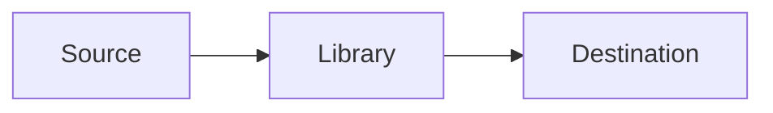

# Docs layout

This page is a fixture for the website's visual checks. It holds one of each
kind of block a docs page can show, so a screenshot of it changes when the docs
layout changes and not when the docs themselves are edited. It is never
published.

## Text

A paragraph with **bold**, _emphasis_, `inline code`, a
[link to another page](../guide/getting-started.md) and an
[outside link](https://example.com/).

1. A numbered step.
2. A second step with a nested list:
   - one item
   - another item

> [!NOTE]
> A note callout.

> [!WARNING]
> A warning callout.

## Code

```bash
cargo run -p bookclerk-cli -- library list
```

```toml
[database]
plugin = "sqlite"
```

## Table

| Setting  | Default | Meaning                      |
| -------- | ------- | ---------------------------- |
| `root`   | none    | Where the local copies go.   |
| `prefix` | empty   | Key prefix in the S3 bucket. |

## Diagram


